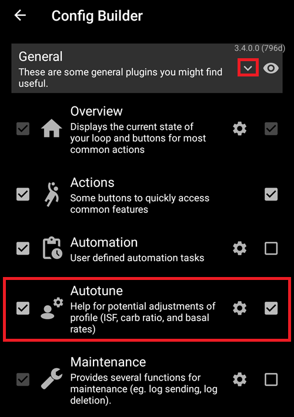
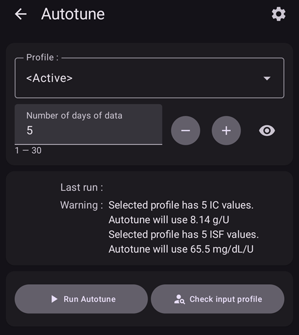
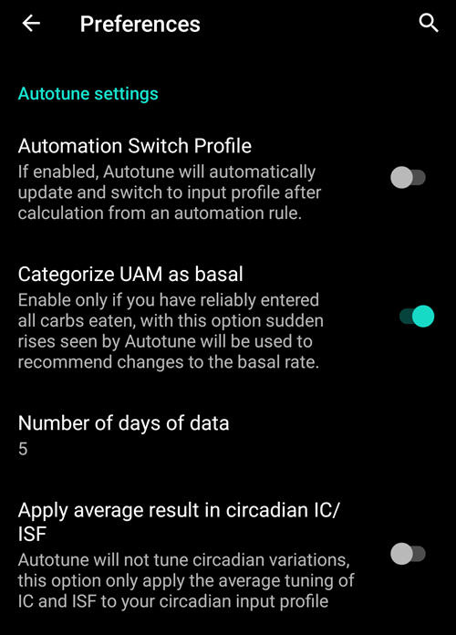
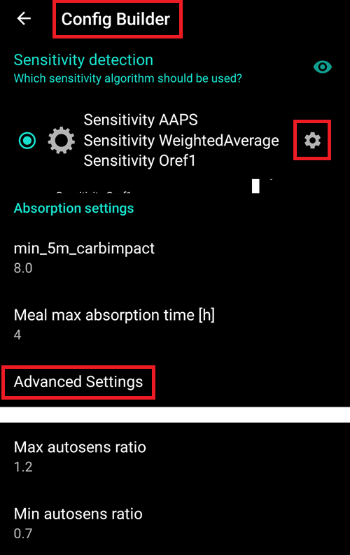

# Как да използвате Autotune plugin

Документацията за Autotune алгоритъма се намира в [OpenAPS documentation](https://openaps.readthedocs.io/en/latest/docs/Customize-Iterate/autotune.html).

Autotune plugin е имплементация на OpenAPS autotune алгоритъма в рамките на AAPS.

Autotune Plugin е наличен в releases на AAPS от версия [3.4](#version3400), но по подразбиране е скрит.

## Показване на Autotune plugin

Създайте празен файл с име `enable_autotune`, в подпапка `extra` в папката на AAPS на вашия телефон, за да активирате Autotune.

*ЗАБЕЛЕЖКА: Проверете в настройките на AAPS къде се намира AAPS директорията и, че сте поставили файла на правилното място, защото множество хора са хванати с грешно поставен файл.


Autotune след това ще се появи в Конфигурация, след като рестартирате AAPS.



***ЗАБЕЛЕЖКА: Ако не виждате опцията `Autotune`, ще трябва да кликнете на маркираната (в червена рамка) стрелка, за да разгънете и покажете всички настройки в секцията `Общи/Основни`.***

## Потребителски интерфейс на Autotune



- В падащото меню Profile можете да изберете входния профил, който искате да настроите (по подразбиране е избран текущият ви активен профил)
  - Забележка: всеки път, когато изберете нов профил, предишните резултати ще бъдат премахнати и параметърът Tune days ще бъде зададен на стойност по подразбиране
- След това Tune days служи за избор на броя дни, използвани при изчислението за настройка на вашия профил. Минималната стойност е 1 ден, а максималната – 30 дни. Това число не трябва да е твърде малко, за да се получат правилни, итеративни и плавни резултати (над 7 дни за всяко изчисление)
  - Забележка: всеки път, когато промените параметъра Tune days, предишните резултати ще бъдат премахнати
- Последен старт/Last run е връзка, която възстановява последното ви валидно изчисление. Ако не сте стартирали Autotune през текущия ден, или ако предишните резултати са били премахнати чрез промяна на параметър за изчисление по-горе, можете да възстановите параметрите и резултатите от последното успешно стартиране.
- Warning ви показва например информация за избрания профил (ако имате няколко IC стойности или няколко ISF стойности)
  - Забележка: изчислението на Autotune работи само с една единствена IC стойност и една единствена ISF стойност. Понастоящем не съществува алгоритъм за Autotune, който да настройва циркадни (circadian) IC или циркадни ISF. Ако входният ви профил има няколко стойности, в секцията с предупреждения можете да видите средната стойност, взета предвид при настройката на вашия профил.
- Бутонът Check Input Profile отваря Profile Viewer, за да ви позволи бърза проверка на вашия профил (Единици, DIA, IC, ISF, базали и цели)
  - Забележка: Autotune ще настрои само вашия IC (единична стойност), ISF (единична стойност) и базал (с циркадна вариация). Единици, DIA и цел ще останат непроменени в изходния профил.

- „Стартирай Autotune" ще стартира изчислението на Autotune с избрания профил и броя дни
  - Забележка: изчислението на Autotune може да отнеме дълго време. След стартиране можете да превключите към друго (начален екран и др.) и да се върнете по-късно в Autotune plugin, за да видите резултатите

  

- След това по време на изпълнението ще виждате междинни резултати по-долу

  - Забележка: по време на изпълнение настройките са заключени, така че вече не можете да променяте избрания входен профил или броя дни. Ще трябва да изчакате края на текущото изчисление, ако искате да стартирате друго изпълнение с други параметри.

  

- Когато изчислението на Autotune приключи, ще видите резултата (Настроен профил) и четири бутона по-долу.

  

- Важно е винаги да сравнявате входния профил (колона "Profile"), изходния профил (колона "Tuned") и процента на вариация за всяка стойност (колона "%").

- а базалните стойности (basal rates) имате също така броя на „липсващите дни" ("missing days"). Имате липсващи дни, когато Autotune няма достатъчно данни, категоризирани като „Базал", за да настрои базалния темп за този период (например след всяко хранене, когато имате усвояване на въглехидрати). Това число трябва да бъде възможно най-ниско, особено когато базалният темп е важен (например през нощта или в края на следобеда)

- Бутонът "Compare profiles" отваря изгледа за сравняване на профили. Входният профил е в синьо, а изходният профил (наречен "Настроен") е в червено.

  - Забележка: в примера по-долу входният профил има циркадна вариация за IC и ISF, но изчисленият изходен профил има единична стойност. Ако за вас е важно да получите циркаден изходен профил, вижте [Циркаден IC или ISF профил](#autotune-circadian-ic-or-isf-profile) по-долу.

  

- Ако имате доверие на резултатите (нисък процент на вариация между входния и изходния профил), можете да кликнете върху бутона "Активирай профил" и след това да кликнете OK, за да потвърдите.

  - Activate Tuned profile автоматично ще създаде нов профил "Настроен" във вашия Local profile plugin.
  - Ако вече имате профил с име "Настроен" в своя local profile plugin, тогава този профил ще бъде обновен с изчисления Autotune профил преди активирането

  

- Ако смятате, че настроеният профил трябва да бъде коригиран (например ако смятате, че някои вариации са твърде значителни), можете да кликнете на бутона "Копирай в локален профил"

  - Нов профил с представка "Настроен" и датата и часа на изпълнението ще бъде създаден в local profile плъгин

  

- След това можете да изберете Локален профил, за да редактирате настроения профил (той ще бъде избран по подразбиране, когато отворите профил плъгин)

  - стойностите в локален профил ще бъдат закръглени в потребителския интерфейс според възможностите на вашата помпа

  

- Ако искате да замените входния си профил с резултата от Autotune, кликнете на бутона "Обнови входящ профил" и потвърдете изскачащия прозорец с OK

  - Забележка: ако кликнете на "Activate profile" след "Update input profile", тогава ще активирате обновения си профил, а не профила по подразбиране "Настроен"

  

- Ако сте обновили входния си профил, тогава бутонът "Обнови входен профил" се заменя с бутона "Върни входен профил" (вижте снимката по-долу). По този начин можете веднага да видите дали текущият ви входен профил в локален профил плъгин вече включва резултата от последното изпълнение или не. Имате също така възможността да възстановите входния си профил без резултата от autotune с този бутон

  


## Настройки на Autotune

(autotune-plugin-settings)=

### Autotune plugin settings

  

```{admonition} Only DEV
:class: info
Функцията Automation Switch профил е налична само в Dev/Engineering режим.
```

- Аutomation Switch профил (по подразбиране Off): вижте [Изпълнение на Autotune с правило за автомация](#autotune-run-autotune-with-an-automation-rule) по-долу. Ако промените тази настройка на включено, входният профил автоматично ще бъде обновен с Настроен профила и той ще бъде активиран.
  - **Внимавайте, трябва да имате доверие и да проверявате в продължение на няколко следващи дни, че след обновяване и активиране на Настроен профил без модификация, той подобрява вашия цикъл**

- Categorize UAM as basal (по подразбиране On): Тази настройка е за потребители, които използват AndroidAPS без въвеждане на никакви въглехидрати (Full UAM). Тя ще предотврати (когато е Off) категоризирането на UAM като базал.
  - Забележка: ако имате поне един час засечено усвояване на въглехидрати през даден ден, тогава всички данни, категоризирани като "UAM", ще бъдат категоризирани като базал, независимо от тази настройка (On или Off)
- Number of days of data (по подразбиране 5): С тази настройка можете да зададете стойност по подразбиране. Всеки път, когато изберете нов профил в Autotune плъгин, параметърът Tune days ще бъде заменен с тази стойност по подразбиране
- Apply average result in circadian IC/ISF (по подразбиране Off): вижте [Циркаден IC или ISF профил](#autotune-circadian-ic-or-isf-profile) по-долу.

### Other settings

- Utotune също използва Max autosens ratio и Min autosens ratio, за да ограничи вариацията. Можете да видите и коригирате тези стойности в Config Builder > Sensitivity detection плъгин > Settings > Advanced Settings

  


## Функции за напреднали

(autotune-circadian-ic-or-isf-profile)=

### Циркаден IC или ISF профил

- Ако имате значителна вариация на IC и/или ISF във вашия профил и напълно се доверявате на своето циркадно време и вариация, тогава можете да зададете "Apply average result in circadian IC/ISF"

  - Обърнете внимание, че изчислението на Autotune винаги ще се извършва с единична стойност, а циркадната вариация няма да бъде настройвана от Autotune. Тази настройка прилага само средната изчислена вариация за IC и/или ISF върху вашите циркадни стойности

- Вижте на снимката по-долу Настроен профил с Apply average variation изключено (Off, вляво) и включено (On, вдясно)

  


### Настройка на конкретни дни от седмицата

- Ако кликнете на квадратчето с окото вдясно от параметъра "Tune days", ще видите избора на дни. Можете да зададете кой ден от седмицата трябва да бъде включен в изчислението на Autotune (на снимката по-долу можете да видите пример за „работни дни" с изключени събота и неделя от изчислението на autotune)
  - Ако броят дни, включени в изчислението на Autotune, е по-малък от броя на Tune days, тогава ще видите колко дни ще бъдат включени вдясно от селектора Tune days (10 дни в примера по-долу)
  - Тази настройка дава добри резултати само ако броят на оставащите дни не е твърде малък (например ако настройвате конкретен профил за почивните дни, само с избрани неделя и събота, трябва да изберете минимум 21 или 28 Tune days, за да имате 6 или 8 дни, включени в изчислението на Autotune)

  

- По време на изчислението на Autotune можете да видите напредъка на изчисленията ("Partial result day 3 / 10 tuned" в примера по-долу)

  


(autotune-run-autotune-with-an-automation-rule)=

## Изпълнение на Autotune с правило за автомация

```{admonition} Only DEV
:class: info
Функцията Automation Switch профил е налична само в Dev/Engineering режим.
```

Първата стъпка е да зададете правилния тригер за правило за автомация с Autotune:

Забележка: за повече информация как да зададете правило за автомация, вижте [тук](../DailyLifeWithAaps/Automations.md).

- Трябва да изберете условие Повтарящо се време на изпълнение Autotune само веднъж на ден, тъй като autotune е проектиран да се изпълнява ежедневно (при всяко ново изпълнение се измествате с един ден напред и промените в профила бързо трябва да станат минимални)

  

- В началото е по-добре да изпълнявате Autotune през деня, за да можете да проверявате резултатите. Ако искате да изпълнявате Autotune през нощта, трябва да изберете в тригера 4 сутринта или по-късно, за да включите текущия ден в следващото изчисление на Autotune.

  

- След това можете да изберете действието "Стартирай Autotune" от списъка

  

- След това можете да изберете действието Autotune, за да коригирате параметрите за вашето изпълнение. Параметрите по подразбиране са "Active профил", стойността по подразбиране за Tune days, зададена в предпочитанията на Autotune плъгин, и са избрани всички дни.

  

- След няколко дни, ако напълно се доверявате на резултатите от Autotune и процентът на модификация е нисък, можете да промените в [настройките на Autotune](#autotune-plugin-settings). "Автоматично превключване на профил" на включено, за да се обновява и активира автоматично настроеният профил след изчислението.

Забележка: ако искате автоматично да настройвате профили за конкретни дни от седмицата (например профил за „почивни дни" и друг за „работни дни"), тогава създайте по едно правило за всеки профил, изберете същите дни в Trigger и в Autotune Action, Tune days трябва да е достатъчно високо, за да сте сигурни, че настройката ще се извърши с поне 6 или 8 дни, и не забравяйте да изберете час след 4 сутринта в условието...

- Вижте по-долу пример за правило за настройка на „моя профил" за всички „работни дни" с избрани 14 Tune days (така че само 10 дни са включени в изчислението на autotune).

  


## Съвети и трикове

Autotune работи с информацията, съществуваща във вашата база данни, така че ако току-що сте инсталирали AAPS на нов телефон, ще трябва да изчакате няколко дни, преди да можете да стартирате Autotune с достатъчно дни, за да получите релевантни резултати.

Autotune е просто помощно средство, важно е редовно да проверявате дали сте съгласни с изчисления профил. Ако имате някакво съмнение, променете настройките на Autotune (например броя дни) или копирайте резултатите в локален профил и коригирайте профила, преди да го използвате.

Винаги използвайте Autotune ръчно в продължение на няколко дни, за да проверите резултатите, преди да ги приложите. И едва когато напълно се доверявате на резултатите от Autotune и вариацията стане минимална между предишния профил и изчисления профил, тогава започвате да използвате Automation (никога преди това)

- Autotune може да работи много добре за някои потребители, а за други – не, затова **ако не се доверявате на резултата от Autotune, не го използвайте**

Важно е също така да анализирате резултатите от Autotune, за да разберете (или да се опитате да разберете) защо Autotune предлага тези модификации

- може да имате цялостно увеличение или намаление на силата на профила ви (например увеличение на общия basal, свързано с намаление на стойностите на ISF и IC). това може да е свързано с няколко последователни дни с autosens корекция над 100% (необходима е по-голяма агресивност) или под 100% (по-чувствителни сте)
- Понякога Autotune предлага различен баланс между базалните темпове и IC/ISF (например по-нисък basal и по-агресивни IC/ISF)

Съветваме да не използвате Autotune в следните случаи:

- Не въвеждате всичките си въглехидрати
  - Ако не въвеждате корекция с въглехидрати за хипогликемия, Autotune ще види неочаквано покачване на стойността на вашето BG и ще увеличи базалните ви темпове 4 часа по-рано, което може да е обратното на това, което ви е необходимо, за да избегнете хипо, особено ако е посред нощ. Затова е важно да въвеждате всички въглехидрати, особено корекции за хипо.
- Имате много периоди с открит UAM през деня.
  - Въвели ли сте всичките си въглехидрати и правилно ли сте оценили въглехидратите си?
  - Всички UAM периоди (освен ако не въвеждате никакви въглехидрати през даден ден и categorized UAM as basal е деактивирано), всички ваши UAM периоди ще бъдат категоризирани като basal, това може значително да увеличи вашия basal (много повече от необходимото)

- Усвояването на въглехидратите ви е много бавно: ако повечето от усвояването на вашите въглехидрати се изчислява с параметъра min_5m_carbimpact (можете да видите тези периоди с малка оранжева точка в горната част на кривата на COB), изчислението на COB може да е грешно и да доведе до грешни резултати.
  - Когато спортувате, обикновено сте по-чувствителни и BG не се покачва много, така че по време на или след тренировка е обичайно да виждате някои периоди с бавни въглехидрати. Но ако твърде често имате неочаквано бавно усвояване на въглехидрати, тогава може да имате нужда от корекция на профила (по-висока стойност на IC) или min_5m_carbimpact е малко твърде висок.
- Имате „много лоши дни", например заседнали в хипергликемия няколко часа с огромно количество инсулин, за да можете да слезете в диапазона, или след смяна на сензора имате продължителни периоди с грешни BG стойности. Ако през последните няколко седмици имате само 1 или 2 „лоши дни", можете ръчно да деактивирате тези дни в изчислението на autotune, за да ги изключите от изчислението, и отново **внимателно проверете дали можете да се доверите на резултатите**
- Ако процентът на модификация е твърде голям
  - Можете да опитате да увеличите броя на дните, за да получите по-плавни резултати
