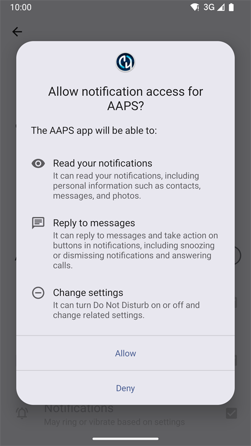

# Dexcom G6 и ONE

## Основни неща най-напред

-   Следвайте общите препоръки за хигиена на CGM и поставяне на сензора [тук](../CompatibleCgms/GeneralCGMRecommendation.md).

## Общи съвети за затворен кръг с G6 и ONE

- Новите трансмитери се наричат Firefly. Сензорите не могат да се рестартират без премахване на трансмитера, а самият трансмитер не може да бъде нулиран. Те също не генерират сурови (raw) данни.

- Ако рестартирате сензори, бъдете готови да калибрирате и следете колебанията на стойностите.

- Предварителното накисване (pre-soaking) на G6/ONE при фабрично калибриране вероятно ще доведе до колебания в резултатите. Ако правите предварително накисване, за да получите най-добри резултати, вероятно ще трябва да калибрирате сензора.

Прочетете повече в [статията](https://www.diabettech.com/artificial-pancreas/diy-looping-and-cgm/), публикувана от Tim Street на [www.diabettech.com](https://www.diabettech.com).

## Ако използвате G6 или ONE с xDrip

- Ако още не сте го направили, изтеглете [xDrip](https://github.com/NightscoutFoundation/xDrip) и го настройте според страницата [Настройки на xDrip](../CompatibleCgms/xDrip.md).
- Изберете xDrip в [**Конфигурация → Източник на КЗ**](#Config-Builder-bg-source).
- Трансмитерите на Dexcom G6 и ONE могат едновременно да бъдат свързани с приемника на Dexcom (или алтернативно с помпата t:slim) и едно приложение на телефона ви.
- Когато използвате xDrip като приемник, първо деинсталирайте приложението Dexcom. **Не можете да свържете едновременно xDrip и приложението Dexcom с трансмитера!**
- Ако ви трябва Clarity и искате да използвате алармите на xDrip, използвайте [BYODA](#DexcomG6-if-using-g6-with-build-your-own-dexcom-app) (само за G6) с локално излъчване към xDrip.
- You can also use xDrip as a companion app of the official Dexcom app, but you might experience delays in BG readings. To read the Dexcom app notifications without xDrip, as a trusted data source, use the [Notification Reader](#DexcomG6-notification-reader).
- При текущите трансмитери xDrip винаги използва [вградения алгоритъм (native algorithm)](https://navid200.github.io/xDrip/docs/Native-Algorithm.html) на трансмитера; няма причина да го изключвате. [Превантивните рестартирания (preemptive restarts)](https://navid200.github.io/xDrip/docs/Preemptive-Restart.html) работят само при стари трансмитери (фърмуер 1.6.5.25 или по-стар), при които са нужни, за да не спре сензорът след 10 дни; новите трансмитери (Firefly) ги пренебрегват. Прочетете [Рестартиране на сензор](https://navid200.github.io/xDrip/docs/Restart-G6-sensor.html), преди да опитате каквото и да е рестартиране.
- Всичко, свързано със самите сензор и трансмитер, е описано на [страницата за Dexcom в документацията на xDrip](https://navid200.github.io/xDrip/docs/Dexcom_page.html).

(DexcomG6-if-using-g6-with-build-your-own-dexcom-app)=
## Ако използвате G6 с Build Your Own Dexcom App

```{admonition} Old app version
:class: warning
Dexcom BYODA вече е много стара версия на приложението и не може да бъде обновявана.
```

-   [Build Your Own Dexcom App](https://docs.google.com/forms/d/e/1FAIpQLScD76G0Y-BlL4tZljaFkjlwuqhT83QlFM5v6ZEfO7gCU98iJQ/viewform?fbzx=2196386787609383750) (BYODA) поддържа локално излъчване към AAPS и/или xDrip

-   Това приложение ви позволява да използвате вашия Dexcom G6 с всеки Android смартфон.
-   Деинсталирайте оригиналното приложение Dexcom или пачнатото приложение Dexcom, ако сте използвали някое от тях преди (**не спирайте** текущо работещия сензор)
-   Инсталирайте изтегления apk
-   Въведете кода на сензора и серийния номер на трансмитера в модифицираното приложение.
-   В настройките на телефона отидете в Приложения (apps) > Dexcom G6 > Разрешения (permissions) > Допълнителни разрешения (additional permissions) и натиснете „Access Dexcom app“.
-   След кратко време BYODA трябва да улови сигнала на трансмитера.

### Настройки за AAPS

-   Изберете **BYODA** в [**Конфигурация → Източник на КЗ**](#Config-Builder-bg-source).

-   Ако не получавате стойности, изберете друг източник на данни и след това отново изберете **BYODA**. Така ще се появи заявка за разрешения, нужни за връзката между AAPS и излъчването на BYODA.

### Настройки за xDrip

-   Изберете „640G/Eversense“ като източник на данни.
-   За да получавате стойности, в xDrip трябва да изпълните командата „start sensor“. Това няма да засегне текущия ви сензор, управляван от Build Your Own Dexcom App.

(DexcomG6-notification-reader)=
## If using G6 or ONE with the Notification Reader

The official Dexcom G6 or ONE app stays connected to the transmitter. **AAPS** reads the glucose value directly from the notification of the Dexcom app, without any other app in between.

```{admonition} Trusted data source
:class: note
Readings from the Dexcom G6 and ONE apps are a [trusted BG data source](#GettingStarted-TrustedBGSource): SMBs can be allowed all the time.
```

Compared to BYODA or xDrip, the Notification Reader has limits:

- **No trend arrow** and **no backfill**: readings missed while the phone was off or out of range are lost.
- Each reading gets the time the notification appeared, not the exact time of the sensor reading.
- Only values between 40 and 405 mg/dL (2.2 and 22.5 mmol/L) are read. "LOW" and "HIGH" are not read.

### Set up the Dexcom app

-   Keep the Dexcom app installed and connected to the transmitter.
-   Make sure the Dexcom app shows the current glucose value in its notification. Известията му трябва да остават видими: не ги заглушавайте и не ги скривайте.
-   Use the same glucose units (mg/dL or mmol/L) in the Dexcom app as in **AAPS**. Otherwise **AAPS** cannot read the value.

### Конфигурация в AAPS

-   Select **Notification Reader** in [**Configuration → BG Source**](#Config-Builder-bg-source) and confirm the switch.

    

-   Back on the main screen, **AAPS** shows **Permissions Required**. Next to **Notification Access**, tap **Grant**.

    

-   Android opens its notification access list (its name depends on your Android version, for example *Notification read, reply & control*). Select **AAPS**, turn on **Allow notification access** and confirm with **Allow**.

    

    Android warns that **AAPS** could read all your notifications. **AAPS** only reads the notifications of supported CGM apps and ignores all others.

    

-   If **Allow notification access** is greyed out (*Controlled by Restricted Setting*), Android blocks it because **AAPS** was not installed from the Play Store. Open the **AAPS** app info (long press the **AAPS** icon > **App info**), tap the three dots menu at the top right and select **Allow restricted settings**. След това се върнете на екрана за достъп до известията и го разрешете.
-   Readings appear in **AAPS** when the Dexcom app shows a new value.

```{warning}
If the Dexcom app notification shows more than one glucose number, or none, **AAPS** skips that notification.
```


(DexcomG6-troubleshooting-g6)=
## Отстраняване на неизправности при G6 и ONE

### Отстраняване на неизправности, специфични за Dexcom G6/ONE

-   Превъртете надолу до **Troubleshooting** [тук](https://navid200.github.io/xDrip/docs/Dexcom_page.html).

### Общо отстраняване на неизправности

Общите указания за отстраняване на неизправности при CGM можете да намерите [тук](#general-cgm-troubleshooting).

### Нов трансмитер с работещ сензор

Ако се случи да смените трансмитера по време на текуща сесия на сензора, можете да опитате да премахнете трансмитера, без да повредите основата на сензора. Видео можете да намерите [тук](https://navid200.github.io/xDrip/docs/Remove-transmitter.html). Ако вместо това изберете [това решение](https://youtu.be/tx-kTsrkNUM), трябва да внимавате да не [повредите контактите на сензора](https://navid200.github.io/xDrip/docs/Petroleum-jelly-in-Dexcom-G6-Sensor.html) с лентата.
