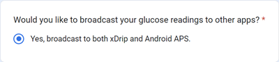

# Dexcom G6 и ONE

## Основни неща най-напред

-   Следвайте общите препоръки за хигиена на CGM и поставяне на сензора [тук](../CompatibleCgms/GeneralCGMRecommendation.md).

## Общи съвети за затворена система с G6 и ONE

- Последните трансмитери G6, се наричат "Firefly". Те не позволяват рестартиране на сензора без премахване на предавателя, и не изпращат сурови (raw) данни.

- Ако рестартирате сензори, уверете се, че сте готови да калибрирате и следете за шум.

- Предварителното накисване (pre-soaking) на G6 с фабрично калибриране вероятно ще доведе до вариация в резултатите. Ако правите предварително накисване, за да получите най-добри резултати, вероятно ще трябва да калибрирате сензора.

Прочетете повече в [статията](https://www.diabettech.com/artificial-pancreas/diy-looping-and-cgm/), публикувана от Tim Street на [www.diabettech.com](https://www.diabettech.com).

## Ако използвате G6 или ONE с xDrip+

- Ако използвате по-нов предавател (Firefly), превантивните рестартирания се **игнорират**.
- Ако използвате модифициран предавател, **не е необходимо** да използвате превантивни рестартирания.
-   Ако използвате модифициран предавател, **не е необходимо** да използвате превантивни рестартирания. Въпреки това, в този случай ще трябва да използвате G6 в режим, различен от [native mode](https://navid200.github.io/xDrip/docs/Native-Algorithm.html)(което не се препоръчва, тъй като деактивира фабричното калибриране и не филтрира шумните отчитания), в противен случай сензорът ще спре след 10 дни.
-   Трансмитерите на Dexcom G6 и ONE могат едновременно да бъдат свързани с приемника на Dexcom (или алтернативно с помпата t:slim) и едно приложение на телефона ви.
-   Когато използвате xDrip+ като приемник, първо деинсталирайте приложението Dexcom. **Не можете да свържете едновременно xDrip+ и приложението Dexcom с трансмитер!**
-   Ако имате нужда от Clarity и искате да се възползвате от алармите на xDrip+, използвайте [BYODA](#DexcomG6-if-using-g6-with-build-your-own-dexcom-app) (само за G6) с локален broadcast към xDrip+.
-   Можете също да използвате xDrip+ като companion приложение на официалното приложение Dexcom, но може да изпитате забавяния в BG отчитанията.
-   Ако все още не е направено, изтеглете [xDrip+](https://github.com/NightscoutFoundation/xDrip) и следвайте инструкциите на [страницата с настройки на xDrip+](../CompatibleCgms/xDrip.md).
-   Изберете xDrip+ в [ConfigBuilder, BG Source](#Config-Builder-bg-source).

- Настройте параметрите в xDrip+ според [страницата с настройки на xDrip+](../CompatibleCgms/xDrip.md)

(DexcomG6-if-using-g6-with-build-your-own-dexcom-app)=
## Ако използвате G6 с Build Your Own Dexcom App

```{admonition} Old app version
:class: warning
Dexcom BYODA вече е много стара версия на приложението и не може да бъде обновявана.
```

-   [Build Your Own Dexcom App](https://docs.google.com/forms/d/e/1FAIpQLScD76G0Y-BlL4tZljaFkjlwuqhT83QlFM5v6ZEfO7gCU98iJQ/viewform?fbzx=2196386787609383750) (BYODA) поддържа локален broadcast към AAPS и/или xDrip+



-   Това приложение ви позволява да използвате вашия Dexcom G6 с всеки Android смартфон.
-   Деинсталирайте оригиналното приложение Dexcom или пачнатото приложение Dexcom, ако сте използвали някое от тях преди (**не спирайте** текущо работещия сензор)
-   Инсталирайте изтегления apk
-   Въведете кода на сензора и серийния номер на трансмитера в пачнатото приложение.
-   В настройките на телефона отидете на apps > Dexcom G6 > permissions > additional permissions и натиснете 'Access Dexcom app'.
-   След кратко време BYODA трябва да улови сигнала на предавателя.

### Настройки за AAPS

-   Изберете 'Dexcom App (patched)' в [ConfigBuilder, BG Source](#Config-Builder-bg-source).

-   Ако не получавате никакви стойности, изберете друг източник на данни, след което отново изберете 'Dexcom App (patched)', за да предизвикате заявката за разрешения за установяване на връзката между AAPS и BYODA-broadcast.

### Настройки за xDrip+

-   Изберете '640G/Eversense' като източник на данни.
-   Командата 'start sensor' трябва да бъде изпълнена в xDrip+, за да получавате стойности. Това няма да засегне текущия ви сензор, управляван от Build Your Own Dexcom App.


(DexcomG6-troubleshooting-g6)=
## Отстраняване на проблеми с G6 и ONE

### Отстраняване на проблеми, специфични за Dexcom G6/ONE

-   Превъртете надолу до **Troubleshooting** [тук](https://navid200.github.io/xDrip/docs/Dexcom_page.html).

### Отстраняване на основни проблеми

За отстраняване на проблеми с повечето CGM устройства може да намерите инфо [тук](#general-cgm-troubleshooting).

### Нов трансмитер с работещ сензор

Ако се случи да смените трансмитер по време на текуща сесия на сензор, можете да опитате да премахнете трансмитеря, без да повредите основата на сензора. Видео можете да намерите [тук](https://navid200.github.io/xDrip/docs/Remove-transmitter.html). Ако вместо това изберете [това решение](https://youtu.be/tx-kTsrkNUM), трябва да внимавате да избегнете [повреждане на контактите на сензора](https://navid200.github.io/xDrip/docs/Petroleum-jelly-in-Dexcom-G6-Sensor.html), с лентата.
