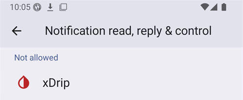

# Dexcom G7, ONE+ и Stelo


## Важно уточнение

Важно е да се знае, че за разлика от G6, системите G7, ONE+ и Stelo не изглаждат стойностите – нито в приложението, нито в приемника. Повече подробности за това [тук](https://www.dexcom.com/en-us/faqs/why-does-past-cgm-data-look-different-from-past-data-on-receiver-and-follow-app).

```{admonition} Smoothing method 
Прочетете препоръките в [Метод за изглаждане](../CompatibleCgms/SmoothingBloodGlucoseData.md) за Dexcom G7/ONE+/Stelo
```

## 1. xDrip (директна връзка с G7, ONE+ или Stelo)

- xDrip се свързва директно със сензора: деинсталирайте приложението Dexcom, защото само едно приложение може да се свърже със сензора. Ако искате да запазите приложението Dexcom, използвайте вместо това [xDrip Companion App](#DexcomG7-xdrip-companion-app).
- Следвайте инструкциите тук: [xDrip G7, ONE+ и Stelo](https://navid200.github.io/xDrip/docs/Dexcom/G7.html). Нужна е скорошна версия на xDrip – минималната версия е посочена на страницата от връзката.
- Изберете xDrip в [**Конфигурация → Източник на КЗ**](#Config-Builder-bg-source).

- Настройте xDrip според обясненията на страницата [Настройки на xDrip](../CompatibleCgms/xDrip.md).

## 2. Build Your Own Dexcom App (само G7)

```{admonition} Old app version
:class: warning
Dexcom BYODA вече е много стара версия на приложението и не може да бъде обновявана. Не е наличен за ONE+ или Stelo.
```

-   [Build Your Own Dexcom App](https://docs.google.com/forms/d/e/1FAIpQLScD76G0Y-BlL4tZljaFkjlwuqhT83QlFM5v6ZEfO7gCU98iJQ/viewform?fbzx=2196386787609383750) (BYODA) поддържа локално излъчване към AAPS

-   Това приложение ви позволява да използвате вашия Dexcom G7 с всеки Android смартфон.
-   Деинсталирайте оригиналното приложение Dexcom
-   Инсталирайте изтегления apk
-   Въведете кода на сензора в модифицираното приложение
-   След кратко време BYODA трябва да улови сигнала на сензора.

(DexcomG7-xdrip-companion-app)=

## 3. xDrip Companion App (G7, ONE+ и Stelo)

Официалното приложение Dexcom остава свързано със сензора. xDrip чете стойностите на глюкозата от известията на приложението Dexcom и ги изпраща към **AAPS**.

```{admonition} Not a trusted data source
:class: note
**AAPS** does not consider xDrip in Companion App mode a [trusted BG data source](#GettingStarted-TrustedBGSource): SMBs are not allowed all the time.

To read the Dexcom app notifications without xDrip, as a trusted data source, use the [Notification Reader](#DexcomG7-notification-reader).
```

### Четене на известията от приложението Dexcom

- Оставете приложението Dexcom инсталирано и свързано със сензора. Известията му трябва да остават видими: не ги заглушавайте и не ги скривайте.
- Изтеглете и инсталирайте [xDrip](https://github.com/NightscoutFoundation/xDrip). Използвайте в xDrip същите мерни единици за глюкозата като в приложението Dexcom.
- В xDrip отидете в **Settings** > **Hardware Data Source** и изберете **Companion App**.

  

- xDrip иска разрешение да чете известията. Докоснете **OK**, след това изберете **xDrip** в списъка и включете **Разрешаване на достъпа до известията** (Allow notification access).

  

- Ако **Разрешаване на достъпа до известията** (Allow notification access) е в сиво (*Контролира се от ограничена настройка* (Controlled by Restricted Setting)), Android го блокира, защото xDrip не е инсталиран от Play Store:

  

  Отворете информацията за приложението xDrip (продължително натискане на иконата на xDrip > **Информация за приложението** (App info)), докоснете менюто с трите точки горе вдясно и изберете **Разрешаване на ограничените настройки** (Allow restricted settings). След това се върнете на екрана за достъп до известията и го разрешете.

  

  

- Стойностите се появяват в xDrip, когато приложението Dexcom покаже нова стойност. Ако нищо не се появи, може да се наложи да стартирате сензор в xDrip: това няма ефект върху истинския сензор. В този режим Stelo дава стойност на всеки 15 минути.

### Companion Bluetooth (G7)

Когато приложението Dexcom е свързано със сензор G7, xDrip може също да слуша стойностите, които сензорът изпраща към приложението Dexcom през Bluetooth. xDrip не се сдвоява със сензора и не е нужно да въвеждате кода на сензора: приложението Dexcom остава в контрол.

С **Companion Bluetooth** xDrip получава от сензора точното време и тенденцията на всяка стойност, вместо времето, в което се е появило известието, и попълва празнините от времето, когато телефонът е бил извън обхват (backfill).

- В xDrip отидете в **Settings** > **Less common settings** > **Bluetooth Settings** и включете **Companion Bluetooth**.

  

- Това не работи на всички телефони и версии на Android. Изключете го, ако забележите проблеми.
- Ако стар сензор Dexcom все още е в списъка с Bluetooth устройства на телефона, xDrip може да слуша грешния: в Android **Настройки** (Settings) > **Свързани устройства** (Connected devices) забравете сензорите, които вече не използвате.
- Companion Bluetooth е направен за G7. При ONE+ и Stelo разчитайте на известията.

### Конфигурация в AAPS

- Изберете xDrip в [**Конфигурация → Източник на КЗ**](#Config-Builder-bg-source).
- Настройте xDrip според обясненията на страницата [Настройки на xDrip](../CompatibleCgms/xDrip.md).

## 4. Juggluco (G7 и ONE+)

Изисква се версия 9.0+

- Деактивирайте приложението, което преди това е било свързано със сензора: деинсталирайте го или използвайте „Принудително спиране“ (Force Stop). Изключете разрешението „Устройства в близост“ (Nearby Devices) в настройките на приложението. Ограничете използването на батерията от приложението.

- „Забравете“ сензора в настройките на Bluetooth: в настройките на Android намерете сензора в списъка със сдвоени устройства и изберете „Забравяне“ (Forget). Имената на сензорите Dexcom G7 започват с DXCM.

- Избягвайте намеса от други сензори: Дръжте старите сензори Dexcom извън обхвата на Bluetooth.

- Свържете сензора G7 с Juggluco: Отворете Juggluco → Ляво меню → Photo. Сканирайте кода Data Matrix върху апликатора на сензора G7. Изчакайте до 5 минути, докато Juggluco открие сензора.

- Изисквания за сдвояване (pairing): Съгласете се за сдвояване на сензора с Juggluco. Уверете се, че екранът не е заключен по време на сдвояването. Ако сдвояването се провали, изчакайте 5 минути, преди да опитате отново.

- Изключение: Часовниците с Wear OS могат да се сдвоят без натискане на бутон за съгласие.

(DexcomG7-notification-reader)=

## 5. Notification Reader (G7, ONE+ and Stelo)

Официалното приложение Dexcom остава свързано със сензора. **AAPS** reads the glucose value directly from the notification of the Dexcom app, without any other app in between.

```{admonition} Trusted data source
:class: note
Readings from the Dexcom G7, ONE+ and Stelo apps are a [trusted BG data source](#GettingStarted-TrustedBGSource): SMBs can be allowed all the time.
```

Compared to the other methods on this page, the Notification Reader has limits:

- **No trend arrow** and **no backfill**: readings missed while the phone was off or out of range are lost.
- Each reading gets the time the notification appeared, not the exact time of the sensor reading.
- Only values between 40 and 405 mg/dL (2.2 and 22.5 mmol/L) are read. "LOW" and "HIGH" are not read.
- Stelo gives a reading every 15 minutes.

### Set up the Dexcom app

- Оставете приложението Dexcom инсталирано и свързано със сензора.
- Make sure the Dexcom app shows the current glucose value in its notification. Известията му трябва да остават видими: не ги заглушавайте и не ги скривайте.
- Use the same glucose units (mg/dL or mmol/L) in the Dexcom app as in **AAPS**. Otherwise **AAPS** cannot read the value.

### Конфигурация в AAPS

- Select **Notification Reader** in [**Configuration → BG Source**](#Config-Builder-bg-source) and confirm the switch.

  

- Back on the main screen, **AAPS** shows **Permissions Required**. Next to **Notification Access**, tap **Grant**.

  

- Android opens its notification access list (its name depends on your Android version, for example *Notification read, reply & control*). Select **AAPS**, turn on **Allow notification access** and confirm with **Allow**.

  

  Android warns that **AAPS** could read all your notifications. **AAPS** only reads the notifications of supported CGM apps and ignores all others.

  

- If **Allow notification access** is greyed out (*Controlled by Restricted Setting*), Android blocks it because **AAPS** was not installed from the Play Store. Open the **AAPS** app info (long press the **AAPS** icon > **App info**), tap the three dots menu at the top right and select **Allow restricted settings**. След това се върнете на екрана за достъп до известията и го разрешете.
- Readings appear in **AAPS** when the Dexcom app shows a new value.

```{warning}
If the Dexcom app notification shows more than one glucose number, or none, **AAPS** skips that notification.
```
