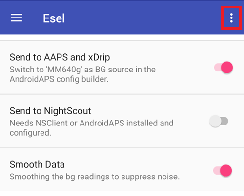

# Eversense

Има четири различни начина за достъп до стойностите от Eversense:

- ESEL в режим Companion
- ESEL в режим с модифицирано приложение
- xDrip като придружаващо приложение (companion app)
- Четец на Нотификации (вграден в **AAPS**)

## ESEL

Изтеглете и инсталирайте [приложението ESEL](https://github.com/BernhardRo/Esel/tree/master/apk), като следвате тези [инструкции](https://github.com/BernhardRo/Esel?tab=readme-ov-file#esel).

- В ESEL отворете менюто с трите точки (⋮) горе вдясно и изберете **Settings** (достъпно и от менюто ☰). В настройките:
  - Включете „Send to AAPS and xDrip“
  - **Изключете** „Send to Nightscout“
  - Тъй като данните за КЗ от Eversense може да имат шум, се препоръчва да включите „Smooth Data“ в ESEL.



### Режим Companion

Чете данните от известията на приложението Eversense (работи със стандартното приложение Eversense, налично от версия 3.0.1 на ESEL).

1. Използвайте официалното приложение Eversense от Google Play Store
   - По желание, но е нужно за попълване на липсващите данни (backfilling): влезте в профила си в Eversense
   - В Sync включете Auto synchronization
2. Конфигурация на ESEL:
   - Изключете настройката „Get data from patched Eversense App“
   - За попълване на липсващите данни: включете „Fill missing data from eversensedms.com“
   - Въведете като имейл адрес и парола данните си за вход в Eversense
3. Изберете „MM640g“ като източник на КЗ в [**Конфигурация → Източник на КЗ**](#Config-Builder-bg-source).

### Модифицирано приложение Eversense

 Изисква модифицирана версия на приложението Eversense (работи напълно офлайн, включително попълването на липсващите данни).

1. Деинсталирайте приложението Eversense (Внимание: локалните ви исторически данни (по-стари от 1 седмица) ще бъдат загубени!)

2. Инсталирайте [модифицираното приложение Eversense](https://cr4ck3d3v3r53n53.club) и го използвайте, както е описано от доставчика

   - Стартирайте приложението Eversense, влезте в профила си, свържете се с трансмитера и го използвайте точно като нормалното приложение.

3. Конфигурация на ESEL:

   - Включете настройката „Get data from patched Eversense App“


If you run ESEL with a fresh installation of Eversense for the first time, it can take up to 15min until your first values appear in xDrip!

4. Изберете „MM640g“ като източник на КЗ в [**Конфигурация → Източник на КЗ**](#Config-Builder-bg-source).

## xDrip

xDrip може да чете известията от приложението на производителя, както прави ESEL. Няма попълване на липсващите данни.

- Изтеглете и инсталирайте xDrip: [xDrip](https://github.com/NightscoutFoundation/xDrip)
- В xDrip като източник на данни трябва да бъде избрано „Companion App“.
- Изберете xDrip в [**Конфигурация → Източник на КЗ**](#Config-Builder-bg-source).
- Настройте xDrip според обясненията на страницата [Настройки на xDrip](../CompatibleCgms/xDrip.md).
- Включете [Експоненциално изглаждане](../CompatibleCgms/SmoothingBloodGlucoseData.md) в AAPS.

## Четец на Нотификации

**AAPS** може да чете стойностите на глюкозата директно от известията на официалното приложение Eversense, без друго приложение между тях. Няма попълване на липсващите данни.

- Изберете **Четец на Нотификации** в [**Конфигурация → Източник на КЗ**](#Config-Builder-bg-source) и разрешете на **AAPS** достъп до известията, когато бъдете попитани.
- Уверете се, че приложението Eversense показва текущата стойност на глюкозата в известието си.

```{warning}
Стойностите на КЗ не винаги идват на всеки 5 минути и може да има дублирани стойности.
```