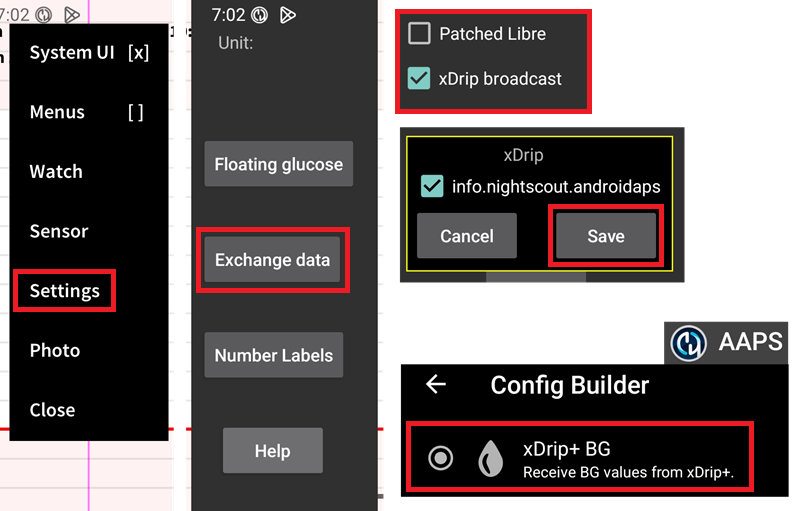

# Настройки на Juggluco

Ако все още не е направено, изтеглете [Juggluco](https://www.juggluco.nl/Juggluco/download.html).

Следвайте [инструкциите](https://www.juggluco.nl/Jugglucohelp/introhelp.html), за да свържете сензора си.

## Основни настройки за всички CGM системи

### Деактивиране на качването към Nightscout

Считано от AAPS 3.2, не трябва да позволявате на никое друго приложение да качва данни (кръвна захар и лечения) към Nightscout.

Деактивирайте всяко активно качване (uploader) към Nightscout в Juggluco.

(juggluco-to-aaps)=

## Juggluco към AAPS

Juggluco може да изпраща кръвна захар директно към AAPS, като позволява SMB винаги, ако използвате [доверен сензор](#GettingStarted-TrustedBGSource).

При използване на сензор Libre 2/2+/3/3+, отчитанията на всяка минута ще бъдат изпращани към AAPS, но няма да задействат изчисления на всяка минута в AAPS.

Активирайте xDrip broadcast в Juggluco (не активирайте Patched Libre), потвърдете и запазете информацията за AAPS пакета. Изберете xDrip+ като източник на данни за КЗ в AAPS.

Приложете достатъчно [изглаждане](./SmoothingBloodGlucoseData.md) в AAPS.

(juggluco-to-xdrip)=

## Juggluco към xDrip+

Juggluco може да изпраща кръвна захар към xDrip+, който след това ще я изпраща към AAPS.

Активирайте Patched Libre в Juggluco (не активирайте xDrip broadcast), потвърдете и запазете информацията за dexdrip пакета. Изберете xDrip+ като източник на данни за КЗ в AAPS.

Приложете достатъчно [изглаждане](./SmoothingBloodGlucoseData.md) в AAPS, ако е необходимо; при използване на сензор Libre 2/2+/3/3+, xDrip+ ще осредни отчитанията на всяка минута до отчитания на всеки 5 минути и [също ще ги изглади](#libre2-value-smoothing-raw-values).

