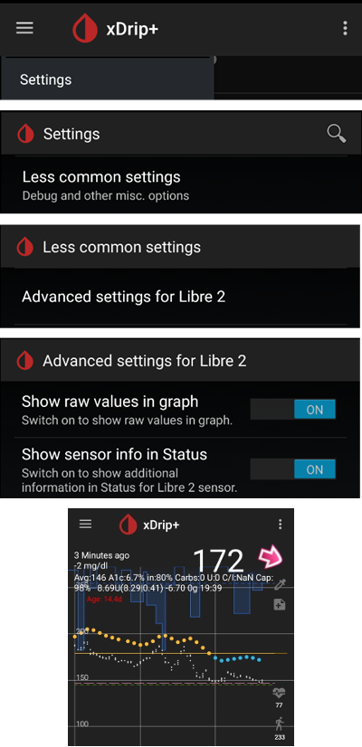

# Freestyle Libre 2 и 2+

Сензорът Freestyle Libre 2 вече е истински CGM дори с официалното приложение. Въпреки това LibreLink не може да изпраща данни към AAPS. Има няколко решения, за да го използвате с AAPS.

## 1. Използване на Bluetooth мост и OOP

Bluetooth трансмитери могат да се използват с Libre 2 (ЕС) или 2+ (ЕС) и приложение с външен алгоритъм (out of process algorithm). Можете да получавате стойности на кръвната захар на всеки 5 минути, както с [Libre 1](./Libre1.md).

Проверете дали мостът и приложението, които искате да използвате, са съвместими с вашия сензор и с xDrip.

Libre2 OOP (намерете го [тук](#Libre2_OOP2)) създава същите стойности на КЗ като оригиналния четец. AAPS с Libre 2 прави изглаждане за 10 до 25 минути, за да избегне някои скокове. Вижте по-долу [Изглаждане на стойностите и необработени стойности](#libre2-value-smoothing-raw-values). OOP създава стойност на всеки 5 минути като средна стойност от последните 5 минути. Затова стойностите на КЗ не са толкова гладки, но съвпадат с оригиналния четец и следват по-бързо „истинските“ стойности на КЗ. Ако искате да използвате затворен кръг с OOP, моля, включете всички настройки за изглаждане в xDrip.

Има няколко добри причини да използвате Bluetooth трансмитер:

-   You can choose various OOP2 calibration strategies (1): have the reader values using "no calibration", or calibrate the sensor like a Libre 1 using "calibrate based on raw" or ultimately calibrate the reader-like values with "calibrate based on glucose".  
  Make sure to leave OOP1 disabled (2).

    → Меню (три черти) → Settings → Less common settings → Other misc. options


-   Сензорът Libre 2 може да се използва 14,5 дни, както Libre 1
-   Попълването на данните за 8 часа назад се поддържа напълно

Забележка: Трансмитерът може да се използва едновременно с приложението LibreLink, без да му пречи.

### Стартиране на сензора

- → Меню (три черти) (1) → Start sensor (2) → Start sensor (3) → Отговорете „Not Today“ (4).


Това по никакъв начин няма физически да стартира сензор Libre2 или да взаимодейства с него. Това е само за да се покаже на xDrip, че нов сензор изпраща стойности на кръвната захар. If available, enter two blood-measured values for the initial calibration. Сега стойностите на кръвната захар би трябвало да се показват в xDrip на всеки 5 минути. Пропуснатите стойности, напр. защото сте били твърде далеч от телефона, няма да бъдат попълнени със задна дата.

След смяна на сензора xDrip автоматично ще открие новия сензор и ще изтрие всички данни за калибриране. You may check your blood glucose after activation and make a new initial calibration.

### Конфигуриране на AAPS (само за затворен кръг)

-   В **AAPS** отворете **менюто** (☰) в горния ляв ъгъл, отидете на **Конфигурация** > **Източник на КЗ** и изберете **xDrip+**


-   If AAPS does not receive BG values when phone is in airplane mode, use 'Identify receiver' as described on [xDrip settings page](#xdrip-identify-receiver).

## 2. Използване на пряка връзка с xDrip

```{admonition} Libre 2 EU only
:class: warning
xDrip не поддържа пряка връзка с Libre 2 за САЩ и Австралия.
Само моделите Libre 2 и 2+ за **ЕС**.
```

- Следвайте [тези инструкции](./Libre2MinimalL00per.md), за да настроите xDrip, защото оригиналната документация води към остаряла версия на OOP2.
- Следвайте инструкциите за настройка на [страницата с настройки на xDrip](../CompatibleCgms/xDrip.md).

-   Изберете xDrip+ в [Конфигурация > Източник на КЗ](#Config-Builder-bg-source).

(libre2-value-smoothing-raw-values)=

### Изглаждане на стойностите и необработени стойности

Технически текущата стойност на кръвната захар се предава към xDrip всяка минута. Филтър с претеглена средна стойност изчислява изгладена стойност за последните 25 минути (по подразбиране). Можете да промените периода в менюто NFC Scan features.

→ Меню (три черти) → Settings → NFC Scan features → Smooth libre 3 data when using xxx method


Това е задължително за затворения кръг. Кривите изглеждат гладки и резултатите на кръга са много добри. Необработените стойности, на които се базират алармите, се колебаят малко повече, но съответстват на стойностите, които показва и четецът. Освен това необработените стойности могат да се показват в графиката на xDrip, за да можете да реагирате навреме на бързи промени. Моля, включете Less Common Settings \> Advanced Settings for Libre2 \> „show Raw values“ и „show Sensors Infos“. Тогава необработените стойности се показват допълнително като малки бели точки, а допълнителна информация за сензора е налична в системното меню.

Необработените стойности са много полезни, когато кръвната захар се променя бързо. Even if the dots are jumpier you would detect the tendency much better than using the smoothed line to make proper therapy decisions.

→ Меню (три черти) → Settings → Less common settings → Advanced settings for Libre 2




#### Калибриране

You can calibrate the Libre2 **with an offset of -40 mg/dL to +20 mg/dL \[-2.2 mmol/L to +1.1 mmol/L\]** (intercept). Наклонът не може да се променя. Моля, проверявайте с измерване от пръст след поставяне на нов сензор, като имате предвид, че той може да не е точен през първите 12 часа след поставянето. Понеже може да има големи разлики спрямо измерванията от кръв, проверявайте на всеки 24 часа и калибрирайте при нужда. Ако сензорът е напълно неточен след няколко дни, той трябва да бъде сменен.

## 3. Използване на Diabox

- Инсталирайте [Diabox](https://www.bubblesmartreader.com/_files/ugd/6afd37_f183eabd4fbd44fcac4b1926a79b094f.pdf). В Settings, Integration включете Share data with other apps.


- Изберете xDrip+ в [Конфигурация > Източник на КЗ](#Config-Builder-bg-source).

## 4. Използване на Juggluco

Вижте [тук](./Juggluco.md).
