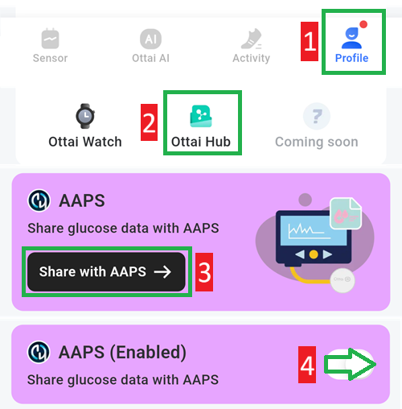

# Ottai M8

## Използване на M8 с приложението Ottai

-   Изтеглете и инсталирайте apk файла от <https://play.google.com/store/apps/details?id=com.ottai.seas>. За китайската версия на Ottai използвайте <https://ottai.com.cn/70ICjxAI4i>

-   Стартиране на сензора

- Изберете **Syai/Ottai** в [Конфигурация, Източник на КЗ](#Config-Builder-bg-source).

Включете излъчването (broadcast) в приложението Ottai:

1. Изберете Profile
2. Ottai hub
3. Докоснете Share with AAPS и приемете споразумението за предаване на данни на трета страна
4. Включете Share glucose data with AAPS

