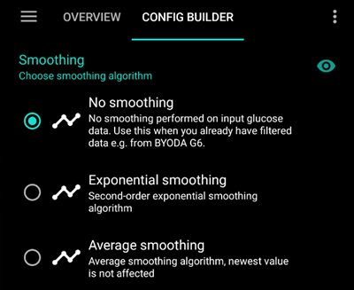

# Изглаждане на данните за кръвна захар

Ако данните за **КЗ** са скокообразни/шумни, **AAPS** може да дозира инсулина неправилно, което да доведе до високи или ниски стойности. If you observe errors in your CGM data it is important to disable the loop until the problem is resolved. В зависимост от вашия CGM, такива проблеми могат да се дължат на конфигурацията на CGM в **AAPS** (обяснено по-долу); или на проблем с мястото на поставяне на сензора на CGM (което може да изисква смяна на сензора на CGM).

## Smoothing data within AAPS

От версия 3.2 на **AAPS**, **AAPS** предлага опция за изглаждане на данните в рамките на **AAPS**, вместо в приложението на CGM. [AAPS](../SettingUpAaps/ConfigBuilder.md) предлага опция за изглаждане на данните в рамките на <0>AAPS</0>, вместо в приложението на CGM. Налични са три опции в <0>Конфигурация > Изглаждане</0>.

### Експоненциално изглаждане

Като цяло това е препоръчителната опция, с която да започнете, тъй като е най-агресивна при отстраняването на шум и пренаписва най-скорошната стойност. Въпреки това, вижте таблицата по-долу за други конкретни препоръки.

### Average smoothing

This option works similar to back smoothing that was previously implemented on certain CGM platforms. It is more reactive to recent changes in BG value and therefore more prone to responding incorrectly to noisy CGM data.

### No Smoothing

Използвайте тази опция само ако вашите CGM данни се изглаждат правилно от приложението-колектор, преди да бъдат предадени към **AAPS**.

(smoothing-xdrip-dexcom-g6)=

## Suggestions to use smoothing

|               | Exponential |    Average     |    None     |
| ------------- |:-----------:|:--------------:|:-----------:|
| G5/G6/ONE     |  If noisy   |                | Recommended |
| G7/ONE+/Stelo |  If noisy   | Ако е стабилен |             |

Сензорите Libre са шумни и могат да изискват изглаждане. При използване на директна връзка с xDrip+, или на пачнатото приложение като източник на данни (получаване от друго приложение, включително Juggluco), [изглаждането вече е извършено в самото приложение](#libre2-value-smoothing-raw-values)(#libre2-value-smoothing-raw-values).

| Сензор / Източник на данни | Juggluco | xDrip+ директно | xDrip+ bridge | xDrip+ с пачната апликация |
| -------------------------- |:--------:|:---------------:|:-------------:|:--------------------------:|
| Libre 1/14 дни /Pro        |   N.A.   |      N.A.       |    Average    |            N.A.            |
| Libre 2/2+ (EU)            | Average  |      None       |    Average    |            None            |
| Libre 2/2+/3/3+            | Average  |      N.A.       |     N.A.      |            None            |
