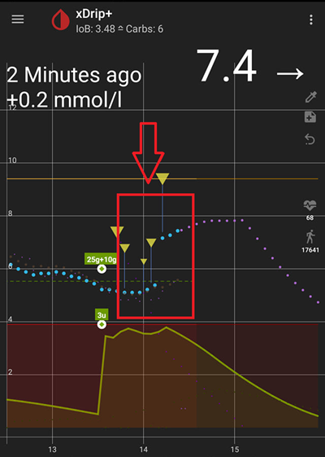
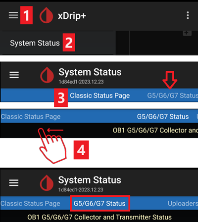
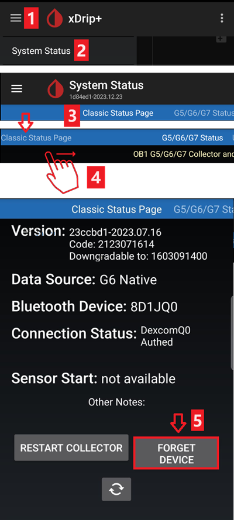
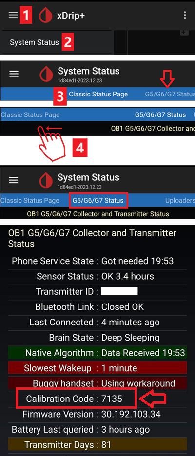

# Настройки на xDrip+

Ако все още нямате, изтеглете [xDrip+](https://jamorham.github.io/#xdrip-plus).

Деактивирайте оптимизацията на батерията и разрешете фонова активност за приложението xDrip+.

Можете спокойно да изтеглите [последния APK (stable)](https://xdrip-plus-updates.appspot.com/stable/xdrip-plus-latest.apk), освен ако не се нуждаете от най-новите функции или не използвате сензори, които активно се интегрират (като G7), в който случай трябва да използвате последния [Nightly Snapshot](https://github.com/NightscoutFoundation/xDrip/releases).

## Основни настройки за всички CGM и FGM системи

### Деактивиране на качването към Nightscout

Считано от AAPS 3.2, не трябва да позволявате на никое друго приложение да качва данни (кръвна захар и treatments) към Nightscout.

→ Hamburger Menu (1) → Settings (2) → Cloud Upload (3) → Nightscout Sync (REST-API) (4) → Изключете **OFF** `Enabled` (5)

#### Деактивиране на автоматичното калибриране и treatments

Ако използвате по-стара версия на AAPS (преди 3.2), уверете се, че сте деактивирали `Automatic Calibration` (7). Ако квадратчето за `Automatic Calibration` е отметнато, активирайте `Download treatments` (6) веднъж, след което премахнете отметката за `Automatic Calibration` и отново деактивирайте `Download treatments`.

Натиснете `Extra Options` (8)

    {admonition} Предупреждение за безопасност
     :class: warning
     Трябва да деактивирате "Upload treatments" в xDrip+, в противен случай treatments могат да се удвоят в AAPS, което води до грешни COB и IOB.

Деактивирайте `Upload treatments` (9) и се уверете, че **НЯМА** да използвате `Back-fill data` (11).

Опцията `Alert on failures` също трябва да бъде деактивирана (10). В противен случай ще получавате аларма на всеки 5 минути в случай на проблеми с Wi-Fi/мобилна мрежа или ако сървърът не е достъпен.

### **Настройки между приложенията** (Broadcast)

Ако ще използвате AAPS и данните трябва да бъдат препращани към AAPS, трябва да активирате broadcasting в xDrip+ в Inter-App settings.

→ Hamburger Menu (1) → Settings (2) → Inter-app settings (3) → Broadcast locally **ON** (4)

За да бъдат стойностите идентични в AAPS спрямо xDrip+, трябва да активирате `Send the displayed glucose value` (5).

Enable Compatible Broadcast (6).

Ако сте активирали също `Accept treatments` в xDrip+ и `Enable broadcasts to xDrip+` в xDrip+ plugin на AAPS, тогава xDrip+ ще получава информация за инсулин, въглехидрати и базален темп от AAPS.

Ако активирате `Accept Calibrations`, xDrip+ ще използва калибровките от AAPS. Бъдете внимателни, когато използвате тази функция със сензори Dexcom: прочетете [това](https://navid200.github.io/xDrip/docs/Calibrate-G6.html) първо.

Не забравяйте да деактивирате Import Sounds, за да избегнете xDrip+ да възпроизвежда сигнал всеки път, когато AAPS изпраща промяна на базал/профил.

(xdrip-identify-receiver)=

#### Идентифициране на получателя (receiver)

- Ако установите проблеми с локалния broadcast (AAPS не получава BG стойности от xDrip+), отидете на → Hamburger Menu (1) Settings (2) → Inter-app settings (3) → Identify receiver (7) и въведете `info.nightscout.androidaps` за AAPS build (ако използвате PumpControl build, моля, въведете вместо това `info.nightscout.aapspumpcontrol`!!).
- Обърнете внимание: автоматичната корекция понякога има тенденция да променя i в главна буква. **Трябва да използвате само малки букви**, когато въвеждате `info.nightscout.androidaps` (или `info.nightscout.aapspumpcontrol` за PumpControl). Главно I би попречило на приложението да получава BG стойности от xDrip+.
    
    

## Използване на AAPS за калибриране в xDrip+

- Ако искате да можете да използвате AAPS за калибриране, тогава в xDrip+ отидете на Settings → Interapp Compatibility → Accept Calibrations и изберете ON. 
- Може също да искате да прегледате опциите в Settings → Less Common Settings → Advanced Calibration Settings.

## Dexcom G6

- Предавателят (transmitter) на Dexcom G6 може едновременно да бъде свързан с приемника на Dexcom (или алтернативно с помпата t:slim) и едно приложение на телефона ви.
- Когато използвате xDrip+ като приемник, първо деинсталирайте приложението Dexcom. **Не можете да свържете едновременно xDrip+ и приложението Dexcom с предавателя!**
- Ако имате нужда от Clarity и искате да се възползвате от функциите на xDrip+, използвайте [Build Your Own Dexcom App](#DexcomG6-if-using-g6-with-build-your-own-dexcom-app) с локален broadcast към xDrip+, или използвайте xDrip+ като Companion приложение, получаващо известия от официалното приложение Dexcom.

### Версия на xDrip+ в зависимост от серийния номер на трансмитера на G6.

- Всички предаватели G6, произведени след есента/края на 2018 г., се наричат "Firefly". Те не позволяват рестартиране на сензора без [премахване на предавателя](https://navid200.github.io/xDrip/docs/Remove-transmitter.html), и не изпращат сурови (raw) данни. Препоръчително е да използвате последния [Nightly Snapshot](https://github.com/NightscoutFoundation/xDrip/releases).
- Старите трансмитери с подменена батерия и модифицираните предаватели позволяват удължаване на живота на сензора и рестартирания, а също изпращат сурови данни. Можете да използвате [последния APK (stable)](https://xdrip-plus-updates.appspot.com/stable/xdrip-plus-latest.apk).

### Специфични настройки за Dexcom

- Следвайте [тези инструкции](https://navid200.github.io/xDrip/docs/G6-Recommended-Settings.html), за да настроите xDrip+.

### Превантивните рестартирания не се препоръчват

**Само трансмитери на Dexcom с подменена батерия или модифицирани. [Превантивните рестартирания](https://navid200.github.io/xDrip/docs/Preemptive-Restart.html) не работят със стандартните трансмитери и напълно ще спрат сензора: трябва да [премахнете трансмитеря](https://navid200.github.io/xDrip/docs/Remove-transmitter.html), за да рестартирате сензора.**

Автоматичното удължаване на сензорите на Dexcom (`preemptive restarts`) не се препоръчва, тъй като това може да доведе до „скокове" в стойностите на BG на 9-ия ден след рестартирането.

Трябва да внимавате за следното:

- Ако използвате суровите (native) данни с калибровъчния код в xDrip+ или Spike, най-безопасно е да не позволявате превантивни рестартирания на сензора.
- Ако трябва да използвате превантивни рестартирания, уверете се, че поставяте сензора в момент от деня, в който можете да наблюдавате промяната и да калибрирате при нужда. 
- Ако рестартирате сензори, или го правете без фабричното калибриране за най-безопасни резултати на 11-ия и 12-ия ден, или се уверете, че сте готови да калибрирате и следите за вариация.
- Предварителното накисване (pre-soaking) на G6 с фабрично калибриране вероятно ще доведе до вариация в резултатите. Ако правите предварително накисване, за да получите най-добри резултати, вероятно ще трябва да калибрирате сензора.
- Ако не следите внимателно промените, които могат да настъпват, може би е по-добре да се върнете към режим без фабрично калибриране и да използвате системата както G5.

За да научите повече за подробностите и причините за тези препоръки, прочетете [пълната статия](https://www.diabettech.com/artificial-pancreas/diy-looping-and-cgm/), публикувана от Tim Street на [www.diabettech.com](https://www.diabettech.com).

(xdrip-connect-g6-transmitter-for-the-first-time)=

### Свързване на трансмитера на G6 за първи път

**За втория и следващите трансмитери вижте [Удължаване на живота на трансмитера](#xdrip-extend-transmitter-life) по-долу.**

Следвайте [тези инструкции](https://navid200.github.io/xDrip/docs/Starting-G6.html).

(xdrip-transmitter-battery-status)=

### Статус на батерията на трансмитера

- Статусът на батерията може да бъде проверен в system status  
    → Hamburger Menu (1) → System Status (2) → Ако сте на Classic Status Page (3), плъзнете екрана (4), за да достигнете → екрана G5/G6/G7 Status.

- Вижте [тук](https://navid200.github.io/xDrip/docs/Battery-condition.html) за повече информация.

(xdrip-extend-transmitter-life)=

### Удължаване на живота на предавателя

- [Животът](https://navid200.github.io/xDrip/docs/Transmitter-lifetime.html) не може да бъде удължен за предаватели Firefly: само за предаватели с подменена батерия или модифицирани.
- Следвайте [тези инструкции](https://navid200.github.io/xDrip/docs/Hard-Reset.html) за предаватели, различни от Firefly.

(xdrip-replace-transmitter)=

### Смяна на трансмитера

- Изключете оригиналния приемник на Dexcom (ако се използва).
- [Спрете сензора](https://navid200.github.io/xDrip/docs/Dexcom/StartG6Sensor.html) (само ако сменяте сензора).

- "Забравете" устройството в system status на xDrip+ И в настройките на BT на смартфона (ще бъде показано като Dexcom?? където ?? са последните две цифри на серийния номер на трансмитера)  
    → Hamburger Menu (1) → System Status (2) → Ако не сте на Classic Status Page (3), плъзнете екрана (4), за да я достигнете → след това натиснете Forget Device (5).

- Премахнете трансмитера (и сензора, ако сменяте и сензора). За да премахнете трансмитера, без да премахвате сензора, вижте [това](https://navid200.github.io/xDrip/docs/Remove-transmitter.html), или това видео <https://youtu.be/AAhBVsc6NZo>.
- Поставете стария трансмитер далеч, за да предотвратите повторно свързване. Микровълновата фурна е перфектна целта – но извадете захранващия кабел, за да сте 100% сигурни, че никой няма да включи микровълновата.
- Следвайте [тези инструкции](https://navid200.github.io/xDrip/docs/Starting-G6.html).
- Не включвайте отново оригиналния приемник на Dexcom (ако се използва), преди xDrip+ да покаже първите отчитания.

### Нов сензор

- Изключете оригиналния приемник на Dexcom (ако се използва).
- Спрете сензора, следвайки [тези инструкции](https://navid200.github.io/xDrip/docs/Dexcom/StartG6Sensor.html).

- Поставете и след това стартирайте нов сензор, следвайки [тези инструкции](https://navid200.github.io/xDrip/docs/Starting-G6.html).

(xdrip-retrieve-sensor-code)=

### Извличане на кода на сензора

→ Hamburger Menu (1) → System Status (2) → If you are on the Classic Status Page (3) swipe the screen (4) to reach → G5/G6/G7 Status screen → Calibration Code.

(xdrip-troubleshooting-dexcom-g5-g6-and-xdrip)=

### Отстраняване на проблеми с Dexcom G5/G6 и xDrip+

#### Проблем при свързване на трансмитера

Следвайте [тези инструкции](https://navid200.github.io/xDrip/docs/Dexcom/SensorFailedStart.html).

#### Проблем при стартиране на нов сензор

Следвайте [тези инструкции](https://navid200.github.io/xDrip/docs/Dexcom/SensorFailedStart.html).

## Libre 1

- Настройте вашия NFC към Bluetooth bridge в xDrip+
    
    → Hamburger Menu (1) → Settings (2) → Less common settings (3) → Bluetooth Settings (4)

- В Bluetooth Settings задайте отметките точно както на снимките по-долу (5)
    
    - Деактивирайте watchdogs, тъй като те ще нулират Bluetooth-а на телефона и ще прекъснат връзката ви с помпата.
    
    

- Можете да опитате да активирате следните настройки (7)
    
    - Use scanning
    - Trust Auto-Connect
    - Use Background Scans

- Ако лесно губите връзка с bridge-а или имате затруднения с възстановяването на връзката, **ДЕАКТИВИРАЙТЕ ГИ** (8).
    
    

- Оставете всички други опции деактивирани, освен ако не знаете защо искате да ги активирате.
    
    

### Ниво на батерията на Libre smart reader

- Нивото на батерията на bridge устройства като MiaoMiao и Bubble може да се показва в AAPS (не и при Blucon).
- Подробности можете да намерите на [страницата със снимки](#screens-sensor-level-battery).

### Свързване на Libre Transmitter и стартиране на сензора

- Ако вашият сензор го изисква (Libre 2 EU и Libre 1 US), инсталирайте последния out of process алгоритъм.

- Вашият сензор трябва вече да е стартиран чрез приложението на производителя или четеца (xDrip+ не може да стартира или спира сензори Libre).

- Задайте източника на данни на Libre Bluetooth.
    
    → Hamburger Menu (1) → Settings (2) → Изберете Libre Bluetooth в Hardware Data source (3)
    
    

- Сканирайте за Bluetooth и свържете bridge-а.
    
    → Hamburger Menu (1) → Scan Bluetooth (2) → Scan (3)
    
    - Ако xDrip+ не може да намери bridge-а, уверете се, че не е свързан с приложението на производителя. Поставете го на зареждане и го нулирайте.
    
    

- Стартирайте сензора в xDrip+.
    
        {admonition} Предупреждение за безопасност
         :class: warning
         Трябва да деактивирате "Upload treatments" в xDrip+, в противен случай treatments могат да се удвоят в AAPS, което води до грешни COB и IOB.
    
    → Hamburger Menu (1) → Start sensor (2) → Start sensor (3) → Задайте точния час, в който сте го стартирали с четеца или приложението на производителя. Ако не сте го стартирали днес, отговорете "Not Today" (4).

(xdrip-libre2-patched-app)=

## Пачнато приложение за Libre 2

- Задайте източника на данни на Libre patched app.
    
    → Hamburger Menu (1) → Settings (2) → Изберете Libre (patched App) в Hardware Data source (3)
    
    

- Можете да добавите `BgReading:d,xdrip libre_receiver:v` в Less Common Settings->Extra Logging Settings->Extra tags for logging. Това ще записва допълнителни съобщения за грешки за отстраняване на проблеми.

