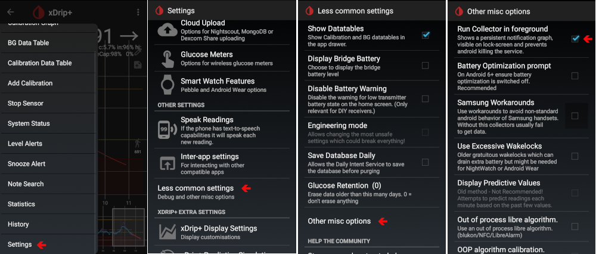

# Как да конфигурирате Huawei телефон

Има различни опции, някои специфични за Android, други – специфични за Huawei:

* Добавете AAPS и xdrip+ в списъка с приложения, които игнорират оптимизацията на батерията:
  
  * Settings / App / Settings / Special autorisations / Ignore battery optimisation / Select "All applications" / Set app to allowed
    
    

* Задайте настройките за опциите на батерията:
  
  * Settings / App / Изберете AndroidAPS/xdrip+ / В Battery / App launch
    
    * Уверете се, че сте изключили "automatic management"
    * Разрешете:
      
      * Automatic launch
      * Secondary launch (може да бъде стартирано от други приложения)
      * Пускай във фонов режим
        
        

* Заключване на приложението (Lock App)
  
  * Отидете в списъка с последни приложения (App recent list) и изберете иконата за заключване
    
    

За xDrip+ трябва да активирате постоянните известия (persistent notifications) (в самото приложение xDrip+):

* Settings / less common settings / other misc options / Run Collector in foreground
  
  

В зависимост от версията на Android, тези настройки може да се намират другаде. Тези обяснения важат за Android 8.1.