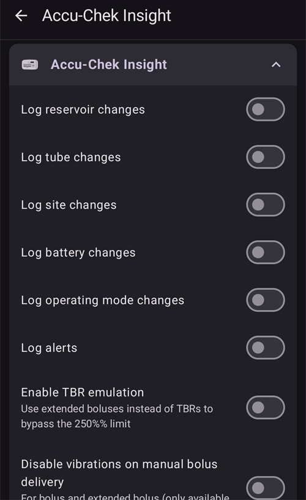

# Accu-Chek Insight

**Този софтуер е част от решение „направи си сам“ (DIY) за изкуствен панкреас и не е продукт, а изисква ВИЕ да прочетете, научите и разберете системата, включително как да я използвате. Той не поема цялото лечение на диабета вместо вас, но ви позволява да подобрите лечението на диабета и качеството си на живот, ако сте готови да отделите нужното време. Не бързайте, а си дайте време да се научите. Само вие носите отговорност за това, което правите с него.**

```{admonition} Accu-Chek Insight постепенно се изтегля от пазара :class: note

Roche се оттегля от пазара на инсулинови помпи, за да насочи продуктите си за диабет към CGM Accu-Chek SmartGuide. Компанията е обявила края на продажбите на помпите Accu-Chek Combo и Accu-Chek Insight; оставащата ѝ микропомпа Accu-Chek Solo също постепенно се спира (последни доставки в Германия в края на 2025 г.). Промяната се въвежда по региони: започва от Германия, а след това се очаква и в другите европейски пазари. Поддръжката на Insight вече е обявена за прекратена (вижте [Помпи, които вече не се продават](./Future-possible-Pump-Drivers.md)). Ако разчитате на тази помпа, планирайте навреме преминаването към поддържана помпа.

    <br />```{note}
    Преди **AAPS** да има собствен драйвер за Insight, Insight се управляваше чрез отделното приложение [SightRemote](https://github.com/TebbeUbben/SightRemote). SightRemote вече не е нужно и не се поддържа: ако все още го имате инсталирано от онова време, деинсталирайте го и вместо това използвайте актуална версия на **AAPS**.
    

```{contents} Съдържание :depth: 1 :local: true

    <br />## Възможности на помпата с AAPS
    
    * Комуникира с **AAPS** чрез вградения Bluetooth на телефона, без допълнително комуникационно устройство.
    * Автоматично обработване на DST (лятно часово време) и смяна на часова зона.
    
    ## Изисквания към хардуера и софтуера
    
    * Помпа Roche Accu-Chek Insight (с какъвто и да е фърмуер – всички работят)
    
    Забележка: AAPS винаги записва данните в **първия базален профил в помпата**.
    
    * Телефон с Android 12 или по-нов (вижте [Телефони](../Getting-Started/Phones.md))
    * Приложението AAPS, инсталирано на телефона ви
    
    ## Настройване
    
    * Помпата Insight трябва да е свързана само с едно устройство в даден момент. Ако преди сте използвали дистанционното управление на Insight (глюкомера), трябва да премахнете глюкомера от списъка със сдвоени устройства на помпата: **Menu** > **Settings** > **Communication** > **Remove device**.
    
       
    
    * В [Конфигурация > Помпа](#Config-Builder-pump) изберете картата **Accu-Chek Insight**. Само една помпа може да бъде активна в даден момент.
    
       
    
       След като е избрана, картата **Accu-Chek Insight** показва два бутона – **Настройки** и **Отвори плъгин**:
    
       
    
       **Настройки** отваря настройките на драйвера Accu-Chek Insight (вижте [Настройки в AAPS](#Accu-Chek-Insight-Pump-settings-in-aaps)).
    
       **Отвори плъгин** (или **Управление → Помпа**) отваря екрана на помпата Accu-Chek Insight. Преди сдвояване на помпа екранът изглежда така:
    
       
    
    (accu-chek-insight-pairing)=
    ### Сдвояване
    
    * На екрана на помпата докоснете **Сдвояване с Insight**. Отваря се съветникът за сдвояване, който търси Bluetooth устройства наблизо (горната част на снимката по-долу).
    * На помпата Insight отидете в **Menu** > **Settings** > **Communication** > **Add Device**. Помпата показва следния екран (долната част на снимката по-долу) със серийния номер на помпата.
    
       
    
    * Обратно на телефона докоснете серийния номер на помпата в списъка с Bluetooth устройства. Ако Android ви поиска да потвърдите сдвояването, докоснете **Сдвояване** (Pair).
    
       
    
    * Помпата и телефонът показват код. Проверете дали кодовете на двете устройства са еднакви. Потвърдете на помпата и докоснете **Да** на телефона. (Докоснете **Не**, ако кодовете не съвпадат.)
    
       
    
    * Телефонът показва **Сдвояване завършено**. Докоснете **Изход**, за да се върнете на екрана на помпата.
    
       
    
    * За да проверите дали всичко е наред, погледнете екрана на помпата (**Управление → Помпа**). След като помпата е сдвоена, екранът показва информация за помпата, например **Сериен номер**, **Дата на производство**, **Версия на софтуера** и **Bluetooth адрес**.
    
       
    
       ```{admonition} По-стара екранна снимка
       :class: note
       Освен горната част на първата снимка, екранните снимки на сдвояването по-горе са от по-ранна версия на **AAPS** и в **AAPS** 4 може да изглеждат различно.
       ```
    
    * За да премахнете сдвояването, докоснете **Раздвояване** на екрана на помпата и потвърдете **Нулиране на сдвояването?**. След това отново се появява бутонът **Сдвояване с Insight**.
    
    Забележка: Между помпата и телефона няма постоянна връзка. **AAPS** се свързва само при нужда (например за да зададе временен базал, да подаде болус или да прочете историята на помпата). Иначе батериите на телефона и на помпата биха се изтощавали твърде бързо.
    
    (Accu-Chek-Insight-Pump-settings-in-aaps)=
    ## Настройки в AAPS
    
    Отворете настройките с **Настройки** на картата **Accu-Chek Insight** в **Конфигурация** > **Помпа** или с иконата със зъбно колело в горния десен ъгъл на екрана на помпата.
    
    
    
    In the Insight settings in **AAPS** you can enable the following options:
    
    * **Log reservoir changes**: automatically records an insulin cartridge change when you change the cartridge in the pump.
    
    * **Записвай смените на тръба**: добавя бележка в базата данни на **AAPS**, когато пуснете програмата „tube filling“ на помпата.
    
    * **Записвай смяната на местата**: добавя бележка в базата данни на **AAPS**, когато пуснете програмата „cannula filling“ на помпата. **Забележка: Смяната на мястото също нулира Autosens.**
    
    * **Записвай смяната на батерия**: записва смяна на батерията, когато поставите нова батерия в помпата.
    
    * **Записвай промените в режима**: добавя бележка в базата данни на **AAPS** всеки път, когато стартирате, спрете или поставите на пауза помпата.
    
    * **Записвай аларми**: добавя бележка в базата данни на **AAPS** всеки път, когато помпата подаде аларма (с изключение на напомнянията и на алармите за болус и за отменен временен базал, които не се записват).
    
    * **Разреши емулация на временни базали**: помпата Insight може да задава временни базали (TBR) само до 250 %. За да се заобиколи това ограничение, когато е поискан TBR над 250 %, емулацията на TBR кара помпата да подаде допълнителния инсулин като удължен болус.
    
      **Забележка: Използвайте само един удължен болус в даден момент. Няколко едновременни удължени болуса могат да причинят грешки.**
    
    * **Изключи вибрациите при ръчно подаване на болус**: помпата Insight не вибрира, когато подава ръчен болус (или удължен болус). Налично само с фърмуер на Insight 3.x.
    
    * **Изключи вибрациите при автоматичен болус**: помпата Insight не вибрира, когато подава автоматичен болус (SMB или временен базал с емулация на TBR). Налично само с фърмуер на Insight 3.x.
    
    * **Мин време за възстановяване [сек]** и **Макс време за възстановяване [сек]**: колко дълго **AAPS** изчаква, преди да опита отново след неуспешен опит за свързване. Можете да изберете от 0 до 20 секунди. Ако имате проблеми с връзката, изберете по-дълго време за изчакване.
        <br><br>Пример за мин. време за възстановяване = 5 и макс. време за възстановяване = 20
        <br><br>няма връзка -> изчакване <b>5</b> сек.
          <br>  нов опит -> няма връзка -> изчакване <b>6</b> сек.
          <br>  нов опит -> няма връзка -> изчакване <b>7</b> сек.
          <br>  нов опит -> няма връзка -> изчакване <b>8</b> сек.
          <br>...
          <br>нов опит -> няма връзка -> изчакване <b>20</b> сек.
          <br>нов опит -> няма връзка -> изчакване <b>20</b> сек.
          <br>...
    
    * **Забавяне при прекъсване на връзката [сек]**: колко дълго (в секунди) **AAPS** изчаква, преди да прекъсне връзката с помпата, след като дадена операция приключи. Можете да изберете от 0 до 15 секунди. Стойността по подразбиране е 5 секунди.
    
    За периодите, в които помпата е била спряна, **AAPS** записва временен базал от 0 %.
    
    ### Екранът на помпата
    
    Екранът на помпата Accu-Chek Insight (**Управление → Помпа**) показва текущото състояние на помпата, например **Статус**, **Последно свързване**, **Работен режим**, **Батерия**, **Инсулин в резервоара**, общите дневни дози за днес (**ТДД болус**, **ТДД базал**), базалните дози и последния болус. След като помпата е сдвоена, екранът има следните бутони:
    
    * **Обнови**: обновява състоянието на помпата.
    * **Разреши съобщения за край на временни базали (настройки на помпата)** / **Забрани съобщения за край на временни базали (настройки на помпата)**: стандартната помпа Insight подава аларма, когато TBR приключи. Този бутон включва или изключва тази аларма, без да е нужен софтуер за конфигуриране.
    * **Раздвояване**: премахва сдвояването с помпата (вижте [Сдвояване](#accu-chek-insight-pairing)).
    
    
    
    ```{admonition} По-стара екранна снимка
    :class: note
    Екранната снимка по-горе е от по-ранна версия на **AAPS**. В **AAPS** 4 екранът на помпата изглежда различно и има и бутон **Раздвояване**.
    

## Настройки на помпата

Настройте алармите в помпата, както следва:

* Menu > Settings > Device settings > Mode settings > Quiet > Signal > Sound
* Menu > Settings > Device settings > Mode settings > Quiet > Volume > 0 (премахнете всички чертички)
* Menu > Modes > Signal mode > Quiet

Така всички аларми на помпата ще бъдат без звук и AAPS ще решава дали дадена аларма е важна за вас. Ако AAPS не потвърди аларма, тя ще става по-силна (първо звуков сигнал, после вибрация).

(Accu-Chek-Insight-Pump-vibration)=

### Вибрация

В зависимост от версията на фърмуера на помпата Insight ще вибрира за кратко при всеки подаден болус (например когато AAPS подава SMB или когато емулацията на временен базал подава удължен болус).

* Фърмуер 1.x: по конструкция няма вибрация.
* Фърмуер 2.x: вибрацията не може да се изключи.
* Фърмуер 3.x: AAPS подава болуса безшумно.

Версията на фърмуера можете да намерите в менюто.

## Смяна на батерията

Battery life for Insight when looping ranges from 10 to 14 days, maximum 20 days. Потребителят, който съобщава това, използва литиеви батерии Energizer.

Помпата Insight има малка вътрешна батерия, която поддържа основни функции, като часовника, докато сменяте сменяемата батерия. Ако смяната на батерията отнеме твърде дълго, вътрешната батерия може да се изтощи, часовникът ще се нулира и след поставяне на новата батерия ще трябва да въведете нов час и дата. Ако това се случи, всички записи в AAPS отпреди смяната на батерията вече няма да се включват в изчисленията, защото правилният час не може да се определи.

(Accu-Chek-Insight-Pump-insight-specific-errors)=

## Грешки, специфични за Insight

### Удължен болус

Използвайте само един удължен болус в даден момент, защото няколко едновременни удължени болуса могат да причинят грешки.

### Таймаут (Time out)

Понякога помпата Insight не отговаря, докато **AAPS** установява връзката. Тогава **AAPS** показва известието „Таймаут при сдвояването - рестартирайте bluetooth“.


Ако това се случи, изключете Bluetooth на помпата И на телефона за около 10 секунди, след това го включете отново.

## Пътуване през часови зони с помпа Insight

За информация относно пътуване през часови зони вижте раздела [Пътуване през часови зони с помпи](#timezone-traveling-insight).

## Къде да получите помощ

Разработката на драйвера на Insight се извършва от общността на **доброволчески** начала. Преди да поискате помощ, моля:

1. **Прочетете** съответния раздел от тази документация, за да проверите как трябва да работи функцията.
2. **Попитайте** в канала *#AAPS* в [Discord](https://discord.gg/4fQUWHZ4Mw) или в някой от другите [канали на общността](../GettingHelp/WhereCanIGetHelp.md).
3. **Съобщете за грешка**, като първо потърсите в [съществуващите проблеми (issues)](https://github.com/nightscout/AndroidAPS/issues); ако вашият го няма, отворете [нов проблем (issue)](https://github.com/nightscout/AndroidAPS/issues) и приложете своите [лог файлове](../GettingHelp/AccessingLogFiles.md).

Когато искате помощ, посочете марката и модела на телефона си, версията на Android, версията на **AAPS** и описание на проблема на прост английски език (какво се е променило, кога е работило за последно).