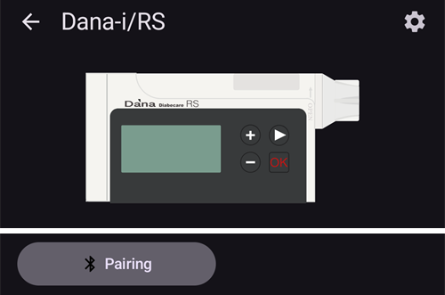
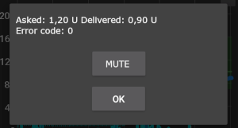

# DanaRS, Dana-i и Dana-i2

*Тези указания са за настройване на приложението и помпата, ако имате DanaRS от 2017 г. нататък, Dana-i или Dana-i2. Ако вместо това имате оригиналната DanaR, вижте [Инсулинова помпа DanaR](./DanaR-Insulin-Pump.md).*

**Dana-i2 може да се използва от версия 4.0 на AAPS нататък.** Тя използва същия драйвер **Dana-i/RS** като Dana-i.

* В помпите DanaRS/i/i2 приложението използва „BASAL A“. Съществуващите данни се презаписват.

    {contents} Съдържание
    :depth: 1
    :local: true

## Възможности на помпата при употреба с AAPS

* Комуникира с **AAPS** чрез вградения Bluetooth на телефона, без допълнително комуникационно устройство.
* Лятното часово време (DST) и смяната на часовата зона трябва да се обработват ръчно (вижте [Пътуване през часови зони](#timezone-traveling-danarv2-danars)).

(DanaRS-Insulin-Pump-pairing-pump)=

## Сдвояване на помпата

* Отворете **менюто** (☰) в горния ляв ъгъл на главния екран на **AAPS** и изберете **Конфигурация**.
* Докоснете **Помпа** и изберете **Dana-i/RS**.
    
    
    
    След като е избран, картата **Dana-i/RS** показва два бутона – **Настройки** и **Отвори плъгин**:
    
    
    
    **Настройки** отваря настройките на драйвера Dana-i/RS:
    
    
    
    **Отвори плъгин** (или **Управление** > **Помпа**) отваря екрана на помпата Dana-i/RS. Преди сдвояване на помпа екранът изглежда така:
    
    

* На екрана на помпата докоснете **Сдвояване**. **AAPS** търси помпи наблизо.

* Докоснете реда на вашата помпа в списъка.
    
    

* **Трябва да потвърдите сдвояването на помпата!** Това става по същия начин като при други Bluetooth сдвоявания, които може би познавате (например смартфон и аудиосистема в кола).
    
    

* Следвайте процеса на сдвояване според типа и фърмуера на помпата:
    
    * За DanaRS v1 **AAPS** иска **Парола на помпата (само v1)**. Въведете паролата на помпата (вижте [Парола по подразбиране](#DanaRS-Insulin-Pump-default-password)).
    * За DanaRS v3 **AAPS** ви моли да натиснете OK на помпата и да въведете двете поредици от цифри и букви, показани на помпата. Дръжте дисплея на помпата включен, като натискате бутона минус, докато не приключите. След това докоснете **Готово**.
    * За Dana-i и Dana-i2 се появява стандартният диалог за сдвояване на Android. Въведете 6-цифреното число, показано на помпата.

* Когато се покаже **Успешно сдвояване!**, докоснете **Готово**.
    
    
    
    Връщате се на екрана на помпата, който вече показва състоянието на помпата.
    
    

* В **Настройки** изберете **Скорост на болус**, за да промените скоростта на болуса по подразбиране (12 сек/Е, 30 сек/Е или 60 сек/Е).

* Задайте стъпката на базала на помпата на 0,01 U/h от менюто за лекари (Doctors menu) (вижте ръководството на помпата).
* Задайте стъпката на болуса на помпата на 0,05 U от менюто за лекари (Doctors menu) (вижте ръководството на помпата). **AAPS** прочита стъпките на базала и болуса от помпата и ги използва за всеки болус, така че болусът винаги съответства на стъпката, зададена на помпата. Екранът на помпата ги показва в реда **Базал/Болус стъпка**.
* Разрешете удължените болуси в настройките на помпата

### Опции, които се показват само при някои модели

* **Авт. заключване**: при Dana-i2 екранът **Потребителски опции** (на екрана на помпата, **Управление** > **Помпа**) има превключвател **Авт. заключване** за настройката на помпата за автоматично заключване. След като го промените, натиснете **Запиши опциите в помпата**.
* **Опростен режим**: при модели помпи, които имат опростен режим на менюто (easy mode), екранът на помпата показва ред **Опростен режим** със стойност **Вкл** или **Изкл**.
* Ако Dana-i2 откаже болус, **AAPS** показва причината, например *Помпата не е напълнена*, *Няма достатъчно инсулин в резервоара* или *Режим за заспиване е активиран в помпата*.

(DanaRS-Insulin-Pump-default-password)=

### Парола по подразбиране

* За DanaRS с фърмуер v1 и v2 паролата по подразбиране е 1234.
* За DanaRS с фърмуер v3 или Dana-i паролата по подразбиране се получава от датата на производство във вида ММДД, където ММ е месецът, а ДД е денят на производство на помпата (например „0124“ означава месец 01 и ден 24).
    
    * От MAIN MENU изберете REVIEW и след това отворете SHIPPING INFORMATION от подменюто
    * Number 3 is manufacturing date. 
    * При v3/i тази парола се използва само за заключване на менюто на помпата. Тя не се използва за комуникация и не е нужно да я въвеждате в AAPS.

(DanaRS-Insulin-Pump-change-password-on-pump)=

## Смяна на паролата на помпата

* Натиснете бутона OK на помпата
* В главното меню изберете „OPTION“ (придвижете се надясно, като натиснете няколко пъти бутона със стрелка)
    
    

* В менюто с опции изберете „USER OPTION“
    
    

* С бутона със стрелка превъртете надолу до „11. password“
    
    

* Натиснете OK, за да въведете старата парола.

* Въведете **старата парола** (за паролата по подразбиране вижте [по-горе](#DanaRS-Insulin-Pump-default-password)) и натиснете OK
    
    

* Ако тук въведете грешна парола, няма да се покаже съобщение за грешка!

* Задайте **нова парола** (променяйте цифрите с бутоните + и - / придвижвайте се надясно с бутона със стрелка).
    
    

* Потвърдете с бутона OK.

* Натиснете OK, за да запазите настройката.
    
    

* Преместете се надолу до „14. EXIT“ и натиснете OK, за да излезете.
    
    

(DanaRS-Insulin-Pump-dana-rs-specific-errors)=

## Грешки, специфични за Dana RS

### Грешка при подаване на инсулин

Ако връзката между AAPS и Dana RS прекъсне по време на подаване на болус (например се отдалечите от телефона, докато Dana RS подава инсулин), ще видите следното съобщение и ще чуете звук на аларма.

* В повечето случаи това е само проблем с комуникацията и се подава правилното количество инсулин.
* Проверете в историята на помпата дали е подаден правилният болус. Можете да направите това на самата помпа или в **AAPS** на екрана на помпата (**Управление** > **Помпа**) > **История** > **Болуси**.
* Ако желаете, изтрийте записа за грешката в [леченията](#screens-bolus-carbs).
* Реалното количество се прочита и записва при следващото свързване. За да ускорите това, докоснете **Обнови** на екрана на помпата или просто изчакайте следващото свързване.

## Специална бележка при смяна на телефона

При смяна на телефона са необходими следните стъпки:

* [Експортирайте настройките](../Maintenance/ExportImportSettings.md) на стария телефон
* Прехвърляне на настройките от стария на новия телефон

### DanaRS v1

* **Сдвоете ръчно** Dana RS с новия телефон
* Ако при импортиране отметнете **Замени и настройките на помпата**, се импортират и настройките за връзка с помпата и AAPS на новия телефон вече ще „познава“ помпата, затова няма да започне търсене през Bluetooth. Затова новият телефон и помпата трябва да се сдвоят ръчно.
* Инсталирайте AAPS на новия телефон.
* [Импортирайте настройките](../Maintenance/ExportImportSettings.md) на новия телефон

### DanaRS v3, Dana-i, Dana-i2

* Започнете процеса на сдвояване, както е описано [по-горе](#DanaRS-Insulin-Pump-pairing-pump).
* Понякога може първо да се наложи да изчистите информацията за сдвояването в **AAPS**. На екрана на помпата (**Управление** > **Помпа**) докоснете **Раздвояване** и потвърдете **Нулиране на сдвояването?**. След това отново докоснете **Сдвояване**.

## Пътуване през часови зони с помпи DanaRS, Dana-i и Dana-i2

За информация относно пътуване през часови зони вижте раздела [Пътуване през часови зони с помпи](#timezone-traveling-danarv2-danars).

## Къде да получите помощ

Разработката на драйвера за DanaRS/Dana-i/Dana-i2 се извършва от общността на **доброволчески** начала. Преди да поискате помощ, моля:

1. **Прочетете** съответния раздел от тази документация, за да проверите как трябва да работи функцията.
2. **Попитайте** в канала *#AAPS* в [Discord](https://discord.gg/4fQUWHZ4Mw) или в някой от другите [канали на общността](../GettingHelp/WhereCanIGetHelp.md).
3. **Съобщете за грешка**, като първо потърсите в [съществуващите проблеми (issues)](https://github.com/nightscout/AndroidAPS/issues); ако вашият го няма, отворете [нов проблем (issue)](https://github.com/nightscout/AndroidAPS/issues) и приложете своите [лог файлове](../GettingHelp/AccessingLogFiles.md).

Когато искате помощ, посочете марката и модела на телефона си, версията на Android, версията на **AAPS** и описание на проблема на прост английски език (какво се е променило, кога е работило за последно).