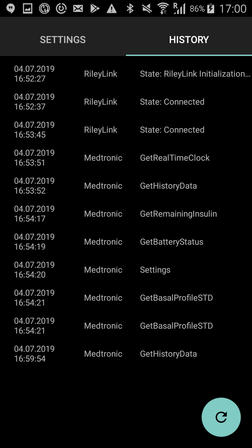

# Помпи Medtronic

Драйверът не работи с по-новите модели, включително всички модели, които завършват на G (530G, серия 600 [630G, 640G, 670G], серия 700 [770G, 780G] и т.н.).

Съвместими са следните комбинации от модел и фърмуер:

- 512/712 (всяка версия на фърмуера)
- 515/715 (всяка версия на фърмуера)
- 522/722 (всяка версия на фърмуера)
- 523/723 (фърмуер 2.4A или по-стар)
- 554/754 европейска версия (фърмуер 2.6A или по-стар)
- 554/754 канадска версия (фърмуер 2.7A или по-стар)

Как да проверите фърмуера на помпата, можете да видите в [документацията на OpenAPS](https://openaps.readthedocs.io/en/latest/docs/Gear%20Up/pump.html#how-to-check-pump-firmware-check-for-absence-of-pc-connect) или в [LoopDocs](https://loopkit.github.io/loopdocs/build/step3/#medtronic-pump-firmware).

    {contents} Съдържание
    :depth: 1
    :local: true

## Възможности на помпата при употреба с AAPS

* Изисква устройство, съвместимо с RileyLink, за комуникация с **AAPS**.
* Автоматично обработване на DST (лятно часово време) и смяна на часова зона.

## Изисквания за хардуер и софтуер

- **Телефон:** Драйверът за Medtronic би трябвало да работи с всеки телефон с Android, който поддържа Bluetooth връзки. **ВАЖНО: Производителите на телефони реализират Bluetooth по различен начин, затова всеки модел телефон може да се държи различно. Например някои телефони включват и изключват Bluetooth по различен начин. Това може да повлияе на работата ви, когато AAPS трябва да се свърже отново с вашето устройство от типа RileyLink.**
- **Устройство, съвместимо с RileyLink:** Телефоните с Android не могат да комуникират с помпите Medtronic без отделно устройство, което да осъществява връзката. Това устройство се свързва с телефона ви чрез Bluetooth и с помпата ви чрез съвместима радиовръзка. Първото такова устройство се казва Rileylink, но сега има и други възможности, някои от които предлагат допълнителни функции.
    
    - Rileylink се предлага на [getrileylink.org](https://getrileylink.org/product/rileylink916)
    - Orangelink се предлага на [getrileylink.org](https://getrileylink.org/product/orangelink)
    - Emalink (няколко модела) се предлага на [github.com](https://github.com/sks01/EmaLink)
    - Gnarl (изисква допълнителна работа „направи си сам“) – подробности на [github.com](https://github.com/ecc1/gnarl)

Сравнителна таблица на различните устройства, съвместими с Rileylink, има на [getrileylink.org](https://getrileylink.org/rileylink-compatible-hardware-comparison-chart)

(MedtronicPump-configuration-of-the-pump)=

## Конфигурация на помпата

Следните настройки трябва да се конфигурират на помпата, за да може AAPS да изпраща команди дистанционно. Стъпките за всяка промяна на Medtronic 715 са дадени в скоби при всяка настройка. Точните стъпки може да се различават в зависимост от типа на помпата и/или версията на фърмуера.

- **Включете дистанционния режим на помпата** (на помпата натиснете Act, отидете в Utilities -> Remote Options, изберете On, а на следващия екран изберете Add ID и добавете произволен ID, например 111111). В списъка Remote ID трябва да има поне един ID, за да очаква помпата дистанционна комуникация.
- **Set Max Basal** (On the pump press Act and go to Basal and then select Max Basal Rate) As an example setting this value to four times your maximum standard basal rate would allow a 400% Temporary Basal Rate. Максималната стойност, която помпата позволява, е 34,9 единици на час.
- **Set Max Bolus** (On the pump press Act and go to Bolus and then select Max Bolus) This is the largest bolus that the pump will accept. Максималната стойност, която помпата позволява, е 25.
- **Задайте профил Standard**. (На помпата натиснете Act, отидете в Basal и изберете Patterns) На помпата е нужен само един профил, защото AAPS управлява различните профили на телефона ви. Други профили (patterns) не са нужни.
- **Задайте типа на временния базал** (на помпата натиснете Act, отидете в Basal и след това в Temp Basal Type). Изберете Absolute (не Percent).

## Конфигурация на Medtronic в телефона/AAPS

- **Не свързвайте устройството, съвместимо с RileyLink, от менюто за Bluetooth на телефона.** Ако го свържете от менюто за Bluetooth на телефона, AAPS няма да вижда устройството, когато следвате инструкциите по-долу.
- Изключете автоматичното завъртане на екрана на телефона. На някои устройства автоматичното завъртане на екрана рестартира Bluetooth връзките, а това създава проблеми с помпата Medtronic. 
- Има два начина да конфигурирате помпата Medtronic в AAPS:

1. Чрез съветника за настройване при нова инсталация
2. В **Конфигурация** > **Помпа**, като изберете **Medtronic**
    
    
    
    След като го изберете, картата **Medtronic** показва два бутона – **Настройки** и **Отвори плъгин**:
    
    
    
    **Настройки** отваря настройките на драйвера за Medtronic:
    
    
    
    **Отвори плъгин** (или **Управление** > **Помпа**) отваря екрана на помпата Medtronic. Преди сдвояване на помпа екранът изглежда така:
    
    

Когато настройвате помпата Medtronic със съветника за настройване, е възможно да не успеете да завършите настройката заради проблеми с Bluetooth (например не можете да се свържете с помпата). В такъв случай изберете виртуалната помпа, за да завършите настройката, и след това продължете с отстраняването на проблема чрез начин 2.

Когато настройвате AAPS да работи с помпата Medtronic, трябва да зададете следното в **Настройки** (вижте снимката на настройките по-горе):

- **Сериен номер на помпа**: Написан е на гърба на помпата и започва със SN. Въведете само 6-те цифри, без букви (например 123456).
- **Тип помпа**: Моделът на помпата, която използвате (например 522). 
- **Честота на помпата**: Има две възможности според това къде първоначално е разпространена помпата. Please check the [FAQ](#MedtronicPump-faq) if you are unsure which option to select: 
    - for US & Canada, frequency used is 916 MHz
    - for Worldwide, frequency used is 868 MHz
- **Максимален базал в помпата (Е/ч)**: Тази стойност трябва да съвпада с настройката в помпата (вижте „Конфигурация на помпата“ по-горе). И тази настройка трябва да се избере внимателно, защото определя колко инсулин AAPS може да подаде чрез базалната доза. Така на практика се задава максималният временен базал. Например, ако зададете тази стойност на четири пъти най-високата ви стандартна базална доза, ще е възможен временен базал от 400 %. Максималната стойност, която помпата позволява, е 34,9 единици на час.
- **Макс болус в помпата (Е)** (за един час): Тази стойност трябва да съвпада с настройката в помпата (вижте „Конфигурация на помпата“ по-горе). Обмислете тази настройка внимателно, защото тя определя най-големия болус, който AAPS може да зададе.
- **Изчакване преди старт на болус (сек)**: Броят секунди след подаването на болус, преди командата наистина да бъде изпратена към помпата. Това време позволява на потребителя да отмени болуса, ако командата за болус е изпратена по грешка. Болус, който вече е започнал, не може да се отмени чрез AAPS. Единственият начин да отмените болус, който вече е започнал, е ръчно да спрете помпата (suspend) и след това да я пуснете отново (resume).
- **Medtronic Encoding**: Determines where the Medtronic encoding is carried out (hardware or software). Препоръчва се хардуерно кодиране (т.е. извършвано от устройството, съвместимо с Rileylink), защото така се изпращат по-малко данни. Софтуерното кодиране (т.е. извършвано от AAPS) може да помогне, ако връзката често прекъсва. Тази настройка не се взема предвид, ако устройството Rileylink е с фърмуер версия 0.x.
- **Тип батерия (напреднали)**: За да се определи правилно оставащият заряд на батерията, изберете типа на използваната AAA батерия. Когато е избрана стойност, различна от „Не е избрано (общ)“, AAPS показва изчисления оставащ заряд на батерията в проценти и напрежението във волтове. Възможни са следните стойности:
    
    - Не е избрано (общ)
    - Алкална (разширен изглед)
    - Литиева (разширен изглед)
    - NiZn (разширен изглед)
    - NiMH (разширен изглед)
- **Използвай сканиране**: Включва Bluetooth сканиране преди свързване с устройството, съвместимо с Rileylink. Това би трябвало да подобри надеждността на връзката с устройството.

- **Покажи нивото на батерията на OrangeLink/EmaLink/DiaLink**: Тази функция се поддържа само от по-новите устройства, като EmaLink или OrangeLink. Стойността се показва като **Батерия на RileyLink** на екрана на помпата Medtronic.
- **Прилагане на неутрални временни базали**: По подразбиране помпите Medtronic издават звуков сигнал в началото на всеки час, когато има активен временен базал. Ако включите тази опция, звуковите сигнали може да намалеят: временният базал се прекъсва при смяната на часа, за да не прозвучи сигналът.

(pairing-your-rileylink-compatible-device)=

### Свързване на устройството, съвместимо с RileyLink

Устройството, съвместимо с RileyLink, се свързва от екрана на помпата Medtronic, а не от менюто за Bluetooth на телефона:

- Отворете екрана на помпата (**Управление** > **Помпа** или **Отвори плъгин** на картата Medtronic в **Конфигурация** > **Помпа**).
- Докоснете **Свързване на RileyLink**. **AAPS** търси устройства наблизо, съвместими с RileyLink.
- Докоснете устройството си в списъка. Когато се покаже **RileyLink успешно свързан**, докоснете **ОК**.

## Екран на помпата Medtronic

За да отворите екрана на помпата Medtronic, отидете в **Управление** > **Помпа**. Екранът на помпата показва текущото състояние на помпата и някои действия, специфични за Medtronic (вижте снимката на екрана на помпата по-горе).

- **RileyLink статус**: Текущото състояние на връзката между телефона и устройството, съвместимо с Rileylink. Тук трябва винаги да пише „Свързан“. Всяко друго състояние може да изисква намеса от потребителя. 
- **Батерия на RileyLink**: Текущото ниво на батерията на устройството EmaLink или OrangeLink. Показва се само ако в настройките на Medtronic е включено **Покажи нивото на батерията на OrangeLink/EmaLink/DiaLink**.
- **Статус на помпата**: Текущото състояние на връзката с помпата. Помпата не е свързана постоянно, затова тук най-често се вижда иконата за сън. Възможни са и други състояния, например „Събуждане“, когато AAPS се опитва да изпрати команда, или други команди към помпата, като „Вземи времето на помпата“, „Приложи временен базал“ и т.н.
- **Батерия**: Показва състоянието на батерията според стойността, избрана за **Тип батерия (напреднали)** в настройките на Medtronic.
- **Последно свързване**: Преди колко време е била последната успешна връзка с помпата.
- **Последен болус**: Преди колко време е подаден последният успешен болус.
- **Базова базална стойност**: Базалната доза от активния ви профил, която помпата подава в този час.
- **Временен базал**: Временният базал, който се подава в момента; може да бъде и 0 единици на час.
- **Резервоар**: Колко инсулин има в резервоара (обновява се поне веднъж на час).
- **Грешки**: Текст на грешката, ако има проблем (най-често при грешка в конфигурацията).

В долната част на екрана има следните бутони:

- **Обнови** обновява текущото състояние на помпата. Използвайте го само ако връзката е била прекъсната за дълго време, защото това изисква пълно обновяване на данните (четене на историята, четене/задаване на времето, четене на профила, четене на състоянието на батерията и т.н.).
- **Свързване на RileyLink**: Намира и свързва устройството, съвместимо с RileyLink (вижте [по-горе](#pairing-your-rileylink-compatible-device)).
- **История**: Показва историята на помпата (вижте [по-долу](#MedtronicPump-pump-history)).
- **Статистика на RL**: Показва статистиката на RL (вижте [по-долу](#MedtronicPump-rl-status-rileylink-status)).
- **Събуди и настрой** и **Ресет на RileyLink**: Вижте [Действия](#medtronic-actions) по-долу.
- **Изчисти Bolus Block**: Показва се само за кратко след болус, докато **AAPS** чака помпата да завърши подаването му. Докосването му прекратява това изчакване.

(MedtronicPump-pump-history)=

## История на помпата

Историята на помпата се чете на всеки 5 минути и се съхранява локално. Съхраняват се само данните за последните 24 часа. Така можете лесно да видите поведението на помпата, ако е нужно. Съхраняват се само записите, които са важни за AAPS; функциите за конфигурация, които нямат значение, не се включват.

Докоснете **История** на екрана на помпата, за да я отворите. По подразбиране е избрано **Всички**. Докоснете един от бутоните за филтриране горе (например **Болуси**, **Базали** или **Аларми**), за да се показва само един вид записи.

(MedtronicPump-rl-status-rileylink-status)=

## RL статус (RileyLink статус)

 

Прозорецът „RL статус“ има два раздела:

- **Настройки**: Показва настройките на устройството, съвместимо с RileyLink: конфигуриран адрес, свързано устройство, състояние на връзката, грешка при свързване и версии на фърмуера на RileyLink. „Тип на устройството“ е винаги „Medtronic помпа“, моделът е моделът на вашата помпа, серийният номер е конфигурираният сериен номер, „Честота на помпата“ показва коя честота използвате, а „Последна честота“ е последно използваната честота.
- **История**: Показва историята на комуникацията. Записите с RileyLink показват промените в състоянието на RileyLink, а записите с Medtronic показват кои команди са изпратени към помпата.

(medtronic-actions)=

## Действия

Когато се използва драйверът за Medtronic, на екрана на помпата (**Управление** > **Помпа**) има две допълнителни действия:

- **Събуди и настрой** – Ако AAPS не се е свързвал с помпата за дълго време (трябва да се свързва на всеки 5 минути), можете ръчно да стартирате настройване (Tune Up). Така AAPS се опитва да се свърже с помпата, като търси на всички радиочестоти, които помпата може да използва. Ако връзката е успешна, успешната честота се задава като честота по подразбиране. Докато настройването тече, статусът на RileyLink на екрана на помпата го показва. Ако настройването не успее (например защото помпата е била извън обхват), **AAPS** опитва отново автоматично приблизително на всеки 10 минути.
- **Ресет на RileyLink** – Ако нулирате (reset) устройството, съвместимо с RileyLink, може да се наложи да използвате това действие, за да се конфигурира устройството отново (задаване на честотата, на типа честота и на кодирането).

## Важни бележки

### Специално внимание при конфигурацията на NS

AAPS използва серийния номер за синхронизация и серийният номер е видим в NS. Тъй като серийният номер на стара помпа Medtronic може да се използва за дистанционно управление на помпата, обърнете специално внимание на защитата на вашия сайт в NS, за да не изтече серийният номер (SN) на помпата. Вижте https://nightscout.github.io/nightscout/security/

### Потребители на OpenAPS

Потребителите на OpenAPS трябва да знаят, че AAPS с Medtronic използва напълно различен подход от OpenAPS. С AAPS основният начин за работа с помпата е чрез телефона. In normal use cases it is likely that the only time it is required to use the pump menu is when changing reservoirs. Това е много различно от OpenAPS, където поне част от болуса обикновено се подава с бутоните за бърз болус. Ако помпата се използва за ръчно подаване на болус, може да има проблеми, ако AAPS се опита да подаде болус по същото време. Има проверки, които се опитват да предотвратят проблеми в такива случаи, но все пак това трябва да се избягва, когато е възможно.

### Логове

Ако трябва да откриете проблем с работата на помпата Medtronic, изберете иконата на менюто в горния ляв ъгъл на екрана и след това Поддръжка и Настройки на логовете. За отстраняване на проблеми с Medtronic трябва да се отметнат Pump, PumpComm и PumpBTComm.

### Medtronic CGM

Medtronic CGM в момента НЕ се поддържа.

### Ръчно използване на помпата

Избягвайте ръчно подаване на болуси или задаване на временни базали (TBR) от помпата. Всички такива команди трябва да се изпращат чрез AAPS. Ако все пак използвате ръчни команди, между тях трябва да има поне 3 минути, за да се намали рискът от проблеми.

### Смяна на часовата зона и лятно часово време (DST) или пътуване с помпа Medtronic и AAPS

AAPS автоматично открива смяната на часовата зона и обновява времето на помпата, когато телефонът ви премине на новото време.

Пътуването на изток означава, че към текущото време се добавят часове (напр. от GMT+0 към GMT+2), което няма да създаде проблеми, защото няма припокриване (т.е. не е възможно един и същ час да се появи два пъти). Пътуването на запад обаче може да създаде проблеми, защото на практика се връщате назад във времето, а това може да доведе до грешни IOB данни.

Проблемите при пътуване на запад са известни на разработчиците и се работи по възможно решение. Вижте https://github.com/andyrozman/RileyLinkAAPS/issues/145 за повече подробности. Засега имайте предвид, че този проблем може да се появи, и следете внимателно при смяна на часовата зона.

### Устройството GNARL напълно съвместимо ли е с Rileylink?

Кодът на GNARL поддържа напълно всички функции, които драйверът за Medtronic в AAPS използва, т.е. той е напълно съвместим. Важно е да знаете, че това изисква допълнителна работа: трябва да намерите съвместим хардуер и след това да заредите кода на GNARL на устройството.

**Бележка от автора:** Моля, имайте предвид, че софтуерът GNARL все още е експериментален и малко тестван и не трябва да се смята за толкова безопасен, колкото RileyLink.

(MedtronicPump-faq)=

## Често задавани въпроси

(MedtronicPump-what-to-do-if-i-loose-connection-to-rileylink-and-or-pump)=

### What to do if I lose connection to RileyLink and/or pump?

Има няколко начина да опитате да решите проблемите с връзката.

- Докоснете **Събуди и настрой** на екрана на помпата (**Управление** > **Помпа**), както е описано по-горе.
- Изключете Bluetooth на телефона, изчакайте 10 секунди и го включете отново. Така устройството Rileylink ще се свърже отново с телефона.
- Нулирайте (reset) устройството Rileylink. След това трябва да докоснете **Ресет на RileyLink** на екрана на помпата (**Управление** > **Помпа**).
- Други потребители са установили, че следните стъпки помагат да се възстанови връзката, когато другите методи не помагат: 
    1. Рестартирайте телефона
    2. *Докато* телефонът се рестартира, рестартирайте устройството Rileylink
    3. Отворете AAPS и изчакайте връзката да се възстанови

### Как да разбера каква честота използва помпата ми

На гърба на помпата има ред с номера на модела и специален код от 3 букви. Първите две букви определят типа честота, а последната – цвета. Възможни стойности за честотата:

- NA – Северна Америка (в избора на честота трябва да изберете „САЩ и Канада (916 MHz)“)
- CA – Канада (в избора на честота трябва да изберете „САЩ и Канада (916 MHz)“)
- WW - Worldwide (in frequency selection you need to select "Worldwide (868 MHz)")

(MedtronicPump-pump-unreachable)=

### Как да поправите грешката „Помпата е недостъпна“ (pump unreachable)

Някои помпи Medtronic показват грешката „Помпата е недостъпна“ (pump unreachable) след актуализация на **AAPS**. За да я поправите, сменете типа на кодирането:

1. Отидете в **Конфигурация** > **Помпа** и докоснете **Настройки** на картата **Medtronic**.
2. Set **Medtronic Encoding** to **Hardware 4b6b Encoding**.

## Къде да получите помощ

Драйверът за Medtronic се разработва от общността на **доброволчески** начала. Преди да поискате помощ, моля:

1. **Прочетете** съответния раздел от тази документация, за да проверите как трябва да работи функцията.
2. **Попитайте** в канала *#AAPS* в [Discord](https://discord.gg/4fQUWHZ4Mw) или в някой от другите [канали на общността](../GettingHelp/WhereCanIGetHelp.md).
3. **Съобщете за грешка**, като първо потърсите в [съществуващите проблеми (issues)](https://github.com/nightscout/AndroidAPS/issues); ако вашият го няма, отворете [нов проблем (issue)](https://github.com/nightscout/AndroidAPS/issues) и приложете своите [лог файлове](../GettingHelp/AccessingLogFiles.md).

Когато искате помощ, посочете марката и модела на телефона си, версията на Android, версията на **AAPS** и описание на проблема на прост английски език (какво се е променило, кога е работило за последно).