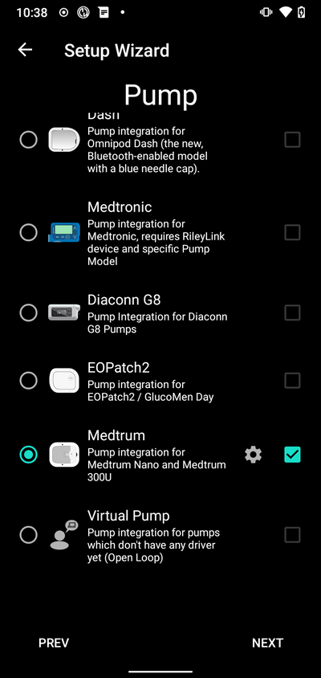
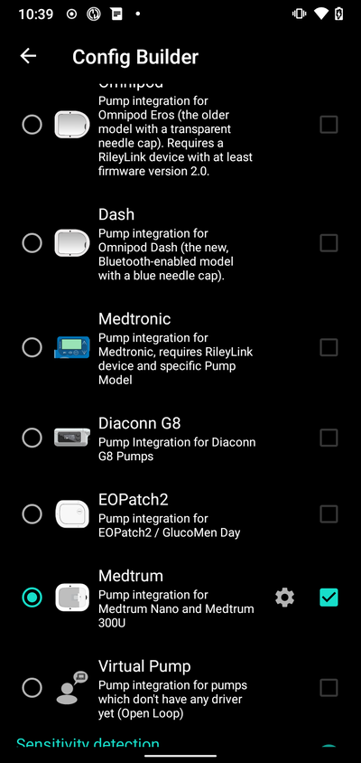
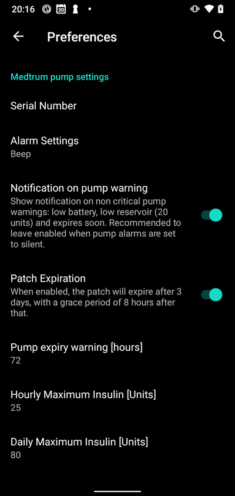
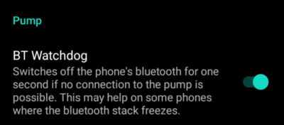
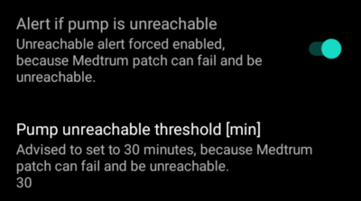
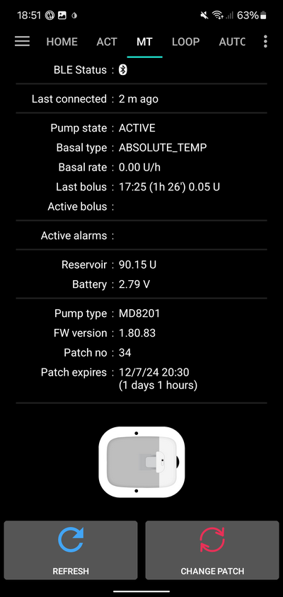

# Medtrum Nano / 300U

Тези инструкции са за конфигуриране на инсулиновата помпа Medtrum.

This software is part of a DIY artificial pancreas solution and is not a product but requires YOU to read, learn, and understand the system, including how to use it. You alone are responsible for what you do with it.

```{contents} Table of contents
:depth: 1
:local: true
```

## Възможности на помпата при употреба с AAPS
* Поддържана е цялата функционалност на цикъла (SMB, TBR и т.н.)
* Автоматично обработване на DST (лятно часово време) и смяна на часова зона
* Удължен болус (extended bolus) не се поддържа от драйвера на AAPS

## Hardware and Software Requirements
* **Съвместими помпена база (pumpbase) и резервоарни пачове (reservoir patches) на Medtrum**
    - В момента се поддържат:
        - Medtrum TouchCare Nano с помпени бази с референции: **MD0201** и **MD8201**.
        - Medtrum TouchCare 300U с помпена база с референция: **MD8301**.
        - Ако имате неподдържан модел и сте готови да дарите хардуер или да помогнете с тестването, моля, свържете се с нас чрез discord [тук](https://discordapp.com/channels/629952586895851530/1076120802476441641).
* **Версия 3.2.0.0 или по-нова на AAPS, компилирана и инсталирана**, следвайки инструкциите [Build APK](../SettingUpAaps/BuildingAaps.md).
* **Съвместим Android телефон** поддръжка на BLE Bluetooth връзка
    - Вижте [Release Notes](../Maintenance/ReleaseNotes.md) на AAPS
* [**Устройство за непрекъснато мониториране на глюкозата (CGM)**](../Getting-Started/CompatiblesCgms.md)

## Before you begin

**НА ПЪРВО МЯСТО БЕЗОПАСНОСТ** Не предприемайте този процес в среда, в която не можете да се справите с грешка (задължителни са резервни пачове, инсулин и устройства за управление на помпата).

**PDM и приложението Medtrum няма да работят с пач, активиран от AAPS.** Преди може да сте използвали своя PDM или приложението Medtrum, за да изпращате команди към помпата си. От съображения за сигурност можете да използвате активирания пач само с устройството или приложението, което е било използвано за неговото активиране.

*Това НЕ означава, че трябва да изхвърлите своя PDM. Препоръчително е да го съхранявате на сигурно място като резервен вариант за спешен случай, например ако изгубите телефона си или AAPS не работи правилно.*

**Помпата ви няма да спре да доставя инсулин, когато не е свързана с AAPS.** Стандартните базални темпове са програмирани на помпата, както са дефинирани в текущо активния профил. Докато AAPS е активен, той ще изпраща команди за временен базал, които се изпълняват максимум 120 минути. Ако по някаква причина помпата не получи нови команди (например заради загубена комуникация поради разстояние между помпата и телефона), помпата ще се върне към стандартния базален темп, програмиран на помпата, след като приключи временният базал.

**30-минутни профили на базалния темп НЕ се поддържат в AAPS.** **Профилът на AAPS не поддържа 30-минутен времеви интервал за базален темп.** Ако сте нови в AAPS и настройвате профила си на базалния темп за първи път, имайте предвид, че базални темпове, започващи на половин час, не се поддържат, и ще трябва да коригирате профила на базалния си темп да започва на кръгъл час. Например, ако имате базален темп от 1.1 единици, който започва в 09:30 и има продължителност 2 часа, завършваща в 11:30, това няма да работи. Ще трябва да промените този базален темп от 1.1 единици на времеви диапазон 9:00-11:00 или 10:00-12:00. Въпреки че самият хардуер на помпата Medtrum поддържа 30-минутни интервали за базалния темп, AAPS в момента не може да ги вземе предвид в своите алгоритми.

**Базални темпове от 0U/h в профила НЕ се поддържат в AAPS.** Въпреки че помпата Medtrum поддържа нулев базален темп, AAPS използва кратни на профилния базален темп, за да определя автоматизираното лечение, и следователно не може да функционира с нулев базален темп. Временен нулев базален темп може да се постигне чрез функцията "Disconnect pump" или чрез комбинация от Disable Loop/Temp Basal Rate или Suspend Loop/Temp Basal Rate.

## Setup

ВНИМАНИЕ: При активиране на пач с AAPS **ТРЯБВА** да деактивирате всички други устройства, които могат да комуникират с помпената база на Medtrum, напр. активен PDM и приложението Medtrum. Уверете се, че имате готови помпената база и серийния номер (SN) на помпената база за активиране на нов пач.

### Стъпка 1: Изберете помпа Medtrum

#### Опция 1: Нови инсталации

Ако инсталирате AAPS за първи път, **Съветника** ще ви преведе през инсталирането на AAPS. Изберете „Medtrum", когато стигнете до избора на помпа (Pump selection).

Ако не сте сигурни, можете също да изберете „Виртуална помпа" и да изберете „Medtrum" по-късно, след настройката на AAPS (вижте опция 2).



#### Опция 2: Конфигурация

При съществуваща инсталация можете да изберете помпа **Medtrum** в [Config Builder > Pump](#Config-Builder-pump):

В горния ляв ъгъл в **hamburger menu** изберете **Конфигурация** ➜ **Помпа** ➜ **Medtrum**, като изберете бутона **Разреши**, озаглавен **Medtrum**.

Отметването на **квадратчето** до **иконата на зъбно колело (Settings Gear)** ще позволи Medtrum overview да се показва като раздел (tab) в интерфейса на AAPS, озаглавен **Medtrum**. Отметването на това квадратче ще улесни достъпа ви до командите на Medtrum при използване на AAPS и е силно препоръчително.



### Стъпка 2: Промяна на настройките на Medtrum

Влезте в настройките на Medtrum, като натиснете иконата на зъбно колело (**Settings Gear**) на модула Medtrum в Config Builder.



#### Сериен номер:

Въведете серийния номер на вашата помпена база тук, както е отбелязан на помпената база. Уверете се, че серийният номер е верен и няма добавени интервали (можете да използвате главни или малки букви).

ЗАБЕЛЕЖКА: Тази настройка може да бъде променяна само когато няма активен пач.

#### Настройки на алармата

***По подразбиране: Beep (звуков сигнал).***

Тази настройка променя начина, по който помпата ще ви предупреждава, когато има предупреждение или грешка.

- Beep > Пачът ще издава звуков сигнал при аларми и предупреждения
- Silent > Пачът няма да ви уведомява при аларми и предупреждения

Забележка: В тих (silent) режим на телефона AAPS все пак ще активира алармата, в зависимост от настройките за сила на звука на телефона ви. Ако не отговорите на алармата, пачът в крайна сметка ще издаде звуков сигнал.

#### Нотификация при предупреждение от помпата

***По подразбиране: Активирано.***

Тази настройка променя начина, по който AAPS показва известия за некритични предупреждения от помпата. Когато е активирана, ще се показва известие на телефона при възникване на предупреждение от помпата, включително:
    - Ниска батерия
    - Малко инсулин (20 единици)
    - Предупреждение за изтичане на срока на пача

Във всеки случай тези предупреждения се показват и на екрана Medtrum overview под [Активни аларми](#medtrum-active-alarms).

(medtrum-patch-expiration)=
#### Изтичане на срока на пача

***По подразбиране: Активирано.***

Тази настройка променя поведението на пача. Когато е активирана, пачът ще изтече след 3 дни и ще издаде звуково предупреждение, ако имате активиран звук. След 3 дни и 8 часа пачът ще спре да работи.

Ако тази настройка е деактивирана, пачът няма да ви предупреждава и ще продължи да работи, докато батерията на пача или резервоарът не се изчерпят.

#### Предупреждение за изтичане на срока на помпата

***По подразбиране: 72 часа.***

Тази настройка променя момента на предупреждението за изтичане на срока – когато [Изтичане на срока на пача](#medtrum-patch-expiration) е активирано, AAPS ще подаде известие в зададения час след активирането.

#### Максимален часов инсулин

***По подразбиране: 25U.***

Тази настройка променя максималното количество инсулин, което може да бъде доставено за един час. Ако този лимит бъде превишен, пачът ще спре и ще пусне аларма. Алармата може да бъде нулирана чрез натискане на бутона за нулиране в менюто overview – вижте [Нулиране на аларми](#nano-reset-alarms).

Задайте разумна стойност според нуждите ви от инсулин.

#### Максимален дневен инсулин

***По подразбиране: 80U.***

Тази настройка променя максималното количество инсулин, което може да бъде доставено за един ден. Ако този лимит бъде превишен, пачът ще спре и ще пусне аларма. Алармата може да бъде нулирана чрез натискане на бутона за нулиране в менюто overview – вижте [Нулиране на аларми](#nano-reset-alarms).

Задайте разумна стойност според нуждите ви от инсулин.

#### Сканиране при грешка във връзката

***По подразбиране: Изключено.***

Намира се в **Advanced Settings**.

Активирайте само ако имате проблеми с връзката. Ако е активирано, драйверът отново сканира за помпата, преди да опита повторно свързване с нея. Уверете се, че разрешението за местоположение (Location) е зададено на "Always allow".

### Стъпка 2б: Настройки за известия (Alerts) на AAPS

Отидете в настройки

#### Помпа:

##### BT Watchdog

Отидете в preferences и изберете **Pump**:



##### BT Watchdog

Тази настройка ще се опитва да заобиколи всякакви проблеми с BLE. Тя ще се опитва да се свърже отново с помпата, когато връзката е загубена. Ще се опитва да се свърже отново с помпата и когато помпата е недостъпна за определен период от време.

Активирайте тази настройка, ако изпитвате чести проблеми с връзката с помпата ви.

#### Локални аларми:

Отидете в настройки и изберете **Локални аларми**:



##### Предупреждение, ако помпата е недостъпна

***По подразбиране: Активирано.***

Тази настройка е предварително активирана, когато драйверът на Medtrum е активиран. Тя ще ви предупреждава, когато помпата е недостъпна. Това може да се случи, когато помпата е извън обхват или не отговаря поради дефектен пач или помпена база, например когато има проникнала вода между помпената база и пача.

От съображения за безопасност тази настройка не може да бъде деактивирана.

##### Праг на недостъпност на помпата [мин]

***По подразбиране: 30 мин.***

Тази настройка променя времето, след което AAPS ще ви предупреди, че помпата е недостъпна. Това може да се случи, когато помпата е извън обхват или не отговаря поради дефектен пач или помпена база, например когато има проникнала вода между помпената база и пача.

Тази настройка може да бъде променяна при използване на помпа Medtrum, но от съображения за безопасност е препоръчително да я зададете на 30 минути.

### Стъпка 3: Активиране на пач

**Преди да продължите:**
- Подгответе помпената база Medtrum Nano и резервоарен пач.
- Уверете се, че AAPS е правилно настроен и [профил е активиран](../DailyLifeWithAaps/ProfileSwitch-ProfilePercentage.md).
- Другите устройства, които могат да комуникират с помпата Medtrum, са деактивирани (PDM и приложението Medtrum)

#### Активиране на пач от раздела Medtrum

Отидете в [раздела Medtrum](#nano-overview) в интерфейса на AAPS и натиснете бутона **Смени пач** в долния десен ъгъл.

Ако вече има активен пач, ще бъдете подканени първо да го деактивирате. вижте [Деактивиране на пач](#nano-deactivate-patch).

Следвайте стъпките, за да напълните и активирате нов пач. Моля, обърнете внимание – важно е да свързвате помпената база с резервоарния пач само в момента, в който бъдете подканени да го направите. **Трябва да поставите помпата на тялото си и да въведете канюлата само когато бъдете подканени по време на процеса на активиране (след като зареждането/подготовката приключи).**

##### Старт на Активиране


На тази стъпка проверете отново серийния номер и се уверете, че помпената база все още не е свързана с пача.

Натиснете **Следващ**, за да продължите.

##### Напълнете пача


След като пачът бъде открит и напълнен с минимум 70 единици инсулин, ще се появи бутонът **Слеващ**.

##### Подготовка (Prime) на пача


Не премахвайте предпазителя и натиснете бутона на иглата на пача.

Натиснете **Следващ**, за да започнете подготовката (prime)


След като подготовката приключи, натиснете **Следващ**, за да продължите.

##### Прикрепяне на пача


Почистете и подсушете мястото на приложение, след което прикрепете пача към кожата. Отстранете предпазителя и натиснете бутона на иглата на пача, за да инжектирате канюлата.

Натиснете **Следващ**, за да активирате пача.

(medtrum-activate-patch)=
##### Активиране на пача


Когато активирането приключи, ще се появи следният екран


Натиснете **OK**, за да се върнете на главния екран.

(nano-deactivate-patch)=

### Деактивиране на пач

За да деактивирате текущо активен пач, отидете в [раздела Medtrum](#nano-overview) в интерфейса на AAPS и натиснете бутона **Смени пач**.


Ще бъдете помолени да потвърдите, че искате да деактивирате текущия пач. **Моля, обърнете внимание, че това действие е необратимо.** Когато деактивирането приключи, можете да натиснете **Следващ**, за да продължите процеса за активиране на нов пач. Ако не сте готови да активирате нов пач, натиснете **Отказ**, за да се върнете на главния екран.


Ако Android APS не успее да деактивира пача (например защото помпената база вече е била разкачена от пач), можете да натиснете **Иткажи**, за да забравите текущата сесия на пача и да направите възможно активирането на нов пач.


След като деактивирането приключи, натиснете **OK**, за да се върнете на главния екран, или натиснете **Следващ**, за да продължите процеса за активиране на нов пач.

(nano-resume-interrupted-activation)=

### Възобновяване на прекъснато активиране

Ако активирането на пач бъде прекъснато, например защото батерията на телефона се изтощи, можете да възобновите процеса на активиране, като отидете в [раздела Medtrum](#nano-overview) в интерфейса на AAPS и натиснете бутона **Смени пач**.


Натиснете **Следващ**, за да започнете активацията. Натиснете **Ok**, за да продължите процеса на активиране.


Драйверът ще се опита да определи текущия статус на активирането на пача. Ако това е успешно, той ще продължи процеса на активиране от текущата стъпка.

(nano-overview)=

## Общ

Преглед съдържа текущия статус на пача Medtrum. Той съдържа също бутони за смяна на пача, нулиране на аларми и опресняване на статуса.



### BLE статус:

Показва текущия статус на Bluetooth връзката с помпената база.

### Последно свързване:

Показва последния път, когато помпата е била свързана с AAPS.

### Състояние на помпата:

Показва текущото състояние на помпата. Например:
    - ACTIVE: Помпата е активирана и работи нормално
    - STOPPED: Пачът не е активиран

### Тип базал:

Показва текущия тип базал.

### Базален темп:

Показва текущия базален темп.

### Последен болус:

Показва последния доставен болус.

### Активен болус:

Показва активния болус, който в момента се доставя.

(medtrum-active-alarms)=
### Активни аларми:

Показва всички активни аларми в момента.

### Резервоар:

Показва текущото ниво на инсулин в пача.

### Батерия:

Показва текущото напрежение на батерията на пача.

### Тип помпа:

Показва номера на текущия тип помпа.

### Версия на FW:

Показва текущата версия на firmware на пача.

### Номер на пач:

Показва поредния номер на пача. Този номер се увеличава всеки път, когато се активира нов пач.

### Пачът изтича:

Показва датата и часа, в които пачът ще изтече.

### Обнови:

Този бутон ще опресни статуса на пача.

### Смени пач:

Този бутон ще стартира процеса за смяна на пача. Вижте [Активиране на пач](#medtrum-activate-patch) за повече информация.

(nano-reset-alarms)=

### Нулиране на аларми

Бутонът за аларма ще се появи на екрана Общ, когато има активна аларма, която може да бъде нулирана. Натискането на този бутон ще нулира алармите и ще възобнови доставянето на инсулин, ако пачът е бил спрян поради алармата. Напр. Помпата е спряна поради превишено максимално количество инсулин за ден.


Натиснете бутона **Reset Alarms**, за да нулирате алармите и да възобновите нормалната работа.

## Смяна на телефон, експортиране/импортиране на настройки

When switching to a new phone the following steps are necessary:
* [Export settings](../Maintenance/ExportImportSettings.md) on your old phone
* Прехвърлете настройките от стария на новия телефон и ги импортирайте в AAPS

Импортираният файл с настройки трябва да бъде от същата сесия на пача, която в момента използвате, в противен случай пачът няма да се свърже.

След импортиране на настройки драйверът ще синхронизира историята с помпата, което може да отнеме известно време в зависимост от възрастта на файла с настройки.

От версия 3.3.0.0 на AAPS нататък, напредъкът на синхронизацията се показва на началния екран: 

## Отстраняване на проблеми

### Проблеми с връзката

Ако изпитвате прекъсвания на връзката (timeouts) или други проблеми с връзката:
- В настройките на Android приложението за AAPS: Задайте разрешението за местоположение на "Allow all the time"(разреши по всяко време).

### Проблеми с Bluetooth
За известни проблеми с Bluetooth връзките, прекъсвания на помпата/пачовете, или проблеми с активирането и връзката вижте [Отстраняване на проблеми с Bluetooth](../GettingHelp/BluetoothTroubleshooting.md)

### Прекъснато активиране

Ако процесът на активиране бъде прекъснат, например поради изтощена батерия на телефона или срив на телефона. Процесът на активиране може да бъде възобновен, като отидете на екрана за смяна на пача и следвате стъпките за възобновяване на активирането, описани тук: [Възобновяване на прекъснато активиране](#nano-resume-interrupted-activation)

### Предотвратяване на грешки в пача

Пачът може да даде различни грешки. За да предотвратите чести грешки:
- Уверете се, че пача е правилно поставен в помпената база и не се виждат празнини.
- При пълнене на пача не прилагайте прекомерна сила върху буталото (plunger). Не се опитвайте да напълните пача над максимума, приложим за вашия модел.

## Къде да получите помощ

Цялата разработка на драйвера за Medtrum се извършва от общността на **доброволни начала**; молим ви да имате предвид този факт и да използвате следните насоки, преди да поискате съдействие:

-  **Ниво 0:** Прочетете съответния раздел от тази документация, за да сте сигурни, че разбирате как трябва да работи функционалността, с която изпитвате затруднения.
-  **Ниво 1:** Ако все още срещате проблеми, които не можете да разрешите с помощта на този документ, моля, отидете в канала *#Medtrum* в **Discord**, като използвате [тази покана](https://discord.gg/4fQUWHZ4Mw).
-  **Ниво 2:** Претърсете съществуващите issues, за да видите дали проблемът ви вече е докладван в <0>Issues</0>; ако съществува, моля, потвърдете/коментирайте/добавете информация за проблема си. Ако не, моля, създайте [нов issue](https://github.com/nightscout/AndroidAPS/issues) и приложете [вашите лог файлове](../GettingHelp/AccessingLogFiles.md).
-  **Бъдете търпеливи – повечето от членовете на нашата общност са добронамерени доброволци, а решаването на проблеми често изисква време и търпение както от потребителите, така и от разработчиците.**