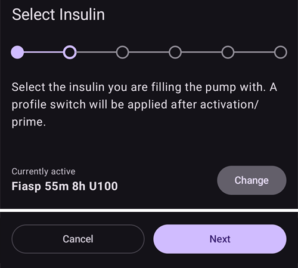
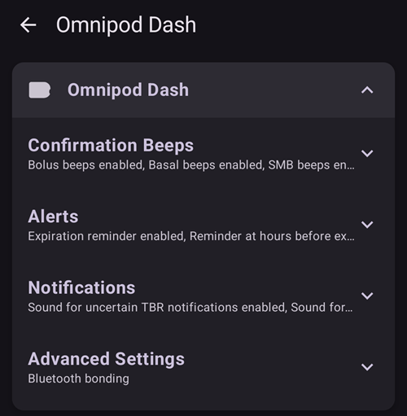

# Omnipod DASH

Тези инструкции са за настройка на помпата от поколението **Omnipod DASH** **(НЕ Omnipod Eros)**. Драйверът за DASH е утвърден и надежден начин за затворен кръг с Omnipod.

```{contents} Table of contents
:depth: 1
:local: true
```

## Спецификации на Omnipod DASH

Основни характеристики на **Omnipod DASH** („DASH“):

- Пачовете DASH се разпознават по **синята капачка на иглата** (по-старият пач EROS има прозрачна капачка на иглата). Пачовете иначе са идентични по физически размери.
- DASH не изисква BLE връзка/устройство мост (bridge) (не е нужен RileyLink, OrangeLink или EmaLink).
- Bluetooth връзката на DASH се използва само при изпращане на команда (напр. болус) и се прекъсва веднага след изпращането на командата.
- **AAPS** ще изчака достъпността на пача, за да изпрати команди.
- При активиране на пач **AAPS** ще открие нов DASH пач и ще се свърже с него.
- Очакван обхват от телефона: 5–10 метра (може да варира).

(omnipod-dash-constraints)=

## Известни ограничения/проблеми на AAPS с Omnipod DASH
- Общият съвет е да работите с **AAPS** на Android 14 или 16. Общността е докладвала много [проблеми](https://github.com/nightscout/AndroidAPS/issues/3471) с Android 15. Ако все пак използвате Android 15, вероятно ще трябва да включите **Bluetooth свързване (bonding)** (в раздела **Разширени настройки** на [Настройки на Dash](#omnipod-dash-advanced-settings)), за да активирате и използвате пачовете успешно. Вижте [Отстраняване на неизправности](../GettingHelp/GeneralTroubleshooting.md) за повече информация за настройките за свързване (bonding).
- Смяната на лятно/зимно часово време и на часовата зона не се прилага автоматично. След смяна на часа трябва да обновите пача ръчно: натиснете **Обнови** на екрана на помпата DASH, след това натиснете **Задаване на часа** (показва се, когато часовите зони на пача и на телефона се различават) или направете **Смяна на профил** (вижте [Смяна на часовата зона при Omnipod Dash](#timezone-traveling-with-pumps)).
- Dash поддържа базална доза само със стъпки от 0,05 U/h. Ако се опитате да зададете базал със стъпки от 0,01 във вашия **AAPS профил**, AAPS няма да покаже предупреждение, въпреки че пачът ще закръгли дозата до стъпки от 0,05. Ако отворите **История на Pod** на екрана на помпата DASH, там ще пише, че е зададен базал 0,05. Това също означава, че най-ниската базална доза, позволена от DASH в **AAPS**, е 0,05 U/h.
- Файлът с настройки съдържа активната сесия на пача. Експортирайте настройките си след всяко активиране на пач и прочетете [Експорт и импорт на настройките](#omnipod-dash-export-import), преди да импортирате настройки.
- При задаване на нов базален профил DASH ще спре доставката, преди да зададе новия базален **Профил**. Ако възникне прекъсване или грешка в комуникацията, базалният профил няма автоматично да се рестартира. Вижте раздел [Възобновяване на доставката на инсулин](#omnipod-dash-resuming-insulin-delivery) за подробности.
- Ако алармите са конфигурирани и пачът наближава изтичане на срока, пачът ще продължи да издава звукови сигнали, докато алармите не бъдат заглушени – вижте [Заглушаване на алармите на пача](#omnipod-dash-silencing-pod-alerts) за подробности.
- Съществуват редица известни проблеми с Bluetooth, които могат да причинят проблеми с активирането на пача. Вижте [Отстраняване на неизправности с Bluetooth](../GettingHelp/BluetoothTroubleshooting.md) за известния проблем и решенията му.

(hardware-software-requirements)=

(omnipod-dash-hardware-software-requirements)=
## Изисквания за хардуер и софтуер

- Omnipod DASH се разпознава по синята капачка на иглата.


- **A Compatible Android phone** with Bluetooth Low Energy (BLE) (see [Phones](../Getting-Started/Phones.md) for more info). In addition, the following information will help guide you on other key considerations around successfully activating and using the DASH on a compatible phone:
    -  Драйверът на **AAPS** за Omnipod Dash се свързва с DASH пача чрез Bluetooth.  
      **AAPS** автоматично ще установява нова Bluetooth връзка с пача всеки път, когато трябва да изпрати команда (напр. болус), а след изпращането на командата Bluetooth връзката веднага се прекъсва.
       - **ЗАБЕЛЕЖКА:**
         - Bluetooth връзката може да бъде прекъсвана/смущавана от други Bluetooth устройства, свързани към телефона, на който работи **AAPS**, като слушалки и др... Такива устройства могат да причинят грешки във връзката или проблеми с активирането на пача при някои модели телефони. Добре е да прегледате списъка с [тествани хардуерни конфигурации](https://docs.google.com/spreadsheets/u/1/d/e/2PACX-1vScCNaIguEZVTVFAgpv1kXHdsHl3fs6xT6RB2Z1CeVJ561AvvqGwxMhlmSHk4J056gMCAQE02sAWJvT/pubhtml?gid=683363241&single=true) за работещи конфигурации, когато избирате телефон за Omnipod DASH.
         - There are a number of known issues with Bluetooth which can cause pod activation problems (See [Troubleshooting](#omnipod-dash-troubleshooting) for advice on other Bluetooth issues) specifically the [Bluetooth related issues](#omnipod-dash-bluetooth-related-issues) section.
    - Телефонът трябва да работи с **Android 12 или по-нов**, а **AAPS** трябва да е компилиран и инсталиран според инструкциите в [**Компилиране на AAPS**](../SettingUpAaps/BuildingAaps.md). Винаги използвайте последната издадена версия.
- Поддържано [**устройство за непрекъснато следене на КЗ (CGM)**](../Getting-Started/CompatiblesCgms.md)

По-долу инструкциите обясняват как да активирате нова сесия на пач с помощта на **AAPS**. You should wait for your current Pod to be close to expiry, as you will need to activate a new Pod with **AAPS**. След като пач бъде деактивиран, той не може да бъде използван повторно/реактивиран – деактивирането е окончателно.

## Преди да започнете

Уверете се, че сте прочели и разбрали цялото това ръководство, сте прочели и разбрали раздела **Преди да започнете**, както и **[Ограничения и проблеми на Omnipod и AAPS](#omnipod-dash-constraints)**, за да избегнете известен проблем.

### **НА ПЪРВО МЯСТО БЕЗОПАСНОСТ** - **НЕ СЛЕДВА** да опитвате да свържете **AAPS** с пач за първи път, без да имате достъп до всичко следното:
1. Резервни пачове (3 или повече)
2. Резервен инсулин и консумативи за многократни дневни инжекции (MDI)
3. Работещ Omnipod PDM (в случай че **AAPS** откаже)
4. Поддържаните телефони са задължителни! (вижте [Изисквания към хардуера/софтуера](#hardware-software-requirements))
5. Правилната версия на AAPS, компилирана и инсталирана

### Вашият Omnipod Dash PDM ще стане излишен, след като драйверът на AAPS за Dash активира пача ви.
- Преди да използвате **AAPS**, вие или вашият болногледач сте управлявали пача с помощта на Omnipod PDM (или в някои региони – приложение за телефон), за да изпращате команди към DASH (напр. болус).
- DASH може да поддържа връзка само с едно Bluetooth устройство (напр. PDM или телефон) за управление и изпращане на команди.
- Устройството, което успешно активира пача, е единственото устройство, на което е позволено да комуникира с този пач от този момент нататък. Това означава, че веднъж активирате ли DASH с вашия Android телефон чрез **AAPS**, **вече няма да можете да използвате своя PDM с този пач!** Докато пачът е активен, драйверът на **AAPS** за Dash, работещ на вашия Android телефон, е новият PDM за вашия пач.
- **НЕ ИЗХВЪРЛЯЙТЕ своя PDM!** Препоръчително е да го запазите като резервен вариант и за спешни случаи, например когато изгубите телефона си или **AAPS** не работи правилно.

### Вашият пач **НЯМА** да спре да доставя инсулин, когато не е свързан с AAPS.
Стандартните базални дози се програмират на пача при активиране, както са дефинирани в текущо активния [**Профил**](../SettingUpAaps/YourAapsProfile.md).  
Докато **AAPS** работи, той ще изпраща команди за корекция на базалната доза, които се изпълняват максимум 120 минути.  
Ако по някаква причина пачът не получи нови команди (например заради загубена комуникация поради разстоянието между пача и телефона), пачът автоматично ще се върне към стандартните базални дози, дефинирани във вашия [**Профил**](../SettingUpAaps/YourAapsProfile.md).

### Профилите на AAPS не поддържат 30-минутни времеви интервали за базалната доза
Ако сте нови в **AAPS** и настройвате своя [**Профил**](../SettingUpAaps/YourAapsProfile.md) с базални дози за първи път, имайте предвид, че базални дози, започващи на половин час, не се поддържат. Например, ако на вашия Omnipod PDM имате базална доза от 1,1 единици, която започва в 09:30 и продължава 2 часа до 11:30, не е възможно да възпроизведете точно този базален **Профил** в **AAPS**.  
Ще трябва да промените времевия интервал на тази базална доза от 1,1 единици на 9:00–11:00 или на 10:00–12:00. Въпреки че самият хардуер на DASH поддържа 30-минутни интервали за базалния **Профил**, **AAPS** НЕ поддържа тази функционалност.

### Базални дози от 0 U/h в профила НЕ се поддържат в AAPS
Въпреки че DASH поддържа нулева базална доза, **AAPS** използва кратни на базалната доза от **Профила** на потребителя, за да определя автоматичното лечение; той не може да работи с нулева базална доза.  
Вместо това временна нулева базална доза може да се постигне чрез функцията „Разкачи помпата“ или чрез комбинация от „Изключи кръга“/временен базал или „Спри кръга“/временен базал.  
**ЗАБЕЛЕЖКА:** Най-ниската базална доза, позволена от DASH в **AAPS**, е 0,05 U/h.

## Избор на Dash в AAPS

Има **два** начина да изберете драйвера за Omnipod DASH в **AAPS**:

### Вариант 1: Нови инсталации

Когато инсталирате **AAPS** за първи път, **Съветник за настройване** ви води през основните функции и изискванията за инсталиране на **AAPS**. Когато стигнете до стъпката **Помпа**, изберете **Omnipod Dash**.


Ако още не сте сигурни, засега можете да изберете **Виртуална помпа** и да изберете **Omnipod Dash** по-късно, след като настроите **AAPS** (вижте Вариант 2).

(omnipod-dash-option-2-config-builder)=
### Вариант 2: Екранът „Конфигурация“

При съществуваща инсталация можете да изберете помпата **Omnipod Dash** от екрана **Конфигурация**:

1. Отворете **менюто** (☰) в горния ляв ъгъл на главния екран и изберете **Конфигурация**.
2. Докоснете **Помпа** и изберете радио бутона на **Omnipod Dash** (*„Интегриране на помпа за Omnipod Dash (новият модел с активиран Bluetooth, със синя капачка на иглата)“*).

3. След като е избран, картата **Omnipod Dash** показва два бутона:
   - **Настройки** отваря [Настройки на Dash](#omnipod-dash-settings).
   - **Отвори плъгин** отваря [екрана на помпата DASH](#omnipod-dash-tab).

   

### Проверка на избора на драйвер за Omnipod

За да проверите дали е избран **Omnipod Dash**, отворете **Управление** (долната навигация на главния екран) и докоснете **Помпа**. Отваря се екранът на помпата DASH, както е показано в следващия раздел.

(omnipod-dash-tab)=

## Екранът на помпата DASH

На екрана на помпата DASH управлявате своите пачове: активирате ги и ги деактивирате, обновявате статуса на пача, заглушавате алармите и преглеждате историята на пача. Отворете го чрез **Управление** > **Помпа** или чрез **Отвори плъгин** на картата **Omnipod Dash** в **Конфигурация** > **Помпа**.

Така изглежда екранът без активен пач:


А така изглежда екранът с активен пач:


Иконата **Настройки** (зъбно колело) в горния десен ъгъл отваря [Настройки на Dash](#omnipod-dash-settings).

***ЗАБЕЛЕЖКА:** Ако поле на екрана на помпата показва (неясно), натиснете **Обнови**, за да обновите статуса на пача.*

### Полета

- **Bluetooth адрес:** Bluetooth адресът на пача.

- **Качество на връзката:** Колко надеждно **AAPS** се свързва с пача. Показва се като *успешни връзки / всички опити за връзка :: процент успешни*, например `412/420 :: 98.10 %`. След повече от 50 успешни връзки стойността става жълта под 90 % и червена под 70 %. Ниската стойност показва проблем с Bluetooth (вижте [Проблеми, свързани с Bluetooth](#omnipod-dash-bluetooth-related-issues)).

- **Статус на доставката:** Необработеният статус на доставката, който пачът съобщава. Това поле се показва само в инженерни компилации (за разработчици).

- **Уникален ID:** Уникалният ID, който **AAPS** е дал на пача при активирането.

- **Партиден (LOT) номер:** Производственият партиден номер на пача.

- **Пореден номер:** Поредният номер на пача.

- **Версия на фърмуера:** Версиите на фърмуера и на Bluetooth на пача.

- **Време на Pod:** Текущото време на пача, заедно с неговата часова зона. Текстът става червен, когато часовата зона на пача е различна от часовата зона на телефона, и жълт, когато времето на пача се различава с повече от 10 минути.

- **Срокът на Pod изтича:** Датата и часът, когато срокът на пача изтича (72 часа след активирането). Текстът става жълт през последните 4 часа преди този момент. Той никога не става червен, защото пачът продължава да доставя инсулин и след това.

- **Крайна дата на Pod:** Краят на допълнителния период на пача (8 часа след **Срокът на Pod изтича**, при максимален живот на пача 80 часа). Текстът става жълт, когато започне допълнителният период (при **Срокът на Pod изтича**), и червен през последните 4 часа преди крайния момент. По време на допълнителния период се показва и оставащото време, например *(17мин остават)*. При крайния момент пачът спира да доставя инсулин и трябва да бъде сменен.

- **Статус на Pod:** Състоянието на пача: **Няма активен Pod**, **Настройка в процес**, **Работи**, **Спрян** или, след повреда на пача, **ALARM**.

- **Последна връзка:** Преди колко време **AAPS** е комуникирал с пача за последен път.

  - *Преди малко* – преди по-малко от 10 секунди.

  - *преди по-малко от минута* – преди 10 до 60 секунди.

  - *преди XX минути* – преди повече от 1 минута (и *преди X часа и XX минути* след един час).

- **Последен болус:** Количеството на последния болус, изпратен до пача, и преди колко време е подаден. Непотвърден болус е отбелязан с (неясно).

- **Базова базална стойност:** Базалната доза, програмирана за текущия час във вашия базален **Профил**.

- **Временна базална стойност:** Временният базал (TBR), който работи в момента, с неговия начален час и продължителност. Това поле се показва само докато работи TBR.

- **Резервоар:** Показва *Над 50 U остават*, когато в резервоара има повече от 50 единици. Под 50 единици се показва точното количество. Стойността става червена под 20 единици.

- **Общо доставени:** Общото количество инсулин, доставено от резервоара. То включва и инсулина, използван за първоначалното пълнене (priming).

- **Активни аларми на Pod:** Алармите, които са активни в пача в момента, например *Pod скоро ще изтече* или *Малко инсулин в резервоара*.

- **Грешки:** Повредата на пача, ако пачът се е повредил. Показва се в червено като *Грешка на Pod:*, последвано от кода и името на повредата, например *Грешка на Pod: 020 ALARM_OCCLUDED*. Прегледайте [Историята на Pod](#omnipod-dash-view-pod-history) и лог файловете за минали грешки и по-подробна информация. Вижте [Повреди на пача](#omnipod-dash-pod-failures).

- **Известие от PDM:** Показва се само след повреда на пача. Показва повредата така, както би я показал Omnipod PDM: заглавие (например *Открита оклузия*, *Празен резервоар* или *Pod е изтекъл*), какво се е случило (например *Доставката на инсулин е спряна. Сменете Pod сега.*) и код *Реф.:*.

### Бутони

Бутоните в долната част на екрана на помпата се променят според състоянието на пача. Показват се само бутоните, които имат смисъл в момента.

- **Обнови:** Пита пача за текущия му статус.
  - *Използвайте го, за да обновите статуса на пача и да изчистите полетата, които показват (неясно).*
  - *Вижте раздела [Отстраняване на неизправности](#omnipod-dash-troubleshooting) по-долу за повече информация.*

- **Заглушаване на алармите:** Спира звуковите сигнали за аларма от пача (например за изтичане на срока на пача или малко инсулин в резервоара). Показва се само докато пачът има активна аларма. Вижте [Заглушаване на алармите на пача](#omnipod-dash-silencing-pod-alerts).

- **Подновяване на доставката:** Подновява доставката на инсулин при спрян пач. Показва се само когато доставката е спряна. Вижте [Възобновяване на доставката на инсулин](#omnipod-dash-resuming-insulin-delivery).

- **Задаване на часа:** Променя часовата зона на пача на тази на телефона, като изпраща отново вашия базален **Профил**. Показва се само когато часовата зона на пача е различна от часовата зона на телефона.

- [**Активирай Pod**](#omnipod-dash-activate-pod): Подготвя (prime) и активира нов пач. Показва се, когато няма активен пач.

- [**Деактивирай Pod**](#omnipod-dash-deactivate-pod): Деактивира активния пач. Показва се веднага щом пач бъде сдвоен с **AAPS**, също и когато активирането е спряло по средата (например защото пачът се е повредил по време на активирането). **AAPS** иска потвърждение, преди да деактивира пача.

- **Възпроизвеждане на тестов звук:** Пачът издава един тестов звуков сигнал.

- [**История на Pod**](#omnipod-dash-view-pod-history): Показва историята на действията на активния пач.

- **Премахни Pod:** Премахва незавършен пач от **AAPS**. Показва се само когато активирането на пач е спряло по средата. **AAPS** иска потвърждение. След премахването **AAPS** вече не може да комуникира с този пач: махнете го от тялото си.


```{admonition} Older screenshot
:class: note
Екранната снимка по-горе е от по-стара версия на **AAPS**, която имаше отделно меню **Pod Management** (управление на пача). В **AAPS** 4 всички тези действия, включително **Активирай Pod**, **Деактивирай Pod**, **Възпроизвеждане на тестов звук** и **История на Pod**, са бутони с текст директно на екрана на помпата.
```

(omnipod-dash-activate-pod)=

## Активиране на пач

1. Отворете екрана на помпата DASH (**Управление** > **Помпа**) и натиснете **Активирай Pod**. Отваря се съветникът за активиране.

   

   ```{admonition} Older screenshot
   :class: note
   Екранната снимка по-горе е от по-стара версия на **AAPS**. В **AAPS** 4 **Активирай Pod** е бутон директно на екрана на помпата DASH, а не в менюто **Pod Management** (управление на пача).
   ```

   Ако никога досега не сте активирали **Профил** в **AAPS**, съветникът първо показва стъпката **Нужен е профил**: изберете профила, който да се приложи при активирането, и продължете.

2. Показва се стъпката **Напълнете Pod**. Напълнете новия пач с достатъчно инсулин за 3 дни, **поне 80 единици**. Изчакайте два звукови сигнала от пача: те означават, че е напълнено минималното количество от 80 единици. Изпразнете напълно спринцовката за пълнене, дори след като сте чули двата сигнала. Все още не махайте капачката на иглата на пача.

   ***ЗАБЕЛЕЖКА:** Когато изчислявате количеството инсулин, което ви трябва за 3 дни, помнете, че първоначалното пълнене (priming) на пача използва около 3–10 единици.*

   

   

   Уверете се, че новият пач и телефонът с **AAPS** са близо един до друг, и натиснете **Напред**.

3. Ако използвате повече от един инсулин в **AAPS**, се показва стъпката **Изберете инсулин**. Тя показва текущия инсулин, отбелязан като **Активно**. Ако сте напълнили пача с друг инсулин, натиснете **Сменете** и го изберете. **AAPS** прилага **Смяна на профил** с този инсулин, когато активирането завърши. Натиснете **Напред**.

   

4. На стъпката **Инициализация на Pod** **AAPS** се сдвоява с новия пач и го пълни (prime). Чувате щракване, последвано от поредица тиктакащи звуци, докато пачът се пълни. Когато това завърши успешно, се появява бутонът **Напред**. Натиснете **Напред**.

       

   ***ЗАБЕЛЕЖКА**: Ако се появи съобщение за грешка, като _Неуспешно сканиране_ или _„Could not find an available pod for activation“_ (не е намерен свободен пач за активиране) (това може да се случи), не се паникьосвайте. Натиснете **Отново**. В повечето случаи активирането след това продължава успешно.*

   

   Ако пачът се е повредил (например защото времето за активирането му е превишено), вместо **Отново** се показва **Деактивирай Pod**. Използвайте го и започнете отначало с нов пач.

   Ако натиснете **Откажи**, преди активирането да е завършило, **AAPS** ви пита дали искате да излезете. Натиснете **ОК**, за да излезете от съветника, или **Откажи**, за да останете.

   

5. Ако следите смяната на мястото на помпата в **AAPS** (**Позволи следене на мястото на помпата** в настройките [Смяна на мястото](#Aapsscreens-site-rotation)), се показва стъпката **Локация**. Изберете върху схемата на тялото къде ще поставите пача и натиснете **Напред** или натиснете **Прескочи**.

   

6. След това подгответе мястото за инфузия за новия пач. Измийте ръцете си, за да избегнете всеки риск от инфекция. Почистете мястото за инфузия със сапун и вода или с тампон със спирт и оставете кожата да изсъхне напълно на въздуха, преди да продължите. Ако лепенката дразни кожата ви, помислете за използване на защитна кърпичка или защитен спрей за кожа.

   На стъпката **Прикрепете Pod** махнете синята пластмасова капачка на иглата на пача. Ако канюлата или нещо друго стърчи от пача или той изглежда необичайно, **СПРЕТЕ**: натиснете **Откажи** и започнете отначало с нов пач. Ако всичко изглежда **наред**, махнете бялата хартиена подложка от лепенката и залепете пача на избраното място на тялото.

   Когато сте готови, натиснете **Напред**.

   

7. Появява се прозорец за потвърждение: *Когато натиснете OK, ще бъде вмъкната канюлата.* **Натиснете ОК САМО ако сте готови канюлата да бъде вмъкната!**

   

8. На стъпката **Вмъкване на канюла** **AAPS** задава вашия базален график и пачът вмъква канюлата. Това може да отнеме известно време (максимум 1–2 минути). **Бъдете търпеливи!**

   ***ЗАБЕЛЕЖКА:** Добра практика е да захванете кожата близо до мястото на вмъкване на канюлата, преди тя да бъде вмъкната. Това помага иглата да влезе гладко и намалява риска от оклузии (запушвания).*

       

9. Когато канюлата е вмъкната успешно, се появява бутонът **Напред**. Натиснете **Напред**.

   

10. Показва се стъпката **Pod е активиран**. Проверете дали канюлата е вмъкната правилно и сменете пача, ако смятате, че не е.

    Натиснете **Край**.

    Поздравления! Вече сте стартирали нова сесия на пач.

    

11. Връщате се на екрана на помпата DASH. Сега той показва информацията за вашия активен пач, включително текущата базална доза, нивото в резервоара, доставения инсулин, грешките и алармите на пача. **Активирай Pod** е заменен от **Деактивирай Pod**: не можете да активирате друг пач, без първо да деактивирате активния пач.

    ***ЗАБЕЛЕЖКА:** За повече подробности за показаната информация вижте [Екранът на помпата DASH](#omnipod-dash-tab).*

    

    ***ЗАБЕЛЕЖКА:** Добра практика е да експортирате настройките си СЛЕД активиране на пача. Експортирайте настройките си след всяка смяна на пача и веднъж месечно. Копирайте експортирания файл с настройки в облачно пространство (например Google Drive) или на друго място извън телефона, в случай че загубите телефона си (вижте [**Експорт настройки**](../Maintenance/ExportImportSettings.md)).*

Ако предишно активиране е спряло, след като пачът е бил напълнен (primed), натискането на **Активирай Pod** продължава от стъпката **Прикрепете Pod**.

(omnipod-dash-deactivate-pod)=

## Деактивиране на пач

При нормални условия пачът издържа три дни (72 часа) плюс допълнителен период от 8 часа след предупреждението за изтичане на срока на пача: общо 80 часа.

За да деактивирате пач (защото срокът му е изтекъл или защото се е повредил):

1. Отворете екрана на помпата DASH (**Управление** > **Помпа**) и натиснете **Деактивирай Pod**.

   

2. На стъпката **Деактивирай Pod** натиснете **Напред**. Прозорец пита *Деактивиран Pod не може да бъде използван отново. Да се деактивира ли този Pod сега?* Натиснете **ОК**, за да започне деактивирането на пача, или **Откажи**, за да го запазите. Деактивирането спира цялата доставка на инсулин и не може да бъде отменено.

   

3. Стъпката **Деактивиране на Pod** се показва, докато **AAPS** деактивира пача. Пачът издава звуков сигнал, за да потвърди, че деактивирането е успешно.

   

   ```{admonition} Older screenshot
   :class: note
   Екранната снимка по-горе е от по-стара версия на **AAPS**. В **AAPS** 4 съветникът показва напредъка си като ред точки в горната част вместо лента за напредък.
   ```

   Когато деактивирането завърши успешно, се появява бутонът **Напред**. Натиснете **Напред**.

   

   Ако деактивирането е неуспешно, се показват съобщение за грешка и бутон **Премахни Pod**. Преди да го използвате, прочетете [Премахване на пач](#omnipod-dash-discard-pod) по-долу. Можете също да натиснете **Откажи** и да опитате **Деактивирай Pod** отново по-късно.

4. Показва се стъпката **Pod е деактивиран**. Махнете пача от тялото си и натиснете **Край**.

   

5. Връщате се на екрана на помпата DASH. Проверете дали полето **Статус на Pod** показва **Няма активен Pod** и дали бутонът **Активирай Pod** се показва отново.

   

(omnipod-dash-discard-pod)=

### Премахване на пач

Премахвайте пач само когато цялата комуникация с него продължава да е неуспешна. Ако **AAPS** все още може да комуникира с пача, използвайте **Деактивирай Pod**.

- **AAPS** иска потвърждение, преди да премахне пача.
- След това **AAPS** вече не може да комуникира с този пач.
- **Доставката на инсулин НЕ е спряна**, защото пачът не е деактивиран правилно. **Махнете пача от тялото си!**
- Стъпката **Pod е премахнат** потвърждава, че състоянието на пача е изтрито. Натиснете **Край**. Сега можете да активирате нов пач.

(omnipod-dash-resuming-insulin-delivery)=

## Възобновяване на доставката на инсулин

**ЗАБЕЛЕЖКА**: По време на **Смяна на профили**, както при използване на PDM, **AAPS** трябва да спре доставката от пача, преди да зададе новия базален **Профил**. Ако комуникацията се прекъсне между командите за спиране и за подновяване, доставката може да остане спряна. Прочетете [**Спряна доставка**](#omnipod-dash-delivery-suspended) в раздела за отстраняване на неизправности за повече подробности.

Когато доставката на инсулин е спряна, трябва да кажете на пача да поднови доставката на инсулин. Когато командата бъде обработена успешно, пачът отново доставя инсулин с базалната доза за текущия час от вашия активен базален **Профил**. Пачът отново приема команди за болус, **TBR** и **SMB**.

1. Отворете екрана на помпата DASH и проверете дали полето **Статус на Pod** показва **Спрян**. Натиснете **Подновяване на доставката**, за да кажете на пача да поднови нормалната доставка на инсулин.

   

2. Когато командата е успешна, полето **Статус на Pod** показва **Работи** и бутонът **Подновяване на доставката** изчезва.

   

   

   ```{admonition} Older screenshot
   :class: note
   Екранните снимки по-горе са от по-стара версия на **AAPS**, която показваше прозорец за потвърждение. В **AAPS** 4 проверявате резултата на екрана на помпата DASH: полето **Статус на Pod** показва **Работи** и бутонът **Подновяване на доставката** го няма.
   ```

   Ако командата е неуспешна, **AAPS** показва прозорец с предупреждение, който започва с *Неуспешно подновяване на доставката на инсулин*. Натиснете **Обнови** и опитайте отново.

   

(omnipod-dash-silencing-pod-alerts)=

## Заглушаване на алармите на пача

Този раздел обяснява как да спрете звуковите сигнали на пача, когато пачът наближава края на живота си. Кога започват тези сигнали, зависи от настройките в **Аларми** (вижте [Настройки на Dash](#omnipod-dash-settings)):

- **Напомняне – часове преди изтичане (72 часа):** колко часа преди изтичането на 72-ия час пачът започва да издава сигнали.
- **Аларма – часове преди изключване (80 часа):** колко часа преди изключването на 80-ия час пачът отново издава сигнали.

Максималният живот на пача е 80 часа (3 дни и 8 часа). Но производителят на пача препоръчва да не се надвишават 72 часа (3 дни).

***ЗАБЕЛЕЖКА**: Бутонът **Заглушаване на алармите** се показва на екрана на помпата DASH само докато пачът има активна аларма, например за изтичане на срока на пача или малко инсулин в резервоара. Ако бутонът **Заглушаване на алармите** не се показва, но чувате пача да издава сигнали, натиснете **Обнови**.*

1. Когато настъпи времето за напомняне, пачът издава сигнали, за да ви каже, че срокът му скоро ще изтече и че трябва да го смените. На екрана на помпата DASH полето **Срокът на Pod изтича (1)** показва точния час, в който срокът на пача ще изтече (72 часа след активирането). Текстът става жълт 4 часа преди този момент. След него **Крайна дата на Pod** става жълто и показва оставащото време, докато пачът спре да доставя инсулин. Полето **Активни аларми на Pod (2)** показва **Pod скоро ще изтече** и се показва бутонът **Заглушаване на алармите (3)**.

   

2. Натиснете **Заглушаване на алармите**. **AAPS** изпраща към пача командата да спре сигналите за изтичане на срока.

   

   ```{admonition} Older screenshot
   :class: note
   Екранната снимка по-горе е от по-стара версия на **AAPS**, в която този екран беше разделът **DASH**. В **AAPS** 4 бутонът **Заглушаване на алармите** е на екрана на помпата DASH (**Управление** > **Помпа**).
   ```

3. Когато алармите са заглушени, алармата вече не се показва в полето **Активни аларми на Pod**, бутонът **Заглушаване на алармите** изчезва и пачът спира сигналите за изтичане на срока.

   

   ```{admonition} Older screenshot
   :class: note
   Екранната снимка по-горе е от по-стара версия на **AAPS**, която показваше прозорец за потвърждение. В **AAPS** 4 проверявате резултата на екрана на помпата DASH: алармата я няма в полето **Активни аларми на Pod**.
   ```

   Ако командата е неуспешна, **AAPS** показва прозорец с предупреждение, който започва с *Неуспешно заглушаване на алармите*. Натиснете **Обнови** и опитайте отново.

Алармата за малко инсулин в резервоара работи по същия начин. Когато останалият инсулин в пача спадне до **Брой единици**, зададен в настройките в **Аларми**, пачът издава сигнали. Полето **Резервоар** показва оставащото количество, полето **Активни аларми на Pod** показва **Малко инсулин в резервоара** и се показва бутонът **Заглушаване на алармите**. Натиснете **Заглушаване на алармите**, за да спрете сигналите, и планирайте следващата смяна на пача.


(omnipod-dash-view-pod-history)=

## Преглед на историята на пача

Този раздел обяснява как да прегледате историята на активния пач и да я филтрирате по вид действие. Историята на пача показва командите, изпратени до активния пач, и техните резултати през тридневния му живот (72–80 часа).

Полезно е да проверите болусите, временните базали (TBR) и базалните команди, изпратени до пача. Другите категории помагат при отстраняване на неизправности и показват последователността на събитията, довели до повреда.

**NOTE:** **Only the last command can be uncertain**. New commands *are not sent* until the **last 'uncertain' command becomes 'confirmed' or 'denied'**. To 'fix' an uncertain command, press **Refresh** on the DASH pump screen.

1. Отворете екрана на помпата DASH и натиснете **История на Pod**.

   

   ```{admonition} Older screenshot
   :class: note
   Екранната снимка по-горе е от по-стара версия на **AAPS**. В **AAPS** 4 **История на Pod** е бутон директно на екрана на помпата DASH, а не в менюто **Pod Management** (управление на пача).
   ```

2. Екранът **История на Pod** се отваря с избран филтър **Всички**. Той показва всяка команда с нейния час и резултат, като най-новите са първи, групирани по дни. Използвайте бутоните за филтриране горе (например **Болуси** или **Базали**), за да покажете само един вид команди. Натиснете стрелката назад, за да се върнете на екрана на помпата DASH.

    

   ```{admonition} Older screenshot
   :class: note
   Втората екранна снимка по-горе е от по-стара версия на **AAPS**, в която избирахте вида на командата от списък **Type** (вид). В **AAPS** 4 използвате бутоните за филтриране, показани на първата екранна снимка.
   ```

   При болусите след количеството се показва видът на болуса, когато това не е нормален болус, например *0,05 Ед. (SMB)* или *0,05 Ед. (Корекция на базала)*. Корекцията на базала е много малък болус (един импулс на пача, 0,05 U), който драйверът изпраща сам; не сте го заявили вие.

   ```{admonition} Why basal corrections happen
   :class: note
   Пачът доставя базалния инсулин на импулси от 0,05 U, отмервани от вътрешен часовник. Всеки път, когато базалната доза се промени (например когато кръгът зададе нов **TBR**), пачът рестартира този часовник и импулсът, към който е отброявал, се губи. Тъй като кръгът често променя базалната доза, особено през нощта, пачът може да достави по-малко базален инсулин от очакваното.

   **AAPS** сравнява базалния инсулин, който пачът съобщава като доставен, с това, което е трябвало да достави. Когато недостигът стане половин импулс или повече, драйверът доставя един допълнителен импулс като корекция на базала, така че все пак да получите базалния инсулин, който са поискали вашият профил и кръгът. Корекция не се изпраща, докато пачът е спрян или докато работи нулев **TBR**.
   ```

(omnipod-dash-settings)=

## Настройки на Dash

Има два начина да отворите настройките на драйвера за Dash:

- Натиснете иконата **Настройки** (зъбно колело) в горния десен ъгъл на [екрана на помпата DASH](#omnipod-dash-tab).
- Отворете **менюто** (☰) в горния ляв ъгъл на главния екран и изберете **Конфигурация** > **Помпа**. На картата **Omnipod Dash** натиснете **Настройки**.

Настройките са групирани в четири разгъващи се раздела: **Звук за потвърждение**, **Аларми**, **Известия** и **Разширени настройки**. Докоснете раздел, за да го отворите:



Повечето настройки са превключватели вкл./изкл.

### Звук за потвърждение


Звукови сигнали за потвърждение от пача при доставка и промени на болус, базал, SMB и TBR.

**Звук при болус активен:**    Пачът издава звуков сигнал, когато се доставя болус. Включено по подразбиране.

**Звук при базал активен:**    Пачът издава звуков сигнал, когато се зададе нова базална доза или когато активната базална доза се отмени или промени. Изключено по подразбиране.

**Звук при SMB активен:**  Пачът издава звуков сигнал, когато се доставя SMB. Включено по подразбиране.

**Звук при временен базал активен:**  Пачът издава звуков сигнал, когато се зададе или отмени TBR. Изключено по подразбиране.

### Аларми


```{admonition} Older screenshot
:class: note
Екранната снимка по-горе е от по-стара версия на **AAPS**. В **AAPS** 4 тези настройки са в разгъващия се раздел **Аларми**.
```

Аларми на пача за изтичане на срока, изключване и малко инсулин в резервоара. Когато промените тези настройки, докато има активен пач, **AAPS** изпраща новите настройки на алармите към пача.

***ЗАБЕЛЕЖКА:** За всяка аларма ВИНАГИ се показва известие от **AAPS**, след като **AAPS** е комуникирал с пача след задействането на алармата. Затварянето на известието НЕ спира алармата на пача. За да спрете алармата, отворете екрана на помпата DASH и натиснете **Заглушаване на алармите**.*

**Напомняне за изтичане на срока:**    Когато е включено, пачът издава звуков сигнал, когато настъпи времето за напомняне. Включено по подразбиране.

**Напомняне – часове преди изтичане (72 часа):** Колко часа преди изтичането на срока на пача (72 часа) започва напомнянето (от 1 до 24 часа; по подразбиране 4).

**Аларма за изтичане включена:**   Когато е включено, пачът издава звуков сигнал, когато настъпи времето на алармата, и отново 1 час преди изключването. Включено по подразбиране.

**Аларма – часове преди изключване (80 часа):**  Колко часа преди изключването на пача (80 часа) започва алармата (от 1 до 8 часа; по подразбиране 8).

**Малко инсулин в резервоара:**    Пачът ви предупреждава, когато останалият инсулин в резервоара спадне до стойността в **Брой единици**. Включено по подразбиране.

**Брой единици:**    Броят единици, при който се задейства алармата за малко инсулин в резервоара (от 5 до 50 единици; по подразбиране 20).

### Известия


Изберете дали **AAPS** да възпроизвежда звук с известията си, когато не е сигурно дали TBR, SMB или болус са доставени, и когато доставката е спряна.

***ЗАБЕЛЕЖКА:** Това са само известия на телефона; самият пач не издава звукови сигнали.*

**Сигнал при неясни TBR известия, разрешен:**  Възпроизвежда звук с известието, когато **AAPS** не е сигурен дали TBR е зададен.

**Сигнал при неясни SMB известия, разрешен:**  Възпроизвежда звук с известието, когато **AAPS** не е сигурен дали SMB е доставен.

**Сигнал при неясни болус известия, разрешен:**    Възпроизвежда звук с известието, когато **AAPS** не е сигурен дали болусът е доставен.

**Сигнал при известие за спряна доставка, разрешен:**     Възпроизвежда звук с известието, когато доставката на инсулин е спряна.

(omnipod-dash-advanced-settings)=

### Разширени настройки


**Bluetooth свързване (bonding):**  Свързва (bond) пача с телефона чрез Bluetooth. Опитайте това само ако пачът не може да поддържа стабилна връзка, например на Android 15 (вижте [Известни ограничения/проблеми на AAPS с Omnipod DASH](#omnipod-dash-constraints)). Когато е включено, телефонът показва заявки за сдвояване, които трябва да приемете. Оставете го изключено, ако пачът се свързва нормално. Няма ефект под Android 15. Изключено по подразбиране.

## Възраст на инсулина и на канюлата

[Редът със статуси](#screens-sensor-level-battery) на главния екран показва възрастта на вашия инсулин и на канюлата. При Omnipod това работи малко по-различно, отколкото при помпите с маркуч.

**AAPS** записва смяна на канюлата и смяна на инсулина автоматично всеки път, когато активирате пач. Така възрастта на **Инсулин** и на **Игла** се нулира след всяка смяна на пача. Не е нужно да ги записвате сами чрез **Смяна/Пълнене**. Причината е, че пачът вмъква канюлата директно в кожата на мястото, където е залепен: Omnipod не използва маркуч.

Възрастта на **Батерия на помпата** не се отчита: батерията и резервоарът за инсулин са вградени във всеки пач, а батерията винаги издържа по-дълго от самия пач (максимум 80 часа).


```{admonition} Older screenshot
:class: note
Екранната снимка по-горе е от по-стара версия на **AAPS**, в която тези възрасти се показваха в раздела **Портал за лечения** на таба **Действия**. В **AAPS** 4 те се показват в реда със статуси на главния екран.
```

### Ниво

**Ниво на инсулина**

Показаното ниво на инсулина е количеството, което съобщава пачът. Но пачът съобщава реалното ниво в резервоара само когато е под 50 единици. Дотогава се показва *Над 50 U остават*. Съобщеното количество не е точно: когато пачът съобщи „празен“, в повечето случаи в резервоара все още има няколко единици инсулин.

Екранът на помпата DASH показва нивото така:

  * **Над 50 U остават** – Пачът съобщава повече от 50 единици в резервоара.
  * **Под 50 единици** – Точното количество инсулин, останало в резервоара, както го съобщава пачът.

Допълнителна забележка:
  * **SMS** – Връща стойността или 50+U, когато е над 50 единици, в SMS отговорите.
  * **Nightscout** – Качва в Nightscout стойност 50, когато е над 50 единици (версия 14.07 и по-стари). По-новите версии съобщават стойност 50+, когато е над 50 единици.

(omnipod-dash-troubleshooting)=

## Отстраняване на неизправности

Този раздел обхваща често срещани известни проблеми и решения за използването на Omnipod DASH с AAPS. В документацията има и раздел [Отстраняване на неизправности](../GettingHelp/GeneralTroubleshooting.md), който също трябва да бъде прегледан, тъй като обхваща теми, които се отнасят и до някои проблеми с пача.

---

(omnipod-dash-bluetooth-related-issues)=

## Проблеми, свързани с Bluetooth

За известни проблеми с Bluetooth връзките, прекъсвания на връзката с помпата/пачовете или проблеми с активирането и връзката вижте [Отстраняване на неизправности с Bluetooth](../GettingHelp/BluetoothTroubleshooting.md)

---

(omnipod-dash-delivery-suspended)=

### Спряна доставка

  - Вече няма бутон за спиране (suspend). Ако искате да „спрете“ пача, можете да зададете нулев **TBR** за x минути.
  - По време на **Смяна на профили** DASH трябва да спре доставката, преди да зададе новия базален **Профил**. Ако комуникацията между двете команди се провали, доставката може да остане спряна. Когато това се случи:
     - Няма да има доставка на инсулин – това включва базал, SMB, ръчно болусиране и т.н.
     - Може да има известие, че една от командите е непотвърдена: това зависи от момента, в който е настъпил проблема.
     - **AAPS** ще опитва да зададе новия базален профил на всеки 15 минути.
     - **AAPS** ще показва известие, информиращо, че доставката е спряна, на всеки 15 минути, ако доставката все още е спряна (възобновяването на доставката се е провалило).
     - Бутонът [**Подновяване на доставката**](#omnipod-dash-resuming-insulin-delivery) се показва на екрана на помпата DASH, ако искате да подновите доставката ръчно.
     - Ако **AAPS** не успее сам да възобнови доставката (това се случва, ако пачът е недостъпен, звукът е заглушен и т.н.), пачът ще започне да издава 4 звукови сигнала на всяка минута в продължение на 3 минути, а след това ще се повтаря на всеки 15 минути, ако доставката все още е спряна за повече от 20 минути.
  - За непотвърдени команди натиснете **Обнови** на екрана на помпата DASH, за да бъдат потвърдени или отхвърлени.

*****ЗАБЕЛЕЖКА:** Когато чуете звукови сигнали от пача, не приемайте, че доставката ще продължи, без да проверите телефона – доставката може да остане спряна, ***затова трябва да проверите!******

---
(omnipod-dash-pod-failures)=

### Повреди на пача

- Пачовете от време на време се повреждат поради различни причини, включително хардуерни проблеми със самия пач.
- Добра практика е да не подавате рекламации за замяна към Insulet, тъй като AAPS не е одобрен метод за използване на пачовете.
- Списък с кодове за грешки може да бъде [**намерен тук**](https://github.com/openaps/openomni/wiki/Fault-event-codes), за да ви помогне да определите причината.

Когато пачът се повреди, той спира да доставя инсулин и издава непрекъснат звуков сигнал. **AAPS** показва известие на главния екран с кода и името на повредата и кода *Реф.:*, например *Грешка на Pod: 020 ALARM_OCCLUDED*. Натиснете **Откажи**, за да затворите известието. Това не спира звуковия сигнал на пача.


На екрана на помпата DASH полето **Статус на Pod** показва **ALARM**, полето **Грешки** показва повредата на пача, а полето **Известие от PDM** я обяснява, например *Открита оклузия. Доставката на инсулин е спряна. Сменете Pod сега. Проверете кръвната си захар.*


Повреден пач не може да се използва отново. Проверете кръвната си захар, след това [деактивирайте пача](#omnipod-dash-deactivate-pod) и активирайте нов.

---
### Предотвратяване на повреди с грешка 49 на пача

Тази повреда е свързана с неправилно състояние на пача за дадена команда или грешка по време на команда за доставяне на инсулин. Това се случва, когато драйверът и пачът не са съгласни относно реалното състояние. Пачът (като вградена мярка за безопасност) тогава реагира с невъзстановим код за грешка 49 (0x31) и се стига до т.нар. „screamer“: дълъг дразнещ звуков сигнал, който може да бъде спрян само чрез пробиване на отвор на съответното място на гърба на пача. Точният произход на „повреда 49 на пача“ често е трудно да се проследи. It can happen, for example, after application crashes, when running a development version or after a re-installation.

---

### Аларми „Помпата е недостъпна“

Когато не може да се установи комуникация с пача за предварително зададен период, ще се задейства аларма „Помпата е недостъпна“. Алармите за недостъпна помпа можете да настроите, като натиснете иконата **Настройки** (зъбно колело) горе вдясно на главния екран и след това изберете **Локални аларми** ➜ **Граница за недостъпна помпа**. Препоръчителна стойност е аларма след **120** минути.

---
(omnipod-dash-export-import)=
### Експорт и импорт на настройките

Експортът на настройките на **AAPS** ви позволява да възстановите всички свои настройки и Цели, например след преинсталиране на **AAPS** или на нов телефон. **Експортирайте настройките си веднага след всяко активиране на пач** и копирайте файла на сигурно място извън телефона (например Google Drive), за да може да се възстанови и активният пач. Вижте [Създаване и възстановяване на резервни копия](#ExportImportSettings-Settings-Export).

```{admonition} Importing settings can end your active Pod
:class: warning
На телефона, който вече управлява пача, оставете **Замени и настройките на помпата** без отметка: сесията на пача се запазва и се импортират само другите настройки. Отметнете я само на нов телефон, с файл, експортиран по време на пача, който носите в момента. Вижте [Помпи без маркуч](#ExportImportSettings-tubeless-pumps).
```

Ако импортираните настройки съдържат пач, който вече не е активен, вижте следващия раздел.

---
### Импортиране на настройки, съдържащи статус на пач от неактивен пач

При импортиране на настройки, съдържащи данни за пач, който вече не е активен, AAPS ще опита да се свърже с него, което очевидно ще се провали. В тази ситуация не можете да активирате нов пач.

За да премахнете старата сесия на пача:
1. На екрана на помпата DASH натиснете **Деактивирай Pod**. Най-вероятно деактивирането ще бъде неуспешно.
2. Когато е неуспешно, натиснете **Премахни Pod** и потвърдете (вижте [Премахване на пач](#omnipod-dash-discard-pod)).
3. След като старият пач бъде премахнат, можете да активирате нов пач.

### Generic error: java.lang.IllegalStateException: Trying to set a Bluetooth Address to ***, but it is already set to ***.

Ако получите тази грешка при опит за инициализиране на нов пач, **AAPS** отказва, защото все още има съхранени настройки за стар пач в конфигурацията.


Това може да се случи, ако възстановявате от резервно копие или ако деактивирането на пач се провали.

За да решите проблема, натиснете **Откажи**, за да излезете от активирането. На екрана на помпата DASH натиснете **Премахни Pod**, ако се показва. В противен случай натиснете **Деактивирай Pod** и когато деактивирането е неуспешно, натиснете **Премахни Pod** (вижте [Премахване на пач](#omnipod-dash-discard-pod)).

Сега трябва да можете да активирате нов пач.

---
### Преинсталиране на AAPS

При деинсталиране на **AAPS** ще загубите всичките си настройки, цели и текущата сесия на пача. **За да ги възстановите, уверете се, че имате наличен скорошен експортиран файл с настройки!**

Когато имате активен пач, използвайте експорт, направен по време на текущата сесия на пача (вижте [Експорт и импорт на настройките](#omnipod-dash-export-import)).

1. Експортирайте настройките си и запазете копие на сигурно място (напр. Google Drive).
2. Деинсталирайте **AAPS** и рестартирайте телефона си.
3. Инсталирайте новата версия на **AAPS**.
4. Импортирайте настройките си.
5. Проверете всички настройки (по избор импортирайте настройките отново).
6. Активирайте нов пач.
7. Когато приключите: Експортирайте текущите настройки.

---
### Обновяване на AAPS до по-нова версия

В повечето случаи не е необходимо деинсталиране. Можете да направите инсталация „на място“ (in-place), като стартирате инсталацията на новата версия. Това е възможно и при активна сесия на пач.

1. Експортирайте настройките си.
2. Инсталирайте новата версия на **AAPS**.
3. Проверете дали инсталацията е успешна
4. ВЪЗОБНОВЕТЕ (RESUME) пача или активирайте нов пач.
5. Когато приключите: Експортирайте текущите настройки.

---
### Аларми от драйвера на Omnipod

Драйверът за Omnipod Dash показва различни специфични аларми на **главния екран**. Повечето от тях са информативни и могат да бъдат затворени, а някои изискват действие от потребителя, за да се отстрани причината за задействаната аларма.

По-долу е обобщение на основните аларми, които може да срещнете:

- *Грешка на Pod: XXX NAME*, последвано от *Реф.: ...*: пачът се е повредил и е спрял да доставя инсулин. Сменете пача. Вижте [Повреди на пача](#omnipod-dash-pod-failures).
- *Няма активен Pod*: не е намерена сесия на пач. Това известие продължава да се появява, докато не активирате нов пач. След като пачът бъде активиран, то изчезва автоматично.
- *Доставянето на инсулин е спряно*: пачът е спрял доставката на инсулин. Вижте [Възобновяване на доставката на инсулин](#omnipod-dash-resuming-insulin-delivery).
- *Задаването на базален профил може да е неуспешно. Доставката на инсулин може да бъде спряна! Please manually refresh the Pod status on the pump screen and resume delivery if needed.* Setting the basal **Profile** on the pod may have failed. Press **Refresh** on the DASH pump screen, and press **Resume Delivery** if it is shown.
- *Unable to verify whether SMB (X U) succeeded. Refresh pod status to confirm or deny this command.* **AAPS** не можа да потвърди, че **SMB** е доставен (съобщението е само на английски). Натиснете **Обнови** на екрана на помпата DASH и проверете полето **Последен болус**.
- *Състоянието на доставка на болус е неопределено. Обновете състоянието на pod, за да потвърдите или отхвърлите.* Същото важи за нормален болус: натиснете **Обнови** на екрана на помпата DASH.
- *Часовата зона на pod е различна от часовата зона на телефона. Базалната доза е неправилна. Превключете профила, за да коригирате* Вижте бележката за лятното/зимното часово време и часовата зона в [Известни ограничения/проблеми на AAPS с Omnipod DASH](#omnipod-dash-constraints).

(omnipod-dash-where-to-get-help-for-dash)=

## Къде да получите помощ

Цялата разработка за DASH се извършва от общността на **доброволни начала**; моля, имайте това предвид и използвайте следните насоки, преди да поискате съдействие:

-  **Ниво 0:** Прочетете съответния раздел от тази документация, за да сте сигурни, че разбирате как трябва да работи функционалността, с която изпитвате затруднения.
-  **Ниво 1:** Ако все още срещате проблеми, които не можете да разрешите с помощта на този документ, моля, отидете в канала *#AAPS* в **Discord**, като използвате [тази покана](https://discord.gg/4fQUWHZ4Mw). Има и много групи във Facebook и на други места, в които можете да попитате (вижте [**Къде мога да получа помощ?**](../GettingHelp/WhereCanIGetHelp.md))
-  **Level 2:** Search existing issues to see if your issue has already been reported at [Issues](https://github.com/nightscout/AndroidAPS/issues). If it exists, please confirm/comment/add information on your problem. Ако не, моля, създайте [нов проблем (issue)](https://github.com/nightscout/AndroidAPS/issues) и приложете [вашите лог файлове](../GettingHelp/AccessingLogFiles.md).
-  **Бъдете търпеливи – повечето от членовете на нашата общност са добронамерени доброволци, а решаването на проблеми често изисква време и търпение както от потребителите, така и от разработчиците.**

Когато молите за помощ, подгответе следната информация, за да помогнете на общността с конкретните ви въпроси и проблеми:
- Марка и модел на Android телефона
- Версия на Android (напр. 15 или 16)
  - Наскоро ли обновихте версията на Android OS?
- Версията на **AAPS**, която използвате
- Ясно описание на проблема, с който се сблъсквате, като имате предвид следните неща
   - Работеше ли преди?
   - Кога е работило или не е работило?
   - Направихте ли някакви промени в конфигурацията или настройките на профила?
   - Свързахте ли ново Bluetooth устройство?
   - Обновихте ли или инсталирахте ли ново приложение?
   - Колко дълго е работило, преди да спре да работи?
