# Omnipod DASH

Тези инструкции са за конфигуриране на помпа **Omnipod DASH** **(НЕ Omnipod Eros)**, налична в **AAPS** от версия 3.0.

## Спецификации на Omnipod DASH

Това са спецификациите на **Omnipod DASH**  и това, което го отличава от **Omnipod EROS** ('EROS'):

- Пачовете (pods) на DASH се разпознават по **синя капачка на иглата** (EROS има прозрачна капачка на иглата). Пачовете иначе са идентични по физически размери.
- DASH не изисква BLE връзка/устройство мост (bridge) (не е нужен RileyLink, OrangeLink или EmaLink).
- Bluetooth връзката на DASH се използва само при изпращане на команда (напр. болус) и се прекъсва веднага след изпращането на командата.
- Няма повече грешки от типа „no connection to link device / pod" при DASH.
- **AAPS** ще изчака достъпността на пача, за да изпрати команди.
- При активиране на пач, **AAPS** ще открие и свърже нов DASH пач.
- Очакван обхват от телефона: 5-10 метра (може да варира).

(omnipod-dash-constraints)=

## Известни ограничения/проблеми на AAPS с Omnipod DASH
- Android 16 изисква версия 3.3.2.1 или по-нова на **AAPS**.
- Общият съвет е да работите с **AAPS** на Android 14 или 16. Android 15 има много докладвани [проблеми](https://github.com/nightscout/AndroidAPS/issues/3471)  за повече информация относно настройките за Свързване.
- ромените на временния базален темп (Temporary Basal rate) (които се случват често, когато цикълът е активен, особено през нощта) водят до недостатъчна доставка на инсулин. Това на практика е хардуерно ограничение на Omnipod DASH. Проблемът е адресиран в AAPS 3.4.2.3, но функционалността в момента изисква ръчно активиране (opt-in). Follow the [Basal Drift Fix Instructions](#omnipod-dash-basal-drift-fix) to enable it. За повече информация относно фикса вижте [Github Issue - 4783](https://github.com/nightscout/AndroidAPS/issues/4783).
- Dash поддържа базален темп само със стъпки от 0.05 U/h. Ако се опитате да зададете базал със стъпки от 0.01 във вашия **AAPS профил**, AAPS няма да покаже предупреждение, въпреки че пачът ще закръгли темпа до стъпки от 0.05. Ако прегледате POD MGMT/Pod History, ще видите, че е зададен базал от 0.05. Това също означава, че най-ниският базален темп, позволен от DASH в **AAPS**, е 0.05U/h.
- Статусът на активиране на пач се съхранява във файла с настройки. Ако експортирате файл с настройки с активен пач, след което смените на нов пач и после възстановите настройките от предишния си export, ще сте възстановили активирането на стария пач и премахнали активирането на новия. Затова препоръчваме да експортирате настройките след всяко активиране на пач, за да можете да възстановите състоянието на активиране на този пач, ако нещо се случи с вашата система.
- При задаване на нов профил на базалния темп, DASH ще спре доставката, преди да зададе новия базален **Профил**. Ако възникне прекъсване или грешка в комуникацията, базалният профил няма автоматично да се рестартира. Вижте раздел [Възобновяване на доставката на инсулин](#omnipod-dash-resuming-insulin-delivery) за подробности.
- Ако предупрежденията (alerts) са конфигурирани и пачът наближава изтичане на срока, пачът ще продължи да издава звуков сигнал, докато предупрежденията не бъдат заглушени – вижте [Заглушаване на предупрежденията от пача](#omnipod-dash-silencing-pod-alerts) за подробности.
- Съществуват редица известни проблеми с Bluetooth, които могат да причинят проблеми с активирането на пача.  (вижте Отстраняване на проблеми за съвети относно други Bluetooth проблеми), по-специално раздела Проблеми, свързани с Bluetooth.

(hardware-software-requirements)=

(omnipod-dash-hardware-software-requirements)=
## Изисквания към хардуера/софтуера

- Omnipod DASH се разпознава по синята капачка на иглата.

- **Съвместим Android телефон** с Bluetooth Low Energy (BLE) (вижте [Phones](../Getting-Started/Phones.md) за повече информация); допълнително следната информация ще ви помогне да разберете други ключови съображения относно успешното активиране и използване на DASH на съвместим телефон:
    -  Драйверът на **AAPS** за Omnipod Dash се свързва с DASH пача чрез Bluetooth. **AAPS** автоматично ще установява нова Bluetooth връзка с пача всеки път, когато трябва да изпрати команда (напр. болус), а след изпращането на командата Bluetooth връзката веднага се прекъсва.
       - **NOTE:**
         - Bluetooth връзката може да бъде прекъсвана/смущавана от други Bluetooth устройства, свързани към телефона, на който работи **AAPS**, като слушалки и др... Такива устройства могат да причинят грешки във връзката или проблеми с активирането на пача при някои модели телефони. Добра идея е да прегледате списъка с [тествани хардуерни конфигурации](https://docs.google.com/spreadsheets/u/1/d/e/2PACX-1vScCNaIguEZVTVFAgpv1kXHdsHl3fs6xT6RB2Z1CeVJ561AvvqGwxMhlmSHk4J056gMCAQE02sAWJvT/pubhtml?gid=683363241&single=true) за известни работещи конфигурации, преди да се обвържете с нова система, изградена около Omnipod DASH.
         - Съществуват редица известни проблеми с Bluetooth, които могат да причинят проблеми с активирането на пача (вижте [Отстраняване на проблеми](#troubleshooting) за съвети относно други Bluetooth проблеми), по-специално раздела [Проблеми, свързани с Bluetooth](#omnipod-dash-bluetooth-related-issues).
    - За **Android 15** или по-стар: **ТРЯБВА** да използвате **версия 3.0 или по-нова на AAPS**, следвайки инструкциите [**Създаване на APK**](../SettingUpAaps/BuildingAaps.md), но е препоръчително да използвате последната версия.
    - За **Android 16** или по-стар: **ТРЯБВА** да използвате **версия 3.3.2.1 или по-нова на AAPS**, следвайки инструкциите [**Създаване на APK**](../SettingUpAaps/BuildingAaps.md), но е препоръчително да използвате последната версия. Всяка версия по-стара от 3.3.2.1 вероятно ще причини повреди на пача и/или [проблеми](https://github.com/nightscout/AndroidAPS/issues/3471) с активирането.
- Поддържано [**устройство за непрекъснато следене на КЗ (CGM)**](../Getting-Started/CompatiblesCgms.md)

По-долу инструкциите обясняват как да активирате нова сесия на пач с помощта на **AAPS**. Трябва да изчакате текущият ви пач да наближи изтичане на срока, тъй като ще трябва да активирате нов пач с **AAPS**. След като пач бъде деактивиран, той не може да бъде използван повторно/реактивиран – деактивирането е окончателно.

## Преди да започнете

Уверете се, че сте прочели и разбрали цялото това ръководство, сте прочели и разбрали раздела **Преди да започнете**, както и **[Ограничения и проблеми на Omnipod и AAPS](#omnipod-dash-constraints)**, за да избегнете попадането в познат проблем.

### **НА ПЪРВО МЯСТО БЕЗОПАСНОСТ** - **НЕ СЛЕДВА** да опитвате да свържете **AAPS** с пач за първи път, без да имате достъп до всичко следното:
1. Резервни пачове (3 или повече)
2. Резервен инсулин и писалка
3. Работещ Omnipod PDM (в случай че **AAPS** откаже)
4. Поддържан телефони – задължително! (вижте [Изисквания към хардуера/софтуера](#hardware-software-requirements))
5. Правилната версия на AAPS, компилирана и инсталирана

### **Вашият Omnipod Dash PDM ще стане излишен, след като драйверът на AAPS за Dash активира пача ви.**
- Преди да използвате **AAPS**, вие или вашият болногледач сте управлявали пача с помощта на Omnipod PDM (или в някои региони – приложение за телефон), за да изпращате команди към DASH (напр. болус).
- DASH може да поддържа връзка само с едно Bluetooth устройство (напр. PDM или телефон) за управление и изпращане на команди.
- Устройството, което успешно активира пача, е единственото устройство, на което е позволено да комуникира с този пач от този момент нататък. Това означава, че веднъж активирате ли DASH с вашия Android телефон чрез **AAPS**, **вече няма да можете да използвате своя PDM с този пач!** Докато пачът е активен, драйверът на **AAPS** за Dash, работещ на вашия Android телефон, е новият PDM за вашия пач.
- **НЕ ИЗХВЪРЛЯЙТЕ своя PDM!** Препоръчително е да го запазите като резервен вариант и за спешни случаи, например когато изгубите телефона си или **AAPS** не работи правилно.

### Вашият пач **НЯМА** да спре да доставя инсулин, когато не е свързан с AAPS.
Стандартните базални темпове се програмират на пача при активиране, както са дефинирани в текущо активния [**Profile**](../SettingUpAaps/YourAapsProfile.md).  
Докато **AAPS** е работоспособен, той ще изпраща команди за корекция на базалния темп, които се изпълняват максимум 120 минути.  
Ако по някаква причина пачът не получи нови команди (например заради загубена комуникация поради разстояние между пача и телефона), пачът автоматично ще се върне към стандартните базални темпове, дефинирани в неговия [**Profile**](../SettingUpAaps/YourAapsProfile.md).

### **Профилите на AAPS не поддържат 30-минутни времеви интервали за базалния темп**
Ако сте нови в **AAPS** и настройвате своя [</strong>Профил</0>](../SettingUpAaps/YourAapsProfile.md) за базалния темп за първи път, имайте предвид, че базални темпове, започващи на половин час, не се поддържат. Например, на вашия Omnipod PDM, ако имате базален темп от 1.1 единици, който започва в 09:30 и има продължителност 2 часа, завършваща в 11:30, не е възможно да възпроизведете точно този базален **Профил** в **AAPS**. Ще трябва да промените този базален темп от 1.1 единици на времеви диапазон 9:00-11:00 или 10:00-12:00. Въпреки че самият хардуер на DASH поддържа 30-минутни интервали за базалния **Профил**, **AAPS** НЕ поддържа тази функционалност.

### **Базални темпове от 0U/h в профила НЕ се поддържат в AAPS**
Въпреки че DASH поддържа нулев базален темп, **AAPS** използва кратни на потребителския базален темп от **Profile**, за да определя автоматизираното лечение; той не може да функционира с нулев базален темп.  
Вместо това, временен нулев базален темп може да се постигне чрез функцията "Disconnect pump" или чрез комбинация от Disable Loop/Temp Basal Rate или Suspend Loop/Temp Basal Rate.  
**ЗАБЕЛЕЖКА:** Най-ниският базален темп, позволен от DASH в **AAPS**, е 0.05U/h.

## Избор на Dash в AAPS

Съществуват **два** налични варианта за конфигуриране на Omnipod в **AAPS**:

### Опция 1: Нови инсталации

При инсталиране на **AAPS** за първи път, **Съветника** ще преведе новите потребители през ключовите функции и изисквания за инсталация на **AAPS**.  
Изберете „DASH", когато стигнете до избора на помпа (Pump selection).

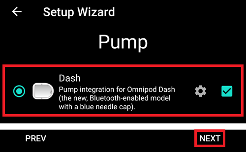

Ако не сте сигурни, можете също да изберете „Virtual Pump" и да изберете „DASH" по-късно, след настройката на **AAPS** (вижте опция 2).

(omnipod-dash-option-2-config-builder)=
### Опция 2: Конфигурация

При съществуваща инсталация можете да изберете помпата **DASH** от Конфигурация:

В горния ляв ъгъл, в **hamburger menu**, изберете **Конфигурацияr (1)** ➜ **Помпа** ➜ **Dash** ➜ **Зъбното колело (3)**, като изберете **радио бутона (2)**, озаглавен **Dash**.

Отметването на **квадратчето (4)** до **Зъбното колело (3)** ще позволи менюто DASH да се показва като раздел (tab) в интерфейса на **AAPS**, озаглавен **DASH**. Отметването на това квадратче ще улесни достъпа ви до командите на DASH при използване на **AAPS**.

**ЗАБЕЛЕЖКА:** По-бърз начин за достъп до [**настройките на Dash**](#omnipod-dash-settings) можете да намерите по-долу в раздела за настройките на DASH в този документ.

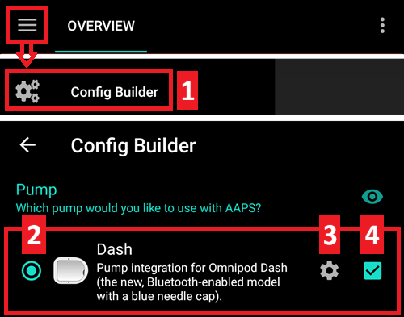

### Проверка на избора на драйвер за Omnipod

За да проверите, че сте избрали DASH в **AAPS**, ако сте **отметнали квадратчето (4)**, **плъзнете наляво** от раздела **Общ**, където сега ще видите раздел **DASH** в **AAPS**. Ако това квадратче е оставено неотметнато, ще намерите раздела DASH в hamburger menu горе вляво.

## Конфигурация на Dash

**Плъзнете наляво** до [**раздела DASH**](#omnipod-dash-tab), където ще можете да управлявате всички функции на пача (някои от тези функции не са активирани или видими без активна сесия на пач):

 'Опресни' – опреснява свързаността и статуса на пача, позволява заглушаване на алармите на пача, когато той издава звуков сигнал

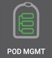   'Управление на под' (активиране, деактивиране, тестов звуков сигнал и история на пача)

(omnipod-dash-activate-pod)=

### Активиране на пач/под

1. Отидете в раздела **DASH** и натиснете бутона **POD MGMT (1)**, след което натиснете **Activate Pod (2)**.

   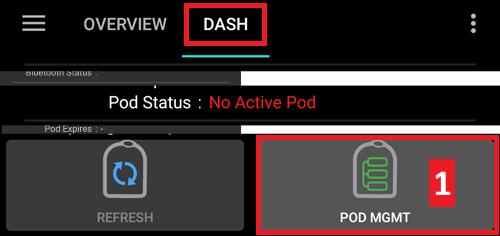

   

2. Показва се екранът **Пълнене на под**. Напълнете нов пач с **поне 80 единици** инсулин и се вслушайте за два звукови сигнала, показващи, че пачът е готов за подготовка (priming).

   ***ЗАБЕЛЕЖКА:** При изчисляване на общото количество инсулин, необходимо за 3 дни, имайте предвид, че подготовката (priming) на пача ще използва около 3-10 единици.*

   

   

   Уверете се, че новият пач и телефонът, на който работи **AAPS**, са в непосредствена близост един до друг, и натиснете бутона **Next**.

   ***ЗАБЕЛЕЖКА**: ако се появи съобщението за грешка по-долу _'Could not find an available pod for activation'_ (това може да се случи), не се притеснявайте. Натиснете бутона **Retry**. В повечето случаи активирането ще продължи успешно.*

   

3. На екрана **Инициализирай под**, пачът ще започне подготовка (priming) (ще чуете щракване, последвано от серия тиктакащи звуци, докато пачът се подготвя). Ще се появи зелена отметка при успешна подготовка, и бутонът **Следващ** ще се активира. Натиснете бутона **Следващ**, за да завършите подготовката на пача и да се покаже екранът **Прикрепете под**.

       

4. След това подгответе мястото за поставяне на новия под. Измийте ръцете си, за да избегнете риск от инфекция. Почистете мястото за поставяне със сапун и вода или с алкохолна кърпичка за дезинфекция и оставете кожата да изсъхне напълно на въздух, преди да продължите.   
   Ако получите кожно дразнене от лепилото, обмислете използването на Barrier Wipe или Barrier Spray.

   Отстранете синята пластмасова капачка на иглата на пода. Ако видите нещо, което стърчи от пача, или изглежда необичайно, **СПРЕТЕ** процеса и започнете с нов под. Ако всичко изглежда наред, продължете, като отстраните бялата хартиена подложка от лепилото и залепите пода на избраното място на тялото си.

   Когато приключите, натиснете бутона **Следващ**.

   

6. Ще се появи диалоговият прозорец **Поставете под**. **натиснете бутона OK САМО ако сте готови да пуснете канюлата!**

   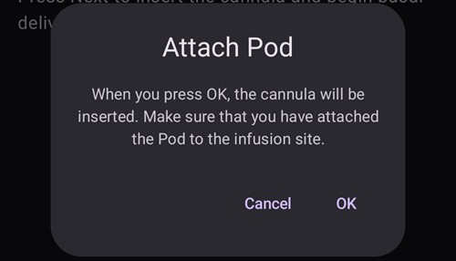

7. След като натиснете **OK**, може да отнеме известно време, преди DASH да отговори и да въведе канюлата (максимум 1-2 минути). **Бъдете търпеливи!**

   ****ЗАБЕЛЕЖКА:** Преди канюлата да бъде въведена, добра практика е да прищипнете кожата близо до мястото на въвеждане на канюлата. Това осигурява плавно въвеждане на иглата и намалява риска от развитие на оклузии.*

       

8. На екрана се показва зелена отметка и бутонът **Следващ** става достъпен за избор при успешно въвеждане на канюлата   
   . Натиснете бутона **Следващ**.

   

1. Показва се екранът **Под активиран**.

   Натиснете зеления бутон **Готово**.

   Поздравления! Вече сте стартирали нова сесия на пач/под.

   

2. Менюто **Pod management** сега трябва да показва бутона **Активирай под(1)** като *деактивиран*, а бутона **Деактивирай под(2)** – като *активиран*. Това е така, защото сега има активен пач и не можете да активирате допълнителен пач, без първо да деактивирате текущо активния.

    Натиснете бутона за връщане назад на телефона си, за да се върнете на екрана на раздела **DASH**, който сега ще показва информация за активната ви сесия на пач, включително текущия базален темп, нивото на резервоара на пача, доставения инсулин, грешки и предупреждения на пача.

    ***ЗАБЕЛЕЖКА:** За повече подробности относно показваната информация вижте раздела [**DASH таб**](#omnipod-dash-tab) на този документ.*

   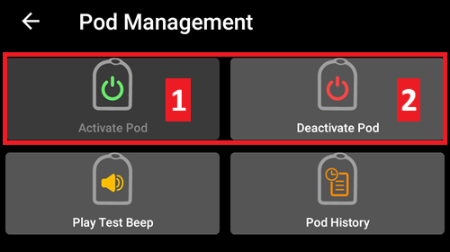

   

   ****ЗАБЕЛЕЖКА:** Добра практика е да експортирате настройките СЛЕД активирането на пача. Настройките трябва да се експортират след всяка смяна на пач и веднъж месечно; уверете се, че копирате експортирания файл с настройки на място в облака (напр. Google Drive) или някъде извън телефона си, в случай че го изгубите (вижте [**Export settings**](../Maintenance/ExportImportSettings.md)).*

(omnipod-dash-deactivate-pod)=

### Деактивиране на пач/под

При нормални обстоятелства очакваният живот на пача е три дни (72 часа) плюс допълнителни 8 часа след предупреждението за изтичане на срока, за общо 80 часа използване на пача.

За да деактивирате пач (било то поради изтичане на срока или поради повреда на пача):

1. Отидете в раздела **DASH**, натиснете бутона **POD MGMT (1)**, на екрана **Pod Management** натиснете бутона **Деактивирай под (2)**.

   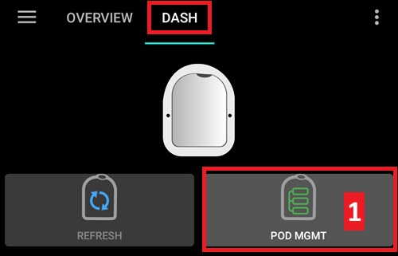

   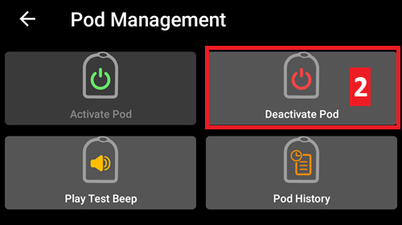

2. На екрана **Деактивирай под** натиснете бутона **Следващ**, за да започнете процеса на деактивиране на пача.

   Ще получите потвърждаващ звуков сигнал от пача, че деактивирането е успешно.

   

   

3. При успешно деактивиране ще се покаже зелена отметка. Натиснете бутона **Следващ**, за да се покаже екранът за деактивиран пач.

   Вече можете да премахнете пача, тъй като активната сесия е деактивирана.

   

4. Натиснете зеления бутон, за да се върнете на екрана **Управление на под**.

   

5. Сега сте в менюто **Управление на под**; натиснете бутона за връщане назад на телефона си, за да се върнете в раздела **DASH**.

   Проверете дали полето **Под статус:** показва съобщение **Няма активен под**.

   

   

(omnipod-dash-resuming-insulin-delivery)=

### Възобновяване на доставката на инсулин

</strong>ЗАБЕЛЕЖКА</strong>: По време на **смяна на профили (Профил Switches)**, както при използване на PDM, AAPS трябва да спре доставката на инсулин от пача, преди да зададе новия базален **Профил</0>. Ако комуникацията между командите за спиране и възобновяване се провали, доставката може да остане спряна. Прочетете [**Спряна доставка**](#omnipod-dash-delivery-suspended) в раздела за отстраняване на проблеми за повече подробности.

Когато доставката на инсулин е спряна, ще трябва да изпратите команда, инструктираща активния, в момента спрян пач, да възобнови доставката на инсулин. След като командата бъде успешно обработена, инсулинът ще възобнови нормалната доставка, използвайки текущия базален темп според текущия час от активния базален **Профил**. Пачът отново ще приема команди за болус, **TBR** и **SMB**.

1. Отидете в раздела **DASH** и се уверете, че полето **Статус на под (1)** показва **SUSPENDED**, след което натиснете бутона **RESUME DELIVERY (2)**, за да стартирате процеса, инструктиращ текущия пач да възобнови нормалната доставка на инсулин. Съобщение **RESUME DELIVERY** ще се покаже в полето **Pod Status (3)**.

      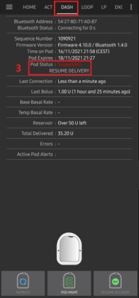

2. Когато командата за възобновяване на доставката е успешна, ще се покаже потвърждаващ диалогов прозорец със съобщение **Insulin delivery has been resumed**. Натиснете **OK**, за да потвърдите и продължите.

   

3. Разделът **DASH** ще обнови полето **Статус на под (1)** да показва **RUNNING**, и бутонът **Resume Delivery** вече няма да се показва

   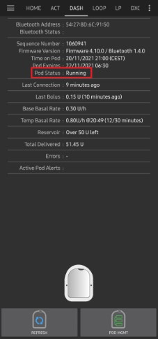

(omnipod-dash-silencing-pod-alerts)=

### Заглушаване на предупрежденията от пача

Процесът по-долу ще ви покаже как да потвърдите и отхвърлите звуковите сигнали на пача, когато времето на активния пач достигне предупредителния времеви лимит преди изтичането на срока от 72 часа (3 дни). Този предупредителен времеви лимит е дефиниран в настройката на Dash за предупреждения **Hours before shutdown**. Максималният живот на пача е 80 часа (3 дни и 8 часа), но Insulet препоръчва да не се превишава лимитът от 72 часа (3 дни).

***ЗАБЕЛЕЖКА**: Бутонът **SILENCE ALERTS (3)** е наличен в раздела **DASH** само когато предупреждението за изтичане на срока или ниския резервоар е задействано. Ако бутонът **SILENCE ALERTS** не се вижда, а чувате звукови сигнали от пача, опитайте да „опресните статуса на пача" (Refresh pod status).*

1. Когато бъде достигнат зададеният предупредителен времеви лимит **Hours before shutdown**, пачът ще издаде предупредителни звукови сигнали, за да ви информира, че наближава изтичане на срока си и скоро ще е необходима смяна на пача. Можете да проверите това в раздела **DASH** – полето **Pod expires: (1)** ще показва точния час, в който пачът ще изтече (72 часа след активирането), а текстът ще стане **червен**, след като този час е изминал. Под полето **Active Pod alerts (2)** се показва статусно съобщение **Pod will expire soon**. Това също ще задейства показването на бутона **SILENCE ALERTS (3)**.

   

2. Това също ще задейства показването на бутона **SILENCE ALERTS (2)**. **AAPS** изпраща команда до пача да деактивира звуковите сигнали за предупреждение за изтичане на срока и обновява полето **Статус на под (1)** с **ACKNOWLEDGE ALERTS**.

   

3. При **успешно деактивиране** на предупрежденията, активният пач ще издаде **2 звукови сигнала** и ще се покаже потвърждаващ диалогов прозорец със съобщение **Activate alerts have been Silenced**. Натиснете бутона **OK**, за да потвърдите и затворите прозореца.

   

4. Отидете в раздела **DASH**. Под полето **Active Pod alerts**, предупредителното съобщение вече не се показва, а активният пач вече няма да издава предупредителни звукови сигнали за изтичане на срока.

(omnipod-dash-view-pod-history)=

### Преглед на историята на пача

Този раздел обяснява как да прегледате историята на активния си пач и да филтрирате по различни категории действия. Инструментът за история на пача ви позволява да видите действията и резултатите, извършени с текущо активния ви пач по време на неговите три дни (72 – 80 часа) живот.

Тази функция е полезна за проверка на болуси, TBR и базални команди, изпратени до пача. Останалите категории са полезни за отстраняване на проблеми и определяне на реда на събитията, довели до дадена повреда.

***ЗАБЕЛЕЖКА:** **Само последната команда може да бъде „несигурна" (uncertain)**. Нови команди *няма да бъдат изпращани*, докато **последната „несигурна" команда не стане „потвърдена" (confirmed) или „отказана" (denied)**. Начинът за „поправяне" на несигурни команди е чрез **„опресняване на статуса на пача"**.*

1. Отидете в раздела **DASH** и натиснете бутона **POD MGMT (1)**, за да влезете в менюто **Pod Management**, след което натиснете бутона **Pod history (2)**, за да влезете в екрана с историята на пача.

     
   

2. На екрана **Pod history** се показва категорията по подразбиране **All (1)**, показваща **дата и час (2)** на всички **действия (3)** и **резултати (4)** на пача в обратен хронологичен ред. Използвайте бутона за връщане назад на телефона си **2 пъти**, за да се върнете в раздела **DASH** в основния интерфейс на **AAPS**.

    

(omnipod-dash-tab)=

## Раздел DASH

По-долу е обяснението на оформлението и значението на иконите и статусните полета в раздела **DASH** в основния интерфейс на AAPS.

***ЗАБЕЛЕЖКА:** Ако в статусните полета на раздела **DASH** се показва каквото и да е съобщение (uncertain), ще трябва да натиснете бутона Refresh, за да го изчистите и опресните статуса на пача.*

### Полета

- **Bluetooth Address:** Показва текущия Bluetooth адрес на свързания пач.

- **Bluetooth Status:**  Показва текущия статус на връзката.

- **Sequence Number:** Показва серийния номер на активния ПАЧ.

- **Firmware Version:** Показва версията на firmware за активната връзка.

- **Time on Pod:** Показва текущото време на пача.

- **Pod status:** Показва статуса на пача.

- **Last connection:** Показва часа на последната комуникация с пача.

  - *Moments ago* - преди по-малко от 20 секунди.

  - *Less than a minute ago* - преди повече от 20 секунди, но по-малко от 60 секунди.

  - *1 minute ago* - преди повече от 60 секунди, но по-малко от 120 секунди (2 мин)

  - *XX minutes ago* - преди повече от 2 минути, както е дефинирано от стойността на XX

- **Last bolus:** Показва количеството на последния болус, изпратен до активния пач, и колко отдавна е бил зададен (в скоби).

- **Base Basal rate:** Показва базалния темп, програмиран за текущия час от профила на базалния темп.

- **Temp basal rate:** Показва текущо изпълнявания временен базален темп (Temporary Basal Rate) в следния формат
  - {единици на час} @{час на начало на TBR}  ({изминали минути}/{общо минути, за които ще се изпълнява TBR})

  - Пример:* 0.00Ед/ч @18:25 ( 90/120 минути)

- **Reservoir:** Показва „над 50 оставащи единици", когато в резервоара остават повече от 50 единици. Под 50 Ед се показват точните единици.

- **Total delivered:** Показва общия брой единици инсулин, доставени от резервоара. Това включва инсулина, използван за активиране и подготовка (priming).

- **Errors:** Показва последната възникнала грешка. Прегледайте [Pod history](#omnipod-dash-view-pod-history) и лог файловете за минали грешки и по-подробна информация.

- **Active pod alerts:** Запазено за в момента активни предупреждения на активния пач.

### Бутони

 Изпраща команда за опресняване към активния пач, за да обнови комуникацията.

  - *Използвайте, за да опресните статуса на пача и да отхвърлите статусните полета, съдържащи текст (uncertain).*

  - *Вижте раздел [Отстраняване на проблеми](#omnipod-dash-troubleshooting) по-долу за допълнителна информация.*

   Навигира до менюто за управление на пача.

 При натискане това ще деактивира звуковите сигнали и известията за предупреждения на пача (изтичане на срока, нисък резервоар и др.).

  - *Бутонът се показва само когато времето на пача е преминало предупредителния час за изтичане на срока.*
  -  *При успешно отхвърляне тази икона вече няма да се показва.*

    Възобновява текущо спряната доставка на инсулин в активния пач.

### Меню Pod Management

По-долу е описано предназначението на всяка икона в менюто **Pod Management**, достъпно чрез натискане на бутона **POD MGMT (1)** в раздела **DASH**.

**Таблицата по-долу описва всеки бутон и неговата функция:**

| Бутон | Функция                                                                                              |
| ----- | ---------------------------------------------------------------------------------------------------- |
| 1     | Достъп до настройките на Pod Mgmt                                                                    |
| 2     | [**Activate Pod**](#omnipod-dash-activate-pod): Подготвя (prime) и активира нов пач.                 |
| 3     | [**Deactivate Pod**](#omnipod-dash-deactivate-pod): Деактивира текущо активния пач.                  |
| 4     | **Play Test Beep**: При натискане пачът издава единичен тестов звуков сигнал.                        |
| 5     | [**Pod history**](#omnipod-dash-view-pod-history): Показва историята на активността на активния пач. |

(omnipod-dash-settings)=

## Настройки на Dash

Настройките на драйвера Dash се конфигурират от **Хамбургер менюто** горе вляво, в **Конфигурация (1)** ➜ **Помпа**  **Dash** ➜ **Зъбното колело (3)**, като изберете **радио бутона (2)**, озаглавен **Dash**. Отметването на **квадратчето (4)** до **Зъбното колело (3)** ще позволи менюто Dash да се показва като раздел (tab) в интерфейса на **Aaps**, озаглавен **Dash**.

***ЗАБЕЛЕЖКА:** По-бърз начин за достъп до **настройките на Dash** е чрез менюто с **3 точки (1)** в горния десен ъгъл на раздела **DASH** и избиране на **Dash опции(2)** от падащото меню.*

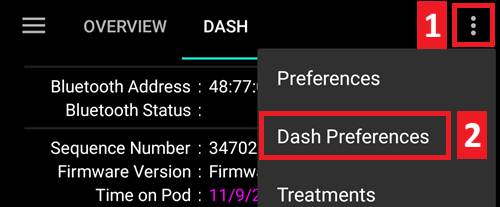

Групите настройки са изброени по-долу; можете да активирате или деактивирате повечето от описаните по-долу елементи чрез превключвател:

***ЗАБЕЛЕЖКА:** Звездичка (\*) означава, че настройката по подразбиране е активирана.*

### Потвърждаващи звукови сигнали

Осигурява потвърждаващи звукови сигнали от пача за доставка и промени на болус, базал, SMB и TBR.

**Bolus beeps enabled:**    Активиране или деактивиране на потвърждаващи звукови сигнали при доставяне на болус.

**Basal beeps enabled:**    Активиране или деактивиране на потвърждаващи звукови сигнали при задаване на нов базален темп, отмяна на активния базален темп или промяна на текущия базален темп.

**SMB beeps enabled:**  Активиране или деактивиране на потвърждаващи звукови сигнали при доставяне на SMB.

**TBR beeps enabled:**  Активиране или деактивиране на потвърждаващи звукови сигнали при задаване или отмяна на TBR.

### Предупреждения (Alerts)

Осигурява предупреждения от **AAPS** за изтичане на срока на пача, спиране и нисък резервоар, базирани на дефинираните прагови стойности.

***ЗАБЕЛЕЖКА:** Известие от AAPS ВИНАГИ ще бъде издавано за всяко предупреждение след първоначалната комуникация с пача, откакто предупреждението е било задействано. Отхвърлянето на известието НЯМА да отхвърли предупреждението, ОСВЕН ако не е активирано автоматично потвърждаване на предупрежденията от пача. За РЪЧНО отхвърляне на предупреждението трябва да отидете в раздела **DASH** и да натиснете бутона **Silence ALERTS**.*

**Expiration reminder enabled:**    Активиране или деактивиране на напомнянето за изтичане на срока на пача, зададено да се задейства при достигане на дефинирания брой часове преди спирането.

**Hours before shutdown:**  Дефинира броя часове преди настъпването на спирането на активния пач, което впоследствие ще задейства предупреждението за напомняне за изтичане на срока.

**Low reservoir alert enabled:**    Активиране или деактивиране на предупреждение, когато оставащите единици в пача достигнат зададения лимит за нисък резервоар, дефиниран в полето Number of units.

**Number of units:**    Броят единици, при които да се задейства предупреждението за нисък резервоар на пача.

### Известия (Notifications)

Разделът Notifications позволява на потребителя да избере предпочитаните известия и звукови сигнали на телефона, когато AAPS не е сигурен относно статуса на TBR, SMB или болус, както и когато събитията за спряна доставка са били успешни.

***ЗАБЕЛЕЖКА:** Това са само известия – не се издават звукови сигнали.*

**Sound for uncertain TBR notifications enabled:**  Активиране или деактивиране на тази настройка, за да се задейства звуково предупреждение и визуално известие, когато **AAPS** не е сигурен дали TBR е бил успешно зададен.

**Sound for uncertain SMB notifications enabled:**  Активиране или деактивиране на тази настройка, за да се задейства звуково предупреждение и визуално известие, когато **AAPS** не е сигурен дали SMB е бил успешно доставен.

**Sound for uncertain bolus notifications enabled:**    Активиране или деактивиране на тази настройка, за да се задейства звуково предупреждение и визуално известие, когато **AAPS** не е сигурен дали болус е бил успешно доставен.

**Sound when delivery suspended notifications enabled:**    Активиране или деактивиране на тази настройка, за да се задейства звуково предупреждение и визуално известие, когато спирането на доставката е било успешно извършено.

## Раздел Действия (ACT)

Този раздел е добре документиран в основната документация на **AAPS**, но има няколко елемента в него, специфични за начина, по който DASH се различава от помпите с тръбичка (tube-based), особено след процеса на прилагане на нов пач.

1. Отидете в раздела **Действия (ACT)** в основния интерфейс на **AAPS**.

2. В раздела **Careportal (1)**, полетата **Инсулин** и **Канюла** ще имат своята **възраст нулирана** до 0 дни и 0 часа **след всяка смяна на пач**. Това се прави заради начина, по който е изградена и работи помпата Omnipod. Тъй като пачът въвежда канюлата директно в кожата на мястото на поставяне на пача, в помпите Omnipod не се използва традиционна тръбичка. *Затова след смяна на пач възрастта на всяка от тези стойности автоматично се нулира.***Pump battery age** не се показва, тъй като батерията в пача винаги е с живот, по-дълъг от живота на самия пач (максимум 80 часа). **Батерията на помпата** и **резервоарът за инсулин** са вградени в самия пач.

   

### Ниво (Level)

**Ниво на инсулина**

Показаното ниво на инсулин е количеството, докладвано от DASH. Пачът обаче докладва действителното ниво на резервоара с инсулин само когато то е под 50 единици. Дотогава се показва „Над 50 единици". Докладваното количество не е точно: когато пачът докладва „empty" (празен), в повечето случаи в резервоара все още остават някои допълнителни единици инсулин.

Раздел DASH overview ще показва следното:

  * **Над 50 единициs** - Пачът докладва, че в момента в резервоара има повече от 50 единици.
  * **Под 50 Единици** - Количеството инсулин, оставащо в резервоара, както е докладвано от пача.

Допълнителна забележка:
  * **SMS** - Връща стойност или 50+U при SMS отговори
  * **Nightscout** - Качва стойност 50, когато има над 50 единици, към Nightscout (версия 14.07 и по-стари).  По-новите версии ще докладват стойност 50+ при над 50 единици.

(omnipod-dash-known-issues-workarounds)=

## Заобикаляне на известни проблеми

Този раздел обхваща често срещани заобиколни решения и настройки, които трябва да бъдат променени, за да заработи дадена функция в отговор на докладван от общността проблем, за който има решение. Напр. Например, процесът за активиране на Basal drift fix е документиран тук.

(omnipod-dash-basal-drift-fix)=

### Инструкции за поправка на Basal Drift (Basal Drift Fix)

Помпата Omnipod Dash има ограничение, което може да доведе до доставяне на по-малко базален инсулин от очакваното от **AAPS** – вижте [Issue #4783](https://github.com/nightscout/AndroidAPS/issues/4783) за повече технически подробности.

Dash използва вътрешен таймер, за да определи кога се доставя базален импулс от 0.05 U. След изтичане на интервала на таймера, импулсът се стартира. Този таймер обаче се рестартира всеки път, когато настъпи промяна в базалния темп, напр. когато **AAPS** изпрати нов базален темп.

Когато се използва в комбинация с looping, това води до недостатъчна доставка на базален инсулин, тъй като алгоритъмът често обновява базалния темп на помпата.

Проблемът е най-забележим през нощта. През деня SMB често водят до базален темп от 0, което маскира ефекта. При наблюдавана употреба това води до недоставяне на приблизително 10% от очакваната обща дневна доза (Total Daily Dose, TDD) за период от 24 часа. Освен това целите за глюкоза често не се постигат през нощта, особено след хранения с продължителен ефект върху глюкозата (напр. паста).

***ЗАБЕЛЕЖКА:** Важно е този проблем да бъде разбран особено от хора с много малки дози инсулин, например деца.*

(omnipod-dash-drift-compensation-how-it-works)=

#### How the drift compensation works

The pod delivers insulin in pulses of 0.05 U. When the drift compensation is enabled, **AAPS** checks that the pod has really delivered the basal insulin it was asked to deliver, and adds the missing pulses.

1. **AAPS** keeps a running total of the basal insulin the pod _should_ have delivered since activation. This total follows your profile basal rates and every temporary basal rate the loop sets.
2. Each time the pod reports its status, **AAPS** compares this total with the basal insulin the pod _actually_ delivered: the pod's total pulse count, minus the pulses delivered as boluses and SMBs.
3. Each time **AAPS** sets or cancels a temporary basal rate, it looks at the difference. If the pod is behind by half a pulse (0.025 U) or more, **AAPS** sends one extra pulse of 0.05 U. The pod delivers it silently, without beeps.

**Safety limits:**

- **AAPS** only adds insulin that the pod owes. It never removes insulin, and it does nothing when the pod is ahead.
- One pulse at a time, at most one every 2 minutes.
- No pulse while the loop runs a zero temporary basal rate, because the loop asked for no insulin. The exception is the 5 minutes after a bolus, when a zero temporary basal rate is usually just the loop compensating for an SMB.
- No pulse while a pod is being activated, while delivery is suspended, after a pod fault, while a bolus is running, or if the reservoir is empty.
- If the difference ever reaches 2 pulses (0.10 U), in either direction, **AAPS** does not try to catch up. It resets its running total to what the pod has really delivered.

**What you will see:**

- On the **DASH** tab, **Last Bolus** can show **0.05 U** even if you did not give a bolus.
- In the [Pod history](#omnipod-dash-view-pod-history), the extra pulses appear as **Set Bolus 0.05 U**, usually right after a **Set Temporary Basal** line. See the example in [Check that the drift compensation is working](#omnipod-dash-drift-compensation-check) below.
- The extra pulses are **not** recorded as boluses or SMBs in **AAPS** treatments, and they do not change your IOB. This is expected: **AAPS** already counted this insulin as basal. The extra pulses only make the pod deliver what **AAPS** thinks was delivered.

#### Активиране на Basal Drift Fix в AAPS

Трябва да използвате версия 3.4.2.3 или по-нова на AAPS за тази функция.

Basal Drift Fix не е активирана по подразбиране в AAPS.

**За да я активирате:**

1. Създайте празен файл с име `omnipod_drift_compensation` (2) в подпапка `extra` (1) на [директорията на AAPS](#preferences-maintenance-settings) на вашия телефон.

   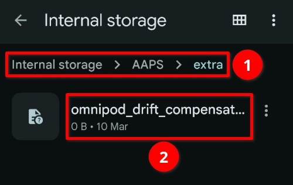

   ***ЗАБЕЛЕЖКА:** Уверете се, че проверявате в настройките на AAPS къде се намира вашата директория на AAPS, и че сте поставили файла в правилната – редица хора са допуснали грешка, поставяйки файла в грешната папка.*

2. Рестартирайте **AAPS**. Това трябва да бъде направено, за да разпознае, че файлът присъства, и да активира функцията за компенсация на дрейфа.
3. Моля, посетете [Github issue #4783](https://github.com/nightscout/AndroidAPS/issues/4783) на първия пост, за да покажете, че използвате тази функция – нуждаем се от тези данни, за да покажем, че функцията е широко използвана. След като има значително възприемане от общността, ще бъде възможно премахването на файла за активиране – ще ви бъдем благодарни за подкрепата тук.

(omnipod-dash-drift-compensation-check)=

#### Check that the drift compensation is working

Compare what the pod delivered over a full day with what **AAPS** counted for the same day. Pick a day that is over: the check needs the full 24 hours.

1. Go to the **DASH** tab (1) and press **POD MGMT** (2), then press **Pod history**. See [View Pod History](#omnipod-dash-view-pod-history).

   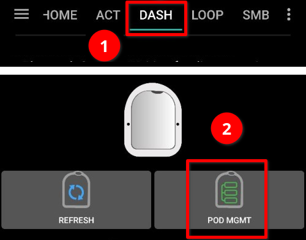

2. Note the **Total delivered** value of the entry closest to 00:00 at the start of the day (3), and of the entry closest to 24:00 at the end of the day (4). The difference is the insulin the pod delivered that day.

   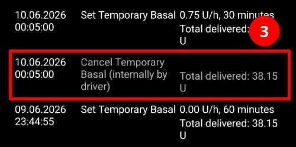   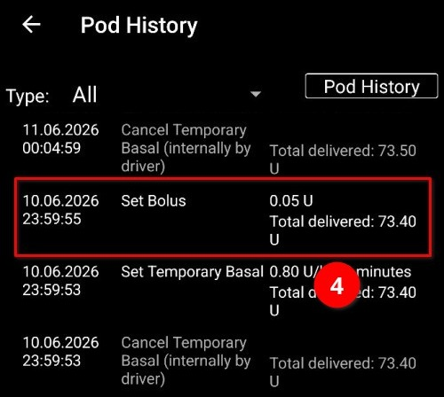

   In this example: 73.40 U (4) − 38.15 U (3) = 35.25 U delivered by the pod.

3. Open the [AAPS statistics](#reviewing-statistics) and find the same day in the **TDD** table. Note the total in the **∑** column (5).

   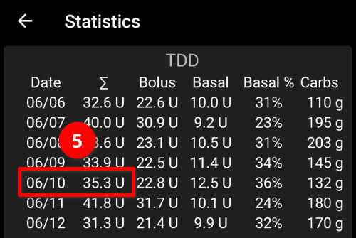

4. Compare the two values. With the drift compensation working, they should differ by no more than 0.05 U. Without it, the pod total is usually clearly lower than the **AAPS** TDD.

   In this example, the **AAPS** TDD is 35.3 U and the pod delivered 35.25 U: the drift compensation is working.

***NOTE:** The **Pod history** only covers the active pod. If you changed pods during the day, choose another day.*

## Отстраняване на проблеми

(omnipod-dash-troubleshooting)=

Този раздел обхваща често срещани известни проблеми и решения за използването на Omnipod DASH с AAPS. В документацията има и раздел [General Troubleshooting](../GettingHelp/GeneralTroubleshooting.md), който също трябва да бъде прегледан, тъй като покрива теми, релевантни и за някои проблеми с пача.

---

(omnipod-dash-bluetooth-related-issues)=

## **Проблеми, свързани с Bluetooth**

За известни проблеми с Bluetooth връзките, прекъсвания на помпата/пачовете, или проблеми с активирането и връзката вижте [Отстраняване на проблеми с Bluetooth](../GettingHelp/BluetoothTroubleshooting.md)

---

(omnipod-dash-delivery-suspended)=

### Спряна доставка

  - Вече няма бутон за спиране (suspend). Ако искате да „спрете" пача, можете да зададете нулев **TBR** за x минути.
  - По време на **смени на профил (Профил Switches)**, DASH трябва да спре доставката, преди да зададе новия базален **Профил**. Ако комуникацията между двете команди се провали, доставката може да остане спряна. Когато това се случи:
     - Няма да има доставка на инсулин – това включва базал, SMB, ръчно болусиране и т.н.
     - Може да има известие, че една от командите е непотвърдена: това зависи от момента, в който е настъпил проблема.
     - **AAPS** ще опитва да зададе новия базален профил на всеки 15 минути.
     - **AAPS** ще показва известие, информиращо, че доставката е спряна, на всеки 15 минути, ако доставката все още е спряна (възобновяването на доставката се е провалило).
     - Бутонът [**Resume delivery**](#omnipod-dash-resuming-insulin-delivery) ще бъде активен, ако потребителят избере да възобнови доставката ръчно.
     - Ако **AAPS** не успее сам да възобнови доставката (това се случва, ако пачът е недостъпен, звукът е заглушен и т.н.), пачът ще започне да издава 4 звукови сигнала на всяка минута в продължение на 3 минути, а след това ще се повтаря на всеки 15 минути, ако доставката все още е спряна за повече от 20 минути.
  - За непотвърдени команди, „опресняване на статуса на пача" трябва да ги потвърди/отхвърли.

***</strong>ЗАБЕЛЕЖКА:</0> Когато чуете звукови сигнали от пача, не приемайте, че доставката ще продължи, без да проверите телефона – доставката може да остане спряна, ***затова трябва да проверите!******

---
### Повреди на пача

- Пачовете от време на време се повреждат поради различни причини, включително хардуерни проблеми със самия пач.
- Добра практика е да не подавате рекламации за замяна към Insulet, тъй като AAPS не е одобрен метод за използване на пачовете.
- Списък с кодове за грешки може да бъде [**намерен тук**](https://github.com/openaps/openomni/wiki/Fault-event-codes), за да ви помогне да определите причината.

---
### Предотвратяване на повреди с грешка 49 на пача

Тази повреда е свързана с неправилно състояние на пача за дадена команда или грешка по време на команда за доставяне на инсулин. Това се случва, когато драйверът и пачът не са съгласни относно реалното състояние. Пачът (от вградена мярка за безопасност) тогава реагира с невъзстановим код за грешка 49 (0x31), завършвайки с това, известно като „screamer": дълъг дразнещ звуков сигнал, който може да бъде спрян само чрез пробиване на отвор на съответното място на гърба на пача. Точният произход на „повреда 49 на пача" често е трудно да се проследи. В ситуации, за които се подозира, че могат да предизвикат тази повреда (например при срив на приложението, работа с версия за разработка (development version) или преинсталиране).

---

### Предупреждения за недостъпност на помпата (Pump Unreachable Alerts)

Когато не може да се установи комуникация с пача за предварително конфигуриран период, ще се задейства предупреждение „Pump unreachable". Предупрежденията за недостъпност на помпата могат да се конфигурират чрез менюто с трите точки горе вдясно, избирайки **Опции ** ➜ **Локални аларми** ➜ **Недостъпна помпа [мин]**. Препоръчителна стойност е предупреждение след **120** минути.

---
### Експортиране на настройки

Експортирането на настройките на **AAPS** ви позволява да възстановите всичките си настройки, а може би най-важното – всичките си Цели. Може да се наложи да възстановите настройки до „последното известно работещо състояние" или след деинсталиране/преинсталиране на **AAPS**, или в случай на загуба на телефона, при преинсталиране на нов телефон.

*</strong>ЗАБЕЛЕЖКА:</0> Информацията за активния пач е включена в експортираните настройки. Ако импортирате „стар" експортиран файл, реалният ви пач ще „умре". Няма друга алтернатива. В някои случаи (като _планирана_ смяна на телефона) може да се наложи да използвате експортирания файл, за да възстановите настройките на **AAPS**, **като запазите текущо активния пач**. В този случай е важно да използвате само наскоро експортирания файл с настройки, съдържащ текущо активния пач.*

</strong>Добра практика е да направите export веднага след активиране на пач</0>. По този начин винаги ще можете да възстановите текущо активния пач в случай на проблем. Например при преминаване на друг резервен телефон.

Редовно (по възможност след всеки export) копирайте експортираните си настройки на сигурно място (облачно хранилище, напр. Google Drive), достъпно от всеки телефон при нужда. Това ви позволява да възстановите на телефон отвсякъде в случай на загуба на телефон или фабрично нулиране на телефона ви, докато не сте вкъщи.

---
### Импортиране на настройки

**ПРЕДУПРЕЖДЕНИЕ**: Моля, имайте предвид, че импортирането на настройки може да импортира остарял статус на пача (в зависимост от това кога е направен последният експорт/backup).  
В резултат съществува **риск от загуба на активния пач!** (вижте **Експорт настройки**).
1. Опитвайте импортиране само когато няма други налични опции.
2. При импортиране на настройки с активен пач, уверете се, че export-ът е направен с текущо активния пач.

**Импортиране докато има активен пач:** (рискувате да загубите пача!)

1. **Уверете се, че импортирате настройки, които са били наскоро експортирани с текущо активния пач!**
2. Импортирайте настройките си.
3. Проверете всички настройки.

**Импортиране (без активна сесия на пач)**

1. Импортирането на всеки скорошен export трябва да работи (вижте по-горе)
2. Импортирайте настройките си.
3. Проверете всички настройки.
4. Може да се наложи да **Деактивирате** „несъществуващия" пач, ако импортираните настройки са включвали данни за активен пач.

---
### Импортиране на настройки, съдържащи статус на пач от неактивен пач

При импортиране на настройки, съдържащи данни за пач, който вече не е активен, AAPS ще опита да се свърже с него, което очевидно ще се провали. В тази ситуация не можете да активирате нов пач.

За да премахнете старата сесия на пача:
1. „Опитайте" да деактивирате пача. Деактивирането вероятно ще се провали.
2. Изберете „Отново".
3. След втория или третия опит ще получите опция за премахване на пача.
4. След като старият пач бъде премахнат, ще можете да активирате нов пач.

### Обща грешка: java.lan.illegalStateException: Trying to set a Bluetooth Address to ***, but it is already set to ***.

Ако получите тази грешка при опит за инициализиране на нов пач, **AAPS** отказва, защото все още има съхранени настройки за стар пач в конфигурацията.

Това може да се случи, ако възстановявате от backup, или ако деактивирането на пач се провали.

За да разрешите проблема, продължавайте да натискате `Отново`, докато се покаже опция `Discard`, след което изберете discard. Тази процедура трябва да работи и за деактивиране на пач.

Сега трябва да можете да активирате нов пач.

---
### Преинсталиране на AAPS

При деинсталиране на **AAPS** ще загубите всичките си настройки, цели и текущата сесия на пача. **За да ги възстановите, уверете се, че имате наличен скорошен експортиран файл с настройки!**

Когато имате активен пач, уверете се, че имате експорт за текущата сесия на пача, в противен случай ще загубите текущо активния пач при импортиране на по-стари настройки.

1. Експортирайте настройките си и запазете копие на сигурно място (напр. Google Drive).
2. Деинсталирайте **AAPS** и рестартирайте телефона си.
3. Инсталирайте новата версия на **AAPS**.
4. Импортирайте настройките си.
5. Проверете всички настройки(по избор импортирайте настройките отново).
6. Активирайте нов пач.
7. Когато приключите: Експортирайте текущите настройки.

---
### Обновяване на AAPS до по-нова версия

В повечето случаи не е необходимо деинсталиране. Можете да направите инсталация „на място" (in-place), като стартирате инсталацията за новата версия. Това е възможно и при активна сесия на пач.

1. Експортирайте настройките си.
2. Инсталирайте новата версия на **AAPS**.
3. Проверете дали инсталацията е успешна
4. ВЪЗОБНОВЕТЕ (RESUME) пача или активирайте нов пач.
5. Когато приключите: Експортирайте текущите настройки.

---
### Предупреждения от драйвера на Omnipod

Драйверът на Omnipod Dash показва разнообразни специфични предупреждения в раздела **Общ**, повечето от които са информационни и могат да бъдат отхвърлени, докато някои изискват действие от страна на потребителя, за да се разреши причината за задействаното предупреждение.

По-долу е обобщение на основните предупреждения, които може да срещнете:

- No active Pod session detected. Това предупреждение може временно да бъде отхвърлено чрез натискане на **Отложи**, но ще продължи да се задейства, докато не бъде активиран нов пач. Once activated this alert is automatically silenced.
- Pod suspended – информационно предупреждение, че пачът е спрян.
- Setting basal **Профил** failed: Delivery might be suspended! Please manually refresh the Статус на под from the Omnipod tab and resume delivery if needed. информационно предупреждение, че задаването на базален **Профил** на пача се е провалило и ще трябва да натиснете *Refresh* в раздела Omnipod.
- Unable to verify whether **SMB** bolus succeeded. If you are sure that the Bolus didn't succeed, you should manually delete the SMB entry from Treatments. предупреждение, че успехът на командата за SMB болус не може да бъде потвърден; ще трябва да проверите полето *Last bolus* в раздела DASH, за да видите дали SMB болусът е успял, и ако не – да премахнете записа от раздела Лечения.
- Ако не сте сигурни, че болус/времен базал/SMB" не е направен, проверете ръчно.

(omnipod-dash-where-to-get-help-for-dash)=

## Къде да получите помощ за DASH

Цялата разработка за DASH се извършва от общността на **доброволни начала**; моля, имайте това предвид и използвайте следните насоки, преди да поискате съдействие:

-  **Ниво 0:** Прочетете съответния раздел от тази документация, за да сте сигурни, че разбирате как трябва да работи функционалността, с която изпитвате затруднения.
-  **Ниво 1:** Ако все още срещате проблеми, които не можете да разрешите с помощта на този документ, моля, отидете в канала *#Medtrum* в **Discord**, като използвате [тази покана](https://discord.gg/4fQUWHZ4Mw). Има и много Facebook и други социални мрежи, в който може да попитате (вижте във [**Получаване на помощ**](../GettingHelp/WhereCanIGetHelp.md))
-  **Ниво 2:** Претърсете съществуващите issues, за да видите дали проблемът ви вече е докладван в [Issues](https://github.com/nightscout/AndroidAPS/issues), ако е направено можете да потвърдете/коментирайте/добавите информация за проблема. Ако не, моля, създайте [нов issue](https://github.com/nightscout/AndroidAPS/issues) и приложете [вашите лог файлове](../GettingHelp/AccessingLogFiles.md).
-  **Бъдете търпеливи – повечето от членовете на нашата общност са добронамерени доброволци, а решаването на проблеми често изисква време и търпение както от потребителите, така и от разработчиците.**

Когато молите за помощ, подгответе следната информация, за да помогнете на общността с конкретните ви въпроси и проблеми:
- Марка и модел на Android телефона
- Версия на Android (напр. 15,16)
  - Наскоро ли обновихте версията на Android OS?
- Версията на **AAPS**, която използвате
- Ясно описание на проблема, с който се сблъсквате, като имате предвид следните неща
   - Работеше ли преди?
   - Кога е работило или не е работило?
   - Направихте ли някакви промени в конфигурацията или настройките на профила?
   - Сдвоихте ли ново Bluetooth устройство?
   - Обновихте ли или инсталирахте ли ново приложение?
   - Колко дълго е работило, преди да спре да работи?
