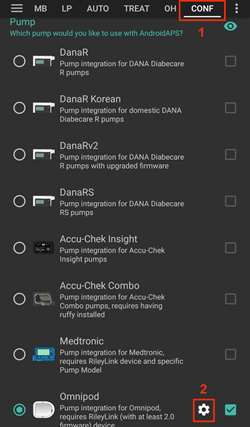
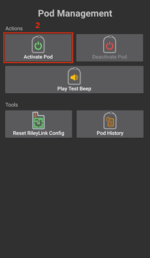
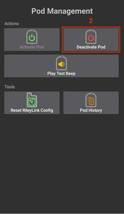
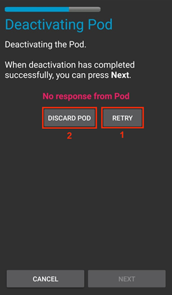
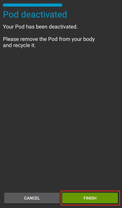
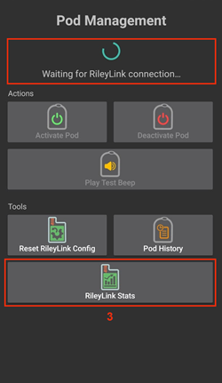
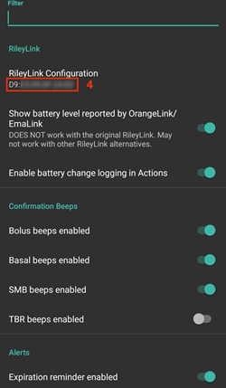
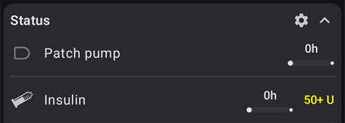

# Omnipod Eros

Тези инструкции са за настройка на помпата Omnipod от поколението Eros (**НЕ Omnipod Dash**).

```{admonition} Omnipod Eros is being phased out
:class: note

[Системата Omnipod](https://www.omnipod.com/current-podders/resources/omnipod-system) (оригиналният Omnipod, който се състои от Personal Diabetes Manager (PDM) и пача) се спира от производство, а крайната дата е различна в различните държави. Например в Канада тя няма да се предлага след 30 юни 2026 г. Ако разчитате на помпата Eros, планирайте навреме преминаването към поддържана помпа.
```

**Този софтуер е част от DIY (направи си сам) решение за изкуствен панкреас. Той не е готов продукт и изисква ВИЕ да прочетете, научите и разберете системата, включително как да я използвате. Само вие носите отговорност за това, което правите с него.**

```{contents} Table of contents
:depth: 1
:local: true
```

## Изисквания за хардуер и софтуер

- **Устройство за комуникация с пача**

> Компонент, който осигурява комуникацията между телефона ви с AAPS и пачовете от поколението Eros.
> 
> > -   [Уебсайт на OrangeLink](https://getrileylink.org/product/orangelink)
> > -  [RileyLink 433MHz](https://getrileylink.org/product/rileylink433)
> > -   [Уебсайт на Emalink](https://github.com/sks01/EmaLink) - [Контакт](mailto:getemalink@gmail.com)
> > -   DiaLink - [Контакт](mailto:Boshetyn@ukr.net)
> > -   [Уебсайт на LoopLink](https://www.getlooplink.org/) - [Контакт](https://jameswedding.substack.com/) - Не е тестван

-   **Мобилен телефон**

> Компонент, който управлява AAPS и изпраща команди към устройството за комуникация с пача.
> 
> > - Поддържан [телефон с Android](#Phones-list-of-tested-phones) с настроени **AAPS** и свързаните компоненти.

-   **Устройство за подаване на инсулин**

> Компонент, който изпълнява командите, получени от устройството за комуникация с пача. Командите идват от телефона ви с AAPS.
> 
> > - Нов пач Omnipod (поколение Eros – **НЕ DASH**)

Тези инструкции предполагат, че започвате нова сесия с пач. Ако не е така, бъдете търпеливи и започнете този процес при следващата смяна на пача.

На тази страница **RileyLink** означава всяко от устройствата за комуникация с пача, изброени по-горе.

## Преди да започнете

**БЕЗОПАСНОСТТА Е НА ПЪРВО МЯСТО** – не започвайте този процес в среда, в която не можете да се справите с грешка (задължително трябва да имате резервни пачове, инсулин, зареден RileyLink и телефон).

**Вашият Omnipod PDM вече няма да работи, след като драйверът Omnipod в AAPS активира пача ви**. Досега сте използвали своя Omnipod PDM, за да изпращате команди към пача Omnipod Eros. Пачът Omnipod Eros позволява само на едно устройство да комуникира с него. Устройството, което успешно активира пача, е единственото, което може да комуникира с него от този момент нататък. Това означава, че след като активирате пач Omnipod Eros с RileyLink чрез драйвера Omnipod в AAPS, **вече няма да можете да използвате своя PDM с този пач**. Сега драйверът Omnipod в AAPS заедно с RileyLink е вашият PDM. *Това НЕ означава, че трябва да изхвърлите своя PDM. Препоръчва се да го пазите като резервно устройство и за спешни случаи, когато AAPS не работи правилно.*

**Само един RileyLink може да комуникира с пача в даден момент.** **AAPS** помни един свързан RileyLink. Ако свържете друг, той заменя предишния.

**Пачът няма да спре да работи, когато RileyLink е извън обхват.** Когато RileyLink е извън обхват или сигналът към активния пач е блокиран, пачът ще продължи да подава базален инсулин. При активиране на пач базалният профил, зададен в AAPS, ще бъде програмиран в новия пач. Ако връзката с пача се загуби, той ще се върне към този базален профил. Няма да можете да изпращате нови команди, докато RileyLink не се върне в обхват и не възстанови връзката.

**Базални профили с интервали от 30 мин НЕ се поддържат в AAPS.** Ако сте нови в AAPS и настройвате базалния си профил за първи път, имайте предвид, че базални дози, които започват в половин час, не се поддържат. Трябва да промените базалния си профил така, че всяка доза да започва в точен час. Например, ако имате базална доза от 1,1 единици, която започва в 09:30 и продължава 2 часа до 11:30, това няма да работи.  Трябва да преместите тази базална доза от 1,1 единици във времеви интервал 9:00–11:00 или 10:00–12:00.  Въпреки че самият хардуер на Omnipod поддържа базални интервали от 30 мин, алгоритмите на AAPS в момента не могат да ги вземат предвид.

## Включване на драйвера Omnipod в AAPS

Можете да включите драйвера Omnipod в AAPS по **два начина**:

### Вариант 1: Съветник за настройване

След инсталиране на нова версия на AAPS автоматично се стартира **Съветник за настройване**. Ако вече сте експортирали настройките си от предишна инсталация, можете да ги импортирате в съветника. При нова инсталация продължете по-долу.

Преминете през [Съветник за настройване на AAPS](../SettingUpAaps/SetupWizard.md), докато стигнете до стъпката **Помпа**, след което изберете **Omnipod Eros** (описанието гласи „Интеграцията за помпа Omnipod Eros“).


Съветникът за настройване не свързва вашия RileyLink. След като завършите съветника, отворете екрана на помпата Omnipod и свържете RileyLink, както е описано в [раздела Настройка на RileyLink](#OmnipodEros-rileylink-setup).

**ИЛИ**

### Вариант 2: Екранът „Конфигурация“

Отворете **менюто** (☰) горе вляво > **Конфигурация** > **Помпа** и изберете **бутона за избор** на **Omnipod Eros**.

След като е избран, картата **Omnipod Eros** показва два бутона, **Настройки** и **Отвори плъгин**:


**Настройки** отваря настройките на драйвера Omnipod (вижте [Настройки на Omnipod](#OmnipodEros-omnipod-settings)):


**Отвори плъгин** отваря екрана на помпата Omnipod. Можете да го отворите по всяко време и от главния екран чрез **Управление** > **Помпа**. На тази страница той се нарича **екран на помпата Omnipod**. Преди да бъде свързан RileyLink и активиран пач, той изглежда така:


### Проверка на избора на драйвер за Omnipod

За да проверите дали сте включили драйвера Omnipod, отворете **Управление** > **Помпа** от главния екран. Трябва да видите екрана на помпата **Omnipod Eros**, показан по-горе. Ако все още не сте свързали RileyLink, **RileyLink статус** показва **Не е стартиран**, а **Статус на Pod** показва **Няма активен Pod**.

## Конфигурация на Omnipod

Всички функции за пача и RileyLink са бутони на [екрана на помпата Omnipod](#OmnipodEros-omnipod-pod-tab) (**Управление** > **Помпа**). Някои бутони се появяват само в определени ситуации, например когато има активен пач.

>  Обновяване на връзката и статуса на пача
> 
>  Управление на пача (активиране, деактивиране, тестов звук, RileyLink статистика и история на пача)

```{admonition} Older screenshot
:class: note
Снимките на екрана по-горе са от по-стара версия на **AAPS**. В **AAPS** 4 няма бутон **POD MGMT** и меню Pod Management: **Обнови** и всички действия за управление на пача са бутони на екрана на помпата Omnipod.
```

(OmnipodEros-rileylink-setup)=

### Настройка на RileyLink

Ако вече сте свързали RileyLink, продължете към [раздела Активиране на пач](#OmnipodEros-activating-a-pod) по-долу.

*Забележка: Добър визуален признак, че RileyLink не е свързан, е, че бутоните за лечение (лентата QuickLaunch) на главния екран липсват. Това се случва и през първите около 30 секунди след стартиране на AAPS, докато той активно се свързва с RileyLink.*

1. Уверете се, че RileyLink е напълно зареден и включен.

2. Поставете RileyLink [близо до телефона](#OmnipodEros-optimal-omnipod-and-rileylink-positioning) (~30 см или по-малко).

3. Отворете екрана на помпата Omnipod (**Управление** > **Помпа**) и натиснете **Свързване на RileyLink**.

4. Екранът **Свързване на RileyLink** веднага започва да търси Bluetooth устройства. Докоснете вашия RileyLink в списъка с намерени устройства.

   

5. Когато се покаже **RileyLink успешно свързан** с името и адреса на устройството ви, натиснете **ОК**.

6. Обратно на екрана на помпата Omnipod проверете дали **RileyLink статус** се променя на **Свързан**. **Статус на Pod** трябва да показва **Няма активен Pod**. Ако RileyLink не се свърже, натиснете **Ресет на RileyLink** или рестартирайте **AAPS**.

 

 


```{admonition} Older screenshot
:class: note
Шестте снимки на екрана по-горе (след стъпка 6) са от по-стара версия на **AAPS**. В **AAPS** 4 свързвате RileyLink с бутона **Свързване на RileyLink** на екрана на помпата Omnipod, вместо чрез **RileyLink Configuration** в настройките на Omnipod, и търсенето започва автоматично.
```

```{note}
За да преминете към друг RileyLink (например резервно устройство), натиснете отново **Свързване на RileyLink** и изберете новото устройство. То заменя устройството, свързано преди това. Не е нужно първо да премахвате старото устройство.
```

(OmnipodEros-activating-a-pod)=

### Активиране на пач

Преди да можете да активирате пач, уверете се, че RileyLink е свързан и **RileyLink статус** показва **Свързан**. Бутонът **Активирай Pod** остава неактивен, докато RileyLink не е готов.

*НАПОМНЯНЕ: При активиране и сдвояване на пача комуникацията работи само на малко разстояние заради мерки за безопасност. Преди сдвояването радиосигналът на пача е по-слаб, но след сдвояването той работи с пълна сила на сигнала. По време на тези процедури се уверете, че пачът е* [наблизо](#OmnipodEros-optimal-omnipod-and-rileylink-positioning) *(~30 см или по-малко), но не върху RileyLink или точно до него.*

01. Отворете екрана на помпата Omnipod (**Управление** > **Помпа**) и натиснете **Активирай Pod**.

    Ако никога не сте активирали профил, първо се появява стъпка **Нужен е профил**. Изберете профил за прилагане при активация.

    >   
    > 
    > ```{admonition} Older screenshot
    >     :class: note
    >     Снимките на екрана по-горе са от по-стара версия на **AAPS**. В **AAPS** 4 **Активирай Pod** е бутон на екрана на помпата Omnipod, а не в менюто **POD MGMT**.
    > ```

02. Показва се екранът **Напълнете Pod**. Напълнете нов пач с достатъчно инсулин за 3 дни и изчакайте да чуете два звукови сигнала. Те означават, че е напълнено минималното количество от 80 единици. Изпразнете напълно спринцовката за пълнене, дори след като сте чули двата сигнала. Когато изчислявате общото количество инсулин, нужно за 3 дни, имайте предвид, че първоначалното напълване (priming) на пача използва от 12 до 15 единици. Все още не махайте капачката на иглата на пача.

    > 
    > 
    > Уверете се, че новият пач и RileyLink са близо един до друг (~30 см или по-малко), и натиснете **Напред**.

03. **Изберете инсулин** (показва се само ако имате настроен повече от един инсулин): изберете инсулина, с който пълните пача, и натиснете **Напред**. След активирането се прилага смяна на профил с този инсулин.

04. На екрана **Инициализация на Pod** пачът ще започне първоначалното напълване (ще чуете щракване, последвано от поредица тиктакащи звуци, докато пачът се пълни). Ако RileyLink е извън обхвата на пача, който се активира, ще получите съобщение за грешка **Няма отговор от Pod**. Ако това се случи, [преместете RileyLink по-близо](#OmnipodEros-optimal-omnipod-and-rileylink-positioning) (~30 см или по-малко) до пача, но не върху него или точно до него, и натиснете **Отново**.

    >  

05. Когато първоначалното напълване е успешно, се показва зелена отметка и бутонът **Напред** става активен. Натиснете **Напред**.

    > 

06. **Локация** (показва се само ако **Позволи следене на мястото на помпата** е включено в [Смяна на мястото](#Aapsscreens-site-rotation)): изберете къде на тялото поставяте пача и натиснете **Напред**.

07. Показва се екранът **Прикрепете Pod**. Подгответе мястото за инфузия на новия пач. Свалете пластмасовата капачка на иглата на пача и бялата хартиена подложка от лепенката и залепете пача на избраното място на тялото. Ако канюлата стърчи, натиснете **Откажи** и изхвърлете пача. Когато сте готови, натиснете **Напред**.

    > 

08. Появява се диалог за потвърждение: „Когато натиснете OK, ще бъде вмъкната канюлата“. **Натиснете ОК САМО ако сте готови да бъде вмъкната канюлата**.

    > 

09. На екрана **Вмъкване на канюла** може да мине известно време, докато Omnipod отговори и вмъкне канюлата (най-много 1–2 минути), затова бъдете търпеливи.

    > Ако RileyLink е извън обхвата на пача, който се активира, ще получите съобщение за грешка **Няма отговор от Pod**. Ако това се случи, преместете RileyLink по-близо (~30 см или по-малко) до пача, но не върху него или точно до него, и натиснете **Отново**.
    > 
    > Ако RileyLink е извън обхвата на Bluetooth или няма активна връзка с телефона, ще получите съобщение за грешка **Няма отговор от RileyLink**. Ако това се случи, преместете RileyLink по-близо до телефона и натиснете **Отново**.
    > 
    > *ЗАБЕЛЕЖКА: Преди да бъде вмъкната канюлата, е добре да защипете с пръсти кожата близо до мястото, където ще влезе канюлата. Това осигурява плавно въвеждане на иглата и намалява риска от развитие на оклузии.*
    > 
    > 
    > 
    >  

10. Когато канюлата е вмъкната успешно, се появява зелена отметка и бутонът **Напред** става активен. Натиснете **Напред**.

    > 

11. Показва се екранът **Pod е активиран**. Проверете дали канюлата е вмъкната правилно, и сменете пача, ако смятате, че не е. Натиснете **Край**. Поздравления! Вече сте започнали нова сесия с активен пач.

    >  
    > 
    > ```{admonition} Older screenshot
    >     :class: note
    >     Снимките на екрана в стъпки 2 до 11 са от по-стара версия на **AAPS** и може да изглеждат различно в **AAPS** 4. Стъпките **Изберете инсулин** и **Локация** не са показани на снимките.
    > ```

12. Връщате се на екрана на помпата Omnipod. Бутонът **Активирай Pod** се заменя с **Деактивирай Pod**, защото не можете да активирате друг пач, без първо да деактивирате активния.

    Екранът на помпата вече показва информация за активния пач, включително текущата базална доза, нивото в резервоара, подадения инсулин, грешките и алармите на пача. За повече подробности вижте раздела [Екран на помпата Omnipod](#OmnipodEros-omnipod-pod-tab).

     

    ```{admonition} Older screenshot
    :class: note
    Снимките на екрана по-горе са от по-стара версия на **AAPS**. В **AAPS** 4 няма меню Pod Management: връщате се директно на екрана на помпата Omnipod, където **Деактивирай Pod** заменя **Активирай Pod**.
    ```

```{note}
Ако активирането е прекъснато след първоначалното напълване (например приложението е било затворено), натиснете отново **Активирай Pod**. Съветникът продължава от стъпките за вмъкване на канюлата.
```

### Деактивиране на пач

При нормални условия пачът трябва да работи три дни (72 часа) и още 8 часа след предупреждението за изтичане на срока му, т.е. общо 80 часа.

За да деактивирате пач (било то поради изтичане на срока или поради повреда на пача):

1. Отворете екрана на помпата Omnipod (**Управление** > **Помпа**) и натиснете **Деактивирай Pod**.

   >   
   > 
   > ```{admonition} Older screenshot
   >    :class: note
   >    Снимките на екрана по-горе са от по-стара версия на **AAPS**. В **AAPS** 4 **Деактивирай Pod** е бутон на екрана на помпата Omnipod, а не в менюто **POD MGMT**.
   > ```

2. На екрана **Деактивирай Pod** първо се уверете, че RileyLink е близо до пача, но не върху него или точно до него. След това натиснете **Напред**. Прозорец пита *Деактивиран Pod не може да бъде използван отново. Да се деактивира ли този Pod сега?* Натиснете **ОК**, за да започне деактивирането на пача, или **Откажи**, за да го запазите. Деактивирането спира цялата доставка на инсулин и не може да бъде отменено.

   > 

3. Появява се екранът **Деактивиране на Pod** и пачът издава звуков сигнал, който потвърждава, че деактивирането е успешно.

   > 
   > 
   > **АКО деактивирането е неуспешно** и не чуете звуков сигнал за потвърждение, може да получите съобщение **Няма отговор от RileyLink** или **Няма отговор от Pod**. Натиснете **Отново**, за да опитате деактивирането пак. Ако деактивирането продължава да е неуспешно, натиснете **Премахни Pod** и потвърдете. След това **AAPS** забравя пача. Доставката на инсулин **не** е спряна, затова свалете пача от тялото си. Ако пачът издава непрекъснат силен алармен сигнал („пищи“), може да се наложи да го заглушите ръчно (с карфица или кламер), защото **Премахни Pod** не го заглушава.
   > 
   > >   

4. Когато деактивирането е успешно, се появява зелена отметка. Натиснете **Напред**, за да се покаже екранът **Pod е деактивиран**. Вече можете да премахнете пача, тъй като активната сесия е деактивирана.

   > 

5. Натиснете **Край**, за да се върнете на екрана на помпата Omnipod.

   >  
   > 
   > ```{admonition} Older screenshot
   >    :class: note
   >    Снимките на екрана в стъпки 2 до 5 са от по-стара версия на **AAPS** и може да изглеждат различно в **AAPS** 4.
   > ```

6. На екрана на помпата Omnipod проверете дали **RileyLink статус** показва **Свързан**, а **Статус на Pod** показва **Няма активен Pod**.

   >    
   > 
   > ```{admonition} Older screenshot
   >    :class: note
   >    Снимките на екрана по-горе са от по-стара версия на **AAPS**. В **AAPS** 4 **Край** ви връща директно на екрана на помпата Omnipod; няма меню Pod Management или раздел **Omnipod (POD)**.
   > ```

### Спиране и възобновяване на доставката на инсулин

Процесът по-долу показва как да спрете и възобновите доставката на инсулин.

*ЗАБЕЛЕЖКА - ако не виждате бутон **Спиране***, той е скрит по подразбиране. Включете **Показвай бутон за спиране на доставката в раздела Omnipod** в [настройките на Omnipod](#OmnipodEros-omnipod-settings) в групата **Друго**.

#### Спиране на доставката на инсулин

Използвайте тази команда, за да поставите активния пач в състояние на спиране. В това състояние пачът вече не подава никакъв инсулин. Тази команда повтаря функцията за спиране, която оригиналният Omnipod PDM изпраща към активния пач.

1. Отворете екрана на помпата Omnipod (**Управление** > **Помпа**) и натиснете **Спиране**. Командата за спиране се изпраща чрез RileyLink към активния пач.

2. Когато пачът спре цялата доставка на инсулин, **Статус на Pod** показва **Спрян**, а бутонът **Спиране** се заменя с **Подновяване на доставката**.

   >  
   > 
   > 
   > 
   >  
   > 
   > ```{admonition} Older screenshot
   >    :class: note
   >    Снимките на екрана по-горе са от по-стара версия на **AAPS**. В **AAPS** 4 тези стъпки се извършват на екрана на помпата Omnipod, а не в раздела **Omnipod (POD)**, и резултатът се показва в **Статус на Pod**.
   > ```

Ако командата е неуспешна, диалогът **Внимание** показва „Неуспешно спиране на доставката на инсулин“ с причината. Проверете връзката с RileyLink и опитайте отново.

#### Възобновяване на доставката на инсулин

Използвайте тази команда, за да накарате активния пач, който в момента е спрян, да възобнови доставката на инсулин. След като командата бъде изпълнена успешно, инсулинът отново ще се подава нормално с базалната доза от активния базален профил за текущия час. Пачът отново ще приема команди за болус, TBR и SMB.

1. Отворете екрана на помпата Omnipod и проверете дали **Статус на Pod** показва **Спрян**. Натиснете **Подновяване на доставката**.

2. Когато командата е успешна, **Статус на Pod** отново показва **Работи** и бутонът **Подновяване на доставката** изчезва (бутонът **Спиране** се показва отново, ако сте го включили).

   >  
   > 
   > 
   > 
   >  
   > 
   > ```{admonition} Older screenshot
   >    :class: note
   >    Снимките на екрана по-горе са от по-стара версия на **AAPS**. В **AAPS** 4 тези стъпки се извършват на екрана на помпата Omnipod, а не в раздела **Omnipod (POD)**, и резултатът се показва в **Статус на Pod**.
   > ```

Ако командата е неуспешна, диалогът **Внимание** показва „Неуспешно подновяване на доставката на инсулин“ с причината. Проверете връзката с RileyLink и опитайте отново.

### Заглушаване на алармите на пача

*ЗАБЕЛЕЖКА - Бутонът **Заглушаване на алармите** се показва на екрана на помпата Omnipod само докато пачът има активна аларма (например аларма за изтичане на срока на пача или за малко инсулин в резервоара) и само ако **Автоматично заглушаване на алармите на Pod** е изключено.*

Процесът по-долу показва как да заглушите звуковите сигнали на пача, които започват, когато пачът достигне времето за предупреждение преди изтичане на срока си. Това време за предупреждение се задава с **Аларма – часове преди изключване (80 часа)** в настройките **Аларми** на Omnipod. Максималният живот на пача е 80 часа (3 дни и 8 часа), но Insulet препоръчва да не се надвишава границата от 72 часа (3 дни).

*ЗАБЕЛЕЖКА - Ако сте включили **Автоматично заглушаване на алармите на Pod** в настройките **Аларми** на Omnipod, **AAPS** заглушава алармата автоматично при следващата комуникация с пача и НЕ е нужно да го правите ръчно.*

1. Когато се достигне времето за предупреждение, пачът издава звукови сигнали, за да ви съобщи, че срокът му скоро изтича и трябва да бъде сменен. На екрана на помпата Omnipod **Срокът на Pod изтича** показва точното време, когато изтича срокът на пача (72 часа след активирането); 4 часа преди това полето става **жълто**. **Крайна дата на Pod** показва кога пачът спира да подава инсулин. **Активни аларми на Pod** показва **Pod скоро ще изтече** и се появява бутонът **Заглушаване на алармите**. **AAPS** показва и известие за предстоящото изтичане на срока на пача.

   >   
   > 
   > ```{admonition} Older screenshot
   >    :class: note
   >    Снимките на екрана по-горе са от по-стара версия на **AAPS**. В **AAPS** 4 бутонът **ACK ALERTS** се нарича **Заглушаване на алармите** и е на екрана на помпата Omnipod.
   > ```

2. Натиснете **Заглушаване на алармите**. RileyLink изпраща към пача командата да спре звуковите сигнали за изтичане на срока.

   >  
   > 
   > ```{admonition} Older screenshot
   >    :class: note
   >    Екранната снимка по-горе е от по-стара версия на **AAPS**. В **AAPS** 4 бутонът се нарича **Заглушаване на алармите**.
   > ```

3. Когато алармите са заглушени, пачът издава два звукови сигнала. **Активни аларми на Pod** вече не показва предупреждението, бутонът **Заглушаване на алармите** изчезва и пачът спира звуковите сигнали за изтичане на срока.

   >  
   > 
   > ```{admonition} Older screenshot
   >    :class: note
   >    Екранната снимка по-горе е от по-стара версия на **AAPS**. В **AAPS** 4 резултатът се показва на екрана на помпата Omnipod: предупреждението изчезва от **Активни аларми на Pod**.
   > ```

Ако командата е неуспешна (например RileyLink е извън обхвата на пача), диалогът **Внимание** показва „Неуспешно заглушаване на алармите“ с причината. Преместете RileyLink по-близо до пача и опитайте отново.


```{admonition} Older screenshot
:class: note
Екранната снимка по-горе е от по-стара версия на **AAPS**. В **AAPS** 4 диалогът **Внимание** показва „Неуспешно заглушаване на алармите“ с причината.
```

(OmnipodEros-view-pod-history)=

### Преглед на историята на пача

Този раздел показва как да прегледате историята на активния пач и да я филтрирате по различни категории действия. Историята на пача ви позволява да видите действията, изпратени към текущо активния пач, и техните резултати през тридневния му живот (72–80 часа).

Тази функция е полезна, за да проверите болуси, TBR и промени в базала, които са били подадени, но не сте сигурни дали са завършили. Останалите категории са полезни най-вече за отстраняване на неизправности и за определяне на реда на събитията преди дадена повреда.

*ЗАБЕЛЕЖКА:* **Неясните** команди ще се покажат в историята на пача, но поради естеството им не можете да сте сигурни, че са точни.

1. Отворете екрана на помпата Omnipod (**Управление** > **Помпа**) и натиснете **История на Pod**.

   >   
   > 
   > ```{admonition} Older screenshot
   >    :class: note
   >    Снимките на екрана по-горе са от по-стара версия на **AAPS**. В **AAPS** 4 **История на Pod** е бутон на екрана на помпата Omnipod, а не в менюто **POD MGMT**.
   > ```

2. Екранът **История на Pod** показва всички действия на пача и техните резултати, групирани по дни, като най-новите са първи. По подразбиране е избрано **Всички**. Докоснете някой от бутоните за филтриране в горната част, за да покажете само една категория. Използвайте стрелката назад горе вляво, за да се върнете на екрана на помпата Omnipod.

   > 

   >  
   > 
   > ```{admonition} Older screenshot
   >    :class: note
   >    Втората снимка на екрана е от по-стара версия на **AAPS** и може да изглежда различно в **AAPS** 4.
   > ```

### Преглед на настройките и историята на RileyLink

Екранът **RileyLink статистика** показва настройките на вашия RileyLink и на активния пач, както и историята на комуникацията и на двете. Той има два раздела: **Настройки** и **История**.

Бутонът **RileyLink статистика** е скрит по подразбиране. За да го покажете на екрана на помпата Omnipod, включете **Показване на RileyLink Stats бутон в меню Управление на Pod** в [настройките на Omnipod](#OmnipodEros-omnipod-settings) в групата **Друго**.

#### Ръчно възстановяване на Bluetooth връзката с устройството за комуникация с пача

Ако устройството за комуникация с пача е било известно време извън обхвата на Bluetooth на телефона, **RileyLink статус** може да показва **RileyLink недостъпен** на екрана на помпата Omnipod. Обикновено **AAPS** се свързва отново сам, когато устройството се върне в обхват. Ако това не стане:

1. Уверете се, че RileyLink е включен, зареден и близо до телефона.

2. На екрана на помпата Omnipod натиснете **Ресет на RileyLink**. Появява се съобщение **RileyLink нулиране на конфигурация**. Вижте [бележките за Ресет на RileyLink](#OmnipodEros-reset-rileylink-config-notes) по-долу.

3. Ако **Bluetooth връзката** не се възстанови, опитайте ръчно да **изключите** и после отново да **включите** Bluetooth на телефона си.

4. Ако все още не се свързва, натиснете **Свързване на RileyLink** и изберете отново своя RileyLink.

5. След успешно повторно свързване **RileyLink статус** показва **Свързан**. Можете да проверите и **Състояние на връзката** в раздела **Настройки** на екрана **RileyLink статистика**. Поздравления, отново свързахте конфигурираното си устройство за комуникация с пача с AAPS!

 


```{admonition} Older screenshot
:class: note
Снимките на екрана по-горе са от по-стара версия на **AAPS**. В **AAPS** 4 свързвате отново с **Ресет на RileyLink** или **Свързване на RileyLink** на екрана на помпата Omnipod, а не с бутона за обновяване на екрана RileyLink Settings.
```

#### Настройки на устройството за комуникация с пача и на активния пач

Този екран показва информация и статус както за свързаното в момента устройство за комуникация с пача, така и за активния в момента пач Omnipod Eros. Информацията се обновява автоматично.

1. Отворете екрана на помпата Omnipod (**Управление** > **Помпа**) и натиснете **RileyLink статистика**. Разделът **Настройки** показва свързания в момента **RileyLink** и активния пач (**Устройство**).

   >   
   > 
   > ```{admonition} Older screenshot
   >    :class: note
   >    Снимките на екрана по-горе са от по-стара версия на **AAPS**. В **AAPS** 4 **RileyLink статистика** е бутон на екрана на помпата Omnipod, а не в менюто **POD MGMT**.
   > ```

   > 

##### Полета за RileyLink

> - **Адрес:** MAC адрес на свързаното устройство за комуникация с пача.
> - **Име:** Bluetooth име на свързаното устройство за комуникация с пача.
> - **Батерия:** Текущото ниво на батерията на свързаното устройство за комуникация с пача. Показва се само когато **Покажи нивото на батерията на OrangeLink/EmaLink/DiaLink** е включено.
> - **Състояние на връзката**: Текущото състояние на Bluetooth връзката между устройството за комуникация с пача и телефона с AAPS.
> - **Грешка при свързване:** Ако има грешка в Bluetooth връзката с устройството за комуникация с пача, подробностите се показват тук.
> - **Firmware версия:** Текущата версия на фърмуера на свързаното в момента устройство за комуникация с пача.

##### Полета за устройството – с активен пач

> - **Тип на устройството:** Типът на устройството, което комуникира с устройството за комуникация с пача (Omnipod (Eros)).
> - **Конфигуриран модел:** Моделът на устройството, настроено да комуникира с устройството за комуникация с пача.
> - **Свързано устройство:** Моделът на устройството, което в момента комуникира с устройството за комуникация с пача.
> - **Сериен номер на помпа:** Серийният номер на текущо активирания пач.
> - **Честота на помпата:** Радиочестотата, използвана за комуникация с пача.
> - **Последна честота:** Последната известна радиочестота, която пачът е използвал за комуникация с устройството за комуникация с пача.
> - **Последна връзка:** Дата и час на последния контакт на пача с устройството за комуникация с пача.

(omnipod-eros-rileylink-and-active-pod-history)=
#### История на RileyLink и на активния пач

Този раздел показва всяко състояние или действие на RileyLink или на свързания в момента пач, като най-новите са първи. Историята е налична само за текущо активния пач. След смяна на пача тази история се изтрива и се записват и показват само събития от новия активиран пач.

1. Отворете екрана на помпата Omnipod (**Управление** > **Помпа**), натиснете **RileyLink статистика** и след това докоснете раздела **История**.

   >   
   > 
   > ```{admonition} Older screenshot
   >    :class: note
   >    Снимките на екрана по-горе са от по-стара версия на **AAPS**. В **AAPS** 4 **RileyLink статистика** е бутон на екрана на помпата Omnipod, а не в менюто **POD MGMT**.
   > ```

   > 

##### Полета

Всеки запис показва:

> - **Устройство:** Устройството, за което се отнася действието или състоянието.
> - **Време:** Времето на събитието.
> - **Състояние или действие:** Състоянието на устройството или действието, което то е извършило.

(OmnipodEros-omnipod-pod-tab)=

## Екран на помпата Omnipod

По-долу е обяснено какво означават полетата за статус и бутоните на **екрана на помпата Omnipod** (**Управление** > **Помпа** или **Конфигурация** > **Помпа** > **Отвори плъгин**).

Иконата със зъбно колело горе вдясно отваря [настройките на Omnipod](#OmnipodEros-omnipod-settings).

*ЗАБЕЛЕЖКА: Ако някое поле за статус показва (неясно), натиснете **Обнови**, за да обновите статуса на пача и да изчистите това.*


```{admonition} Older screenshot
:class: note
Снимката на екрана по-горе е от по-стара версия на **AAPS**, в която този екран беше разделът **Omnipod (POD)**. В **AAPS** 4 това е екранът на помпата Omnipod и някои имена на полета и бутони са различни.
```

### Полета

- **RileyLink статус:** Показва текущото състояние на връзката с RileyLink. Грешките се показват в червено.

- *Не е стартиран* - все още няма свързан RileyLink или връзката не е стартирана.
- *RileyLink недостъпен* - устройството за комуникация с пача е извън обхвата на Bluetooth на телефона, изключено е или има повреда, която пречи на Bluetooth комуникацията.
- *RileyLink готов* - устройството за комуникация с пача е включено и активно установява Bluetooth връзката.
- *Свързан* - устройството за комуникация с пача е включено, свързано и може активно да комуникира чрез Bluetooth.

- **Уникален ID:** Показва адреса на активния пач.

- **Партиден (LOT) номер:** Показва партидния (LOT) номер на активния пач.

- **Пореден номер:** Показва серийния номер (TID) на пача.

- **Версия на фърмуера:** Показва версията на фърмуера на активния пач.

- **Време на Pod:** Показва текущото време на активния пач. Полето се маркира, когато се различава от времето на телефона с повече от 5 минути.

- **Срокът на Pod изтича:** Показва датата и часа, когато изтича срокът на активния пач. Текстът става жълт през последните 4 часа преди този момент. Той никога не става червен, защото пачът продължава да доставя инсулин и след това.

- **Крайна дата на Pod:** Показва края на допълнителния период на пача (8 часа след **Срокът на Pod изтича**, т.е. максимален живот на пача 80 часа). Текстът става жълт, когато започне допълнителният период (при **Срокът на Pod изтича**), и червен през последните 4 часа преди крайния момент. По време на допълнителния период се показва и оставащото време, например *(17мин остават)*. При крайния момент пачът спира да доставя инсулин и трябва да бъде сменен.

- **Статус на Pod:** Показва статуса на активния пач (например **Няма активен Pod**, **Работи** или **Спрян**).

- **Последна връзка:** Показва кога за последно е имало комуникация с активния пач. Текстът става червен, когато [границата за недостъпна помпа](#OmnipodEros-troubleshooting) е надвишена.

- *Преди малко* - преди по-малко от 20 секунди.
- *преди по-малко от минута* - преди повече от 20 секунди, но по-малко от 60 секунди.
- *преди 1 минута* - преди повече от 60 секунди, но по-малко от 120 секунди (2 мин)
- *преди XX минути* - преди повече от 2 минути; XX е броят на минутите

- **Последен болус:** Показва дозата на последния болус, изпратен към активния пач, и в скоби – преди колко време е подаден.

- **Базова базална стойност:** Показва базалната доза, програмирана за текущия час в базалния профил.

- **Временна базална стойност:** Показва се само докато работи временен базал. Показва го в следния формат:

- Единици/час @ час на задаване на TBR (изминали минути / общо минути на TBR)
- *Пример:* 0.00U/h @18:25 ( 90/120 минути)

- **Резервоар:** Показва **Над 50 U остават**, когато в резервоара са останали повече от 50 единици. Под тази стойност се показва приблизителният брой единици. Текстът става червен под границата за малко инсулин, зададена в [настройките за аларми](#OmnipodEros-omnipod-settings).

- **Общо доставени:** Показва общия брой единици инсулин, подадени от резервоара. *Имайте предвид, че това е приблизителна стойност, тъй като първоначалното напълване и пълненето на пача не са точни процеси.*

- **Активни аларми на Pod:** Показва алармите, които в момента са активни на пача. Обикновено се използва, когато срокът на пача е над 72 часа и звуковите аларми на самия пач вече звучат.

- **Грешки:** Показва последната възникнала грешка (в червено). Прегледайте [историята на пача](#OmnipodEros-view-pod-history), [историята на RileyLink](#omnipod-eros-rileylink-and-active-pod-history) и лог файловете за минали грешки и по-подробна информация.

### Бутони

Бутоните в долната част на екрана на помпата се променят според ситуацията. Бутоните, които не могат да се използват в момента, са сиви, например докато RileyLink не е свързан.

**Бутони за статуса на пача** (показват се, когато има активен пач):

- **Обнови:** Изпраща команда за обновяване към активния пач, за да обнови статуса му. Използвайте го, за да обновите статуса на пача и да изчистите полетата за статус, които съдържат текста (неясно). Вижте [раздела Отстраняване на неизправности](#OmnipodEros-troubleshooting) по-долу за допълнителна информация.

  

  ```{admonition} Older screenshot
  :class: note
  Снимката на екрана по-горе е от по-стара версия на **AAPS**. В **AAPS** 4 това е текстов бутон с име **Обнови** на екрана на помпата Omnipod.
  ```

- **Заглушаване на алармите:** Заглушава звуковите сигнали и известията за изтичане на срока на пача и за малко инсулин в резервоара. Показва се само когато пачът има активна аларма и **Автоматично заглушаване на алармите на Pod** е изключено. След като алармите бъдат заглушени, бутонът изчезва.

  

  ```{admonition} Older screenshot
  :class: note
  Снимката на екрана по-горе е от по-стара версия на **AAPS**. В **AAPS** 4 този бутон се нарича **Заглушаване на алармите**.
  ```

- **Задаване на часа:** Сверява времето на пача с текущото време на телефона. Показва се само когато времето на пача се различава от времето на телефона с повече от 5 минути.

  

  ```{admonition} Older screenshot
  :class: note
  Снимката на екрана по-горе е от по-стара версия на **AAPS**. В **AAPS** 4 това е текстов бутон с име **Задаване на часа** на екрана на помпата Omnipod.
  ```

- **Спиране:** Спира доставката на инсулин от активния пач. Показва се само ако е включено в настройките (**Показвай бутон за спиране на доставката в раздела Omnipod**).

  

  ```{admonition} Older screenshot
  :class: note
  Снимката на екрана по-горе е от по-стара версия на **AAPS**. В **AAPS** 4 това е текстов бутон с име **Спиране** на екрана на помпата Omnipod.
  ```

- **Подновяване на доставката:** Възобновява доставката на инсулин от активния пач, който в момента е спрян. Показва се само докато пачът е спрян.

  

  ```{admonition} Older screenshot
  :class: note
  Снимката на екрана по-горе е от по-стара версия на **AAPS**. В **AAPS** 4 това е текстов бутон с име **Подновяване на доставката** на екрана на помпата Omnipod.
  ```

**Бутони за управление на пача и RileyLink:**


```{admonition} Older screenshot
:class: note
Екранната снимка по-горе е от по-стара версия на **AAPS**. В **AAPS** 4 няма меню Pod Management: тези действия са бутони директно на екрана на помпата Omnipod.
```

- **Активирай Pod:** Извършва първоначалното напълване и активира нов пач. Показва се, когато няма активен пач. Бутонът е активен само когато RileyLink е свързан.

  

  ```{admonition} Older screenshot
  :class: note
  Снимката на екрана по-горе е от по-стара версия на **AAPS**. В **AAPS** 4 **Активирай Pod** е бутон на екрана на помпата Omnipod, а не в менюто Pod Management.
  ```

- **Деактивирай Pod:** Деактивира текущо активния пач. Показва се веднага щом пачът е сдвоен, също и когато активирането е спряло по средата (например защото пачът се е повредил по време на активирането). Бутонът е активен само когато RileyLink е свързан. **AAPS** иска потвърждение, преди да деактивира пача.

- Използвайте тази команда, за да деактивирате „пищящ“ пач (грешка 49).
- Ако деактивирането е неуспешно, съветникът за деактивиране предлага опцията **Премахни Pod**.

  

  ```{admonition} Older screenshot
  :class: note
  Снимката на екрана по-горе е от по-стара версия на **AAPS**. В **AAPS** 4 **Деактивирай Pod** е бутон на екрана на помпата Omnipod, а не в менюто Pod Management.
  ```

- **Възпроизвеждане на тестов звук:** При натискане пачът издава един тестов звуков сигнал. Показва се, когато пачът е сдвоен.

  

  ```{admonition} Older screenshot
  :class: note
  Снимката на екрана по-горе е от по-стара версия на **AAPS**. В **AAPS** 4 **Възпроизвеждане на тестов звук** е бутон на екрана на помпата Omnipod, а не в менюто Pod Management.
  ```

- **История на Pod:** Показва историята на действията на активния пач. Вижте [Преглед на историята на пача](#OmnipodEros-view-pod-history).

  

  ```{admonition} Older screenshot
  :class: note
  Снимката на екрана по-горе е от по-стара версия на **AAPS**. В **AAPS** 4 **История на Pod** е бутон на екрана на помпата Omnipod, а не в менюто Pod Management.
  ```

- **Свързване на RileyLink:** Търси вашето устройство за комуникация с пача и го свързва. Вижте [Настройка на RileyLink](#OmnipodEros-rileylink-setup).

- **RileyLink статистика:** Отваря екрана „RileyLink статистика“ с два раздела. Показва се само ако е включено в настройките (**Показване на RileyLink Stats бутон в меню Управление на Pod**).

- **Настройки** - показва информация за настройките на RileyLink и на активния пач
- **История** - показва историята на комуникацията на RileyLink и на пача

  

  ```{admonition} Older screenshot
  :class: note
  Снимката на екрана по-горе е от по-стара версия на **AAPS**. В **AAPS** 4 **RileyLink статистика** е бутон на екрана на помпата Omnipod, а не в менюто Pod Management.
  ```

- **Ресет на RileyLink:** Нулира конфигурацията на свързаното в момента устройство за комуникация с пача. Когато започне комуникацията, в RileyLink се изпращат и задават определени данни:

- Задават се регистрите на паметта
- Задават се комуникационните протоколи
- Задава се настроената радиочестота
  > 
  > Вижте [допълнителните бележки](#OmnipodEros-reset-rileylink-config-notes) по-долу.

  

  ```{admonition} Older screenshot
  :class: note
  Снимката на екрана по-горе е от по-стара версия на **AAPS**. В **AAPS** 4 този бутон се нарича **Ресет на RileyLink** и е на екрана на помпата Omnipod.
  ```

- **Премахни Pod:** След потвърждение изтрива състоянието на пач, който не отговаря. Показва се само когато пачът е стартиран, но не е напълно сдвоен, тъй като правилното деактивиране вече не е възможно:

- **Пачът не е напълно сдвоен** и затова не приема команди за деактивиране.
- **Пачът е блокирал** по време на сдвояването между две стъпки.
- **Пачът изобщо не се сдвоява.**
  > 
  > След като премахнете пача, **AAPS** вече не може да комуникира с него. Свалете пача от тялото си.

  

  ```{admonition} Older screenshot
  :class: note
  Снимката на екрана по-горе е от по-стара версия на **AAPS**. В **AAPS** 4 **Премахни Pod** е бутон на екрана на помпата Omnipod, а не в менюто Pod Management.
  ```

(OmnipodEros-reset-rileylink-config-notes)=

#### *Бележки за Ресет на RileyLink*

- Тази функция се използва главно, когато текущото активно устройство за комуникация с пача не отговаря и комуникацията е блокирала.
- Ако устройството за комуникация с пача бъде изключено и включено отново, натиснете **Ресет на RileyLink**, за да се зададат отново тези параметри за комуникация в устройството.
- Ако това НЕ се направи, AAPS трябва да се рестартира, след като устройството за комуникация с пача бъде изключено и включено отново.
- Този бутон **НЕ** трябва да се натиска при превключване между различни устройства за комуникация с пача.

(OmnipodEros-omnipod-settings)=

## Настройки на Omnipod

За да отворите настройките на драйвера Omnipod, или:

- натиснете иконата със зъбно колело горе вдясно на екрана на помпата Omnipod (**Управление** > **Помпа**), или
- отворете **менюто** (☰) горе вляво > **Конфигурация** > **Помпа** и натиснете **Настройки** на картата **Omnipod Eros**.


```{admonition} Older screenshot
:class: note
Екранната снимка по-горе е от по-стара версия на **AAPS**. В **AAPS** 4 отваряте настройките с **Настройки** на картата **Omnipod Eros** или с иконата със зъбно колело на екрана на помпата Omnipod, вместо със зъбното колело за настройки в **Конфигурация** или с менюто с 3 точки.
```

Настройките са групирани, както е показано по-долу. Докоснете група, за да я разгънете. Повечето елементи са превключватели, които можете да включите или изключите:


*ЗАБЕЛЕЖКА: Звездичка (\*) означава, че по подразбиране настройката е включена.*

### RileyLink

Настройки за устройството за комуникация с пача. Самото устройство свързвате с бутона **Свързване на RileyLink** на екрана на помпата (вижте [Настройка на RileyLink](#OmnipodEros-rileylink-setup)).

- **Използвай сканиране:** Търси устройството, преди да се свърже с OrangeLink. Това може да подобри връзката. Може да се използва и с други клонинги на RileyLink, ако е нужно.

- **Покажи нивото на батерията на OrangeLink/EmaLink/DiaLink:** Показва реалното ниво на батерията на OrangeLink/EmaLink/DiaLink. **Силно се препоръчва** всички потребители на OrangeLink/EmaLink/DiaLink да включат тази настройка.

- НЕ работи с оригиналния RileyLink.
- Може да не работи с алтернативи на RileyLink.
- Включено - показва текущото ниво на батерията на поддържаните устройства за комуникация с пача.
- Изключено - показва стойност n/a.

- **Позволи записване на смяна на батерията в Действия:** Налично е само когато горната настройка за отчитане на батерията е включена. Някои устройства за комуникация с пача използват обикновени батерии, които можете да смените. Когато тази настройка е включена, можете да въведете **Смяна на батерия на помпата** като [запис в Портал за лечения](#aaps-screens-careportal), за да отбележите смяната и да нулирате възрастта на батерията.

### Звук за потвърждение

Осигурява потвърждаващи звукови сигнали от пача за доставка и промени на болус, базал, SMB и TBR.

- **\*Звук при болус активен:** Включва или изключва звуковите сигнали за потвърждение при подаване на болус.
- **Звук при базал активен:** Включва или изключва звуковите сигнали за потвърждение при задаване на нова базална доза, отмяна на активната базална доза или промяна на текущата базална доза.
- **\*Звук при SMB активен:** Включва или изключва звуковите сигнали за потвърждение при подаване на SMB.
- **Звук при временен базал активен:** Включва или изключва звуковите сигнали за потвърждение при задаване или отмяна на TBR.

### Аларми

Осигурява аларми в AAPS и съобщения в Nightscout при изтичане на срока на пача, изключване на пача и малко инсулин в резервоара според зададената граница в единици.

*Имайте предвид, че AAPS ВИНАГИ ще покаже известие за всяка аларма след първата комуникация с пача, след като алармата се е задействала. Отхвърлянето на известието НЕ заглушава алармата, ОСВЕН АКО е включено **Автоматично заглушаване на алармите на Pod**. За да заглушите алармата РЪЧНО, отворете екрана на помпата Omnipod и натиснете **Заглушаване на алармите**.*

- **\*Напомняне за изтичане на срока:** Когато е включено, пачът издава звуков сигнал, когато се достигне зададеното по-долу време.
- **Аларма – часове преди изключване (80 часа):** Броят часове преди изключването на пача (80 часа след активирането), в който се задейства напомнянето за изтичане на срока (от 1 до 8 часа, по подразбиране 8).
- **\*Малко инсулин в резервоара:** Включва или изключва аларма, когато оставащите единици в пача достигнат границата за малко инсулин, зададена в полето „Брой единици“.
- **Брой единици:** Броят единици, при който се задейства алармата за малко инсулин в резервоара на пача (от 5 до 50, по подразбиране 20).
- **Автоматично заглушаване на алармите на Pod:** Когато е включено, известието пак се показва, но алармата се заглушава автоматично при следващата комуникация с пача след началото на алармата.

### Известия

Осигурява известия в AAPS и звукови аларми на телефона, когато не е сигурно дали TBR, SMB или болус са изпълнени успешно.

*ЗАБЕЛЕЖКА: Това са само известия, пачът не издава звукови сигнали.*

- **\*Сигнал при неясни TBR известия, разрешен:** Включете или изключете тази настройка, за да получавате звукова аларма и визуално известие, когато AAPS не е сигурен дали TBR е зададен успешно.
- **\*Сигнал при неясни SMB известия, разрешен:** Включете или изключете тази настройка, за да получавате звукова аларма и визуално известие, когато AAPS не е сигурен дали SMB е подаден успешно.
- **\*Сигнал при неясни болус известия, разрешен:** Включете или изключете тази настройка, за да получавате звукова аларма и визуално известие, когато AAPS не е сигурен дали болусът е подаден успешно.

### Друго

Осигурява разширени настройки, които помагат при отстраняване на грешки.

- **Показвай бутон за спиране на доставката в раздела Omnipod:** Скрива или показва бутона **Спиране** на екрана на помпата Omnipod.
- **Показване на PULSE LOG в менюто на Pod Management:** Тази настройка все още е в списъка, но текущата версия на екрана на помпата няма бутон **Pulse лог**.

- **Показване на RileyLink Stats бутон в меню Управление на Pod:** Скрива или показва бутона **RileyLink статистика** на екрана на помпата Omnipod.
- **\*Разрешена смяна на часовото време (лятно/зимно):** Позволява автоматично откриване на промени в часовата зона, ако телефонът се използва в област, където има лятно часово време.

### Смяна или премахване на активното устройство за комуникация с пача (RileyLink)

Има много алтернативни модели на оригиналния RileyLink (като OrangeLink или EmaLink). Може също да имате няколко или резервни устройства от един и същ вид. Затова може да се наложи да преминете към друго устройство.

За да смените устройството, отворете екрана на помпата Omnipod (**Управление** > **Помпа**), натиснете **Свързване на RileyLink** и изберете новото устройство, както е описано в [Настройка на RileyLink](#OmnipodEros-rileylink-setup). Новото устройство заменя свързаното преди това.

 


 

```{admonition} Older screenshot
:class: note
Снимките на екрана по-горе са от по-стара версия на **AAPS**. В **AAPS** 4 добавяте устройство със **Свързване на RileyLink** на екрана на помпата Omnipod, вместо чрез **RileyLink Configuration** в настройките на Omnipod, и търсенето започва автоматично.
```

Няма отделен бутон за премахване на свързано устройство. Ако спрете да използвате даден RileyLink, просто свържете новия, когато ви потрябва.


```{admonition} Older screenshot
:class: note
Снимките на екрана по-горе са от по-стара версия на **AAPS**. В **AAPS** 4 няма бутон **Изтрий**: свързването на нов RileyLink заменя предишния.
```

## Ред за състояние и Портал за лечения

Има няколко особености, свързани с разликата между пача Omnipod и помпите с тръбичка, особено след поставяне на нов пач.

Възрастта на **инсулина** и на **канюлата** в [реда за състояние](#screens-sensor-level-battery) на главния екран се **нулира** на 0 дни и 0 часа **след всяка смяна на пача**. Това се прави заради начина, по който е изградена и работи помпата Omnipod. **Батерията на помпата** и **резервоарът за инсулин** са вградени в самия пач. Тъй като пачът въвежда канюлата директно в кожата на мястото на поставяне на пача, в помпите Omnipod не се използва традиционна тръбичка. *Затова след смяна на пач възрастта на всяка от тези стойности автоматично се нулира.* **Възрастта на батерията на помпата** не се показва, тъй като батерията в пача винаги издържа по-дълго от живота на самия пач (максимум 80 часа).



### Нива

**Ниво на инсулина**

Отчитането на количеството инсулин в пача Omnipod Eros не е точно. Това е така, защото не се знае точно колко инсулин е поставен в пача. Знае се само, че когато при пълненето на пача прозвучат 2-та звукови сигнала, са напълнени поне 80 единици. Един пач може да побере най-много 200 единици. Първоначалното напълване също може да внесе разлика, тъй като не е точен процес. Като взема предвид и двата фактора, драйверът Omnipod е написан така, че да дава възможно най-добрата приблизителна стойност на оставащия инсулин в резервоара.

> - **Над 50 единици** - показва стойност 50+U, когато в резервоара има повече от 50 единици.
> - **Под 50 единици** - показва приблизително изчислена стойност на оставащия инсулин в резервоара.
> - **SMS** - Връща стойност или 50+U при SMS отговори
> - **Nightscout** - Качва стойност 50, когато има над 50 единици, към Nightscout (версия 14.07 и по-стари).  По-новите версии ще докладват стойност 50+ при над 50 единици.

**Ниво на батерията**

Отчитането на нивото на батерията е настройка, която може да се включи, за да се показва текущото ниво на батерията на устройствата за комуникация с пача, като OrangeLink, EmaLink или DiaLink.  Хардуерът на RileyLink не може да отчита нивото на батерията си.  Нивото на батерията се отчита след всяка комуникация с пача, затова при зареждане може да не видите равномерно нарастване.  Ръчното обновяване ще обнови текущото ниво на батерията.  Когато поддържано устройство за комуникация с пача не е свързано, ще се покаже стойност 0 %.

> - **Хардуерът на RileyLink НЕ може да отчита нивото на батерията**
> - **Настройката „Покажи нивото на батерията на OrangeLink/EmaLink/DiaLink“ ТРЯБВА да е включена в настройките на Omnipod, за да се показват стойности за нивото на батерията**
> - **Отчитането на нивото на батерията работи САМО с устройствата OrangeLink, EmaLink и DiaLink**
> - **Отчитането на нивото на батерията МОЖЕ да работи с други устройства (без RileyLink)**
> - **SMS** - връща текущото ниво на батерията като отговор, когато има реално ниво; стойност n/a не се връща
> - **Nightscout** - нивото на батерията се отчита, когато има реално ниво; стойност n/a не се отчита

(OmnipodEros-troubleshooting)=

## Отстраняване на неизправности

### Повреди на пача

Пачовете от време на време се повреждат поради различни причини, включително хардуерни проблеми със самия пач. Добре е да не съобщавате за тях на Insulet, тъй като AAPS не е одобрен начин на употреба. Списък с кодовете на грешките можете да намерите [тук](https://github.com/openaps/openomni/wiki/Fault-event-codes). Той помага да се определи причината.

### Предотвратяване на повреди с грешка 49 на пача

Тази повреда е свързана с неправилно състояние на пача за дадена команда или грешка по време на команда за доставяне на инсулин. Препоръчваме да настроите синхронизацията с Nightscout *само за качване*: оставете изключени всички опции „Получавай ... от NS“ (Receive ... from NS) в настройките за синхронизация на клиента за Nightscout (вижте [Nightscout](../SettingUpAaps/Nightscout.md)), за да избегнете възможни грешки.

### Аларми „Помпата е недостъпна“

Препоръчваме да зададете алармите за недостъпна помпа на **120 минути**. Натиснете иконата **Настройки** (зъбно колело) горе вдясно на главния екран, изберете **Локални аларми** > **Граница за недостъпна помпа** и я задайте на **120**.

(OmnipodEros-import-settings-from-previous-aaps)=
### Импортиране на настройки от предишна инсталация на AAPS

```{admonition} Importing settings can end your active Pod
:class: warning
На телефона, който вече управлява пача, оставете **Замени и настройките на помпата** без отметка: сесията на пача се запазва и се импортират само другите настройки. Отметнете това само ако файлът е експортиран по време на пача, който носите в момента. Вижте [Помпи без маркуч](#ExportImportSettings-tubeless-pumps).
```

Най-безопасният начин да преинсталирате **AAPS** е между два пача:

1. Деактивирайте сесията на пача. Проверете, че нямате активна сесия на пач.
2. Експортирайте настройките си и пазете копие на сигурно място.
3. Деинсталирайте предишната версия на AAPS и рестартирайте телефона.
4. Инсталирайте новата версия на AAPS и проверете, че нямате активна сесия на пач.
5. Импортирайте настройките си и активирайте новия пач.

### Аларми от драйвера на Omnipod

Имайте предвид, че драйверът Omnipod показва различни специфични аларми на **главния екран**. Повечето от тях са информационни и могат да бъдат отхвърлени, а някои подсказват на потребителя какво да направи, за да отстрани причината за алармата. По-долу е обобщение на основните аларми, които може да срещнете:

#### Няма активен Pod

Не е открита активна сесия на пач. Тази аларма може временно да бъде отхвърлена чрез натискане на **Отложи**, но ще продължи да се задейства, докато не бъде активиран нов пач. След активиране на нов пач тази аларма се заглушава автоматично.

#### Pod е спрян

Информационна аларма, че пачът е спрян.

#### Неуспешно задаване на базален профил. Доставката на инсулин може да бъде спряна! Моля, ръчно опреснете състоянието на Pod от раздел Omnipod и възобновете доставката, ако е необходимо.

Информационна аларма, че задаването на базалния профил на пача е неуспешно. Отворете екрана на помпата Omnipod и натиснете **Обнови**, след това **Подновяване на доставката**, ако е нужно.

#### Не може да се провери дали SMB болусът е успешен. Ако сте сигурни, че болусът не е успял, трябва ръчно да изтриете записа за SMB от Лечения.

Аларма, че не може да се провери дали SMB болусът е подаден успешно. Проверете полето **Последен болус** на екрана на помпата Omnipod, за да видите дали SMB е бил успешен. Ако не е, изтрийте записа от леченията.

#### Не е сигурно дали „задачата болус/TBR/SMB“ е изпълнена. Моля, проверете ръчно дали е успешна.

Заради начина, по който RileyLink и Omnipod комуникират, може да има ситуации, в които е *неясно* дали дадена команда е изпълнена успешно. Беше необходимо потребителят да бъде информиран за тази несигурност.

По-долу има няколко примера кога може да се появи известие за неясен резултат.

- **Болуси** - неясните болуси не могат да бъдат проверени автоматично. Известието остава до следващия болус, но ръчното обновяване на пача изчиства съобщението. *По подразбиране звуковите сигнали за този тип известия са включени, тъй като потребителят трябва да ги провери ръчно.*
- **TBR, статуси на пача, смени на профила, промени на времето** - ръчното обновяване на пача изчиства съобщението.
- **Отклонение на времето на пача -** Когато времето на пача и времето на телефона се различават твърде много, на кръга на AAPS му е трудно да работи правилно и да прави точни прогнози и препоръки за дозите. Ако разликата във времето между пача и телефона е повече от 5 минути, на екрана на помпата Omnipod се появява бутон **Задаване на часа**. Натиснете **Задаване на часа**, за да синхронизирате времето на пача с времето на телефона. Ако след това **Статус на Pod** показва **Спрян**, натиснете **Подновяване на доставката**, за да продължи нормалната работа на пача.

## Добри практики

(OmnipodEros-optimal-omnipod-and-rileylink-positioning)=

### Оптимално разположение на Omnipod и RileyLink

Антената на RileyLink, която комуникира с пача Omnipod, е спирална (хеликална) антена за 433 MHz. Поради конструкцията си тя излъчва сигнал във всички посоки, подобен на триизмерна поничка, като оста z съответства на изправената вертикално антена. Това означава, че има оптимални положения за поставяне на RileyLink, особено при активиране и деактивиране на пач.


> *(Фиг. 1. Графично изображение на спирална антена с излъчване във всички посоки*)

От съображения за безопасност и сигурност *активирането* на пача трябва да се прави на *по-малко разстояние (~30 см или по-малко)*, отколкото другите операции, като подаване на болус, задаване на TBR или просто обновяване на статуса на пача. Поради начина на излъчване на сигнала от антената на RileyLink НЕ се препоръчва пачът да се поставя директно върху RileyLink или точно до него.

Изображението по-долу показва оптималното положение на RileyLink при активиране и деактивиране на пач. Пачът може да се активира и в други положения, но най-голям успех ще имате с положението от изображението по-долу.

*Забележка: Ако комуникацията е неуспешна, въпреки че пачът и RileyLink са разположени оптимално, причината може да е слаба батерия, която намалява обхвата на антената на RileyLink. За да избегнете този проблем, уверете се, че RileyLink е добре зареден или е свързан директно към кабел за зареждане по време на процеса.*


## Къде да получите помощ

Цялата разработка на драйвера Omnipod се прави от общността на доброволни начала. Молим ви да бъдете внимателни и да спазвате следните насоки, когато търсите помощ:

- **Ниво 0:** Прочетете съответния раздел от тази документация, за да сте сигурни, че разбирате как трябва да работи функционалността, с която изпитвате затруднения.
- **Ниво 1:** Ако все още имате проблеми, които не можете да решите с помощта на този документ, отидете в канала *#androidaps* в **Discord** чрез [тази покана](https://discord.gg/4fQUWHZ4Mw).
- **Ниво 2:** Потърсете в съществуващите проблеми (issues) дали вашият проблем вече е докладван. Ако не е, създайте нов [проблем (issue)](https://github.com/nightscout/AndroidAPS/issues) и прикачете своите [лог файлове](../GettingHelp/AccessingLogFiles.md).
- **Бъдете търпеливи – повечето от членовете на нашата общност са добронамерени доброволци, а решаването на проблеми често изисква време и търпение както от потребителите, така и от разработчиците.**
