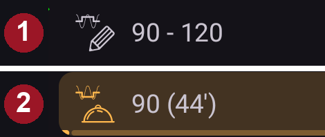
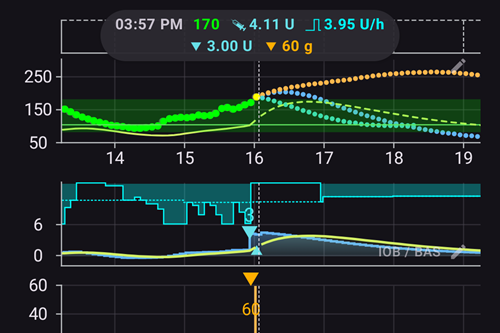
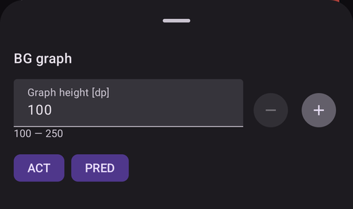
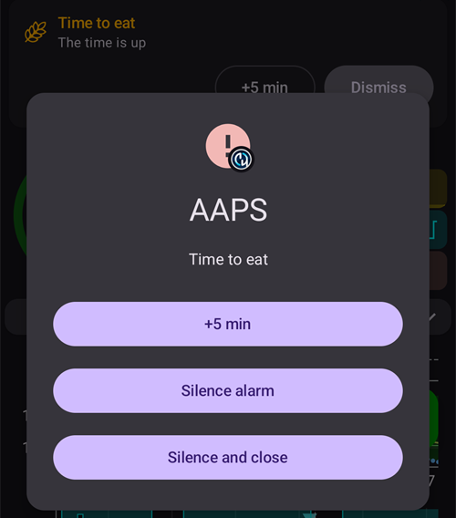

# Екраните на AAPS

```{contents}
:backlinks: entry
:depth: 2
```

(the-homescreen)= (AapsScreens-the-homescreen)=

## Главният екран


Това е първият екран, който виждате, когато отворите **AAPS**. Той съдържа повечето информация, която ви трябва всеки ден.

### Раздел A – Горна лента

* **Менюто** (☰) вляво отваря страничното меню с **История на леченията**, **История**, **Статистика**, **Профил съветник**, **Поддръжка**, **Съветник за настройване**, **Конфигурация** и други.
* **Лентата за търсене** намира настройки, диалози и документация – просто започнете да пишете (вижте [Глобално търсене](../DailyLifeWithAaps/GlobalSearch.md)).
* Иконата **Настройки** (зъбно колело) вдясно отваря всички [настройки](../SettingUpAaps/Preferences.md).

(aaps-screens-profile--target)=

### Раздел B – Блок за статус

#### Текуща кръвна захар

Последната стойност на КЗ от вашия CGM се показва в големия кръг вляво, заедно с разликата спрямо предишната стойност (делта) и колко време е минало от получаването ѝ.

Цветът на стойността на КЗ показва къде е тя спрямо зададения [диапазон](#Preferences-range-for-visualization).

* зелено = в диапазона
* червено = под диапазона
* жълто = над диапазона

  

(loop-status)= (AapsScreens-loop-status)=

#### Статус на кръга


До кръга на КЗ има икона, която показва текущия режим на кръга (от горе надолу на картинката):

1. Зелен кръг = [затворен кръг](#KeyAapsFeatures-ClosedLoop), кръгът работи
2. Лилав кръг с пунктирна линия = [спиране на базала при ниска КЗ (LGS)](#KeyAapsFeatures-LGS)
3. Син кръг с пунктирна линия = [отворен кръг](#KeyAapsFeatures-OpenLoop)
4. Червен кръг с кръстче = кръгът е изключен (не работи, без ограничение във времето)
5. Червена икона за пауза = кръгът е спрян (временно на пауза, но базалният инсулин се подава) – оставащото време се показва до иконата
6. Сив кръг с щепсел = помпата е разкачена (временно няма никакво подаване на инсулин) – оставащото време се показва до иконата

Натиснете иконата, за да отворите диалога на кръга. Съдържанието на диалога зависи от текущото състояние:

* Докато кръгът **работи** (затворен, отворен или LGS), можете да смените текущия режим (Затворен кръг, Спиране на базал при ниска КЗ, Отворен кръг или Изключи кръга), да **спрете** кръга или да **разкачите** помпата за избрано време.
* Докато кръгът е **изключен**, можете да го включите отново, като изберете текущ режим, или да разкачите помпата.
* Докато кръгът е **спрян**, можете да го **възстановите**, да разкачите помпата или да изберете ново време под **Спри кръга**, за да удължите спирането.
* Докато помпата е **разкачена**, можете да я **свържете** отново или да изберете ново време под **Разкачи помпата**, за да удължите разкачването.

Когато удължите спирането или разкачването, новото време **започва от сега**: то заменя оставащото време, а не се добавя към него. Не е нужно първо да възстановявате кръга или да свързвате помпата.

Диалогът, когато кръгът работи в режим Затворен кръг:


Диалогът, когато кръгът е спрян, с **Възстанови** и времената за удължаване на спирането:


Диалогът, когато помпата е разкачена, с **Свържи помпата** и времената за удължаване на разкачването:


Диалогът в режим Спиране на базал при ниска КЗ, в режим Отворен кръг и когато кръгът е изключен се различава само по текущите режими, които предлага:


Ето как изглежда главният екран във всеки режим. Цветната лента в горната част на графиката се променя в момента на смяната.

Спиране на базал при ниска КЗ:


Отворен кръг:


Кръгът е изключен:


Кръгът е спрян – оставащото време се показва до иконата:


Помпата е разкачена – оставащото време се показва до иконата. Бутоните за лечения остават в лентата QuickLaunch, така че все още можете да запишете инсулин, подаден с писалка, или въглехидрати:


След всеки избор се изисква потвърждение.

```{admonition} Аларма: помпата не прие нулевия временен базал :class: warning Докато помпата е разкачена, **AAPS** поддържа нулев временен базал на помпата и го задава отново, ако липсва. Ако това все още не успява след 10 минути, **AAPS** подава спешна аларма: *„Помпата не прие нулевия временен базал. Възможно е все още да подава базален инсулин. Проверете помпата.“* Алармата се повтаря на всеки 15 минути, докато нулевият временен базал не бъде зададен или разкачването не приключи. Ако я видите, проверете помпата си: възможно е тя да подава базален инсулин, въпреки че **AAPS** я показва като разкачена.

    <br />Забележка: предлаганите режими зависят от напредъка ви в [Целите](../SettingUpAaps/CompletingTheObjectives.md) – Затворен кръг и LGS стават достъпни едва когато изпълните съответните цели.
    
    (aaps-screens-bg-warning-sign)=
    #### Предупредителен знак за КЗ
    
    Ако **AAPS** открие проблем със стойностите на КЗ, които получава, в долната лента на главния екран се появява бутон за бърз достъп до вашия източник на КЗ (с неговото име, например **КЗ от xDrip+**) с червен предупредителен знак. Докоснете го, за да отворите [екрана на източника на КЗ](#aaps-screens-bg-source).
    
    ##### Дублирани данни за КЗ
    
    Червеният предупредителен знак ви казва да действате веднага: получавате **дублирани данни за КЗ**, което пречи на кръга да работи правилно. **AAPS** не може надеждно да изчисли тенденцията на КЗ от дублирани стойности, затова спира корекциите.
    
    Ако кръгът ви е бил затворен, **AAPS** го превключва в режим [Спиране на базал при ниска КЗ (LGS)](#KeyAapsFeatures-LGS): иконата на кръга става лилава.
    
      
    
    Натиснете иконата на кръга: картата **Ограничения** в горната част ви казва защо: „BgQualityCheck: LGS режим поради дублирани данни за КЗ“.
    
      
    
    ```{admonition} Кръгът ви работи в режим Спиране на базал при ниска КЗ
    :class: note
    Кръгът ви продължава да работи, но само за да ви пази от ниски стойности: **AAPS** все още може да намали или спре базала ви, но няма да подава инсулин за корекция, докато не решите този проблем!
    

Трябва да откриете защо получавате дублирани стойности на КЗ:

* Включен ли е Dexcom bridge във вашия сайт Nightscout? Изключете bridge: отворете административния панел на вашия Nightscout, редактирайте променливата „enable“ и премахнете от нея частта „bridge“. (For Heroku [details can be found here](https://nightscout.github.io/troubleshoot/troubleshoot/#heroku).)
* Качват ли няколко източника вашата КЗ в Nightscout? Ако използвате приложението BYODA, включете качването в **AAPS**, но не го включвайте в xDrip, ако използвате и него.
* Имате ли последователи, които получават вашата КЗ, но и я качват отново във вашия сайт Nightscout?
* Последна мярка: в [настройките на NSClient](#Preferences-nsclient) изберете настройките за синхронизация и изключете опцията „Получаване на КЗ от Nightscout“.

За да премахнете предупреждението веднага и кръгът отново да прави корекции, изтрийте дублираните записи от екрана на източника на КЗ: докоснете бутона за бърз достъп в долната лента. Дублираната стойност е оцветена в червено. Натиснете продължително една стойност, за да започнете избирането, отметнете дубликатите и докоснете иконата с кошче горе вдясно.


Но когато има много дубликати, може да е по-лесно да

* [направете резервно копие на настройките](../Maintenance/ExportImportSettings.md),
* нулирайте базата данни в менюто за поддръжка и
* [импортирайте настройките](../Maintenance/ExportImportSettings.md) отново

    {admonition} Превключете сами обратно на Затворен кръг
    :class: important
    **AAPS** не се връща сам в режим **Затворен кръг**, след като дубликатите изчезнат. Натиснете иконата на кръга на главния екран и изберете отново **Затворен кръг**.

##### Непроменящи се данни за КЗ

При някои източници на КЗ (Libre 1, AiDEX, Glutec, Medtronic и източници, които не съобщават вида на сензора си) **AAPS** проверява и за стойности, които не се променят: ако КЗ се е променила с по-малко от 2 mg/dl (0,1 mmol/l) за 45 минути, данните се смятат за грешни. Тогава бутонът за бърз достъп до източника на КЗ показва червен знак за равна тенденция, а кръгът спира всеки висок временен базал и не подава инсулин за корекция, докато стойностите не започнат отново да се променят. Проверете сензора и приложението, което изпраща стойностите.

##### Неравномерни данни за КЗ

Когато стойностите пристигат на неравни интервали или някои липсват, **AAPS** изчислява отново 5-минутни стойности от тези, които има. Това се случва например след смяна на сензора или при сензорите Libre, чието време се измества с минута-две на всеки няколко часа. Кръгът продължава да работи и не е нужно да правите нищо. **AAPS** 4 вече не показва жълт предупредителен знак за това.

#### Текущ профил

Текущият профил се показва до иконата със звезда.

Докоснете името на профила, за да отворите [екрана Профил](#aaps-screens-profile), където можете да видите подробностите за профила и да [превключвате между различни профили](../DailyLifeWithAaps/ProfileSwitch-ProfilePercentage.md).

За да **промените процента на профила** (и неговата продължителност), докоснете името на профила, след това докоснете кръглия бутон **▶** (Активиране) долу вдясно на екрана Профил. В **AAPS** 3.x този екран се отваряше с продължително натискане на името на профила; в **AAPS** 4 продължителното натискане не прави нищо. Стъпка по стъпка: [Промяна на процента на профила](#ProfileSwitch-change-percentage).


1. Обикновен изглед при активиране на стандартен профил.
2. Смяна на профил с определен процент 90 % и оставащо време 9 минути – името на профила става жълто, докато тече временна смяна на профил.
3. Смяна на профил с изместване на времето с 1 час и оставащо време 9 минути.

#### Цел



Текущата целева КЗ се показва под името на профила.

Натиснете кратко целта, за да отворите екрана **[Временна цел](../DailyLifeWithAaps/TempTargets.md)**.

1. Обикновен изглед: целевият диапазон, зададен в профила ви.
2. Ако е зададена временна цел, целта става жълта/оранжева с иконата на използваната предварителна настройка, а оставащото време в минути се показва в скоби.

(AapsScreens-visualization-of-dynamic-target-adjustment)=

#### Визуализация на динамичната промяна на целта

Когато използвате [алгоритъма SMB](#Config-Builder-aps) и функцията [Autosens](#Open-APS-features-autosens), **AAPS** може динамично да променя целта ви според чувствителността.

Включете едната или двете от следните опции в [настройките на OpenAPS SMB](#Preferences-openaps-smb-settings):

* „Чувствителността увеличава целта“ и/или
* „Инсулиновата резистентност намалява целта“

Ако **AAPS** открие резистентност или чувствителност, целта ще се промени спрямо зададената в профила, а показаната цел сменя цвета си, за да покаже промяната.

(aaps-screens-iob-cob-basal-sens)=

#### IOB, COB, базал и чувствителност


1. **Спринцовка**: активен инсулин (IOB) – количеството активен инсулин в тялото ви  
    Стойността на активния инсулин би била нула, ако се подава само стандартният ви базал и няма оставащ инсулин от предишни болуси. 
    * IOB може да е отрицателен, ако наскоро е имало периоди с намален базал.
    * Натиснете елемента, за да видите разделението на болусен и базален инсулин (първият диалог на картинката – тук с отрицателен IOB след период с намален базал)
2. **Зърно**: [активни въглехидрати (COB)](../DailyLifeWithAaps/CobCalculation.md) – още неусвоени въглехидрати, които сте изяли преди това
3. Синьо-зеленият бутон вдясно показва **текущото подаване на базал**: равна линия, когато се подава базалът от профила, и променена икона, докато е активен временен базал
4. **Редът с процента** показва текущата чувствителност ([Autosens](#Open-APS-features-autosens) / [DynamicISF](../DailyLifeWithAaps/DynamicISF.md)). Когато кръгът промени вашия ISF, редът показва и ISF от профила, стрелка и ISF, който кръгът използва в момента, например „80% 2,0 ↗ 2,5“. Натиснете го, за да видите стойността на Autosens и ефективния ISF (вторият диалог на картинката). Ако кръгът работи с различна стойност от последния резултат на Autosens (например защото временна цел променя чувствителността ви), диалогът показва и тази стойност като **Аутосенс в алгоритъма**. Когато Autosens е изключен, кръгът запазва ISF от профила ви и не се показва ефективен ISF.

Диалогът IOB, отворен с натискане на елемента IOB:


Натиснете синьо-зеления бутон, за да видите временния базал, който се подава в момента, кога е започнал и от колко време се подава:


(aaps-screens-carbs-required)=

#### Нужни въглехидрати


Предложения за въглехидрати се показват, когато референтният алгоритъм (reference design) установи, че са нужни въглехидрати.

Това е, когато алгоритъмът oref смята, че не може да ви спаси с нулев временен базал и са нужни въглехидрати, за да се оправи ситуацията.

Известията за въглехидрати са много по-сложни от тези на болус калкулатора. Може да видите предложение за въглехидрати, докато болус калкулаторът не показва липсващи въглехидрати.

При желание известията за нужни въглехидрати могат да се изпращат към Nightscout. В този случай ще се покаже и разпространи известие.

### Раздел C – Ред за статус


Редът за статус дава визуално предупреждение за

* Възраст на иглата
* Възраст на инсулина (колко дни се използва резервоарът) и ниво на резервоара (единици)
* Възраст на сензора
* Възраст и ниво на батерията на помпата (%)

Ако прагът за предупреждение е надвишен, стойностите се показват в жълто.

Ако критичният праг е надвишен, стойностите се показват в червено.

The age is always shown in its short form, whatever the screen size: *4h* on the first day, *3d4h* later.

Праговете могат да се променят чрез малката икона **Настройки**, която се показва, когато редът за статус е **разгънат** (стрелката вдясно) – вижте [Индикатори](#Preferences-status-lights).

Разгънатият панел за статус има и бутон в края на някои редове за записване на смяна, който нулира съответната възраст: **Добави** на реда **Сензор** записва поставяне на сензор. Ако помпата ви го поддържа, **Смяна/Пълнене** се появява на редовете **Игла** (или **Пач помпа**) и **Инсулин**, а **Добави** – на реда **Батерия на помпата**.


В зависимост от помпата ви, може да нямате всички тези икони.

(screens-sensor-level-battery)=

#### Ниво на сензора (батерия)

Работи за CGM с допълнителен трансмитер, като MiaoMiao 2. (Технически сензорът трябва да изпраща информация за нивото на батерията към xDrip.)

Праговете могат да се зададат в [Индикатори](#Preferences-status-lights).

(aaps-screens-main-graph)=

### Раздел D – Главна графика


Графиката показва кръвната ви захар (КЗ), отчетена от глюкозния монитор (CGM).

Използвайте жестовете за превъртане и за мащабиране с два пръста върху графиката, за да промените видимия период.

Зелената зона показва вашия целеви диапазон.

Тази информация се показва и на тази графика:

* Ръчни болуси: син триъгълник точно над кривата на КЗ, сочещ надолу към стойността в този момент, с количеството инсулин
* Въведени въглехидрати: оранжев триъгълник точно под кривата на КЗ, сочещ нагоре към стойността, с количеството въглехидрати. Хранене, въведено заедно с болуса си, изглежда като един маркер, разделен от стойността.
* Триъгълниците са в три размера (малък, среден, голям) според количеството в сравнение с най-голямото за деня. Ако в този момент няма стойност на КЗ (прекъсване на сензора), триъгълникът се рисува в долната част на графиката.
* Проверки на КЗ и калибрации: рисуват се на собствената си измерена стойност, за да можете да ги сравните с кривата на сензора
* Целта, зададена в профила или променена от временна цел: зелена линия
* Смени на профил: икони със звезда в горната част на графиката
* Статус на кръга: цветна лента в горната част на графиката, когато [текущият режим](#AapsScreens-loop-status) е различен от затворен кръг: синьо = отворен кръг, лилаво = LGS, червено = кръгът е изключен, жълто = кръгът е спрян, сиво = помпата е разкачена, оранжево = суперболус (на снимката на екрана: лилаво, след това жълто). Историята на тези промени е в [Текущ режим](#AapsScreens-running-mode)
* [SMB](#Open-APS-features-super-micro-bolus-smb) не се рисуват на графиката на КЗ (щеше да има по един на всеки няколко минути): те се показват на [графиката IOB](#aaps-screens-iob).

Докоснете **Проверка на КЗ** на графиката, за да видите стойността ѝ и бележката, ако сте написали такава.

(aaps-screens-graph-press-and-hold)=

#### Вижте стойностите в даден момент

**Натиснете и задръжте** графиката на КЗ за момент, за да видите данните за едно измерване. Точка отбелязва най-близкото измерване, пунктирана линия се рисува в този момент на всички графики, а изскачащ прозорец в горната част на графиката показва:

* времето и стойността на КЗ
* IOB, COB (само когато е над 0 г) и базалната доза в този момент – иконата на базала показва дали е бил активен временен базал, както на главния екран
* всеки болус, SMB или въглехидрати в този момент, със същите триъгълници като на графиките

Задръжте пръста си на екрана и го движете наляво или надясно, за да преминавате от едно измерване към следващото. При всяко измерване усещате леко потрепване, а графиката не се превърта, докато правите това. Изскачащият прозорец остава 2 секунди, след като вдигнете пръста си.

Това работи по същия начин и на [допълнителните графики](#aaps-screens-additional-graphs) под графиката на КЗ (IOB, COB...): натиснете и задръжте която и да е от тях.



(aaps-screens-graph-clock-change)=

#### Clock changes

When the clock of the phone jumped, at a daylight saving change or in a new time zone, a dashed vertical line marks that moment in the BG graph, with a small clock icon at its foot. The same dashed line runs through the [additional graphs](#aaps-screens-additional-graphs) below.


(AapsScreens-activate-optional-information)=

#### Активиране на допълнителна информация

Натиснете иконата **молив** в горния десен ъгъл на графиката, за да отворите настройките на графиката:



* **Височина на графика** определя колко висока е графиката.
* **ДЕЙСТВ** добавя кривата на активността на инсулина: плътна жълто-зелена линия <span style="background:#141218;color:#D3F166;padding:0 0.3em;border:1px solid #141218;border-radius:4px">━━━━</span> (не я бъркайте с пунктираната жълта прогноза UAM)
* **ПРЕДВ** добавя [линиите на прогнозата](#aaps-screens-prediction-lines) (вижте по-долу)

(aaps-screens-prediction-lines)=

#### Линии на прогнозата

Когато **ПРЕДВ** е включено, AAPS рисува прогнозите си като **пунктирани линии** вдясно от линията „сега“. Всяка прогноза има свой цвят. Тъмната тема използва по-светли нюанси на същите цветове, а линия в зеления целеви диапазон може да изглежда малко по-зелена.

| Линия                    | Светла тема                                                                                                                       | Тъмна тема                                                                                                                         | Какво прогнозира                         |
| ------------------------ | --------------------------------------------------------------------------------------------------------------------------------- | ---------------------------------------------------------------------------------------------------------------------------------- | ---------------------------------------- |
| **IOB** (синя)           | <span style="background:#FFFFFF;color:#1E88E5;padding:0 0.3em;border:1px solid #CCCCCC;border-radius:4px">●●●●</span>             | <span style="background:#141218;color:#64B5F6;padding:0 0.3em;border:1px solid #141218;border-radius:4px">●●●●</span>              | само инсулин                             |
| **COB** (оранжева)       | <span style="background:#FFFFFF;color:#FB8C00;padding:0 0.3em;border:1px solid #CCCCCC;border-radius:4px">●●●●</span>             | <span style="background:#141218;color:#FFB74D;padding:0 0.3em;border:1px solid #141218;border-radius:4px">●●●●</span>              | активни въглехидрати                     |
| **UAM** (жълта)          | <span style="background:#FFFFFF;color:#C9BD60;padding:0 0.3em;border:1px solid #CCCCCC;border-radius:4px">●●●●</span>             | <span style="background:#141218;color:#E6D39A;padding:0 0.3em;border:1px solid #141218;border-radius:4px">●●●●</span>              | необявено хранене                        |
| **ZT** (циан)            | <span style="background:#FFFFFF;color:#00D2D2;padding:0 0.3em;border:1px solid #CCCCCC;border-radius:4px">●●●●</span>             | <span style="background:#141218;color:#4DD4D4;padding:0 0.3em;border:1px solid #141218;border-radius:4px">●●●●</span>              | нулев временен базал (инсулинът е спрян) |
| **aCOB** (бледооранжева) | <span style="background:#FFFFFF;color:rgba(251,140,0,0.5);padding:0 0.3em;border:1px solid #CCCCCC;border-radius:4px">●●●●</span> | <span style="background:#141218;color:rgba(255,183,77,0.5);padding:0 0.3em;border:1px solid #141218;border-radius:4px">●●●●</span> | само по-старият алгоритъм AMA            |

Когато две прогнози дават еднакви стойности, точките им се припокриват и виждате само единия цвят (например UAM върху IOB, когато КЗ е равна).

* **COB** line (orange): [carbs on board](CobCalculation.md) (orange is used throughout AAPS for COB and carbs)
    
    Тази линия на прогнозата показва накъде ще отиде КЗ (а не самият COB!) според текущите настройки на **Профил**, като се приема, че отклоненията поради усвояването на въглехидратите остават постоянни. Тази линия се показва само ако има известни COB.

* Линия **IOB** (синя): активен инсулин (синьото се използва навсякъде в AAPS за IOB и инсулин)
    
    Тази линия на прогнозата показва какво би станало само под влиянието на инсулина. Например, ако сте подали инсулин и след това не сте яли въглехидрати.

* Линия **ZT** (циан): нулев временен базал (прогнозна КЗ, ако се зададе временен базал 0 %)
    
    Тази линия на прогнозата показва как би се променила траекторията на КЗ, ако помпата спре напълно подаването на инсулин (TBR 0 %). Линията спира, щом се покачи над целта ви.
    
    *Тази линия се показва само когато се използва алгоритъмът [SMB](#Config-Builder-aps).*

* Линия **UAM** (жълта): [необявени хранения](#SensitivityDetectionAndCob-sensitivity-oref1)
    
    Необявени хранения (unannounced meals) означава, че е открито значително покачване на КЗ поради хранене, адреналин или други влияния. Линията на прогнозата е подобна на **оранжевата линия COB**, но приема, че отклоненията ще намаляват с постоянна скорост (като продължава текущата скорост на намаляване).
    
    *Тази линия се показва само когато се използва алгоритъмът [SMB](#Config-Builder-aps), **Разреши UAM** е включено в настройките на OpenAPS SMB и КЗ се покачва повече, отколкото обяснява само инсулинът.*

* Линия **aCOB** (бледа, полупрозрачна оранжева): ускорено усвояване на въглехидратите
    
    Similar to COB, but assuming a static 10 mg/dL/5m (0.555 mmol/L/5m) carb absorption rate. Остаряло и с ограничена полезност.
    
    *Тази линия се показва само когато се използва по-старият алгоритъм [AMA](#Config-Builder-aps).*

Обикновено реалната ви крива на КЗ се оказва в средата между тези линии или близо до тази, чиито допускания най-добре отговарят на вашата ситуация.

(aaps-screens-how-predictions-become-a-dosing-decision)=

#### Как AAPS превръща прогнозите в решение за дозиране

AAPS не дозира инсулин само на базата на текущата ви КЗ – при всяко изпълнение на кръга (приблизително на всеки 5 минути) той разглежда заедно всички линии на прогнозата по-горе и намира най-безопасния начин на действие.

Основното правило е **безопасността на първо място**: ако *която и да е* линия на прогнозата, в който и да е период, падне под долния ви праг за безопасност, AAPS задава нулев временен базал (временен базал 0 %) и не подава повече инсулин, дори ако текущата ви КЗ е висока. Едва когато всяка линия на прогнозата остава над този праг, AAPS ще обмисли да подаде повече инсулин.

Когато е безопасно да подаде повече инсулин, AAPS гледа къде се очаква КЗ да стигне накрая (**крайната КЗ**, eventual BG) според комбинираните прогнози и изчислява колко корекция е нужна, за да върне тази крайна КЗ към целта – подадена или като повишен временен базал, или (ако алгоритъмът oref1/[SMB](#Open-APS-features-super-micro-bolus-smb) е включен) като малък незабавен болус. Ако КЗ е висока сега, но вече спада достатъчно сама, AAPS ще изчака или дори може да намали базалната доза, вместо да добави инсулин, който само би направил по-късна ниска КЗ още по-ниска.

За примери на тази логика за вземане на решения с реални снимки на екрана вижте [сценариите за дозиране в ръководството за лекари](#clinicianguide-dosing-scenarios) – те са написани за лекари, но важат за всеки потребител на AAPS.

*За пълното техническо описание как се изчисляват тези прогнози и полученото решение за дозиране вижте [документацията на OpenAPS за determine-basal](https://openaps.readthedocs.io/en/latest/docs/While%20You%20Wait%20For%20Gear/Understand-determine-basal.html).*

#### Базали

**Плътната синя** линия показва базала, подаден от помпата, и отразява реалното подаване във времето.

**Пунктирната синя** линия показва каква би била базалната доза, ако нямаше временни промени на базала (TBR).

Когато се подава стандартната базална доза, площта под кривата е тъмносиня. Когато базалната доза е временно променена (увеличена или намалена), площта под кривата е светлосиня.

#### Активност

**Тънката жълта** линия показва активността на инсулина.

Тя се базира на очаквания спад на КЗ от инсулина в тялото ви, ако нямаше други фактори (например въглехидрати).

(AapsScreens-section-g-additional-graphs)= (aaps-screens-additional-graphs)=

### Раздел E – Допълнителни графики

Можете да активирате допълнителни графики под главната графика. В [Опростен режим](#preferences-simple-mode) допълнителните графики са предварително зададени и не могат да се променят. Изключете **Опростен режим**, ако искате сами да настроите допълнителните графики.

Допълнителните графики следват главната графика: когато превъртате или мащабирате графиката на КЗ, те се движат с нея. Плъзгане настрани върху допълнителна графика също превърта всички графики. Те нямат собствени обозначения за времето – вижте времето на графиката на КЗ.

За да настроите допълнителна графика, натиснете иконата **молив** в горния ѝ десен ъгъл:


Изберете бутоните за данните, които искате да виждате на тази графика; бутонът **Изтрий** премахва графиката.

За да създадете още една графика, натиснете **Добави графика** под последната графика и изберете бутоните ѝ по същия начин:


Новата графика се добавя под другите – тук втора допълнителна графика с **ЧУВСТВ%** и **Откл**:


Повечето потребители намират следната конфигурация на допълнителните графики за подходяща:

* Графика 1 с IOB, COB, промяна в чувствителността
* Графика 2 с отклонения и BGI.

#### Абсолютен инсулин (АБС)

Активен инсулин, включително болусите **и базала**.

(aaps-screens-iob)=

#### Активен инсулин (IOB)

Показва активния инсулин (IOB) (= инсулина, който още действа в тялото ви). Включва инсулина от болуси и временен базал (**но не включва базалните дози от профила ви**).

Ако нямаше [SMB](#Open-APS-features-super-micro-bolus-smb), болуси и TBR по време на DIA, това щеше да е нула.

SMB се показват на тази графика като сини триъгълници в три размера според количеството в сравнение с най-големия SMB за деня.

IOB може да е отрицателен, ако нямате оставащ болус и дълго време имате нулев или нисък временен базал.

Намаляването зависи от [настройките за DIA и вида инсулин](#Config-Builder-insulin-dia).

#### Активни въглехидрати (COB)

Показва активните въглехидрати (COB) (= въглехидратите в тялото ви, които още не са усвоени).

Намаляването зависи от [отклоненията, които алгоритъмът открива](../DailyLifeWithAaps/CobCalculation.md).

Ако алгоритъмът открие по-бързо усвояване на въглехидратите от очакваното, ще бъде подаден инсулин и това ще увеличи IOB (повече или по-малко, според настройките ви за безопасност).

#### Промяна в чувствителността (ЧУВСТВ%)

Показва чувствителността, която [Autosens](#Open-APS-features-autosens) е открил.

Чувствителността е изчисление на чувствителността към инсулин в резултат на физическа активност, хормони и т.н.

Имайте предвид, че трябва да сте стигнали до [Цел 8](#objectives-objective8), за да може определянето на чувствителност/[Autosens](#Open-APS-features-autosens) автоматично да променя количеството подаван инсулин. Преди да достигнете тази цел, линията на графиката се показва само за информация.

### Променлива чувствителност (ПРОМ ЧУВСТВ)

Показва чувствителността, изчислена от [DynamicISF](../DailyLifeWithAaps/DynamicISF.md). Попълва се само ако използвате тази функция.

(screen-heart-rate-steps)=

#### Сърдечен ритъм (HR) и стъпки

Тези данни може да са налични, когато използвате [смарт часовник с Wear OS](../WearOS/WearOsSmartwatch.md). Включете ги в приложението **AAPS** Wear и дайте разрешение за данните за здравето.

Steps are drawn as columns, and the heart rate as a curved line that breaks where the watch sent no data.

#### Отклонения (Откл)

* **Сивите** стълбчета показват отклонение поради въглехидрати.
* **Зелените** стълбчета показват, че КЗ е по-висока, отколкото алгоритъмът е очаквал. Зелените стълбчета се използват за увеличаване на резистентността в [Autosens](#Open-APS-features-autosens).
* **Червените** стълбчета показват, че КЗ е по-ниска, отколкото алгоритъмът е очаквал. Червените стълбчета се използват за увеличаване на чувствителността в [Autosens](#Open-APS-features-autosens).
* **Жълтите** стълбчета показват отклонение поради UAM.
* **Черните** стълбчета показват малки отклонения, които не се вземат предвид за чувствителността

#### Въздействие върху КЗ (-BGI)

Тази линия показва доколко КЗ „би трябвало“ да се покачи или спадне само заради активността на инсулина.


Добра комбинация е тази линия да се показва заедно със стълбчетата на отклоненията. They share the same scale, but it is a different one than the other optional data, so it is a good idea to display them on a separate graph, as shown above. Сравняването на линията BGI и стълбчетата на отклоненията е още един начин да разберете как се колебае **КЗ**. Тук, в момента, отбелязан с **1**, стълбчетата на отклоненията са много над линията BGI: КЗ се покачва повече, отколкото обяснява само активността на инсулина (например след въглехидрати). В момента, отбелязан с **2**, стълбчетата на отклоненията са под нулата (червени): КЗ е по-ниска, отколкото алгоритъмът е очаквал.

### Раздел F – Лента QuickLaunch


Плаващата лента в долната част на екрана съдържа вашите действия **[QuickLaunch](../DailyLifeWithAaps/QuickLaunch.md)**. Малкото **зъбно колело** отваря настройките на QuickLaunch, където избирате кои бутони да се показват (лечения, записи в портала за лечения, действия за CGM, екраните от панела **Управление**, бутони [Бързи действия](../DailyLifeWithAaps/QuickWizards.md), [Сценарии](../DailyLifeWithAaps/Scenes.md) и други).

По-горе е показана типична конфигурация: **Инсулин**, **Въглехидрати** и **Болус калкулатор**.

Докато помпата е **разкачена**, бутоните за лечения остават в лентата, например за да запишете инсулин, подаден с писалка (вижте [Инсулин](#aaps-screens-buttons-insulin) по-долу). Същите действия са налични и в [панела Лечения](#aaps-screens-treatments-sheet) на долната навигация.

(aaps-screens-buttons-insulin)=

#### Инсулин


За да подадете определено количество инсулин, без да използвате [болус калкулатора](#aaps-screens-bolus-wizard).

Като включите **Старт на вр. цел за хранене**, можете автоматично да стартирате вашата [временна цел „Преди хранене“](#TempTargets-eating-soon-temp-target).

If you do not want to bolus through the pump but record an insulin amount (i.e. insulin given by pen) enable "**Bolus will be recorded only (not delivered by pump)**". Допълнителен ред **Време**, зададен на **Сега**, ви позволява да запишете инжекция с инсулин, направена в миналото: използвайте **-** / **+**, за да го промените, или докоснете стрелката, за да въведете минутите или да изберете дата и час.

 

Можете да използвате бутоните **+0,5 / +1,0 / +2,0**, за да увеличите бързо количеството инсулин. Стъпките на увеличаване могат да се променят в [настройките на болус калкулатора](#Preferences-deliver-this-part-of-bolus-wizard-result).

Диалогът Инсулин може да се използва и когато помпата е спряна или разкачена, напр. за да запишете инсулин, инжектиран с писалка. In this case, "**Bolus will be recorded only (not delivered by pump)**" is forced on (shown in red) and additional fields appear to select the insulin type and a **Time** offset for an injection made in the past:


#### Въглехидрати


За да запишете въглехидрати без болус.

Някои [предварително зададени временни цели](#TempTargets-hypo-temp-target) (Хипогликемия, Преди хранене, Физ. активност) могат да се стартират директно с превключвателите отгоре.

**Започват от**: кога ще ядете / кога сте яли въглехидратите.

**Duration**: To be used for ["extended carbs"](ExtendedCarbs.md). Този ред е сгънат, за да не въведете по грешка грамовете в него: използвайте **-** / **+**, за да го промените, или докоснете стрелката, за да го отворите и да въведете стойност.

Можете да използвате бутоните **+5 / +10 / +20**, за да увеличите бързо количеството въглехидрати.

#### Бързи действия

Лесно въвеждане на количеството въглехидрати и задаване на основата за изчислението с един предварително настроен бутон.

Подробностите се задават в [Бързи действия](../DailyLifeWithAaps/QuickWizards.md).

(aaps-screens-treatments-sheet)=

### Раздел G – Долна навигация

Долната лента за навигация дава достъп до:

* **Лечения** – панел с бързи действия с вашите действия за лечение:
    
    

* **Сценарии** – показва се само когато имате поне един [сценарий](../DailyLifeWithAaps/Scenes.md) или правило в **Автоматизация**, отбелязано като **Потребителско действие**. Отваря панел, от който можете да ги стартирате; значка показва колко от тях можете да стартирате в момента. **Моливът** в горната част на панела отваря **Управление → Сценарии**.

* **Управление** – центърът за всичко, което управлявате в **AAPS**: Профил, Настройки на инсулина, Временна цел, Бързи действия, Сценарии, Автоматизация, Храна, Смяна на мястото, Помпа и Оторизирани клиенти. Под тях са действия за устройствата и базала, например Поставяне на сензор и Временен базал. Някои елементи се показват само когато се отнасят за вашата настройка – например Смяна/Пълнене и смяната на батерия зависят от помпата ви, а Временен базал, Удължен болус и записите в портала за лечения са скрити в [Опростен режим](#preferences-simple-mode):
    
    

* **Цели** – вашият напредък в [Целите](../SettingUpAaps/CompletingTheObjectives.md); значка показва колко са изпълнени. Този елемент изчезва, щом всички цели са изпълнени, и го няма в **AAPSClient**.

(aaps-screens-notifications)=

#### Известия

Над долната лента, вдясно, може да се появи **балонче с известия**. То събира активните известия на **AAPS**; малкото число показва колко са те. Цветът му следва най-важното от тях: червено за спешно съобщение, зелено за обикновена информация.


Докоснете балончето, за да отворите панела **Известие**. Всяко съобщение показва времето, в което е възникнало. Натиснете **Откажи** под съобщение, за да го премахнете; някои съобщения имат друг бутон вместо него, който ви отвежда до настройката, изискваща вниманието ви.


(bolus-wizard)= (aaps-screens-bolus-wizard)=

## Болус калкулатор


Когато искате да дадете болус за хранене, обикновено ще го правите оттук.

### Раздел I

Заглавието **Калкулация** показва изчисления болус. Ако активният инсулин вече е повече от изчисления болус, ще се покаже само количеството въглехидрати, което все още е нужно.

Болус калкулаторът може да се използва при всяка текуща **КЗ**, включително когато е твърде висока или твърде ниска. Ако **КЗ** е над целта, към болуса за хранене се добавя корекция. Ако **КЗ** е под целта, болусът се намалява и ако активният инсулин е повече от нужното, калкулаторът ви казва колко въглехидрати все още са нужни, вместо да предлага инсулин.

Редът с икони под заглавието показва кои данни влизат в изчислението (КЗ, тенденция, IOB, временна цел, COB). Натискането на икона включва / изключва тези данни от изчислението; иконата **(i)** показва подробните числа зад изчислението.

#### Комбинации на COB и IOB и какво означават

* От съображения за безопасност данните за IOB не могат да се изключат, когато COB е включен, защото рискувате да получите твърде много инсулин, ако **AAPS** не отчита вече подадения.
* Ако включите COB и IOB, ще се вземат предвид неусвоените въглехидрати, които още не са покрити с инсулин, + целият инсулин, подаден като TBR или SMB.
* Ако включите IOB без COB, **AAPS** отчита вече подадения инсулин, но няма да го съпостави с въглехидратите, които още не са усвоени. Това води до съобщение за „липсващи въглехидрати“.
* If you bolus for **additional food** shortly after a meal bolus (e.g. additional dessert) it can be helpful to **disable all inputs**. Така се добавят само новите въглехидрати, тъй като основното хранене не е задължително усвоено и затова IOB няма да съответства точно на COB скоро след болус за хранене.
* От съображения за безопасност **временна цел** се включва в изчислението само ако включите тези данни ръчно.

(AapsScreens-section-j)=

### Раздел J – Полета за въвеждане

В полето **Въглехидрати** въвеждате вашата оценка за количеството въглехидрати **в грамове**, за което искате болус; бутоните **+** под него добавят бързо въглехидрати. **AAPS** работи само с грамове: ако броите в хлебни единици или обменни единици (*напр.* обменните единици „CHO“ на DAFNE), преобразувайте ги в грамове, преди да ги въведете. Вижте [бележката за хлебните единици](#your-aaps-profile-insulin-to-carbs-ratio) на страницата за профила.

#### Вид въглехидрати: хляб, торта или пица

Под полето **Въглехидрати** бутоните **Хляб**, **Торта** и **Пица** казват на **AAPS** колко бързо се усвоява храната. С **Торта** и **Пица** болусът покрива само част от въглехидратите сега, а останалата част се добавя по-късно като eCarbs (удължени въглехидрати). Вижте [Вид въглехидрати: хляб, торта или пица](#AapsScreens-carbs-type) на страницата за удължените въглехидрати за процентите и времената.

Редът **Корекция** е за случаите, когато искате да промените крайната доза по някаква причина.

Само полето **Въглехидрати** е винаги отворено. Другите редове (**Корекция**, **Започват от**, **КЗ** и **% от профила**) са сгънати: те показват стойността си с бутони **-** / **+**, за да можете да я променяте на малки стъпки. Докоснете стрелката, за да отворите ред и да въведете стойност, и я докоснете отново, за да затворите реда. Така се избягва въвеждането на грамове в полето **Корекция** по грешка.


Докоснете където и да е на реда **Профил**, за да отворите списъка с профилите си, след това докоснете име, за да използвате този профил за това изчисление.


Полето **Започват от** е за предварителен болус (pre-bolus): с него казвате на системата, че въглехидратите ще дойдат след известно време. Можете да въведете отрицателно число в това поле, ако давате болус за минали въглехидрати.

**Напомни ми** (напомняне за хранене): когато въведете време на въглехидратите в бъдещето, се появява превключвател „**Напомни ми**“, за да ви се напомни в даденото време да изядете въглехидратите, които сте въвели в **AAPS**:


The reminder starts when the bolus has been delivered. While it runs, a **Time to eat** bar on the main screen counts down, with **Stop** and **+5 min**. **+5 min** moves the end of the wait five minutes later, and the bar shows the total wait. When the time has come, the reminder rings with its own sound, a soft kitchen timer. Besides **Silence alarm** (the screen stays open) and **Silence and close**, the alarm screen offers **+5 min**, which starts a new five-minute wait. Once it has rung, the bar reads *The time is up* with **+5 min** and **Dismiss**; **Silence and close** removes the bar too. The bar and the alarm are also shown on **AAPSClient**, and on the [watch](#WearOsSmartwatch-wizard-carb-time). The reminder does not create a timer in your phone's clock app. If Android does not let **AAPS** set alarms, the wizard asks you to allow *Alarms and reminders* for **AAPS** in the Android settings. The bell is not offered for a carb time in the past.




Полето **КЗ** обикновено вече е попълнено с последната стойност от вашия CGM. Ако нямате работещ CGM, полето ще е празно. Когато стойността е скорошна, редът **КЗ** остава сгънат. The field follows new readings while the wizard is open, until you change it yourself.

Бутонът с резултата долу показва предложения болус; при натискането му се иска потвърждение, преди да се подаде инсулин. While the confirmation is waiting, the loop gives no SMB, so the bolus you confirm is still right. If an SMB is being delivered at that moment, **OK** waits until it has finished.

Добре е да знаете:

* Ако изчисленият болус е над вашия **[Максимален болус](#Preferences-maximum-bolus)**, той се намалява до максималния болус и потвърждението показва предупреждението „Приложено болус ограничение“. В този случай бутон от [Бързи действия](../DailyLifeWithAaps/QuickWizards.md) се отказва.
* When the bolus is only recorded (for example while the pump is disconnected), the "**Bolus will be recorded only (not delivered by pump)**" warning stays at the top of the dialog, also when you scroll.
* Болус, който давате ръчно, има предимство пред [SMB](#Open-APS-features-super-micro-bolus-smb), който чака да бъде подаден: SMB се отменя и кръгът изчислява отново. Ако в момента се подава SMB, болусът ви се отказва със съобщението „В момента се доставя SMB. Опитайте отново, когато приключи.“ Не се подава инсулин, а въглехидратите, въведени с този болус, не се запазват: изчакайте малко и ги въведете отново.

(AapsScreens-wrong-cob-detection)=

#### Грешно отчитане на COB


Ако видите горното предупреждение след използване на болус калкулатора, **AAPS** е установил, че изчислената стойност на COB може да е грешна. Затова, ако искате да дадете отново болус след предишно хранене с COB, внимавайте за предозиране!

За подробности вижте съветите на страницата [Калкулиране на COB](#CobCalculation-detection-of-wrong-cob-values).

Търсите раздела **Действия** от **AAPS** 3.x? Функциите му са преместени на главния екран, в панела **Управление** и в лентата QuickLaunch: вижте [Къде отиде разделът Действия?](#screens-action-tab).

(aaps-screens-careportal)=

## Записи в портала за лечения

Възрастта и нивата, показани в [реда за статус](#screens-sensor-level-battery) (сензор, инсулин, игла, батерия на помпата), се базират на записи в портала за лечения: **Смяна/Пълнене** (записва смяна на мястото на помпата и на резервоара с инсулин), **Поставяне на сензор** и **Смяна на батерия на помпата**.

Можете да ги записвате от разгънатия панел за статус на главния екран, от панела **Управление** или с бутони [QuickLaunch](../DailyLifeWithAaps/QuickLaunch.md).

**Смяна/Пълнене** записва смяна на мястото на помпата и/или смяна на резервоара с инсулин и може да подаде количество за пълнене:


**Поставяне на сензор** и **Смяна на батерия на помпата** питат само за времето на събитието:


 Записите за физическа активност, известие, въпрос и бележка съответстват на портала за лечения (careportal) на Nightscout и са специални видове бележки.

В панела **Управление** превъртете надолу и натиснете **Портал за лечения**, за да видите тези записи: **Проверка на КЗ**, **Бележка**, **Физ. активност**, **Въпрос** и **Известие**.


**Проверка на КЗ**, **Въпрос** и **Известие** ви позволяват да въведете стойност на КЗ (от глюкомер, сензора или друг източник), бележка и времето на събитието. Във **Въпрос** и **Известие** редът за КЗ е сгънат и показва вида на измерването до стойността: ако промените стойността, видът се сменя от **Сензор** на **Глюкомер**.


**Бележка** и **Физ. активност** ви позволяват да въведете продължителност (сгънат ред: използвайте **-** / **+** или докоснете стрелката, за да я въведете), бележка и времето на събитието:


Във всички тези диалози (**Смяна/Пълнене**, **Поставяне на сензор**, **Смяна на батерия на помпата** и записите в портала за лечения) времето на събитието използва същия ред **Време** като [диалога Инсулин](#aaps-screens-buttons-insulin) и болус калкулатора: използвайте **-** / **+**, за да местите времето на стъпки по 5 минути (до една седмица назад и 12 часа напред), или докоснете стрелката, за да изберете произволна дата и час.

## Смяна на мястото

**Управление → Смяна на мястото** записва къде е поставена всяка игла и всеки сензор на карта на тялото, за да можете да сменяте местата: вижте [Смяна на мястото](#Aapsscreens-site-rotation) на страницата за помпи и игли.

**TDD** (обща дневна доза) и практическото правило за съотношението базал/болус са обяснени в [раздела Инсулин на Статистика](#reviewing-tdd).

(AapsScreens-insulin-profile)=

## Инсулин


**Управление → Настройки на инсулина** показва и управлява вашите конфигурации на инсулина. Всяка конфигурация се показва на карта с **времето на пика** и **[DIA](#Config-Builder-insulin-dia)**; използваната в момента е отбелязана с **АКТИВЕН**. Под картата виждате кривата на активността. Можете да редактирате името, пика и DIA на всяка конфигурация освен активната: за да смените инсулина, който използвате, [добавете нова конфигурация и я активирайте](#Config-Builder-insulin-change-active).

Вижте [Време на действие на инсулина](#Config-Builder-insulin-dia), за да научите повече какво е то и как да го зададете.

## Статус на помпата


**Управление → Помпа** (или **Конфигурация → Помпа → Отвори плъгин**) показва статуса на помпата ви: последна връзка, основна базална доза, батерия, резервоар...

* Показаната информация зависи от модела на помпата ви.
* Вижте [страницата за помпите](../Getting-Started/CompatiblePumps.md) за подробности.

## Кръг, AMA / SMB

**Конфигурация → Кръг → Отвори плъгин** (и **Конфигурация → APS → Отвори плъгин**) показват подробности за изчисленията на алгоритъма и защо **AAPS** действа така: последното изпълнение, получената заявка и ограниченията. Екранът **Кръг** показва само ограниченията, които реално са ограничили подадения временен базал или SMB (и защо затвореният кръг не е разрешен, ако е така); екранът **APS** показва всяко ограничение, участвало в изчислението.

Изчисленията се правят всеки път, когато системата получи нова стойност от CGM.

За повече подробности вижте [раздела APS на страницата Конфигурация](#Config-Builder-aps).

(aaps-screens-profile)=

## Профил


**Управление → Профил** (или докосване на името на профила на главния екран) отваря екрана Профил: профилите ви като въртележка от карти, които се плъзгат, с бутони за добавяне, редактиране, копиране, изтриване и **активиране** на профил.

Профилът съдържа информация за вашите индивидуални настройки за диабета. За повече информация вижте подробната страница **[Профил](../SettingUpAaps/YourAapsProfile.md)**.

## Автоматизация


**Управление → Автоматизация** показва вашите правила за автоматизация. Вижте отделната страница [тук](../DailyLifeWithAaps/Automations.md).

## NSClient


**Конфигурация → Комуникация → NSClientV3 → Отвори плъгин** показва статуса на връзката с вашия сайт Nightscout: URL, статус на websocket, опашка и дневник на синхронизацията.

Настройките могат да се променят в [настройките на NSClient](#Preferences-nsclient).

За отстраняване на неизправности вижте тази [страница](../GettingHelp/TroubleshootingNsClient.md).

(aaps-screens-bg-source)=

## Източник на КЗ – xDrip, BYODA...


**Конфигурация → Източник на КЗ → Отвори плъгин** показва историята на стойностите от CGM и дава възможност да изтриете стойности при грешка (т.е. ниска стойност поради притискане на сензора, compression low) или дублирани стойности.

## История на леченията

Отворете **менюто** (☰) и изберете **История на леченията**, за да видите, проверите и коригирате всичко, което **AAPS** е записал: въглехидрати и болуси, временни базали, временни цели, смени на профил, записи в портала за лечения, смени на режима на кръга и потребителски записи. Вижте [История на леченията](#aaps-screens-treatments) на страницата „Преглед на данните“.

## История


Отворете **менюто** (☰) и изберете **История**.

Позволява ви да се връщате назад в историята на **AAPS**. Вижте отделната страница [Преглед на данните > История](../Maintenance/Reviewing.md).

(aaps-screens-statistics)=

## Статистика


Отворете **менюто** (☰) и изберете **Статистика**.

Дава ви статистика за общата дневна доза, времето в диапазона, профила на КЗ ви през деня (AGP) и модела на инсулиновия ви цикъл, в четири раздела. Вижте отделната страница [Преглед на данните > Статистика](#reviewing-statistics).

(aaps-screens-profile-helper)=

## Профил съветник

Отворете **менюто** (☰) и изберете **Профил съветник**.


Профил съветник ви позволява да сравнявате профили и да създавате начални профили за деца. Вижте [Вашият профил в AAPS](../SettingUpAaps/YourAapsProfile.md) – разделите [Създаване на профил от нулата за дете](#your-aaps-profile-profile-from-scratch-for-a-kid) и [Сравняване на два профила](#your-aaps-profile-compare-profiles).

(aaps-screens-widgets)=

## Уиджети за началния екран

**AAPS** предлага пет уиджета, които можете да добавите към началния екран на телефона си, за да виждате данните си, без да отваряте приложението. Вижте отделната страница [Уиджети за началния екран](../DailyLifeWithAaps/Widgets.md).

