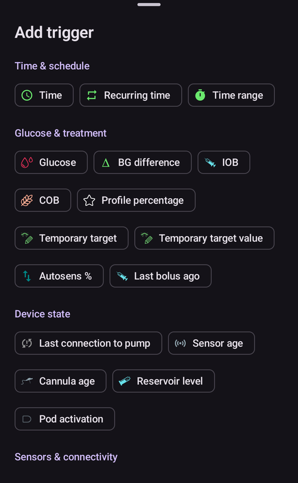
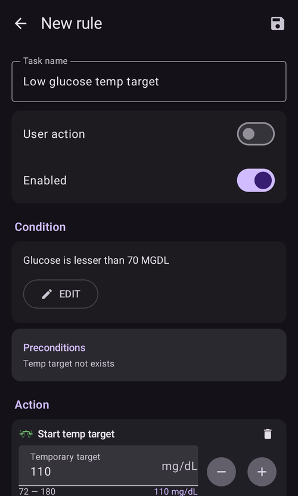

# Автоматизация

```{contents} In this page
:backlinks: entry
:depth: 2
```

## Какво е автоматизация?

„**Автоматизация**“ е функция, която може да автоматизира задачи в AAPS.

Автоматизацията изпълнява определени действия според едно или повече условия (тригери). Тригерите може да са нередовни събития, например ниска или висока кръвна захар (КЗ), или определена стойност на отрицателен активен инсулин (IOB). Автоматизациите могат да се справят и с повтарящи се събития, например хранене или спорт в определени часове от деня, или когато потребителят е на определено разстояние от GPS местоположение или в зоната на Wi-Fi мрежа (SSID). Автоматизацията може да прави резервни копия на настройките на AAPS по график или при всяка смяна на под.

Правилата за автоматизация се създават и променят от екрана **Автоматизация** (**Управление → Автоматизация**). Всяко правило се определя от две неща:

- Едно или повече условия или „тригери“, които стартират действие.

    Например определен график, събитие или стойност на някой параметър в AAPS

- Едно или повече действия, които да се изпълнят.

    Например аларма, задаване на процент на профила или експорт на настройките на AAPS при смяна на под.


Възможностите на автоматизацията са много и е добре да ги разгледате в приложението AAPS, в раздела „Автоматизация“. Можете също да потърсите примери за автоматизации от други потребители в групите на AAPS във [**Facebook**](https://www.facebook.com/groups/AndroidAPSUsers) и [**Discord**](https://discord.gg/4fQUWHZ4Mw).

## Как може да помогне автоматизацията

1. **Автоматизиране на повтарящи се задачи:** автоматично изпълнение на зададени действия без намеса на потребителя.

1. **По-малко умора от вземане на решения:** Основната полза от **автоматизациите** е, че освобождават потребителя от нуждата да прави ръчни промени в **AAPS**. [Изследване](https://www.ncbi.nlm.nih.gov/pmc/articles/PMC6286423/#ref4) изчислява, че хората с диабет тип 1 трябва да вземат средно 180 допълнителни решения на ден. **Автоматизациите** могат да намалят умственото натоварване и да освободят енергия на потребителя за други неща в живота.

1. **Възможно по-добър контрол на кръвната захар:** например **автоматизациите** могат да осигурят, че **временните цели** винаги се задават, когато е нужно, дори при натоварен график или когато сте забравили. Например, ако дете с диабет има спорт в училище във вторник в 10:00 и в четвъртък в 14:00 и има нужда от висока временна цел (TT), стартирана 30 минути преди спорта, **временната цел** може да се включи чрез **автоматизация**.

1. **AAPS може да се настрои много гъвкаво**, за да е по-агресивен или по-малко агресивен в определени ситуации, според предпочитанията на потребителя. Например временно намаляване на процента на **профила** за определено време, ако посред нощ се появи отрицателен **IOB**. Това показва, че текущият **профил** може да е твърде силен.

Примерът по-долу показва как **автоматизацията** може да премахне някои стъпки.

Потребителят тренира всяка сутрин в 6:00: трябва да не забравя ръчно да зададе „Временна цел – Физ. активност“ в AAPS в 5:00, преди тренировката.


Потребителят е създал **автоматизация**, която в 5:00 стартира „Временна цел – Физ. активност“, за да са **КЗ** и **IOB** оптимални за тренировката в 6:00:


## Важни неща преди да започнете с автоматизации

1. Преди да настроите някои автоматизации, трябва да имате добър контрол на **КЗ** с **AAPS**. Автоматизациите не бива да се използват, за да компенсират неоптимални настройки на базала, **ISF** или **CR** (вижте по-долу). Не задавайте автоматична **смяна на профил**, за да компенсирате покачване на **КЗ**, причинено _напр._ от храна. С това е по-добре да се справите по други начини (SMB и т.н.).

1. Както всяка технология, **CGM**, **помпите** и телефоните могат да се повредят: технически проблеми или грешки на сензора могат да нарушат действията на **автоматизацията** и може да се наложи ръчна намеса.

1. **Requirements for Automations are likely to change as routines change**. Когато преминавате между периоди на работа, училище и ваканция, сложете си напомняне в календара да проверите кои **автоматизации** са активни в момента (лесно се активират и деактивират). Например, ако отидете на почивка и вече нямате нужда от автоматизация за спорта в училище или за ежедневните тренировки, или трябва да промените часовете.

1. **Автоматизациите** може да си противоречат. Добре е внимателно да проверите всяка нова настройка на **автоматизация(и)** в безопасна обстановка и да разберете защо една **автоматизация** се е задействала или не се е задействала така, както очаквате.

1. Ако използвате Autosens, опитайте да използвате **временни цели** вместо **смени на профил**. **Временните цели** не връщат Autosens обратно на 0. **Смените на профил** нулират Autosens.

1. Повечето **автоматизации** трябва да се задават само за **ограничено време**. След това **AAPS** може да направи нова оценка и да повтори **автоматизацията**, ако е нужно и ако условието все още е изпълнено. Например „стартирай временна цел 7,0 mmol/l за 30 мин“ или „стартирай **профил** 110 % за 10 мин“ _и_ „стартирай временна цел 5,0 mmol/l за 10 мин“. Използването на **автоматизации** за постоянни промени (напр. към по-силен процент на профила) носи риск от хипогликемия.

## Кога мога да започна да използвам автоматизация?

**Автоматизациите** могат да се използват от **цел 10**.

## Къде се намира автоматизацията в AAPS?

Отворете **Управление** в долната навигация на главния екран и изберете **Автоматизация**.

## Как да настроя автоматизация?

За да настроите **автоматизация**, натиснете бутона **+** на екрана „Автоматизация“, за да създадете „правило“:


* дайте име на „правилото“ (Име на правилото);
* натиснете „**РЕД**“ под **Условие**. В екрана **Условие** изберете как да се свържат тригерите (**И**, **или**, **Изключващо или**) и натиснете „**Добавяне на тригер**“:


* добавете поне един тригер:



* натиснете „**ДОБ**“ под **Действие** и изберете едно действие:


* запишете правилото с бутона **Запиши** и проверете дали полето вляво от името на правилото е „отметнато“, за да активирате **автоматизацията**:


За да деактивирате правило за **автоматизация**, махнете отметката в полето вляво от името на **автоматизацията**. Примерът по-долу показва **автоматизация**, която е активирана („отметната“) или деактивирана („без отметка“):


Когато настройвате **автоматизация**, първо можете да я тествате, като използвате действието „Известие“ в „Действия“. Така **AAPS** първо показва известие, вместо наистина да изпълни действието автоматично. Когато сте сигурни, че известието се появява в правилното време и при правилните условия, можете да промените правилото за **автоматизация** и да замените „Известие“ с „Действие“.


```{admonition} Important note
:class: note

**Автоматизациите** остават активни, дори когато кръгът е изключен!
```


## Кога се проверяват правилата

**AAPS** проверява всички правила за **автоматизация** всеки път, когато обработи ново измерване на глюкозата. Така правилата се проверяват със скоростта на вашия CGM, също и когато екранът на телефона е изключен. Правилата се проверяват и когато телефонът започне да се зарежда, когато се промени мрежата или местоположението и когато се свърже Bluetooth устройство. Наведнъж се изпълнява само една проверка, затова правило, чиито действия отнемат време (например команда към помпата), не може да се изпълни два пъти.

## Ограничения за безопасност

За **автоматизациите** има ограничения за безопасност:

* **Временна цел**, зададена от **автоматизация**, трябва да е между 72 и 180 mg/dl (или 4 и 10 mmol/l).
* **Процентът на профила** трябва да е между 50 % и 130 %.
* Между изпълненията на **автоматизацията** (и преди първото изпълнение) има ограничение от 5 минути.

## Правилно използване на отрицателни стойности

```{admonition} Warning
:class: warning

Моля, бъдете внимателни, когато избирате отрицателна стойност в **Автоматизация**
```

Бъдете внимателни, когато в **автоматизациите** избирате „отрицателна стойност“ в „Условие“, например „по-малко от“. Например:


**Пример 1:** Условие **„е по-малко от“** „-0,1 mmol/l“ (или „-2 mg/dl“) ще:

Задейства **автоматизация** за всяко число, което е **строго по-малко от** -0,1 (-2). Това включва числа като -0,2, -0,3, -0,4 (-4, -6, -8) и т.н. Запомнете, че самото -0,1 (-2) **не е** включено в това условие. (Условието „е равно или по-малко от -0,1 mmol/l (-2 mg/dl)“ _би_ включило -0,1 mmol/l или -2 mg/dl).

**Пример 2:** Условие „е по-голямо от“ -0,1 mmol/l (-2 mg/dl) ще:

Задейства **автоматизация** за всяко число, което е **по-голямо от** -0,1 mmol/l (-2 mg/dl). Това включва числа като 0, 0,2, 0,4 mmol/l (0, 4, 8 mg/dl) и всяко друго положително число.

Важно е внимателно да обмислите какво точно искате да постигне вашата **автоматизация**, когато избирате тези условия и стойности.

(automations-automation-triggers)=
## Тригери на автоматизацията


Превъртете надолу, за да видите останалата част от списъка:


Потребителят може да избира от различни „тригери“. Тригерите са условията, които трябва да са изпълнени, за да се изпълни автоматизацията. Списъкът по-долу не е пълен:

**Тригер:** свързване на условия

**Опции:**

Няколко условия могат да се свържат с
* „И“
* „или“
* „Изключващо или“ (това означава, че действието или действията ще се изпълнят, ако е изпълнено едно – и само едно – от условията)

**Тригер:** време или повтарящо се време

**Опции:**

* време = еднократно събитие в определен час
* повтарящо се време = нещо, което се случва редовно (напр. веднъж седмично, всеки работен ден и т.н.)

**Тригер:** местоположение

**Опции:**

* в [Настройки > Автоматизация](#preferences-maintenance-settings) потребителят може да избере нужната услуга за местоположение (настройка „Как да се определя локацията“).

**Тригер:** услуга за местоположение

**Опции:**

* Чрез пасивна локация: **AAPS** взема местоположението само когато други приложения го изискват.
* Чрез локация на мрежата: местоположението на вашата Wi-Fi мрежа.
* Чрез GPS (Внимание! Това може силно да изтощи батерията!)

**Тригери**: данни от помпата и сензора

* Тригер „Игла на“ (възраст на иглата): наличен за всички помпи
* Тригер „Инсулин на“ (възраст на инсулина): наличен за поддържаните помпи
* Тригер „Батерия на“ (възраст на батерията): наличен за поддържаните помпи
* Тригер „Сензор на“ (възраст на сензора): винаги наличен
* Тригер „Активиране на под“: наличен за пач помпи (patch pumps)

Обърнете внимание, че при всички тригери за възраст сравнението „е равно на“ едва ли ще се задейства, затова в този случай са нужни два тригера, които да зададат диапазон

* Тригер „В резервоара“ (ниво в резервоара): наличен за всички помпи. Сравнението "NOT\_AVAILABLE" не работи за този тригер, защото в **AAPS** стойността винаги е попълнена
* Тригер „Батерия на помпата“ (ниво на батерията на помпата): наличен за поддържаните помпи. Сравнението "NOT\_AVAILABLE" не работи за този тригер, защото в **AAPS** стойността винаги е попълнена

(automations-automation-action)=
## Действие


Превъртете надолу, за да видите останалата част от списъка:


**Действия:** **Стартирай временна цел**

**Опции:**

* **КЗ** трябва да е между 72 mg/dl и 180 mg/dl (4 mmol/l и 10 mmol/l)
* **TT** работи само ако няма предишна временна цел – **AAPS** автоматично добавя към правилото ред „**Предварителни условия: Временна цел не съществува**“

**Действия:** **Спри временна цел**

**Опции:**

няма

**Действия:** **Профил процент**

**Опции:**

* **Профилът** трябва да е между 50 % и 130 %
* работи само ако предишният процент е 100 %

**Actions:** **Change smoothing** (in the **Loop & insulin** group)

**Опции:**

* select the [smoothing method](../CompatibleCgms/SmoothingBloodGlucoseData.md) to switch to. The list is the same as under **Configuration** > **Smoothing**, and the action does exactly what a change there does: the new method is saved, synced to paired clients, and the BG data is smoothed again right away.
* изпълнява се само ако този метод за изглаждане още не е активен – **AAPS** автоматично добавя към правилото ред „**Предварителни условия: Изглаждане … е неактивно**“. Щом избраното изглаждане е активно, правилото се пропуска без съобщение.
* Example: a new sensor is often noisy during its first day. Two rules with the **Sensor age** trigger give stronger filtering while the sensor settles, and lag-free smoothing after that:
  * **Sensor age** less than 24 h: **Change smoothing** to **Unscented Kalman Filter**
  * **Sensor age** more than 24 h: **Change smoothing** to **Average smoothing**

**Действия:** **Бележка** (в групата **Аларми** на списъка)

**Опции:**

* изберете събитието за запис: **Бележка**, **Физ. активност**, **Въпрос**, **Известие** или **Смяна на сет**, и бележка по желание. Името на действието се сменя на събитието, което изберете.
* **Продължителност**: използва се за **Бележка**, **Физ. активност** и **Смяна на сет**. **Въпрос** и **Известие** нямат продължителност: вместо това те записват текущата ви КЗ.
* **Смяна на сет** нулира възрастта на иглата (канюлата), все едно сте записали смяна на сета ръчно. Пример: някои помпи (като Combo) сами записват смяна на резервоара, но не и смяна на сета. Ако винаги сменяте двете заедно, правило с **Инсулин на** по-малко от 1 час и **Игла на** повече от 24 часа може да запише смяната на сета вместо вас.

 

**Действия:** **Изпратете SMS на всички** (в групата **Аларми**)

**Опции:**

* въведете текста на съобщението. То се изпраща до всички телефонни номера, разрешени в настройките на [SMS комуникатор](../RemoteFeatures/SMSCommands.md). Плъгинът „SMS комуникатор“ трябва да е включен.

**Действия:** **Смени профила на** (в групата **Профил**)

**Опции:**

* изберете **профила**, който да се активира. Той се активира със 100 %, без изместване във времето (timeshift). Ако този профил вече е активен, действието не прави нищо.

**Действия:** **Пусни/спри SMB** (в групата **Кръг & инсулин**)

**Опции:**

* изберете **ВКЛ** или **ИЗКЛ**. Това променя настройката **Използвай SMB** на OpenAPS SMB точно както ако я бяхте променили в **Настройки**, и тя остава така, докато вие или друго правило не я върнете.

**Действия:** **Стартирай Autotune** (в групата **Кръг & инсулин**)

**Опции:**

* изберете профила за настройване и броя дни: вижте [Стартиране на Autotune с правило за автоматизация](#autotune-run-autotune-with-an-automation-rule).

**Действия:** **Спри изпълнението** (в групата **Кръг & инсулин**)

**Опции:**

* няма. While the conditions of a rule with this action are true, **AAPS** does not check the rules below it in the list. As soon as its conditions are false again, the rules below are checked as usual. Добавете го към правило, което трябва да има предимство пред правилата под него (вижте [реда на автоматизациите](#Automations-the-order-of-the-automations-in-the-list-matters)).

**Действия:** **Стартирай сценарий**, **Разреши сценарий**, **Забрани сценарий** (в групата **Сценарии**)

**Опции:**

* изберете [сценария](Scenes.md), който да се стартира, разреши или забрани.

След като добавите „Действие“, трябва да промените стойностите по подразбиране на желаните, като ги натиснете и коригирате.


(Automations-the-order-of-the-automations-in-the-list-matters)=
## Редът на **автоматизациите** в списъка е важен
 **AAPS** изпълнява създадените правила по реда на приоритет, като започва от началото на списъка с **автоматизации**. Например, ако **автоматизацията** „Low“ е най-важната **автоматизация**, над всички други правила, тази **автоматизация** трябва да е най-горе в списъка с **автоматизации** на потребителя, както е показано по-долу:


За да промените приоритета на правилата за **автоматизация**, докоснете и задръжте дръжката **=** вдясно от правилото. Подредете **автоматизациите**, като местите правилата нагоре или надолу.


## Как да изтриете правила за автоматизация

За да изтриете правило за **автоматизация**, натиснете иконата с кошче.


## Примери за автоматизации

По-долу има примери за **автоматизации**. Още дискусии за **автоматизациите** и за това как потребителите са настроили своите **автоматизации** ще намерите в групите във Facebook или в Discord. Не копирайте примерите по-долу, ако не разбирате добре как ще работи **автоматизацията**.

(automations-low-glucose-temp-target)=
### Временна цел при ниска КЗ

Тази **автоматизация** автоматично стартира **временна цел**, когато **КЗ** падне под определен праг – тук, когато глюкозата е по-ниска от 70 mg/dl, се стартира цел 110 mg/dl за 30 минути:



### Временна цел за обяд (с „Местоположение“)


Тази **автоматизация** е създадена за потребител, който обядва на работа приблизително по едно и също време всеки работен ден, но тя се задейства само ако потребителят се намира в зададено „местоположение“.  Така, ако потребителят един ден не е на работа, тази **автоматизация** няма да се активира.

Тази **автоматизация** ще зададе ниска **временна цел** (Преди хранене) в 13:00, за да доведе КЗ до 90 mg/dl (или 5 mmol/l) преди обяда.

Тригерът „Местоположение“ има име, позиция (докоснете **Избери на карта** или използвайте текущото си местоположение) и радиус в метри. Той се задейства, когато сте вътре в зоната (или извън нея):


Заради връзката „И“ **автоматизацията** се изпълнява само в „избраното време“ и само ако потребителят е на избраното местоположение.

**Автоматизацията** няма да се задейства в друго време на това местоположение, нито в това време извън радиуса от 50 метра около избраната позиция.

### Автоматизация с местоположение по Wi-Fi SSID

Wi-Fi SSID е добър начин да задействате **автоматизация**, докато сте в обхвата на определена Wi-Fi мрежа (в сравнение с GPS): той е доста точен, използва по-малко батерия и работи в затворени помещения, където GPS и другите услуги за местоположение може да не са налични.

Ето още един пример за настройка на **временна цел** само в работни дни преди закуска (1).


**Автоматизацията** ще се задейства в 05:30 само от понеделник до петък (2)  
и докато телефонът е свързан към домашната Wi-Fi мрежа (3).


След това тя ще зададе **временна цел** 75 mg/dl за 30 минути (4). Едно от предимствата да включите местоположението е, че правилото няма да се задейства, например ако потребителят е на почивка.


Превъртете надолу, за да видите действието: **временна цел** 75 mg/dl за 30 минути (4).


Ето екранната снимка с тригерите на **автоматизацията**:

1) Под основното „И“ (и двете условия трябва да са изпълнени, за да се задейства) 1) Повтарящо се време = П,В,С,Ч,П В 5:30  
1) WiFi SSID на мрежа = My_Home_WiFi_Name


(automating-preference-settings-export)=

## Автоматичен експорт на настройките

### Автоматичен експорт: по график (ежедневно)

Екранни снимки с тригерите на автоматизацията:

1) Условие: Повтарящо се време = П,В,С,Ч,П В 8:00 1) Действие: Експортиране на настройките (в „Текст в лечения“ въведете „Ежедневно“)


Забележка: изпълнението на експорта се записва в „Портал за лечения“

### Автоматичен експорт: Активиране на под (само за пач помпи)

Екранни снимки с тригерите на автоматизацията:

1) Условие: Активиране на под 1) Действие: Експортиране на настройките (в „Текст в лечения“ въведете „Активиране на под: експорт на настройките“)


Забележка: изпълнението на експорта се записва в „Портал за лечения“. Забележка: автоматизацията **изобщо** няма да се задейства, ако преди това не сте направили ръчен експорт на настройките. Вижте [Настройки → Поддръжка](#preferences-maintenance-settings) за правилното включване на автоматичния експорт на настройките.


## Дневник на автоматизацията

**AAPS** показва дневник на последните събития на **автоматизацията** в долната част на екрана **Автоматизация**, под правилата. Използвайте го, за да проверите дали правилата ви са се задействали, когато сте очаквали.

В примера по-долу правилото **Low glucose temp target** (1) (вижте [Временна цел при ниска КЗ](#automations-low-glucose-temp-target) по-горе) е включено. Дневникът (2) показва, че в 03:09 PM (15:09) глюкозата е паднала под 70 mg/dl и правилото се е задействало:
* действието е „Стартирай временна цел: 110mg/dL@30 min“: **временна цел** 110 mg/dl за 30 минути;
* **OK** в края означава, че действието е изпълнено успешно.


(automations-troubleshooting)=

## Отстраняване на неизправности

* Проблем: __AAPS не задейства моите автоматизации?__

Проверете дали полето вляво от името на **автоматизацията** е „отметнато“, за да сте сигурни, че правилото е активно:


* Проблем: __Моите автоматизации се задействат в грешен ред.__

Проверете реда на приоритет на правилата, както е описано по-горе.

* Проблем: __Условие показва „Неизвестен тригер … - никога не е възможен“.__

Правилото съдържа тригер, който тази версия на **AAPS** не може да прочете, например след като сте се върнали към по-стара версия или сте импортирали настройки от по-нова. Такъв тригер никога не е изпълнен, затова правилото не се изпълнява. Той се запазва непроменен, за да може по-нова версия все още да го използва. Редактирайте правилото и сменете тригера или обновете **AAPS**.

## Алтернативи на автоматизацията

За напреднали потребители има и други начини за автоматизиране на задачи – с IFTTT или с приложение за Android от трета страна, наречено Automate. 
