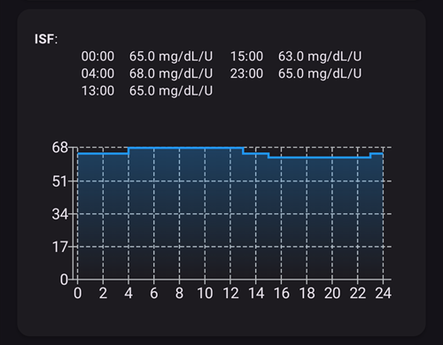
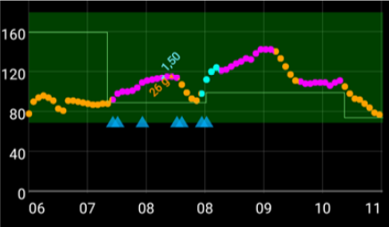

(Open-APS-features-DynamicISF)=
# Динамично ISF (DynISF)

Досега, при **AMA** и **SMB**, **ISF** се задаваше в **Профил** и беше постоянен за всеки зададен период от деня. Но в действителност **ISF** на човека не е толкова постоянен и се променя според нивото на **КЗ**: при висока КЗ потребителят има нужда от повече инсулин, за да понижи **КЗ** с 50 mg/dl / 3 mmol/l, отколкото при по-ниска **КЗ**. [Autosens](#Open-APS-features-autosens) беше първият алгоритъм, който се опита да реши този проблем, като променя **ISF** извън времето за хранене.

**Динамично ISF** (наричано също **DynISF**) има същата цел, но е по-напреднало, защото може да се използва по всяко време. Препоръчва се само за напреднали потребители, които добре владеят управлението и наблюдението на **AAPS**. Прочетете раздела [Какво да имате предвид, преди да активирате Динамично ISF](#dyn-isf-things-to-consider-when-activating-dynamicisf) по-долу, преди да го изпробвате.

```{admonition} CAUTION - Automations or Profile Percentage change
:class: warning

**Автоматизациите** винаги трябва да се използват внимателно. Това важи особено при **Динамично ISF**.

Когато използвате **Динамично ISF**, изключете всяко правило в **Автоматизация**, което временно променя **Профил**, защото то би направило **Динамично ISF** прекалено агресивно при корекционните болуси и би довело до хипогликемия. Точно това е задачата на **Динамично ISF**, затова няма нужда **AAPS** да получава указание чрез Автоматизация да подава допълнителен инсулин при висока **КЗ**.

```

За да използвате **Динамично ISF**, базата данни на **AAPS** трябва да съдържа данни от **AAPS** на потребителя за поне 7 дни.

## What does Dynamic ISF do?

**Динамично ISF** променя динамично инсулиновата чувствителност (**ISF**) въз основа на:

- общата дневна доза инсулин (**TDD**); и
- текущите и прогнозните стойности на кръвната захар.

When using **Dynamic ISF**, the **ISF** values entered in the **Profile** are not used at all anymore, except as a fallback if there is not enough TDD data in **AAPS** database (*i.e.* fresh reinstallation of the app).

**SMB/AMA** – пример за **Профил** на потребител със статичен **ISF**, зададен от потребителя и използван от **SMB** и **AMA**.



**Динамично ISF** – пример за **ISF** на потребител, който се променя според изчисленията на **Динамично ISF**.


Разделът, ограден в червено, показва: `profile ISF` -> `ISF as calculated by DynISF`. <br/> Tapping on this section shows a dialog with additional information, such as the **ISF** used for the calculator and carbs absorption (see [Other usages of ISF](#dynisf-other-usages-of-isf) below).

Стойността на **DynISF** може да се покаже и на графика: докоснете **Добави графика** под графиките на главния екран и изберете **ПРОМ ЧУВСТВ** (променлива чувствителност). Тя се показва като бяла линия (в долната част на изображението по-горе).

## How is Dynamic ISF calculated?

**Динамично ISF** използва модела на Chris Wilson, за да определи **ISF**, вместо статичната стойност на **ISF**, зададена от потребителя в **Профил**. Подробно обяснение има тук: [Chris Wilson on Insulin Sensitivity (Correction Factor) with Loop and Learn, 2/6/2022](https://www.youtube.com/watch?v=oL49FhOts3c).

Използваното уравнение на **Динамично ISF** е: `ISF = 1800 / ((TDD * DynISF Adjust Factor) * Ln (( current BG / insulin divisor) + 1 ))`

Променливите в това уравнение са описани по-долу.<br/> Бележка: `Ln` означава натурален логаритъм – математическа функция.

Програмата използва горното уравнение, за да изчисли текущия **ISF**, както и в [прогнозите на oref1 за **IOB**, **ZT** (нулев временен базал) и **UAM**](#aaps-screens-prediction-lines). Използва се също за **COB** и в болус калкулатора (вижте [Други приложения на ISF](#dynisf-other-usages-of-isf) по-долу).

### TDD (Обща дневна доза)
За TDD се използва комбинация от следните стойности:
1.  средната **TDD** за 7 дни;
2.  **TDD** от предишния ден; и
3.  претеглена средна стойност на използвания инсулин за последните осем (8) часа, екстраполирана за 24 часа.

**TDD**, използвана в горното уравнение, се образува от всяка от горните стойности с тегло една трета.

### Фактор за настройка на Динамично ISF

Задава се в **Настройки** на потребителя и се използва, за да направи **Динамично ISF** по-агресивно или по-малко агресивно. Вижте раздела [Опции](#dyn-isf-preferences) по-долу.

### Делител на инсулина
Делителят на инсулина зависи от пика на използвания инсулин и е обратно пропорционален на времето до пика. За Lyumjev тази стойност е 75, за Fiasp – 65, а за обикновен бързодействащ инсулин – 55.

### ISF според прогнозната КЗ при решенията за дозиране

Динамичната чувствителност се изчислява с **текущата КЗ** и се показва като текущ ISF в **AAPS**. Но при изчисленията за дозиране алгоритъмът oref1 изчислява и използва **бъдещ ISF**.

Това се прави, за да не се подава твърде много инсулин, когато **КЗ** е ниска или се очаква да стане ниска.

**Бъдещият ISF** използва същата формула, описана по-горе, с тази разлика, че може да използва **минималната прогнозна КЗ** вместо **текущата КЗ**. **Минималната прогнозна КЗ**, [изчислена от oref1](#aaps-screens-how-predictions-become-a-dosing-decision), е най-ниската стойност, до която се очаква да стигне вашата КЗ през целия период на прогнозите.

* If the current **BG** is above target<br/> **and** if **BG** levels are flat, within +/- 3 mg/dL:<br/>BG is used in the formula as follows: `average(minimum predicted BG, current BG)`.
* If eventual **BG** is above target and glucose levels are increasing,<br/> **or** eventual **BG** is above current **BG**:<br/>BG is used in the formula as follows: `current BG`.
* Във всички останали случаи:<br/>във формулата за КЗ се използва: `minimum predicted BG`.

За опростено обяснение вижте екранната снимка по-долу, която показва описаната по-горе ситуация. Оранжевите точки използват **прогнозната КЗ**, лилавите точки използват **средното от (прогнозната КЗ, текущата КЗ)**, а сините точки използват **текущата КЗ**.



(dynisf-other-usages-of-isf)=
## Други приложения на ISF

### ISF и усвояване на COB

Както е описано на страницата [Калкулиране на COB](../DailyLifeWithAaps/CobCalculation.md), обикновено усвояването на COB се изчислява с тази формула:   
`absorbed_carbs = deviation * ic / isf`  
Когато използвате **Динамично ISF**, тук се използва **ISF**, равен на средната стойност на Динамично ISF за последните 24 ч.

### ISF в болус калкулатора

Когато използвате [Болус калкулатор](#aaps-screens-bolus-wizard), **ISF** се използва, за да се добави корекция, ако **КЗ** е над целта.

Когато използвате **Динамично ISF**, тук се използва **ISF**, равен на средната стойност на Динамично ISF за последните 24 ч.

(dyn-isf-preferences)=
## Настройки

Отметнете **Използвай динамична чувствителност** в [Настройки > OpenAPS SMB](#Preferences-openaps-smb-settings), за да го активирате. След избиране се появяват нови настройки.


(dyn-isf-adjustment-factor)=
### Фактор за настройка на DynamicISF
**Динамично ISF** работи по едно правило, което би трябвало да важи за всички. Това означава, че хора с еднаква **TDD** биха имали еднаква чувствителност. Тъй като всеки потребител има своя лична чувствителност, **Факторът за настройка** позволява на потребителя да зададе дали е по-чувствителен или по-малко чувствителен към инсулина от „стандартния“ човек.

**Факторът за настройка** е стойност между 1 % и 300 %. Той действа като множител на стойността на **TDD**.

* Ако увеличите тази стойност над 100 %, **DynISF** става по-агресивно: стойностите на **ISF** стават *по-малки* (_т.е._ нужен е повече инсулин, за да се понижи **КЗ** с малко)
* Ако намалите тази стойност под 100 %, **DynISF** става по-малко агресивно: стойностите на **ISF** стават по-големи (_т.е._ нужен е по-малко инсулин, за да се понижи **КЗ** с малко).

**Факторът за настройка** се променя и когато активирате [**Смяна на профил** с процент](../DailyLifeWithAaps/ProfileSwitch-ProfilePercentage.md). По-нисък **процент на профила** намалява **Фактора за настройка**, а по-висок **процент на профила** го увеличава.

For example, if your **Adjustment Factor** is 80%, and **Profile Switch** to 80% is actioned, the resulting **Adjustment Factor** will be `0.8*0.8=0.64`.

Това означава, че когато използвате **DynISF**, можете да използвате **процент на профила**, за да настроите временно и ръчно своята чувствителност. Това може да е полезно при физическа активност (по-нисък процент), болест (по-висок процент) и др.

### LGS граница

Стойност на **КЗ**, под която подаването на инсулин се спира (спиране на базала при ниска КЗ). Стойността по подразбиране използва стандартния модел на целта. Потребителят може да зададе тази стойност между 60 mg/dl (3,3 mmol/l) и 100 mg/dl (5,5 mmol/l). Стойности под 65/3,6 водят до използване на модела по подразбиране.

### DynamicISF да регулира чувствителността

Тази настройка (*„Използвай DynamicISF за автоматична настройка на чувствителността“*) заменя Autosens и използва съотношението **TDD** за последните 24 ч / **TDD** за 7 дни като основа за увеличаване и намаляване на базалната доза, по същия начин като стандартния Autosens. Тази изчислена стойност се използва и за промяна на целта, ако са включени опциите за промяна на целта според чувствителността. За разлика от Autosens, тази опция не променя стойностите на **ISF**.

(dyn-isf-things-to-consider-when-activating-dynamicisf)=
## Какво да имате предвид, преди да активирате Динамично ISF

* **Динамично ISF** се препоръчва само за напреднали потребители, които добре владеят управлението и наблюдението на **AAPS**. В идеалния случай потребителите трябва да постигнат добър контрол със **SMB**, преди да преминат към **Динамично ISF**.
* Както е посочено по-горе, изключете всички [**Автоматизации**](../DailyLifeWithAaps/Automations.md), които активират **процент на профила** в зависимост от **КЗ**, защото това ще е прекалено агресивно и може да доведе до подаване на твърде много инсулин! Това вече е част от алгоритъма на **Динамично ISF**.
* [Процентът на профила](../DailyLifeWithAaps/ProfileSwitch-ProfilePercentage.md) се взема предвид при изчислението на Динамично ISF (вижте [Фактор за настройка на Динамично ISF](#dyn-isf-adjustment-factor) по-горе). Лоша практика е да използвате дълго време **процент на профила**, различен от 100 %. Ако установите, че вашият **Профил** се е променил, създайте нов **Профил** с новите стойности, който да възпроизвежда **Профил** с определения процент.
* **Динамично ISF** може да не е подходящо за всеки. По-специално, може да видите неочаквани резултати, ако някоя от тези ситуации се отнася за вас:
  * Променлив начин на живот (нередовно хранене или нередовна физическа активност)
  * TDD или чувствителност, които се променят много от ден на ден.
* Няма точно ръководство как да зададете началната стойност на **Фактора за настройка**. Все пак, като начална точка: ако стойностите във вашия **Профил** са правилни, когато сте в целевия диапазон и нивата на **КЗ** са стабилни, стойността на **DynISF** трябва да е приблизително същата като тази, която сте имали преди във вашия **Профил**.<br/>Ако видите, че **Динамично ISF** е прекалено агресивно, намалете **Фактора за настройка**, и обратно.
* Въпреки че **DynISF** изобщо не използва **ISF от профила**, ако забележите, че чувствителността ви е много различна от тази, която е записана във вашия **Профил**, добре е да го поддържате актуален. This may be useful in case you lose your **AAPS** data (_e.g._ new phone, new **AAPS** version…), as your **Profile ISF** will be used as fallback for the next 7 days.