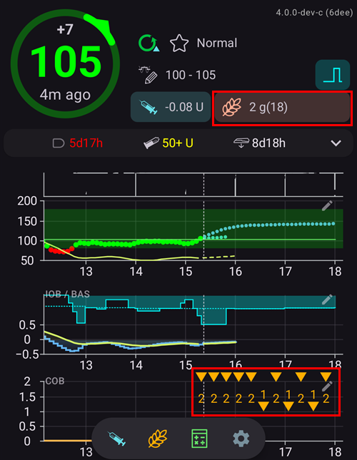

(Extended-Carbs-extended-carbs-ecarbs)=
# Удължени въглехидрати / „eCarbs“

## Какво са eCarbs и кога са полезни?

При обикновена терапия с помпа удължените болуси са добър начин да се справите с мазни или по друг начин бавно усвоявани храни, които повишават кръвната захар по-дълго, отколкото действа инсулинът. Но при затворен кръг удължените болуси нямат много смисъл (и създават технически трудности), защото по същество са постоянен висок временен базал. Това противоречи на начина, по който работи кръгът – той променя базалната доза динамично. За подробности вижте [удължен болус](#extended-bolus-and-why-they-wont-work-in-closed-loop-environment) по-долу.

Но нуждата да се справите с такива храни все пак остава. Затова AAPS поддържа т.нар. удължени въглехидрати или eCarbs.

eCarbs са въглехидрати, разпределени в рамките на няколко часа. При стандартни хранения с повече въглехидрати, отколкото мазнини/белтъчини, обикновено е достатъчно да въведете въглехидратите предварително (и при нужда да намалите началния болус), за да не се подаде инсулин твърде рано.  Но при бавно усвоявани храни, при които въвеждането на всички въглехидрати предварително води до твърде много IOB от SMB, можете да използвате eCarbs. Така по-точно се симулира как въглехидратите (и въглехидратните еквиваленти, които въвеждате за другите макронутриенти) се усвояват и влияят на кръвната захар. С тази информация кръгът може да подава SMB по-постепенно, за да покрие тези въглехидрати. Това може да се разглежда като динамичен удължен болус (това би трябвало да работи и без SMB, но вероятно е по-малко ефективно).

**Note:** eCarbs aren't limited to fatty / protein heavy meals: they can also be used to help in any situation where there are influences that increase the blood sugar, e.g. other medication like corticosteroids.

## Как се използват eCarbs

За да въведете eCarbs, отворете прозореца **Въглехидрати** (**Лечения** → **Въглехидрати**), въведете общото количество въглехидрати, задайте **Продължителност** и при желание изместете началото с **Започват от** (*числата по-долу са само примери – ще трябва да изпробвате свои стойности, за да постигнете задоволителна реакция на глюкозата във вашите случаи*):

eCarbs на главния екран: числото в скоби в полето **COB** показва въглехидратите, които тепърва ще дойдат, а графиката на **COB** показва всеки бъдещ запис на eCarbs като оранжев маркер. Ако не виждате графика на **COB**, добавете я с **Добави графика** под графиките (вижте [Екраните на AAPS](../DailyLifeWithAaps/AapsScreens.md)).

(AapsScreens-carbs-type)=
## Вид въглехидрати в болус калкулатора: хляб, торта или пица

В [Болус калкулатор](#aaps-screens-bolus-wizard) три бутона под полето **Въглехидрати** ви позволяват да изберете колко бързо се усвоява храната. Изберете един от тях, преди да потвърдите. В зависимост от вида **AAPS** взема част от въведените въглехидрати като обикновени въглехидрати и добавя по-късно [удължени въглехидрати („eCarbs“)](#Extended-Carbs-extended-carbs-ecarbs) за бавни, богати храни. Натиснете иконата **(i)** до бутоните, за да видите типичните храни за избрания вид и какво прави той с вашите въглехидрати.

| Тип                        | Typical foods (examples from the app)                                                                                           | Въглехидрати сега, използвани за болуса | Добавени eCarbs                                          |
| -------------------------- | ------------------------------------------------------------------------------------------------------------------------------- | --------------------------------------- | -------------------------------------------------------- |
| **Хляб** (по подразбиране) | Хляб, солени тестени изделия, кисело мляко, плодове, картофи, ориз, овесени ядки, зеленчуци                                     | 100 %                                   | Няма                                                     |
| **Торта**                  | Кнедли, паста, азиатски ястия с много въглехидрати и мазнини, сладки и дрождени тестени изделия, зърнени закуски, мед, конфитюр | 90 %                                    | 20 %, започват 60 минути по-късно, разпределени в 2 часа |
| **Пица**                   | Лазаня, пица, хамбургери, пържени картофи, печени картофи, чипс                                                                 | 80 %                                    | 35 %, започват 60 минути по-късно, разпределени в 3 часа |

**Пример**: въвеждате 100 г и избирате **Пица**. Болусът се изчислява за 80 г, записани сега. 35 г eCarbs започват 1 час по-късно и се разпределят в 3 часа.

Добре е да знаете:
* Това не е просто разделяне: при **Торта** и **Пица** записаните въглехидрати са общо **повече от въведеното** (110 % и 115 %). Разликата е само в eCarbs.
* Болусът покрива само въглехидратите, приети сега. **AAPS** не подава болус предварително за eCarbs: кръгът ги взема предвид, след като започнат, както всички други [eCarbs](#Extended-Carbs-extended-carbs-ecarbs).
* Ако зададете **Започват от**, eCarbs започват 60 минути след това време.
* Прозорецът за потвърждение показва eCarbs на отделен ред, _напр._ „Уд въглехидрати 35гр / 3ч (+60мин)“.
* Грамовете се закръглят надолу до цели числа.
* Процентите, закъсненията и продължителностите са фиксирани; не могат да се променят в настройките.
* Изборът не се запомня: калкулаторът се отваря на **Хляб** всеки път.

______________________________________________________________________

Един начин за справяне с мазнините и белтъчините с тази функция е описан тук: [https://adriansloop.blogspot.com/2018/04/page-margin-0.html](https://adriansloop.blogspot.com/2018/04/page-margin-0.html)

______________________________________________________________________

## Препоръчителна настройка, примерен сценарий и важни бележки

Препоръчителната настройка е да използвате APS плъгина OpenAPS SMB, с разрешени SMB и с включена опция *Разреши SMB с COB (въглехидрати)*.

Примерен сценарий, напр. за пица, може да бъде да подадете (частичен) болус предварително чрез *Болус калкулатор* и след това да използвате прозореца *Въглехидрати*, за да въведете останалите въглехидрати с продължителност 4–6 часа, с начало след 1 или 2 часа.

За по-бързо начало *Болус калкулатор* може да добави eCarbs вместо вас: изберете [вид въглехидрати](#AapsScreens-carbs-type) **Торта** или **Пица** под полето **Въглехидрати** (вижте по-горе). Количествата и времето са фиксирани, затова използвайте прозореца *Въглехидрати*, ако искате други стойности.

**Важни бележки:** Разбира се, ще трябва да изпробвате кои конкретни стойности са подходящи за вас. Можете също внимателно да промените настройката *Максимални минути до които да ограничава SMB*, за да направите алгоритъма по-агресивен или по-малко агресивен. При храни с малко въглехидрати и много мазнини/белтъчини може да е достатъчно да използвате само eCarbs без ръчни болуси (вижте публикацията в блога по-горе). Когато се създават eCarbs, се създава и бележка в Портал за лечения, която записва всички въведени данни. Така е по-лесно да ги проверявате и подобрявате стъпка по стъпка.

(extended-bolus-and-why-they-wont-work-in-closed-loop-environment)=
## Extended boluses and why they don't work in a closed-loop environment

Както е посочено по-горе, удължените или многовълновите болуси всъщност не работят при затворен кръг. [See below](#why-extended-boluses-won-t-work-in-a-closed-loop-environment) for details

(Extended-Carbs-extended-bolus-and-switch-to-open-loop-dana-and-insight-pump-only)=
### Удължен болус и превключване към отворен кръг – само за помпи Dana и Insight

Някои хора все пак искаха възможност да използват удължен болус в AAPS, защото искаха да покриват определени храни по начина, по който са свикнали.

Затова **AAPS** предлага удължен болус за потребителите на помпи Dana и Insight: отворете **Управление** и изберете **Удължен болус**.

Първо **AAPS** ви предупреждава, че затвореният кръг ще бъде спрян, докато тече удълженият болус. Докоснете **ОК**, за да продължите:

Въведете количеството **Инсулин** и **Продължителност**, след това докоснете бутона за потвърждение долу и **ОК**:

При помпата Insight удълженият болус *не е достъпен*, ако се използва [емулация на TBR](#Accu-Chek-Insight-Pump-settings-in-aaps).

Докато тече удълженият болус, кръгът работи в режим **Отворен кръг** (иконата на кръга на главния екран се променя), а затвореният кръг се включва отново автоматично, когато удълженият болус приключи:

Менюто **Управление** показва бутон **Откажи** със скоростта и изминалото / общото време (например **Откажи 2,00 U/h 1/60'**). Докоснете го, за да спрете удължения болус по-рано:

(why-extended-boluses-won-t-work-in-a-closed-loop-environment)=
### Защо удължените болуси не работят при затворен кръг

1. Кръгът решава, че сега трябва да се подават 1,55 U/h. За алгоритъма няма значение дали това се подава като удължен болус или като TBR. Всъщност някои от помпите използват удължения болус. Какво трябва да стане тогава? Повечето драйвери за помпи тогава спират удължения болус -> Изобщо не е било нужно да го стартирате.

2. Ако удълженият болус беше входна стойност, какво трябва да стане в модела?

   1. Трябва ли да се смята за неутрален заедно с BR и кръгът да работи с него? Тогава кръгът трябва ли да може и да намали болуса, ако например КЗ стане твърде ниска и целият „неутрален“ инсулин бъде премахнат?
   2. Трябва ли удълженият болус просто да се добави? Значи кръгът просто трябва да може да продължи? Дори при най-тежката хипогликемия? Не мисля, че това е добре: хипогликемията е предвидена, но не бива да бъде предотвратена?

3. IOB, който натрупва удълженият болус, се появява след 5 минути при следващото изпълнение. Затова кръгът ще подаде по-малко базал. Така че не се променя много... освен че се губи възможността да се избегне хипогликемия.
