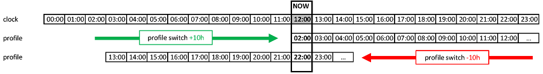

# Смяна на профил и процент на профила

Този раздел обяснява какво са **Смяна на профил** и **Процент на профила**. Можете да научите как да създадете **профил** на страницата [Вашият профил в AAPS](#your-aaps-profile-create-and-edit-profiles).

Когато започвате с **AAPS**, ще трябва да създадете **профил**, да разберете как се прави **Смяна на профил** и да научите какъв е ефектът на **Процента на профила** в **AAPS**. The features of a **Profile Switch** or **Profile Percentage** can be particularly beneficial for:

- менструалния цикъл – в **Автоматизация** може да се настрои процентна промяна на **профила**, за да може **AAPS** да се съобрази с различните фази на хормоналния цикъл и с очакваната инсулинова резистентност.

- физическа активност – в **Автоматизация** може да се настрои процентна промяна на **профила** за физическа активност, за да се намали базалът.

- нощна работа или работа на смени – за хора, които работят на смени, може да се настрои отместване във времето на **профила**: броят часове в **профила** се променя според това колко по-късно/по-рано потребителят ще си легне или ще стане.

Защо да използвате **Процент на профила** вместо временна промяна на базала? За да бъде по-ефективен, **Процентът на профила** прилага пропорционално намаление или увеличение на: базала, ISF и I:C. Така **AAPS** изчислява балансирано подаването на инсулин на потребителя. Намаляването само на базала в **профила** на потребителя в **AAPS** дава малка полза, ако алгоритъмът продължава да използва същите коефициенти ISF и I:C.

(ProfileSwitch-change-percentage)=

## Промяна на процента на профила от главния екран

Нужен ви е поне един записан **профил**. **Процентът на профила** винаги се прилага чрез **Смяна на профил**: активирате отново **профил**, този път с процент.

```{admonition} Идвате от AAPS 3? :class: note Продължителното натискане на името на профила вече не отваря диалога за смяна на профил. **Докоснете** името на профила и след това докоснете кръглия бутон **▶** долу вдясно: той отваря същите настройки (процент, продължителност, временна цел „Физ. активност“).

    <br />1. На главния екран **докоснете името на профила** (до иконата със звезда). Отваря се [екранът „Профил“](#ProfileSwitch-manage-v4) на картата на текущия **профил**, маркирана с **АКТИВЕН**.
    
       
    
    2. За да запазите същия **профил**, оставете избрана картата с **АКТИВЕН**. За да смените и **профила** в същото време, плъзнете до друга карта.
    3. Докоснете кръглия бутон **▶** (**Активиране**) долу вдясно. Отваря се екранът **Активиране**.
    4. Задайте **Процент** с **−** / **+** (на стъпки от 5 %) или го въведете (от 30 до 250 %). Полето винаги започва от **100 %**: то не показва процента, който работи в момента. Например въведете **80** за 20 % по-малко инсулин или **120** за 20 % повече.
    5. Задайте **Срок** в минути:
       * **0** запазва новия процент, докато не направите друга **Смяна на профил**;
       * всяка друга стойност прекратява смяната след това време и **AAPS** се връща към **профила**, който е работил преди това.
    
       
    
    6. Докоснете **▶ Активиране** в долната част на екрана. Проверете обобщението в диалога **Смяна на профил** и докоснете **ОК**.
    
       
    
    След връщане на главния екран името на профила показва процента и оставащото време, например *Normal (80%) (59')*, и става жълто, докато работи смяна с продължителност. Звезда отбелязва смяната на графиката на КЗ. Вижте [главния екран](#aaps-screens-profile--target).
    
    
    
    За да **се върнете към 100 %** преди края, повторете стъпките и оставете **Процент** на 100 и **Срок** на 0.
    
    ```{admonition} Проценти с едно докосване
    :class: tip
    Ако често използвате един и същ процент (спорт, болест), добавете [пряк път към профил](#profile-shortcuts) в лентата QuickLaunch или създайте [сценарий](Scenes.md). И двете прилагат профил с предварително зададени процент и продължителност с едно докосване.
    

(ProfileSwitch-manage-v4)=

## Управление и активиране на профили (Управление → Профил)

В **AAPS** v4 профилите се управляват и активират от екрана **Управление** (долната навигация) → **Профил** (*„Редакция и активация на профили“*).

Екранът „Профил“ показва профилите ви като **карусел от карти, които се плъзгат**. Картата на текущия профил е маркирана с **АКТИВЕН** и показва общия му дневен базал (напр. *∑ 30,15 U*). Below the selected card you see that profile's details — the **Insulin** type, and the **IC**, **ISF**, **basal** and **target** schedules with graphs.

When a temporary switch is running, the **ACTIVE** card shows its percentage and time shift with the time left, for example *110% +2 h · 2 h 40 min*, above a progress bar. Both are refreshed every 30 seconds. The details below then have two columns: the values of the profile in blue, and the values in use with the percentage in red.


Бутоните долу действат върху **избрания** профил: **➕ Добави**, **✏️ Редактирай**, **⧉ Клонирай** и **‘️ Изтрий**, а вдясно е кръглият бутон **▶ Активиране**. За това как да попълните четирите графика в редактора (И / Въгл, Чувств, БАЗА, ЦЕЛ), вижте [Създаване и редактиране на профили](#your-aaps-profile-create-and-edit-profiles).

**⧉ Клонирай** използва иконата с два квадрата, която често означава *копиране*, но няма какво да поставяте: дубликатът се прави с една стъпка. Потвърдете *Да се клонира ли профил Normal?* и нов профил с име *Normal copy* се добавя в края на карусела и се избира, готов за **✏️ Редактирай** (там можете и да го преименувате). Това не е същото като клонирането на минала **Смяна на профил** от историята на леченията, което създава нов профил *с приложени процент и отместване във времето*. Вижте [Запазване на смяна на профил за по-късно използване](#ProfileSwitch-keep-for-later).

(ProfileSwitch-read-only-mode)= **Има само бутон ▶ Активиране?** Настройките ви са защитени, затова екранът се отваря само за четене. Докоснете **✏️ молива** в горната лента и въведете паролата за настройките. Вижте [Защитата на настройките вече заключва и екраните за управление](#v4changes-read-only-management).

### Подреждане на профили

Ако имате повече от един профил, можете да изберете реда им в карусела: докоснете иконата **Подреди** (⇅, две стрелки нагоре и надолу) в горната лента. Индикаторът на страниците се заменя с **бутони за преместване ◀ / ▶** и показване *позиция / общо* — премествайте картата в центъра по-рано или по-късно и след това потвърдете с **✓** (или отхвърлете с **✕**). Новият ред се записва веднъж, когато потвърдите.


### Активиране на профил

Изберете профил и докоснете **▶ Активиране**. Екранът **Активиране** ви позволява да нагласите как да се приложи **Смяната на профил**:


- **Процент** (30–250 %, всеки път започва от 100 %) — променя пропорционално целия профил. При 100 % профилът се използва без промяна; например 70 % намалява базала и изчислената доза инсулин (и болусите за хранене, и корекциите) с 30 %. Това не променя целевите стойности на КЗ, нито усвояването на въглехидратите. Вижте [Процент на профила](#profile-percentage) за пълния ефект.
- **Срок** (0–10080 минути, т.е. до 7 дни) — колко дълго продължава смяната. **0 = без ограничение** (докато не смените отново); стойност, различна от нула, връща предишния профил, когато изтече.
- **Временна цел / Физ. активност** — появява се само когато зададете **Срок** и **Процент** под 100 %. Включете го, за да стартирате и [временна цел „Физ. активност“](#TempTargets-activity-temp-target) за същото време, както бихте направили преди физическа активност.
- **Време на отместване** — показва *0ч*; докоснете **Промяна**, за да преместите графика напред или назад с до 23 часа (полезно при работа на смени или пътуване). Вижте [Отместване във времето](#ProfileSwitch-ProfilePercentage-time-shift-of-the-circadian-percentage-profile).
- **Приложи отново** — появява се, когато текущата смяна е с процент, различен от 100 %, или с отместване във времето, например **Приложи отново 80% 0ч**. Докоснете го, за да попълните същите процент и отместване във времето, например за да удължите смяна, която скоро ще приключи.
    
    

- **Време** — по подразбиране *Сега*. Можете да изберете друго време, до 24 часа преди или след текущия момент. Смяна, зададена в бъдещето, започва в този момент; временната цел „Физ. активност“, зададена заедно с нея, също започва тогава.
    
    

- **Бележки** — показва се само ако [Покажи бележките в диалоговите прозорци](#Preferences-show-notes-field-in-treatments-dialogs) е включено.

Ако базалните дози при избрания процент не са съвместими с помпата ви, най-горе се показва предупреждение и **▶ Активиране** остава неактивен: изберете друг процент.

Докоснете **▶ Активиране** и след това **ОК** в диалога за потвърждение. След това текущият профил носи значката **АКТИВЕН** на картата си.

```{admonition} Помпата може да закръгли базалните дози :class: note Всяка помпа може да подава базал само на своите стъпки (например 0,05 U/h), затова тя закръглява дозите от вашия **профил**. След това **AAPS** използва базала, който помпата наистина подава, така че IOB и TDD остават правилни. Ако помпата подава малко повече или по-малко инсулин на ден, отколкото е във вашия **профил**, известието *„Профилът на помпата е обновен“* ви казва с колко, например *„подава 10,00 U на ден вместо 10,12 U“*.

Ако помпата отчита базал, който е далеч от вашия **профил**, **AAPS** запазва базала от **профила** и ви моли да проверите базалните дози в помпата.

    <br />```{admonition} С процент и отместване във времето един профил покрива много ситуации
    :class: note
    Вместо да създавате много подобни профили, използвайте един основен профил и го прилагайте с различен **процент** или **отместване във времето** при повтарящи се ситуации (болест, физическа активност, пътуване). Точно това автоматизират [сценариите](Scenes.md).
    

Смяната на профил не е само на този екран. Същата смяна може да бъде задействана и от **часовник с Wear OS**, свързан **клиент** (вижте [Контрол главен ↔ клиент](../RemoteFeatures/ClientMasterControl.md)), **[сценарий](Scenes.md)** или правило в **Автоматизация**.

## Процент на профила

Важно е потребителят да разбира основните особености на **Процента на профила**. Когато приложите процентно увеличение или намаление при **Смяна на профил**, параметрите, зададени в **профила** на потребителя, се увеличават или намаляват със същия процент.

Например: **Смяна на профил** на 130 % (означава, че потребителят е с 30 % по-инсулинорезистентен) ще накара **AAPS** да

- **увеличи** базалната доза с 30 %; 
- **намали** **ISF**, като го раздели на 1,3;
- **намали** **I:C**, като го раздели на 1,3.

Запомнете, че по-ниски **ISF** или **I:C** означават по-силен коефициент и повече подаден инсулин. Новите потребители на **AAPS** лесно могат да пропуснат това.

След като го изберете, **AAPS** променя стандартната базална доза и **AAPS** (в отворен или затворен кръг) продължава да работи на базата на избрания процентен **профил**.

Ефектът на процента на **профила** е обобщен в таблицата по-долу:

| Смяна на профил  
Процент |     Ефект      |     I:C  
g/U     | пример  
15 г |          ISF  
mmol/L/U  
mg/dL/U          | U to lower  
2mmol/L  
40mg/dL |
|:-------------------------:|:--------------:|:-----------------:|:-------------:|:------------------------------------------:|:------------------------------:|
|           90 %            |    По-слаб     | 5/0,9  
=**5,55** |     2.7 U     | 2,2/0,9  
=**2,4**  
  
40/0,9  
=**44,4** |             0.8 U              |
|         **100 %**         | **Стандартен** |       **5**       |    **3 U**    |                **2,2  
40**                |           **0.9** U            |
|           130 %           |    По-силен    | 5/1,3  
=**3,85** |     3.9 U     | 2,2/1,3  
=**1,7**  
  
40/1,3  
=**30,8** |             1.2 U              |

(ProfileSwitch-ProfilePercentage-time-shift-of-the-circadian-percentage-profile)=

## Отместване във времето на циркадния процентен профил

„Отместване във времето“ на **профила** на потребителя премества настройките на **профила** по денонощния часовник („циркаден“) с въведения брой часове. Това може да е полезно за:

- **хора, които работят нощни смени или на смени**: при работа на нощни смени броят часове в **профила** се променя според това колко по-късно/по-рано потребителят ще си легне или ще стане; 
- **потребители, които сменят часовите зони при пътуване**; или
- **деца с диабет тип 1**, които имат определен режим за лягане и инсулинова резистентност, взета предвид в техния **профил**. Ако по някаква причина детето ще си легне по-късно, родителят може да приложи „отместване във времето“ към **профила** на детето, за да може **AAPS** да реагира на инсулиновата резистентност в желания от потребителя период.

Въпросът винаги е: настройките на **профила** от кой час трябва да заменят настройките за текущия час. Това време трябва да се отмести с x часа. Затова, моля, внимавайте с посоките, както е описано в следващия пример:

- Текущо време: 12:00
- **Положително** отместване във времето 
    - 2:00 **+10 ч** -> 12:00
    - Поради положителното отместване ще се използват настройките от 2:00 вместо настройките, които обикновено се използват в 12:00.
- **Отрицателно** отместване във времето 
    - 22:00 **-10 ч** -> 12:00
    - Поради отрицателното отместване ще се използват настройките от 22:00 вместо настройките, които обикновено се използват в 12:00.



Този механизъм за запазване на моментни снимки на **профила** позволява много по-точно изчисляване на миналото и възможност да се проследяват промените в **профила**.

(ProfileSwitch-keep-for-later)=

## Запазване на смяна на профил за по-късно използване

След като сте направили смяна на профил с процент и/или отместване във времето, можете да направите копие на този временен профил като нов профил.

За да направите това, отворете менюто (☰) → **Лечения** и отидете в раздела **Смяна на профил**, вижте [Клониране на смяна на профил в нов профил](#your-aaps-profile-clone-profile-switch).