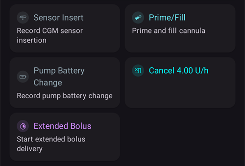

# Помпи и игли

## Смяна на инфузионните сетове: резервоари за инсулин и игли

Описаната по-долу процедура е само за помпи с маркуч и не важи за пластирни помпи като Omnipod, Medtrum Nano, Accu-Chek Solo и др. Тази процедура понякога се нарича „смяна на сет“. „Пълна“ смяна на сет включва резервоара за инсулин и иглата, а „частична“ смяна на сет означава смяна само на иглата.

Пластирните помпи (patch pumps) се пълнят и подготвят сами в своя съветник за активиране, а иглата им вече е в тялото. **AAPS** не предлага пълнене за тях: **Смяна/Пълнене** не се показва в листа **Управление**, нито в QuickLaunch. Вижте страницата на вашата помпа в [Съвместими помпи](../Getting-Started/CompatiblePumps.md).

Физическата смяна на касетата/резервоара не може да се направи чрез **AAPS**. Тя трябва да се направи директно на помпата. След това смяната трябва да се запише ръчно в **AAPS**.

(pumps-cannulas-changing-reservoir-and-cannula)=
### Ръководство за смяна на резервоара на помпата и на иглата

1. В **AAPS** разкачете помпата: натиснете [иконата на кръга](#AapsScreens-loop-status) на главния екран и изберете **Разкачи помпата** за 1 час. Иконата се сменя със сива икона на щепсел. Това показва, че помпата е разкачена.

2. Сменете физически резервоара за инсулин: физически разкачете помпата от тялото и сменете резервоара/касетата и иглата според инструкциите на производителя.

3. Напълнете маркуча и иглата: това може да се направи директно на помпата. Уверете се, че сте премахнали всички мехурчета от маркуча.

4. Поставете новата игла на тялото. След като канюлата е поставена и иглата на апликатора е извадена, в канюлата остава малко въздух, който също трябва да се напълни. To announce this in **AAPS** and prime the site: open **Prime/Fill** (in the expanded status panel on the main screen, in the **Manage** sheet, or as a [QuickLaunch](QuickLaunch.md) button) and tick **Record pump site change** and/or **Record insulin cartridge change** as appropriate to record the change. Сега натиснете количеството по подразбиране за пълнене на иглата (обикновено е около 0,3 U, но проверете дали тази стойност е правилна за вашата игла) и изберете **ОК**. Прочетете съобщението с обобщението и потвърдете пълненето, като докоснете **ОК**.

   


5. Свържете отново помпата в **AAPS**: натиснете сивата икона на щепсел и изберете **Свържи отново помпата**, за да продължи работата на затворения кръг.

### Полезна информация за смяната на инсулина/иглата

* Записът на смяна на сет нулира Autosens на 100 %. Той нулира и съответните индикатори за статус и възрастта на иглата/инсулина на главния екран на **AAPS**.

* Можете да зададете/промените количествата за пълнене по подразбиране в настройките на **Смяна/Пълнене** – въведете „пълнене“ (или английската дума „prime“) в лентата за търсене на главния екран, за да ги отворите (вижте [Опции](../SettingUpAaps/Preferences.md)). Вижте листовката в кутията с игли, за да разберете колко единици (според дължината на иглата и на маркуча) трябва да напълните за вашата игла.

* Инсулинът, подаден чрез функцията за пълнене, не се взема предвид от **AAPS** при изчисляването на активния инсулин (IOB) и е отбелязан в [История на леченията](#aaps-screens-treatments) като „Prime“.

* Всеки инсулин, подаден като болус от помпата по време на разкачване, също няма да се вземе предвид от **AAPS**. Ако подадете болус директно от помпата, докато **AAPS** е разкачен, след като свържете отново помпата можете да отбележите този инсулин (без да го подавате) в диалога **Инсулин** (вижте [Как да отбележите подаден инсулин, без наистина да подавате болус](#pumps-cannulas-announce-insulin) по-долу).

### Проблеми с иглата, мястото на поставяне, маркуча и/или помпата

Ако сте сигурни, че не сте получавали инсулин за известно време, въпреки че **AAPS** е записал, че сте получавали, и знаете точно кога е започнал проблемът (_напр._ махате иглата и виждате, че е била прегъната при поставянето), можете да коригирате това в **AAPS**. Имайте предвид, че инсулинът може всъщност да е бил подаден, но по някаква причина да действа бавно.

```{admonition} Caution - Risk of Hypoglycemia
:class: danger
Изтривайте подаден инсулин от **AAPS** САМО с ИЗКЛЮЧИТЕЛНО внимание, в случай че инсулинът _все пак_ е бил подаден, и следете внимателно КЗ през следващите 24 ч.
```

За да изтриете болусите и SMB, за които знаете, че не са подадени, отворете **менюто** (☰), изберете [История на леченията](#aaps-screens-treatments) и в раздела **Въглехидрати и болус** внимателно изтрийте записаните болуси от момента, в който е станал инцидентът. Това ще коригира стойността на активния инсулин (IOB), която е ключова за изчисленията на **AAPS**. Ако сега се върнете на главния екран, ще видите, че IOB е намалял. Имайте предвид, че не можете да изтриете базалния инсулин, който според изчисленията на **AAPS** е бил подаден. Затова **AAPS** ще продължи да го взема предвид.

При по-неясни случаи на проблеми с подаването на инсулин, _напр._ изтичане, запушване или тунелиране, когато не сте сигурни кога е започнал проблемът или смятате, че част от инсулина е подадена, трябва да внимавате. Можете да забележите тези проблеми, като „усетите миризма“ на инсулин, видите мокър пластир, имате високи стойности на КЗ или получите аларма. Тъй като никога няма да знаете колко инсулин е влязъл в кожата ви (той може да започне да действа след известно време), ще бъде трудно да определите правилното количество инсулин, което трябва да се извади от текущата стойност на активния инсулин (IOB). Една възможност е да спрете кръга за 5 часа (или за вашето време на действие на инсулина), след като сте решили проблема с подаването на инсулин, и след това отново да пуснете кръга. Така IOB ще бъде правилен, когато отново пуснете кръга.

(pumps-cannulas-disconnecting)=
## Разкачване на помпата за душ или физическа активност

Ако сваляте помпата за душ, вана, плуване, контактни спортове или други дейности, трябва да кажете на **AAPS**, че не се подава инсулин. Така IOB ще остане правилен. Помпата може да се разкачи чрез [иконата на кръга](#AapsScreens-loop-status) на главния екран: натиснете я и изберете **Разкачи помпата** с нужната продължителност. Ако дейността продължи по-дълго от планираното, отворете отново същия диалог и изберете нова продължителност под **Разкачи помпата**: разкачването се удължава и новата продължителност започва да тече от сега. Не е нужно първо да свързвате отново помпата.

Тъй като не получавате инсулин, докато помпата е разкачена, трябва да я свързвате отново на всеки два часа, за да наваксате липсващия базал. Можете да направите това, като свържете помпата, подадете като болус липсващия базал (_напр._ за последните два часа) и после отново я разкачите. Това би трябвало да помогне да се избегне тежък недостиг на инсулин, който може да доведе до диабетна кетоацидоза (DKA). Ако е неудобно да свържете отново помпата по време на дейността (мястото на иглата е покрито от неопренов костюм _и др._), помислете дали вместо това да не си направите инжекция с писалка. Тази ръчна инжекция може да се запише в **AAPS**. Не е нужно да я записвате в момента на инжектирането (просто запомнете часа на инжекцията), защото можете да отбележите инсулина и да зададете със задна дата часа, в който е бил поставен, когато свържете отново помпата.

(pumps-cannulas-announce-insulin)=
## Как да отбележите подаден инсулин, без наистина да подавате болус

To announce insulin delivered from the pump either while **AAPS** was disconnected, or from pen injections: open the [Insulin dialog](#aaps-screens-buttons-insulin) (**Treatments** in the bottom navigation, or a QuickLaunch button), enter the amount in units and enable **Bolus will be recorded only (not delivered by pump)**. След това ред **Време** (зададен на **Сега**) ви позволява да запишете действителния час на инжекцията: можете да не го променяте, ако инжекцията е направена наскоро. Ако болусът е подаден преди известно време, използвайте **-**, за да преместите часа назад (_напр._ -30 мин), или отворете реда със стрелката (шеврон), за да изберете точната дата и час. След това **AAPS** ще вземе предвид времето на действие на инсулина и ще изчисли според него оставащия инсулин в тялото.

Ако използвате **AAPS** като болногледач или родител, можете много лесно да разкачите (и отново да свържете) помпата от разстояние чрез [SMS команда](../RemoteFeatures/SMSCommands.md), например с командите „pump disconnect 120“ и „pump connect 120“. Продължителността на дистанционното разкачване е от 1 до 120 мин (в този пример е 120 минути). Това е много полезно, ако телефонът с **AAPS** е труден за достъп: например е скрит в колан за помпа на дете, което тича към басейна, или е строго пазен (или използван) от тийнейджър.

## Свързване на помпата отново след активност

След дълго разкачване (1–2 часа) често се случва **AAPS** да изчисли, че сега имате отрицателен IOB. Когато свържете отново помпата, в зависимост от предпочитанията ви, текущото ниво на глюкозата, планираната храна или следващата активност, можете или:

а) Просто свържете отново помпата в **AAPS** (от сиво към зелено при затворен кръг) и оставете **AAPS** отново да започне да подава инсулин

_или_

б) Ако искате да сте по-агресивни (например КЗ ви върви към хипергликемия), можете да отворите [Болус калкулатор](#aaps-screens-bolus-wizard) и да подадете болус за нула въглехидрати, за да получите веднага изчисления липсващ инсулин като болус.

Коя стратегия ще предпочетете е много лично решение и най-добре се определя чрез проба и грешка.


(Aapsscreens-site-rotation)=
## Смяна на мястото

**Управление → Смяна на мястото** отваря диалога „Смяна на мястото“ в режим на преглед:

- С двата бутона горе (икона на игла и икона на сензор) можете да покажете само местата на иглата, само местата на сензора или и двете
- All Cannula change and Sensor change events from the past 45 days are available.
- Натиснете върху зона на тялото или върху един запис в списъка отдолу, за да филтрирате списъка само до записите в избраната зона. Избраната зона ще бъде оцветена в светлозелено.
- Докоснете иконата с **молив** до запис, за да отворите режима на редакция и да промените мястото, стрелката или бележката


- Иконата със **зъбно колело** (горе вдясно) отваря настройките: **Потребителски профил при смяна на мястото на помпата** отваря диалог, в който избирате **Мъж**, **Жена** или **Дете**, а превключвателите **Позволи следене на мястото на помпата** и **Позволи следене на CGM локацията** определят кои места следите.


*Note: this setting decides whether the Site Rotation dialog (Edit mode) opens automatically when a new entry is made with the "Prime/Fill" button or the "Sensor Insert" button.*

- При смяна на мястото, направена директно на помпата, трябва да отворите режима на преглед и да редактирате новия запис, за да изберете място и стрелка

Режимът на редакция ви позволява да изберете място, стрелка и бележка за избрания запис:

- Редактираният запис се показва под изображенията на тялото, с иконата на своя вид (игла или сензор)
- Изгледите отпред и отзад се показват един до друг: докоснете зоната, където сте го поставили
- Once a site is selected (highlighted in green), the list below shows all entries made in this site in the past 45 days.


- Можете да добавите стрелка (по избор), като докоснете иконата със стрелка вдясно от записа: диалогът **Изберете стрелка** ви позволява да посочите по-точно място или посоката на пача (pod)


- Можете също да добавите **Бележка** за избраното място
- Докоснете иконата за **запис** (горе вдясно), за да запишете мястото

Филтрирането може да се направи графично върху изображението или чрез натискане на събитие в списъка За да махнете филтъра, просто натиснете върху изображението извън местата


