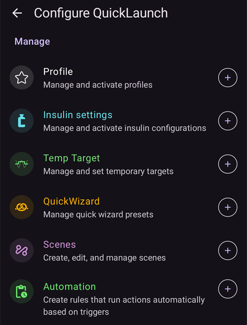

(quicklaunch)=
# QuickLaunch (лента с бързи бутони на главния екран)

**QuickLaunch** е малката **лента с бързи бутони**, която стои в долната част на главния екран на **AAPS**, точно над долната навигация. Това е ред от бутони, които можете да настроите и които работят с едно докосване: вие решавате кои действия да са там и в какъв ред. Така нещата, които правите най-често, винаги са на едно докосване разстояние на главния екран.

```{contents} Table of contents
:depth: 2
:local: true
```


---

## Използване на лентата

Лентата е на **главния екран**, между графиките и долната навигация:


- **Докоснете** икона, за да изпълните нейното действие – точно както ако го бяхте отворили от обичайния му екран (болус или лечение все пак първо показва обичайното потвърждение).
- С **продължително натискане** на икона ще видите **подсказка** (tooltip) с името на действието и кратко описание.
- Ако добавите **повече бутони, отколкото се побират** на екрана, излишните отиват в **допълнително меню** (бутонът **⋮** в края на лентата).
- Всяка икона запазва **цвета** на своето действие (напр. инсулин, въглехидрати, временна цел), така че се разпознава веднага.

```{admonition} The toolbar is always there
:class: note
Последният бутон винаги е **Конфигуриране на QuickLaunch** (зъбното колело **⚙️**). Той не може да се премахне, така че винаги можете да стигнете до екрана за конфигуриране направо от лентата. По подразбиране лентата съдържа само два бутона – **Болус калкулатор** и това зъбно колело.
```

---

## Конфигуриране на QuickLaunch

Докоснете зъбното колело **⚙️** на лентата (или отворете **[Конфигурация](../SettingUpAaps/ConfigBuilder.md) → … → Конфигуриране на QuickLaunch**), за да отворите екрана **Конфигуриране на QuickLaunch** (*„Настройка на бързите бутони в общия таб“*).


Екранът има две части:

- **Избрани действия** (горе) – бутоните, които в момента са на вашата лента, в реда на лентата.
- **Каталог** под тях – всички действия, които можете да добавите, групирани по категории. Всеки запис в каталога има бутон **➕** за добавяне.

### Избрани действия – подреждане, редакция, премахване

Всяко избрано действие има:

- **⠿ дръжка за плъзгане** – натиснете и плъзнете, за да **подредите** бутоните (редът тук е редът на лентата),
- бутон **−** – **премахва** действието от лентата,
- и само за пряк път към **Профил** – бутон **✏️** за промяна на процента/продължителността (вижте [Преки пътища към профил](#profile-shortcuts)).

Промените важат **веднага** – няма отделен бутон *Запиши*. Добавено действие отива в края на лентата; оттам можете да го преместите.

---

## Категории действия

Каталогът групира всичко, което можете да добавите, в следните категории, в този ред. Категориите, в които няма нищо за добавяне (напр. нямате сценарии), просто не се показват.

### Лечение

Ежедневните диалози за лечение и CGM:

- **Инсулин** – ръчно подаване на болус.
- **Въглехидрати** – запис на въглехидрати без инсулин.
- **Болус калкулатор** – отваря калкулатора за болус.
- **Лечение** – запис на инсулин и въглехидрати заедно.
- **CGM** – отваря вашето CGM приложение (напр. xDrip).
- **Калибрация** – калибриране на CGM сензора.

### Care Portal

Събитията от портала за лечения и записите за поддръжка на устройствата:

- **Проверка на КЗ**, **Бележка**, **Физ. активност**, **Въпрос**, **Известие**,
- **Поставяне на сензор**, **Смяна на батерия на помпата**, **Смяна на сет**, **Смяна/Пълнене**, **Смяна на мястото**.

**Смяна/Пълнене** и **Смяна на батерия на помпата** се предлагат само ако вашата помпа ги използва. Пластирните помпи (patch pumps) например се пълнят и сменят батерията си в своите собствени стъпки за активиране, затова тези записи не се показват за тях (както и в листа **Управление**).


Това са същите записи, до които иначе стигате чрез листовете **[Лечения](#v4changes-treatments)** и **[Управление](#v4changes-manage)** – QuickLaunch просто слага тези, които използвате, на главния екран.

### Управление

Екраните от листа **[Управление](#v4changes-manage)**, в същия ред, така че можете да отворите от лентата този, който използвате най-често:

- **Профил**, **Настройки на инсулина** (управление и активиране на конфигурации на инсулина – нарочно с различно име от **Инсулин**, защото този бутон подава болус), **Временна цел**, **Бързи действия**, **Сценарии**, **Автоматизация**, **Храна**,
- **Текущ режим** – затваряне или отваряне на кръга, спиране на кръга или разкачване на помпата,
- **Оторизирани клиенти** – само на главен телефон или на свързан клиент.

Тези бутони отварят екрана; сами по себе си не стартират нищо. За да стартирате сценарий или бързо действие (QuickWizard) с едно докосване, добавете го от категорията **Сценарии** или **Съветник** по-долу.

 

### Бързи действия

Всяко от вашите **[Бързи действия](QuickWizards.md)** (QuickWizard) може да се добави като бутон, така че често повтарящо се хранене е на едно докосване от главния екран. Бутонът носи името на настройката и показва количеството въглехидрати/инсулин; при докосване се изпълнява бързото действие с обичайното потвърждение.

Бързите действия, настроени да се показват само на часовника, не се предлагат. Бутон за бързо действие на лентата следва същите правила като в листа **Лечения**: той е скрит извън своя [период на валидност](#quickwizard_validity) и за кратко време след използване. Той остава в конфигурацията на лентата и се появява отново, когато бързото действие може да се използва пак.

### Сценарии

Всеки активен **[сценарий](Scenes.md)** може да се добави като бутон. При докосване се иска потвърждение, след което сценарият се активира (същият набор от действия, който бихте получили от екрана „Сценарии“). Тази категория се показва само ако имате поне един сценарий.

Подсказката и каталогът показват същото обобщение като **Управление → Сценарии**, например *„3 действия, 2 ч → Възстановяване“*, където името след стрелката е следващият сценарий.

### Автоматизация

Вашите правила за автоматизация от вид **Потребителско действие** (тези, които стартирате ръчно) могат да се добавят като бутони. При докосване се иска потвърждение, след което се изпълняват действията на това правило.

```{admonition} Automation buttons run on the master
:class: note
Автоматизацията се изпълнява на **главния телефон**, затова преките пътища към автоматизации се предлагат и изпълняват само на главния телефон. Те не са налични на свързан **[клиент](../RemoteFeatures/ClientMasterControl.md)**.
```

### Предварително зададени временни цели

Всяка ваша предварително зададена **[временна цел](TempTargets.md)** може да се добави като бутон (показват се нейното име, цел и продължителност, например *„Преди хранене – 5,0 mmol/l, 45 мин“*). При докосване се иска потвърждение, след което тази временна цел се стартира.


(profile-shortcuts)=
### Профил

Всеки **[профил](ProfileSwitch-ProfilePercentage.md)** може да се добави като **пряк път**, който прави **смяна на профил** с едно докосване. За разлика от повечето преки пътища, прекият път към профил има собствени **процент** и **продължителност**, които задавате след добавянето с бутона **✏️**:

- **Процент** (30–250 %, на стъпки от 5 %) – мащабира профила, когато се приложи. При 100 % профилът се използва без промяна.
- **Продължителност** (0–10080 мин, т.е. до 7 дни, на стъпки от 10 мин) – колко дълго трае смяната. **0 = Постоянно** (докато не смените отново).


Така можете да имате няколко бутона за **един и същ** профил с различна сила – например *„Профил 100 %“* и *„Профил 70 % за 2 ч“* – и да приложите всеки от тях с едно докосване. (Можете да добавите един и същ профил повече от веднъж с различни настройки.)

### Плъгини


Накрая, всеки **активен плъгин**, който има собствен екран, може да се добави като пряк път, за да го отваряте директно. Те са групирани по вид плъгин – **Помпа**, **Източник на КЗ**, **APS**, **Кръг**, **Определяне на чувствителност**, **Изглаждане**, **Калибрация**, **Ограничения**, **Комуникация** и **Основни** – така например можете да отидете направо от главния екран на екрана на помпата или на кръга.

---

## QuickLaunch и главен телефон/клиент

За разлика от повечето ви настройки, **лентата QuickLaunch се конфигурира поотделно за всяко устройство** – тя се пази **локално и не се синхронизира** между главния телефон и свързаните клиенти, така че всяко устройство има свой набор от бутони. (Тя *се* включва в **резервното копие/експорта** на настройките, така че възстановяването я връща на същото устройство.)

Какво може да сложи всяко устройство на своята лента все пак зависи от това, което има: бързите действия, сценариите, предварително зададените временни цели и профилите се синхронизират, така че каталогът на клиента предлага същите елементи – просто ги избирате поотделно за всяко устройство. Няколко подробности, които трябва да знаете:

- Бутоните, чиято цел вече не съществува (изтрито бързо действие, сценарий или предварителна настройка, изключено правило), се **пропускат автоматично**.
- Преките пътища към **Автоматизация** се предлагат и изпълняват само на **главния телефон** (автоматизацията се изпълнява на главния телефон). Бутоните за сценарий, бързо действие, временна цел и профил са налични на клиента.
- Когато докоснете бутон на клиента, чието действие трябва да се изпълни на главния телефон (болус, временна цел, смяна на профил или сценарий), **главният телефон** го изпълнява и изпраща потвърждението. Вижте [Контрол главен ↔ клиент](../RemoteFeatures/ClientMasterControl.md).

---


<!-- =====================================================================
     Screenshots captured from a real master device:
       - quicklaunch_toolbar.png    (cropped close-up of the overview toolbar pill)
       - quicklaunch_overview.png   (full overview showing the toolbar in place)
       - quicklaunch_config.png     (Configure QuickLaunch: Selected actions + Treatment + start of Manage)
       - quicklaunch_dynamic.png    (catalog: Quick Wizard / Scenes / Automation / Temp Target Presets)
       - quicklaunch_categories.png (catalog: Profile shortcuts + plugin categories)
     No QuickLaunch action was actually run (nothing delivered; only scrolled).
     Maintainers: relocate page + images and fix cross-links as needed.
     ===================================================================== -->
