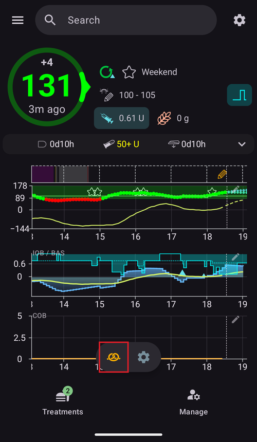

(quickwizards)=
# Бързи действия (QuickWizard) – болуси с едно докосване

**Бързо действие** (QuickWizard) е запазен бутон за едно докосване за повтарящо се хранене или ситуация. То съдържа фиксирано количество **въглехидрати** (и как да се дозира за тях), така че можете да подадете болус – или само да запишете въглехидрати – с едно докосване и потвърждение, вместо всеки път да отваряте целия болус калкулатор.

```{contents} Table of contents
:depth: 2
:local: true
```

---

## Отваряне на бързите действия

Отворете екрана **Управление** (долната навигация) и изберете **Бързи действия** (*„Настройки на съветника“*).

---

## Управление на бързите действия

Вашите бързи действия се показват като **въртележка от карти, които се плъзгат** (всяка карта показва текста на бутона, въглехидратите и валидния диапазон от време). Редакторът отдолу настройва **избраната** карта; долната лента с действия има бутони **➕ добави**, **⧉ клонирай**, **🗑️ изтрий** и бутон **▶**, който изпълнява избраното бързо действие.


Основните полета на редактора са:

- **Текст на бутона** – надписът, който се показва на бутона.
- **Въглехидрати** и **Започват от** – количеството въглехидрати и отместването им във времето.
- **Валиден диапазон** – вижте [Валидност](#quickwizard_validity).
- **Опции** (опции на калкулатора) и **Избор на устройство** – вижте по-долу.

---

## Трите режима

Изборът най-горе в редактора – **Съветник / Инсулин / Въглехидрати** – определя **какво прави бутонът**, когато го докоснете:

- **Съветник** – изпълнява пълния **болус калкулатор** за зададените въглехидрати, като използва текущите ви **КЗ, IOB, COB и посока** (според *Опции* по-долу). Подава *изчисления* болус и записва въглехидратите. Това е класическото бързо действие.
- **Инсулин** – подава **фиксирано, предварително зададено количество инсулин**, което вие определяте – без изчисление.
- **Въглехидрати** – записва **само зададените въглехидрати**, **без болус**.

---

## Опции на калкулатора (режим „Съветник“)

За бутон в режим **Съветник** избирате кои данни използва изчислението:

- **Включвай КЗ**, **Включвай въглехидрати**, **Включвай IOB** (с *Само при позитивен инсулин*), **Използвай посока** (*Всички / Само положителни / Само отрицателни*), **Включи временната цел**, **Използвай аларма**.
- **Болус процент** – мащабира изчисления болус.
- **Добави уд. въглехидрати** – планира и удължени въглехидрати (eCarbs).


---

## Валидност – кога се показва бутонът

(quickwizard_validity)= **Валиден диапазон** (*От / До*) определя **кога** бързото действие се показва и може да се използва. Бутон, зададен например за **06:00–10:00**, се показва само сутрин – така бързо действие *Закуска* не пречи на екрана ви (и не се докосва по грешка) на вечеря. Извън своя период бутонът е скрит от листа **Лечения** и от [лентата QuickLaunch](QuickLaunch.md). Бутонът на лентата не се изтрива: той се появява отново, когато периодът започне пак.

Когато валидният диапазон от време е по-кратък от 4 часа, бутонът също се скрива за 30 минути след като го използвате, за да не се въведе едно и също хранене два пъти по грешка.

---

## Места за използване – къде го използвате

Превключвателите в **Избор на устройство** определят къде се показва всяко бързо действие:

- **Покажи на телефона** – показва се в **листа [Лечения](../Maintenance/V4Changes.md)** (с изчислената доза направо на бутона). Бързо действие, което се показва на телефона, може също да се **закачи като бърз бутон на главния екран**: отворете *Конфигуриране на QuickLaunch* (⚙ на лентата [QuickLaunch](QuickLaunch.md)) и го добавете от категорията **Съветник**.
- **Покажи на часовника** – показва се на **плочката (tile) „Съветник“ на Wear OS** (плъзнете до нея във въртележката с плочки на часовника, после докоснете бутон, за да го изпълните – точно както при [плочката „Сценарий“](#scenes-from-watch)).

```{admonition} Don't see Device Selection?
:class: note
Разделът **Избор на устройство** се показва в редактора само когато плъгинът **Часовник** (Wear) е включен и неговата настройка **Контрол от часовник** е включена. Без това всяко бързо действие просто се показва на телефона.
```

На телефона бързите действия се показват най-горе в долния лист **Лечения**:


…и като бърз бутон на главния екран:




Свързан **клиент** (**AAPSClient**) също може да стартира бързо действие – **главният телефон** го изчислява и подава (вижте [Контрол главен ↔ клиент](../RemoteFeatures/ClientMasterControl.md)).

Откъдето и да е стартирано, докосването на бързо действие винаги показва **потвърждение** (потвърждението от главния телефон, когато е стартирано от клиент или часовник), преди да се подаде каквото и да е.

Бързото действие се отказва, когато дозата му е над вашия максимален болус или когато въглехидратите или удължените въглехидрати (eCarbs) са над вашия максимум за въглехидрати (например след като сте намалили ограничението). Когато въглехидратите са над ограничението, бутонът в листа **Лечения** е изключен. Редактирайте бързото действие или ограничението.

---

## Добавяне и премахване

- **➕ Добави** – създава ново бързо действие.
- **⧉ Клонирай** – копира съществуващо като начална точка.
- **🗑️ Изтрий** – премахва бързо действие.

Когато имате две или повече бързи действия, можете да промените и реда им във въртележката: докоснете иконата **Подреди** (⇅) в горната лента, премествайте централната карта с **бутоните за преместване ◀ / ▶**, след това потвърдете с **✓**. (Бутоните изглеждат както при [подреждането на профили](ProfileSwitch-ProfilePercentage.md).)

Бързите действия са част от синхронизираната конфигурация, така че са общи за главния телефон и свързаните клиенти.

---


<!-- =====================================================================
     Screenshots captured from a real master device:
       - quickwizard_editor.png   (Manage → QuickWizard: carousel, mode, carbs, carb time, valid time range)
       - quickwizard_options.png  (Calculator Options, Bolus percentage, Device Selection)
       - quickwizard_overview.png (the QuickWizard quick-action button on the overview)
       - quickwizard_watch_tile.png (the Wear OS QuickWizard tile)
     No QuickWizard was actually run (no bolus delivered).
     Maintainers: relocate page + images and fix cross-links as needed.
     ===================================================================== -->
