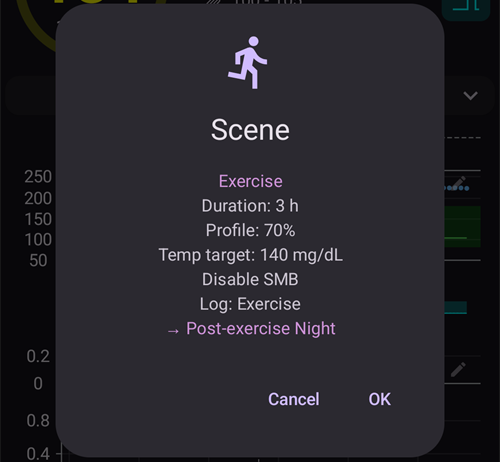

(scenes)=
# Сценарии (готови настройки за ситуации)

**Сценарият** е готова настройка с име, която прилага **няколко действия наведнъж** – например сценарий *Сън*, *Физ. активност* или *Болест*, който с едно докосване сменя профила ви, задава временна цел, включва или изключва SMB и добавя бележка в портала за лечения, по желание за определено време.

```{contents} Table of contents
:depth: 2
:local: true
```

---

## Какво е сценарий

Вместо да променяте ръчно няколко неща всеки път, когато се повтори една и съща ситуация, вие ги настройвате веднъж като сценарий и го активирате с едно докосване. Един сценарий може да съдържа всяко от тези действия:

- **Смяна на профил** – сменя профила и/или го мащабира с процент (напр. 70 %).
- **Временна цел** – задава временна цел (напр. *Физ. активност*, *Преди хранене* или собствена стойност).
- **SMB вкл./изкл.** – включва или изключва супер микро болусите, докато сценарият е активен.
- **Текущ режим** – сменя режима на кръга (напр. на по-предпазлив режим).
- **Бележка в портала за лечения** – записва събитие (напр. *Физ. активност*, *Болест*), което се вижда на графиката и в Nightscout.

Сценарият има и **продължителност** – фиксирано време (минути/часове/дни) или *Безкрайно (ръчно спиране)* – и **действие при край**, което се изпълнява, когато сценарият приключи: или **известие**, или **преминаване** към друг сценарий (например *Болест → Физ. активност*).

---

## Управление на сценарии

Отворете **Управление → Сценарии**, за да виждате, създавате, редактирате, включвате/изключвате и подреждате сценариите си.


Всяка карта на сценарий показва:

- **поле за отметка** за включване/изключване на сценария,
- **икона** и **име**,
- обобщение – *„N действия, продължителност“*, и **→ следващия сценарий**, ако след този сценарий следва друг,
- и три бутона: **▶ активиране**, **✏️ редактиране**, **🗑️ изтриване**.

Докоснете бутона **+**, за да създадете нов сценарий.

---

## Създаване или редактиране на сценарий

### Започнете от темплейт

За да **създадете** сценарий, докоснете бутона **+** на екрана „Сценарии“. Първата стъпка е **Стартирай от темплейт**: изберете готов сценарий за честа ситуация – *Физ. активност*, *Болест*, *Болест с повръщане*, *Сън*, *Вечер след физ. активност*, *Преди хранене*, *Алкохол*, *Шофиране*, *Душ*, *Лутеална фаза*, *Горещо време*, *Медицинска процедура* – или започнете от *Празен* сценарий. Всеки темплейт **попълва предварително препоръчаните действия** и можете да промените всичко в следващите стъпки.


След като изберете темплейт, се показва за какво служи – *кога* и *защо* да го използвате – преди да продължите:


### Преминете през действията стъпка по стъпка

Останалата част от редактора е кратък съветник **стъпка по стъпка**. Всяка стъпка е един вид действие с превключвател *„Добави … в сценария“* – включете го само за действията, които искате този сценарий да изпълни, а другите оставете изключени.


Преминете през стъпките с **Напред**/**Назад**: *Смяна на профил*, *Временна цел*, *SMB*, *Текущ режим*, *Портал за лечения*, след това **продължителността**, **действието при край** (известие или преминаване към друг сценарий) и накрая **името и иконата** на сценария. Запишете, когато сте готови. (За да **редактирате** съществуващ сценарий, докоснете неговия бутон **✏️** – отивате направо в тези стъпки.)

Всяка стъпка започва с кратко обяснение какво прави действието. Стъпките изглеждат така, тук с темплейта *Физ. активност*:

**Временна цел** – изберете един от вашите шаблони за временна цел:


**SMB** – включете или изключете SMB, докато сценарият е активен:


**Текущ режим** – по желание сменете режима на кръга:


**Портал за лечения** – видът на събитието и бележката за запис:


**Продължителност** – колко дълго сценарият остава активен; 0 означава, докато не го прекратите сами:


**Следващ сценарий** – по желание сценарият, който започва, когато този приключи:


**Сценарий** – името и иконата. Натиснете **Край**, за да запишете:


---

## Активиране на сценарий

Активирайте сценарий от списъка **Сценарии** (бутона **▶**) или от елемента **Сценарии** в долната навигация. В листа **Сценарии** на долната навигация всеки сценарий показва същото обобщение като в списъка със сценарии, а **моливът** в горната част на листа отваря **Управление → Сценарии**, за да създавате или редактирате сценариите си.


If [bolus protection](#Preferences-protection) is on, **AAPS** asks for it before a scene starts or ends. Changing a scene needs the [settings protection](#Preferences-settings-protection) instead.

Преди да се приложи каквото и да е, получавате **потвърждение**, което показва точно какво ще направи сценарият, за да можете да го прегледате:


Ако след сценария следва друг, потвърждението завършва с **→** и името на следващия сценарий, по същия начин, както е показано в списъка със сценарии.

Когато стартирате сценария от елемента **Сценарии** в долната навигация, потвърждението е по-прост диалог със същия списък с действия. Натиснете **ОК**, за да активирате:



След като потвърдите, действията се прилагат и **активният сценарий** се показва в горната част на главния екран с бутон **Край на сценарий**. Ако след сценария следва друг, лентата показва и името на следващия сценарий:


Действията на сценария остават в сила, докато:

- неговата **продължителност** изтече (изпълнява се **действието при край** – известие или преминаване към следващия сценарий), или
- не докоснете **Край на сценарий**, за да го прекратите ръчно. Ако след сценария следва друг, имате два избора: **Прескочи до** следващия сценарий (активният сценарий приключва и следващият започва веднага) или **Край на сценарий** (активният сценарий приключва и следващият не започва).

Сценарий без следващ сценарий иска само потвърждение:


Прекратяването на сценарий **връща** промените, които той е направил (например смяната на профил и временната цел, които е стартирал).

Докато сценарият е активен, профилът и целта на главния екран имат малка икона на сценарий, ако сценарият ги е задал. Листът **Сценарии** в долната навигация остава достъпен, за да стартирате друг сценарий:


Когато продължителността изтече сама, промените се връщат веднага и лентата се сменя на **Сценарият приключи** с бутон **Откажи**. Затварянето на лентата само я маха от екрана – самият сценарий вече е приключил, затова правилата за автоматизация и следващият сценарий продължават, без да чакат.

---

## Стартиране на сценарии от автоматизация

Сценарият не е задължително да се стартира ръчно – **автоматизацията** може да го стартира вместо вас. Когато добавяте действие към правило за автоматизация (**Управление → Автоматизация**), в списъка с действия има категория **Сценарии**:

- **Стартирай сценарий** – активира сценарий, когато тригерите на правилото се задействат (например в определен час, когато пристигнете някъде или когато глюкозата премине определен праг).
- **Разреши сценарий** / **Забрани сценарий** – прави сценарий достъпен (или недостъпен), без да го активира.


Автоматизацията може и да **реагира на** сценарий: в списъка с тригери има тригер **Сценарий**, така че едно правило може да се изпълнява само докато е активен определен сценарий. В комбинация с **действието при край** на сценария (връщане, известие или преминаване към друг сценарий) това позволява сценариите да започват, да продължават един след друг и да приключват автоматично.

---

## Сценарии с главен телефон/клиент и часовник

**Текущият активен сценарий се синхронизира** между всички ваши свързани устройства – активирайте го на един телефон и другите също ще го показват.

Свързан **клиент** (**AAPSClient**) също може да активира или прекрати сценарий: заявката се изпраща до **главния телефон**, който създава потвърждението и прилага сценария върху собственото си състояние. Вижте [Контрол главен ↔ клиент](../RemoteFeatures/ClientMasterControl.md), за да разберете как работи това.

(scenes-from-watch)=
### От часовник с Wear OS

Сценариите са достъпни на **часовник с Wear OS** като **плочка „Сценарий“**. Плъзнете до плочката **Сценарий** във въртележката с плочки на часовника (ако я няма, първо я добавете от списъка с плочки) и докоснете сценария, който искате да стартирате:


Плочката има четири места. По подразбиране всяко място се попълва **автоматично** със следващия от включените ви сценарии, в реда, в който са на телефона. За да изберете сами, **натиснете продължително плочката** и отворете настройките ѝ: за всяко от четирите места можете да оставите **Автоматично**, да закачите **определен сценарий** или да изберете **Без**, за да оставите мястото празно. Място, закачено за сценарий, който междувременно е изтрит или изключен, показва **Неналично** – изберете друг сценарий за него.

След това часовникът показва потвърждение – докоснете **✓**, за да активирате, или плъзнете назад, за да откажете:


Както при клиента, **главният телефон създава потвърждението и изпълнява сценария**; часовникът само предава заявката (през клиентския телефон, ако часовникът е свързан с клиент).

Докато сценарият работи – или лентата му **Сценарият приключи** все още се показва на телефона – плочката показва бутон **Край** с името на сценария под него. Докоснете го, за да прекратите активния сценарий или да махнете останалата лента – направо от китката си.

Ако след работещия сценарий следва друг, плочката показва и бутон **Пропусни** с името на следващия сценарий под него. Това са същите два избора като на телефона:

- **Край** – активният сценарий приключва. Потвърждението ви казва, че следващият сценарий няма да започне.
- **Пропусни** – активният сценарий приключва и следващият сценарий започва веднага. Потвърждението показва имената на двата сценария.

[Екранът „Статус на кръга“](#WearOsSmartwatch-loop-status) на часовника също показва активния сценарий, оставащото време и следващия сценарий.

---


<!-- =====================================================================
     Screenshots captured from a real master device:
       - scenes_list.png        (Manage → Scenes management list)
       - templates_picker.png   (create: "Start from template" picker)
       - template_explanation.png (create: chosen template's explanation)
       - scene_editor.png       (scene editor, Profile switch step)
       - scene_confirmation.png (scene activation confirmation — also used on the Client/Master page)
       - scene_active_banner.png (overview active-scene banner with the End Scene button)
       - automation_scene_action.png (Automation action picker — Scenes category)
       - scene_watch_tile.png    (Wear OS Scene tile)
       - scene_watch_confirm.png (Wear OS scene confirmation)
     Maintainers: relocate page + images and fix cross-links as needed.
     ===================================================================== -->
