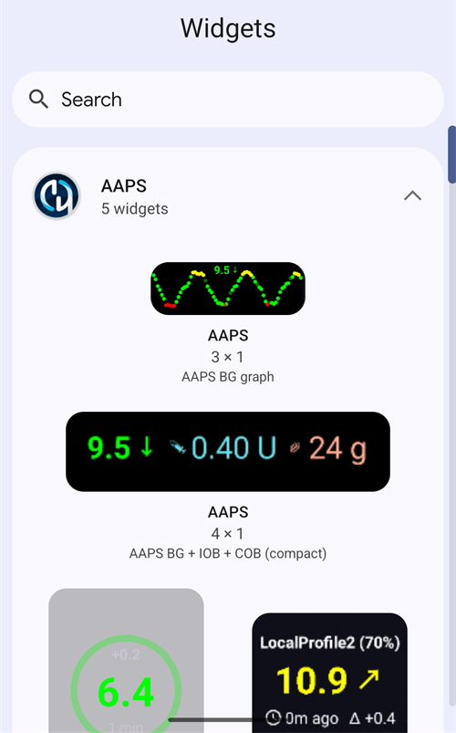

(widgets)=
# Уиджети за началния екран

**AAPS** предлага уиджети, които можете да добавите на началния екран на телефона си. Уиджетът показва текущите ви данни, без да отваряте приложението. Докоснете уиджет, за да отворите **AAPS**.

```{contents} Table of contents
:depth: 2
:local: true
```

---

## Налични уиджети

Има пет уиджета. Те са изброени под **AAPS** в списъка с уиджети на Android:



| Уиджет                          | Размер по подразбиране | Какво показва                                                                                                                                                                                                                                              |
| ------------------------------- | ---------------------- | ---------------------------------------------------------------------------------------------------------------------------------------------------------------------------------------------------------------------------------------------------------- |
| **AAPS уиджет**                 | 5 × 2                  | The status block of the main screen: BG with trend and delta, the loop mode as an icon beside the profile name, target, sensitivity (shown as on the main screen), IOB and COB. The texts shrink to fit the size you give the widget instead of being cut. |
| **AAPS кръг за КЗ**             | 2 × 2                  | Кръга за КЗ от главния екран: пръстен в цвета на КЗ, дъга за посоката, делтата, стойността на КЗ и времето от последното измерване.                                                                                                                        |
| **AAPS малка**                  | 2 × 2                  | Име на профила, КЗ със стрелка за посоката, време от последното измерване, делта, IOB и COB.                                                                                                                                                               |
| **AAPS КЗ + IOB + COB (малка)** | 4 × 1                  | Един ред с КЗ и стрелка за посоката, IOB и COB.                                                                                                                                                                                                            |
| **Графика на КЗ**               | 3 × 1                  | Стойността на КЗ с малка графика на последните измервания.                                                                                                                                                                                                 |

**AAPS уиджет**, **кръгът за КЗ** и уиджетът **AAPS малка** на началния екран:


**Компактният** уиджет (AAPS КЗ + IOB + COB) и уиджетът **Графика на КЗ**:


Стойностите на КЗ са в същите цветове като в **AAPS**: зелено в диапазона, жълто над диапазона, червено под диапазона.

---

## Добавяне на уиджет

Точните стъпки зависят от телефона и неговия launcher (програмата за начален екран). На повечето телефони:

1. Натиснете продължително празно място на началния екран и изберете **Приспособления** (Widgets).

   

2. Отворете **AAPS** в списъка и докоснете уиджета, който искате.
3. Натиснете **Добавяне** (Add) (или плъзнете уиджета до мястото, което искате).

   

Уиджетът се поставя на началния екран. Веднага след добавянето той се показва с дръжки: плъзнете дръжка, за да **промените размера** на уиджета, или плъзнете уиджета, за да го преместите. Размерът на кръга за КЗ може да се променя свободно.


Ако страницата на началния екран е пълна, телефонът слага уиджета на нова страница.

---

## Конфигурация на уиджет

Докоснете бутона с **молив**, който се показва на уиджета веднага след като го добавите. По-късно натиснете продължително уиджета, за да видите отново дръжките и молива.

Диалогът **Конфигурация на уиджет** има две настройки:

- **Конфигуриране на прозрачността** – колко плътен (непрозрачен) е фонът на уиджета. При ниска стойност тапетът се вижда през фона.
- **Използвай черен цвят** – използва черен фон вместо фона по подразбиране.


Всеки уиджет има своя собствена конфигурация.

---

## Полезно е да знаете

- Уиджетът само **показва** данни. Не можете да подадете болус или да промените нещо от уиджет.
- Уиджетът се обновява от **AAPS**. Ако **AAPS** не работи или ако Android го ограничава във фонов режим, уиджетът може да показва стари данни. Проверявайте времето от последното измерване и се уверете, че **AAPS** е изключен от [оптимизацията на батерията](#SetupWizard-StoragePermission).
- При **AAPSClient**, **AAPSClient2** и **AAPSClient3** фонът на уиджета е жълт, син или зелен, за да можете да различавате приложенията. Увеличете плътността (непрозрачността) в конфигурацията на уиджета, ако цветът се вижда трудно. Вижте [За AAPSClient, AAPSClient2 и AAPSClient3](#remotecontrol-aapsclient-versions).
