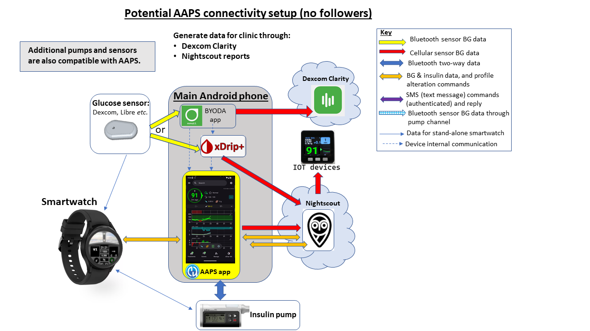

# Въведение в APS и AAPS

```{contents} In this page
:backlinks: entry
:depth: 2
```

## Какво е „система за изкуствен панкреас“?

Човешкият панкреас прави много неща освен регулирането на кръвната захар. Терминът **„система за изкуствен панкреас“ (Artificial Pancreas System, APS)** обаче обикновено означава система, която автоматично поддържа нивата на кръвната захар в здравословни граници.

Най-простият начин за това е да се измерват **нивата на глюкозата**, тези стойности да се използват за **изчисления** и след това в тялото да се подава (предвиденото) правилно количество **инсулин**. Системата повтаря изчислението на всеки няколко минути, 24/7. Тя използва **аларми** и **предупреждения**, за да информира потребителя, когато е нужна намеса или внимание. Такава система обикновено се състои от **сензор за глюкоза**, **инсулинова помпа** и **контролер**, който прави изчисленията. В **AAPS** и другите системи с отворен код контролерът е приложение на телефона. В повечето търговски системи това е софтуер, вграден в самата помпа, а приложението на телефона се използва главно за показване на данни и за управление.

Тази обзорна статия от 2022 г. е добро начало, ако искате да научите как са се развили системите със затворен кръг и как работят. Имайте предвид, че тя е писана преди повечето от днешните системи, затова не е ръководство за това какво се предлага в момента на пазара:

 [Closed-Loop Insulin Delivery Systems: Past, Present, and Future Directions](https://www.frontiersin.org/journals/endocrinology/articles/10.3389/fendo.2022.919942/full) (Templer, _Frontiers in Endocrinology_, 2022).

Така наречените „двухормонални“ системи подават глюкагон заедно с инсулина, за да предотвратят тежки хипогликемии и да позволят още по-строг контрол на кръвната захар. Първата система от този вид е одобрена в Европа, но се предоставя само чрез проучвания и проекти, а други все още се разработват. Все още нито една не се продава свободно.

Изкуственият панкреас може да се разглежда като [„автопилот за вашия диабет“](https://www.artificialpancreasbook.com/). Какво означава това?

В самолета автопилотът не върши цялата работа на пилота – пилотът не може да спи през целия полет. Автопилотът помага в работата на пилота. Той освобождава пилота от тежестта постоянно да управлява самолета и така пилотът може да се съсредоточи върху цялостното наблюдение. Автопилотът получава сигнали от различни сензори, компютър оценява данните заедно със зададените от пилота параметри, след това прави нужните корекции и предупреждава пилота при всеки проблем. Пилотът вече не трябва постоянно да взема решения и това сравнение може да се приложи и към **AAPS**.


(Introduction-what-does-hybrid-closed-loop-mean)=
## Какво означава хибриден затворен кръг?

Най-доброто решение за диабет тип 1 би било „функционално излекуване“ (вероятно имплант от клетки на панкреаса, които са защитени от имунната система). Докато общността на хората с диабет тип 1 (T1D) чака това, изкуственият панкреас с „напълно затворен кръг“ вероятно е най-доброто следващо решение. Това е техническа система, която не изисква никакви действия от потребителя (например болус инсулин за хранене или обявяване на физическо натоварване) и добре регулира нивата на кръвната захар. Почти всяка система, която се използва ежедневно, е с „хибриден“ затворен кръг, защото съчетава автоматизирана технология и действия от потребителя. Първите системи с напълно затворен кръг бяха одобрени в Европа през 2026 г., но все още нито една не е широко достъпна.

## Как и защо започна използването на затворен кръг?

Разработването на търговски технологии за хора с диабет тип 1 (T1D) е много бавно. През 2013 г. общността на хората с диабет тип 1 създаде движението #WeAreNotWaiting („Ние не чакаме“). Те сами разработиха системи с вече одобрени технологии (инсулинови помпи и сензори), за да подобрят контрола на кръвната захар, безопасността и качеството на живот. Те са известни като системи OS-AID (Open-Source Automated Insulin Delivery – автоматизирано подаване на инсулин с отворен код), по-рано наричани DIY системи („направи си сам“), защото не са официално одобрени от здравните органи (FDA, NHS и др.). Има четири основни системи OS-AID: [OpenAPS](https://openaps.org/what-is-openaps/), **AAPS**, [Loop](https://loopkit.github.io/loopdocs/#what-is-loop) и [Trio](https://triodocs.org).

Чудесен начин да разберете основите на затворения кръг с OS-AID е да прочетете книгата на Dana Lewis „Automated Insulin Delivery“. Можете да я прочетете безплатно [тук](https://www.artificialpancreasbook.com/) (или да купите печатно копие на книгата). Ако искате да научите повече за [OpenAPS](https://openaps.org/what-is-openaps/), от която е създадена **AAPS**, [уебсайтът на OpenAPS](https://openaps.org/what-is-openaps/) е много добър източник.

Пуснати са и няколко търговски системи с хибриден затворен кръг. Те са много различни от системите OS-AID главно защото много от тях включват „самообучаващ се алгоритъм“, който променя количеството подаван инсулин според нуждите ви от инсулин през предишните дни. Много хора от общността на OS-AID вече са изпробвали търговски системи и са ги сравнили със своята система OS-AID. Повече за сравнението между различните системи можете да научите, като попитате в специалните групи във Facebook за тези системи, в [групата на AAPS във Facebook](https://www.facebook.com/groups/AndroidAPSUsers/) или в [Discord](https://discord.com/invite/4fQUWHZ4Mw).

## Какво е Android APS (AAPS)?


**Фигура 1**. Основна схема на Android APS (Artificial Pancreas System – система за изкуствен панкреас), AAPS.

Android APS (**AAPS**) is a hybrid closed loop system, or Artificial Pancreas System (APS). Тя изчислява дозите инсулин с утвърдените алгоритми на [OpenAPS](https://openaps.org/) (набор от правила), разработени от общността на хората с диабет тип 1 #WeAreNotWaiting.

Тъй като OpenAPS е съвместима само с някои по-стари инсулинови помпи, **AAPS** (която може да се използва с повече видове инсулинови помпи) първоначално е разработена през 2016 г. за член на семейство с диабет тип 1. От тези ранни дни насам **AAPS** непрекъснато се развива и подобрява от екип от доброволци – програмисти и други ентусиасти, които имат връзка със света на диабет тип 1. Днес **AAPS** се използва от много хиляди хора по целия свят. Това е силно настройваема и гъвкава система и тъй като е с отворен код, тя лесно се съчетава с много други програми и платформи с отворен код за диабет. Основните компоненти на сегашната система **AAPS** са показани на **Фигура 1** по-горе.


## Кои са основните компоненти на AAPS?

„Мозъкът“ на AAPS е **приложение**, което компилирате сами. За това има подробни инструкции стъпка по стъпка. След това инсталирате **приложението AAPS** на [съвместим](../Getting-Started/Phones.md) **смартфон с Android** (**1**). Някои потребители предпочитат кръгът им да работи на отделен телефон, а не на основния им телефон. Така че не е задължително да използвате телефон с Android за всичко друго в живота си – само за работата на кръга с AAPS.

Освен **AAPS**, на **смартфона с Android** трябва да бъде инсталирано и още едно приложение. Това [допълнително приложение](../Getting-Started/CompatiblesCgms.md) получава данните за глюкозата от сензора (**2**) чрез Bluetooth и след това ги изпраща вътре в телефона към **приложението AAPS**.

**Приложението AAPS** използва процес за вземане на решения (**алгоритъм**) от OpenAPS. Beginners start out using the basic **oref0** algorithm, but it is possible to switch to using the newer **oref1** algorithm as you progress with AAPS. Кой алгоритъм ще използвате (oref0 или oref1), зависи от това кой е най-подходящ за вашата конкретна ситуация.  И в двата случая алгоритъмът взема предвид много фактори и прави бързи изчисления всеки път, когато от сензора дойде нова стойност. След това алгоритъмът изпраща чрез Bluetooth инструкции към инсулиновата помпа (**3**) колко инсулин да подаде. Цялата информация може да се изпраща в интернет (**4**) чрез мобилни данни или Wi-Fi. При желание тези данни могат да се споделят и с последователи и/или да се събират за анализ. По желание можете да сдвоите с телефона и [смарт часовник](../Getting-Started/Watches.md) (**5**), за да виждате данните си с един поглед, а с някои часовници – и да изпращате основни команди към **AAPS**.

## Какви са предимствата на системата AAPS?

Алгоритъмът на OpenAPS, който **AAPS** използва, управлява нивата на кръвната захар без действия от потребителя според зададените от него параметри (важни са базалните дози, факторите на инсулинова чувствителност, коефициентите инсулин/въглехидрати, времето на действие на инсулина и т.н.) и реагира на всеки 5 минути на новите данни от сензора.

Някои от предимствата на **AAPS**, за които съобщават потребителите, са многото възможности за фина настройка, **автоматизациите** и по-голямата прозрачност на системата за пациента/болногледача. Това може да доведе до по-добър контрол на диабета ви (или на човека, за когото се грижите), а оттам до по-добро качество на живот и повече спокойствие.

Ако отделите време, **AAPS** може да доведе до:

- намаляване на стреса и тежестта от лечението на диабет тип 1;

- по-малко от многото ежедневни решения, които диабетът тип 1 изисква;

- лично и гъвкаво дозиране на инсулина въз основа на данни в реално време, което може да намали нуждата от лечение на хипогликемии и броя на хипергликемиите;

- повече знания за управлението на инсулина и повече увереност при фината настройка на параметрите;

- възможност да създавате автоматични настройки (**автоматизации**), съобразени с начина ви на живот;

- по-добро качество на съня и като цяло по-рядка нужда от намеса през нощта;

- дистанционно наблюдение и управление на подаването на инсулин за болногледачите на хора с диабет тип 1; и

- обединяване на цялото ви преносимо оборудване за диабет (приемник на системата за продължително наблюдение на глюкозата и устройства за управление на инсулина) в един телефон с Android, управляван от **AAPS**.


В крайна сметка **AAPS** може да даде на хората възможност да управляват по-добре диабета си, което води до стабилна кръвна захар и по-добро здраве в дългосрочен план.

### Конкретните предимства включват:

#### 1) Вградена безопасност
За да прочетете за функциите за безопасност на алгоритмите, известни като oref0 и oref1, [натиснете тук](https://openaps.org/reference-design/). Потребителят сам управлява своите ограничения за безопасност.

#### 2) Гъвкавост на хардуера

**AAPS** работи с много видове инсулинови помпи и сензори и дава гъвкавост, когато животът се промени. Например, ако развиете алергия към лепилото на сензорите Dexcom, можете да преминете към сензор Libre. Потребителите не трябва да компилират или инсталират отново приложението **AAPS** – за да смените хардуера, просто изберете друга помпа или друг източник на КЗ в **Конфигурация**. **AAPS** не зависи от определени драйвери за помпи и съдържа „виртуална помпа“, така че потребителите могат безопасно да експериментират, преди да я използват върху себе си.

#### 3) Широки възможности за настройване

Потребителите могат лесно да добавят или премахват модули или функции, а **AAPS** може да се използва както в режим Отворен кръг, така и в режим Затворен кръг. Ето някои примери за възможностите на системата **AAPS**:

 а) Възможност да зададете по-ниска цел за **КЗ** 30 мин преди хранене; можете да зададете цел дори 72 mg/dl (4,0 mmol/l).

 b) If you are insulin-resistant resulting in high blood sugars, **AAPS** allows you to set an **automation** rule to activate when BG rises above 8 mmol/L (144 mg/dL), switching to (for example) a 120% profile (resulting in a 20% increase in basal and strengthening of other factors too, compared to your normal **profile** setting). Автоматизацията ще действа според времето, което сте задали. Такава автоматизация може да се настрои да е активна само в определени дни от седмицата, в определени часове от деня и дори на определени места.

 c) If your child is on a trampoline with no advance notice, **AAPS** allows insulin suspension for a set time period, directly via the phone.

 d) After reconnecting a tubed pump which has been disconnected for swimming, **AAPS** will calculate the basal insulin you have missed while disconnected and deliver it carefully, according to your current BG. Ако този инсулин не е нужен, можете просто да „отмените“ пропуснатия базал.

 д) **AAPS** ви позволява да зададете различни профили за различни ситуации и лесно да превключвате между тях. For example, features which make the algorithm quicker to bring down elevated BG (like supermicro boluses (“**SMB**”) and unannounced meals (“**UAM**”)) can be set to only work during the daytime, if you are worried about night-time hypos.

Всичко това са примери – пълният набор от функции дава голяма гъвкавост в ежедневието, включително при спорт, болест, хормонални цикли _и т.н._ В крайна сметка потребителят решава как да използва тази гъвкавост и няма автоматизация, която да е подходяща за всички.

#### 4) Дистанционно наблюдение
Има няколко възможни начина за наблюдение (Sugarmate, Dexcom Follow, xDrip, Android Auto _и т.н._), които са полезни за родители/болногледачи и за възрастни в определени ситуации (сън/шофиране), когато са нужни настройваеми аларми. В някои приложения (xDrip) можете и напълно да изключите алармите. Това е много удобно, ако имате нов сензор, който още се „накисва“ (стабилизира) и с който още не искате да използвате затворен кръг.

#### 5) Дистанционно управление
Голямо предимство на **AAPS** пред търговските системи е, че последователите могат да изпращат много различни команди обратно към системата **AAPS** чрез удостоверени текстови (SMS) команди или чрез сдвоено приложение **AAPSClient**. Тази функция се използва много от родителите на деца с диабет тип 1, които използват **AAPS**.

Функциите за дистанционно управление могат да бъдат много полезни: например на детската площадка, ако искате да подадете предварителен болус за закуска от собствения си телефон, докато детето ви е заето с игра. Можете също да наблюдавате системата от смарт часовник (_напр._ Garmin) или да изпращате основни команди от него (_напр._ часовник с Wear OS, като Samsung Galaxy Watch).

#### 6) Без търговски ограничения благодарение на отворените програмни интерфейси
Освен подхода с отворен код, който позволява изходният код на **AAPS** да се преглежда по всяко време, общият принцип на отворените програмни интерфейси дава възможност и на други разработчици да допринасят с нови идеи. **AAPS** е тясно интегриран с Nightscout. Това ускорява разработката и позволява на потребителите да добавят функции, които правят живота с диабет още по-удобен. Добри примери за такива интеграции са [Nightscout](https://nightscout.github.io/), [Nightscout Reporter](https://nightscout-reporter.zreptil.de/), xDrip, [M5 stack](https://github.com/mlukasek/M5_NightscoutMon/wiki) и др. Между разработчиците на системи с отворен код и тези, които разработват търговски системи, има постоянен диалог. Много от нововъведенията на OS-AID постепенно се възприемат от търговските системи, където разработката разбираемо е по-бавна, отчасти защото интерфейсите между системи на различни компании (помпи, приложения, сензори _и т.н._) трябва внимателно да се договорят и лицензират. Това може да забави и нововъведения, които са удобни за пациента (или за малка група пациенти с много специфични нужди), но не носят значителна печалба.

#### 7) Подробен интерфейс на приложението
С **AAPS** е лесно да следите неща като: количеството инсулин в помпата, възрастта на канюлата, възрастта на сензора, възрастта на батерията на помпата, активния инсулин (IOB) _и т.н._ Много действия могат да се извършват чрез приложението **AAPS** (пълнене на помпата, откачане на помпата _и т.н._), а не на самата помпа. Така помпата може да остане в джоба или на колана ви (или на човека, за когото се грижите).

#### 8) Достъпност и цена
**AAPS** дава на хората, които в момента не могат да си позволят сами да платят или нямат финансиране/застраховка, достъп до система с хибриден затворен кръг, която като концепция е години пред търговските системи по отношение на развитието. В момента ви трябва сървър за отчети (Nightscout или Tidepool), за да настроите **AAPS**, въпреки че той не е нужен за ежедневната работа на кръга на **AAPS**. Много хора продължават да използват Nightscout за събиране на данните си и за дистанционно наблюдение. Въпреки че самият **AAPS** е безплатен, настройването на Nightscout чрез някоя от различните платформи може да струва пари (0 € – 12 €) в зависимост от това какво ниво на поддръжка искате (вижте таблицата за сравнение) и дали искате да продължите да използвате Nightscout след настройването. **AAPS** работи с много достъпни [телефони с Android](https://docs.google.com/spreadsheets/u/1/d/e/2PACX-1vScCNaIguEZVTVFAgpv1kXHdsHl3fs6xT6RB2Z1CeVJ561AvvqGwxMhlmSHk4J056gMCAQE02sAWJvT/pubhtml?gid=683363241&single=true) (от около 150 €). Има различни версии за определени места и езици, а AAPS може да се използва и от [незрящи](#accessibility-for-users-aaps-who-are-partially-or-completely-blind) хора.

#### 9) Поддръжка
Никоя система за автоматизирано подаване на инсулин не е съвършена. Търговските системи и системите с отворен код имат много общи проблеми – както с комуникацията, така и с временни повреди на хардуера. Има помощ от общността на потребителите на AAPS по целия свят във Facebook, Discord и GitHub – хората, които са създали, разработили и в момента използват **AAPS**. За търговските системи APS има и групи за помощ във Facebook, както и помощ от клиники/търговски компании – струва си да поговорите с потребители или бивши потребители на тези системи, за да научите за честите проблеми, качеството на обучението и нивото на постоянната поддръжка.

#### 10) Предвидимост, прозрачност и безопасност
**AAPS** е прозрачен, логичен и предвидим и така може да е по-лесно да разберете кога дадена настройка е грешна и да я коригирате. Можете да видите точно какво прави системата, защо го прави, и да зададете границите на работата ѝ, така че контролът (и отговорността) са във вашите ръце. Това може да даде на потребителя увереност и по-спокоен сън.

#### 11) Достъп до разширени функции чрез версиите за разработка (dev), включително напълно затворен кръг
Тази документация на **AAPS** се отнася за основния клон **„master“** на **AAPS**. Но проучванията и разработката продължават непрекъснато. По-опитните потребители може да искат да изпробват експерименталните функции в клона за разработка (**development**). Нововъведенията в разработката са насочени към начини за напълно затворен кръг (без нужда от болус за хранене _и т.н._) и като цяло към това животът с диабет тип 1 да бъде възможно най-удобен.

#### 12) Възможност сами да допринасяте за по-нататъшни подобрения
Диабетът тип 1 може да бъде много изтощителен и да изолира човека. Да имате контрол върху собствената си технология за диабет и възможността да „предадете доброто нататък“, като помагате на другите по техния път веднага щом сами напреднете, може да носи голямо удовлетворение. Можете да се обучавате, да откривате пречките и да търсите нови разработки и дори да допринасяте за тях и за документацията. В общността ще има и други хора със същата цел, с които можете да обсъждате идеи и да работите заедно. Това е същността на #WeAreNotWaiting.

## Как се сравнява AAPS с MDI и с отворения кръг?

Многократните дневни инжекции (MDI, (a) на **Фигура 2** по-долу) обикновено включват една инжекция дългодействащ инсулин (_напр._ Tresiba) веднъж дневно и инжекции с по-бързодействащ инсулин (_напр._ Novorapid, Fiasp) при хранене или за корекции. При помпа без затворен кръг (b) помпата подава базал от бързодействащ инсулин с предварително програмирани дози, а при хранене или за корекции се подават болуси чрез помпата. Основният принцип на системата със затворен кръг е, че приложението използва данните за глюкозата от сензора, за да накара помпата да спре подаването на инсулин, когато предвижда, че КЗ ще падне ниско, и да ви даде допълнителен инсулин, ако нивата на глюкозата се покачват и се очаква да станат твърде високи (c). Тази фигура е силно опростена в сравнение с реалния живот, но целта ѝ е да покаже основните разлики между подходите. С всеки от тези три подхода може да се постигне изключително добър контрол на глюкозата.


**Фигура 2**. Основен преглед на (a) MDI, (b) помпа без затворен кръг и (c) помпа с хибриден затворен кръг.

## Как се сравнява AAPS с другите системи със затворен кръг?

Към 25 юни 2023 г. има четири основни системи със затворен кръг с отворен код: [OpenAPS](https://openaps.readthedocs.io/), **AAPS**, [Loop](https://loopkit.github.io/loopdocs/#what-is-loop) и [Trio](https://triodocs.org) (преди FreeAPS X). Функциите на различните системи са показани в таблицата по-долу:


| Вид устройство | Име                                                                        | [AAPS](https://wiki.aaps.app)              | [Кръг](https://loopkit.github.io/loopdocs/) | [Open APS](https://openaps.readthedocs.io/en/latest/) | [Trio](https://triodocs.org)               |
| -------------- | -------------------------------------------------------------------------- | ------------------------------------------ | ------------------------------------------- | ----------------------------------------------------- | ------------------------------------------ |
| Телефон        | Android                                                                    |         |   |             |  |
| Телефон        | iPhone                                                                     |  |          |             |         |
| Rig            | малък компютър (1)                                                         |  |   |                    |  |
| ПОМПА          | [Dana I](../CompatiblePumps/DanaRS-Insulin-Pump.md)                        |         |          |             |         |
| ПОМПА          | [Dana RS](../CompatiblePumps/DanaRS-Insulin-Pump.md)                       |         |          |             |         |
| ПОМПА          | [Dana R](../CompatiblePumps/DanaR-Insulin-Pump.md)                         |         |   |             |  |
| ПОМПА          | [Omnipod (Dash)](../CompatiblePumps/OmnipodDASH.md)                        |         |          |             |         |
| ПОМПА          | [Omnipod (Eros)](../CompatiblePumps/OmnipodEros.md)                        |         |          |             |         |
| ПОМПА          | [Diaconn G8](../CompatiblePumps/DiaconnG8.md)                              |         |   |             |  |
| ПОМПА          | [EOPatch 2](../CompatiblePumps/EOPatch2.md)                                |         |   |             |  |
| ПОМПА          | [Medtrum TouchCare Nano 200U](../CompatiblePumps/MedtrumNano.md)           |         |          |             |         |
| ПОМПА          | [Medtrum TouchCare 300U](../CompatiblePumps/MedtrumNano.md)                |         |          |             |         |
| ПОМПА          | [Roche Combo](../CompatiblePumps/Accu-Chek-Combo-Pump-v2.md)               |         |   |             |  |
| ПОМПА          | [Roche Insight](../CompatiblePumps/Accu-Chek-Insight-Pump.md)              |         |   |             |  |
| ПОМПА          | [По-стари Medtronic](../CompatiblePumps/MedtronicPump.md)                  |         |          |                    |         |
| ПОМПА          | [Equil 5.3](../CompatiblePumps/Equil5.3.md)                                |         |   |             |  |
| ПОМПА          | [CareLevo](../CompatiblePumps/CareLevo.md)                                 |         |   |             |  |
| CGM            | [Dexcom G7/One+/Stelo](../CompatibleCgms/DexcomG7.md)                      |         |          |             |         |
| CGM            | [Dexcom One](../CompatibleCgms/DexcomG6.md)                                |         |          |             |         |
| CGM            | [Dexcom G6](../CompatibleCgms/DexcomG6.md)                                 |         |          |                    |         |
| CGM            | [Libre 3/3+](../CompatibleCgms/Libre3.md)                                  |         |          |             |         |
| CGM            | [Libre 2/2+](../CompatibleCgms/Libre2.md)                                  |         |          |             |         |
| CGM            | [Libre 1](../CompatibleCgms/Libre1.md)                                     |         |          |             |         |
| CGM            | [Eversense](../CompatibleCgms/Eversense.md)                                |         |          |             |         |
| CGM            | [MM640g/MM630g](../CompatibleCgms/MM640g.md)                               |         |   |             |  |
| CGM            | [PocTech](../CompatibleCgms/PocTech.md)                                    |         |   |             |  |
| CGM            | [Ottai](../CompatibleCgms/OttaiM8.md)                                      |         |   |             |  |
| CGM            | [Syai Tag](../CompatibleCgms/SyaiTagX1.md)                                 |         |   |             |  |
| CGM            | [Nightscout като източник на КЗ](../CompatibleCgms/CgmNightscoutUpload.md) |         |          |                    |         |

_Бележки към таблицата:_
1. **Rig** е малък компютър без монитор, който носите със себе си. Един от поддържаните видове устройства е Intel Edison + Explorer Board, а другият – Raspberry Pi + Explorer HAT или Adafruit RFM69HCW Bonnet. Първите системи APS бяха изградени по този начин, защото мобилните телефони не можеха да изпълняват нужните алгоритми. Тези системи се използват все по-рядко, защото настройването на мобилни телефони стана по-лесно, а телефоните имат дисплей. Освен това Intel спря да продава Intel Edison. Отличните алгоритми на OpenAPS **oref0** и **oref1** вече са включени в AAPS и Trio.


Международно рецензирано консенсусно становище с практически насоки за системите със затворен кръг с отворен код беше написано от и за медицински специалисти и публикувано във водещо медицинско списание през 2022 г.: [_Lancet Diabetes Endocrinol_, 2022; 10: 58–74](https://www.ncbi.nlm.nih.gov/pmc/articles/PMC8720075/)(_1_). Струва си да го прочетете (включително и за вашата диабетна клиника) – то обобщава основните технически разлики между различните системи с хибриден затворен кръг с отворен код.

Трудно е да добиете „усещане“ за една система, без да я използвате или да говорите с хора, които я използват, затова се свържете с другите във Facebook/Discord и питайте. Повечето хора смятат, че **AAPS** е изключително сложна система в сравнение с другите системи с хибриден затворен кръг (особено търговските), с огромен брой настройки и функции, които могат да се променят, както е описано по-горе. За някои хора това може да е малко плашещо в началото, но няма нужда да проучите всички възможности наведнъж. Можете да напредвате толкова бавно или бързо, колкото искате, и на всяка стъпка има кой да ви помогне.


## Използва ли AAPS изкуствен интелект или някакъв самообучаващ се алгоритъм?

Текущата версия на **AAPS** (4.0) няма алгоритми за машинно обучение, модели на реакцията към инсулина с много параметри или изкуствен интелект. Затова системата е отворена и прозрачна в начина, по който работи, и може да бъде разбрана не само от експерти, но и от лекари и пациенти. Това означава също, че ако графикът ви рязко се променя (например от напрегната седмица в работата към спокойна почивка) и вероятно ще ви трябва значително различно количество инсулин, можете веднага да превключите **AAPS** към по-слаб/по-силен профил, настроен от вас. „Самообучаващата се система“ прави тази корекция автоматично вместо вас, но вероятно ще ѝ трябва повече време, за да коригира подаването на инсулин.

(which-system-is-right-for-me-or-my-dependent)=
## Коя система е подходяща за мен или за човека, за когото се грижа?

На практика изборът на система често е ограничен от това коя помпа вече имате или можете да получите от здравната си институция, и от избора ви на телефон (Apple или Android). Ако все още нямате помпа, имате най-голям избор от системи. Технологиите непрекъснато се развиват: някои помпи спират да се произвеждат, а излизат нови помпи и сензори. Повечето системи с отворен код работят с основните сензори (Libre и Dexcom) или бързо се адаптират за работа с нови сензори около година след появата им (с известно забавяне заради тестовете за безопасност и стабилност).

Повечето потребители на **AAPS** съобщават за повече време в целевия диапазон, по-нисък HbA1c и по-добро качество на живот, защото системата може автоматично да коригира базалните дози през нощта, докато спят. Това важи за повечето системи с хибриден затворен кръг. Някои хора предпочитат много проста система, която не може да се настройва много (тогава може да предпочетете търговска система), а други намират тази липса на контрол за много неприятна (тогава може да предпочетете система с отворен код). Ако вие (или човекът, за когото се грижите) имате новооткрит диабет, обичайният път е първо да свикнете с MDI и сензор за глюкоза, след това да преминете към помпа, която може да работи в затворен кръг, и после към **AAPS**. Но някои хора (особено малките деца) може да започнат направо с помпа.

Важно е да се отбележи, че потребителят на **AAPS** трябва сам активно да търси и отстранява проблемите с помощта на общността. Това е много различен начин на мислене в сравнение с използването на търговска система. С **AAPS** потребителят има повече контрол, но и повече отговорност, и трябва да се чувства комфортно с това.

## Безопасно ли е да се използват системи с отворен код като AAPS?

### Безопасност на системата AAPS
По-точният въпрос вероятно е „безопасна ли е **в сравнение** със сегашната ми система за подаване на инсулин?“, защото нито един начин за подаване на инсулин не е без риск. В **AAPS** има много проверки и механизми за безопасност. Наскорошна [статия](https://www.liebertpub.com/doi/epub/10.1089/dia.2019.0375) разглежда използването на **AAPS** в компютърна симулация. Това е ефективен начин за обективна проверка колко безопасна и ефективна е системата. По-общо казано, много хиляди хора по света използват системи с отворен код за автоматизирано подаване на инсулин и броят им по света продължава да расте.

Всяко устройство, което използва радиовръзка, може да бъде хакнато. Това важи и за инсулинова помпа без затворен кръг. В момента не знаем някой да се е опитал да навреди на хора, като хакне медицинското им оборудване за диабет. Все пак има няколко начина да се защитите от такива рискове:

1.  В настройките на помпата ограничете максималния разрешен болус и максималния временен базал до стойности, които смятате за най-безопасни. Това са твърди граници, които според нас нито един злонамерен хакер не може да заобиколи.

2.  Включете алармите на CGM както за висока, така и за ниска КЗ.

3.  Следете подаването на инсулин онлайн. Потребителите на Nightscout могат да зададат допълнителни аларми за много различни ситуации, включително ситуации, които са много по-вероятни от злонамерена атака. Освен високите и ниските стойности, Nightscout може да показва диагностични данни, които помагат да проверите дали помпата работи както трябва, включително текущия IOB, историята на временните базали и историята на болусите на помпата. Nightscout може да се настрои и да предупреждава потребителите предварително за нежелани ситуации, като очаквана висока или ниска КЗ, малко инсулин в резервоара и слаба батерия на помпата.

Ако се извърши злонамерена атака срещу инсулиновата ви помпа, тези мерки значително ще намалят риска. Всеки бъдещ потребител на **AAPS** трябва да прецени рисковете от използването на **AAPS** спрямо рисковете от използването на друга система.

#### Съображения за безопасност при твърде бързо подобряване на контрола на кръвната захар

Бързото понижаване на HbA1c и по-добрият контрол на кръвната захар звучат привлекателно. Но _твърде бързото_ понижаване на средната кръвна захар при започване на която и да е система със затворен кръг може да причини трайни увреждания, включително на очите, и болезнена невропатия, която никога не изчезва. Тези увреждания могат да се избегнат просто като нивата се понижават по-бавно. Ако в момента имате повишен HbA1c и преминавате към AAPS (или към друга система със затворен кръг), моля, обсъдете този възможен риск с медицинския си екип, преди да започнете, и договорете с тях план във времето. Повече обща информация как безопасно да понижите нивата на глюкозата, включително връзки към медицинска литература, ще намерите в раздела за безопасност [тук](#preparing-safety-first).

#### Медицинска безопасност при устройствата, консумативите и другите лекарства

За системата за изкуствен панкреас използвайте тествана, напълно изправна инсулинова помпа и CGM, одобрени от FDA или с маркировка CE. Хардуерни или софтуерни промени по тези компоненти могат да доведат до неочаквано дозиране на инсулин и така да създадат сериозен риск за потребителя. Ако намерите или ви предложат повредени, променени или самоделни инсулинови помпи или приемници за CGM, не ги използвайте за изграждане на система AAPS.

Използвайте оригинални консумативи, като апликатори, канюли и резервоари за инсулин, одобрени от производителя на вашата помпа и CGM. Неизпитани или променени консумативи могат да доведат до неточни стойности на CGM и до грешки в дозирането на инсулина. Инсулинът е изключително опасен, когато е дозиран неправилно – моля, не си играйте с живота си, като променяте консумативите си.

Не приемайте SGLT-2 инхибитори (глифлозини), докато използвате **AAPS**, защото те понижават кръвната захар по непредвидим начин. Комбинирането на този ефект със система, която намалява базалните дози, за да повиши КЗ, е опасно. Повече подробности за това ще намерите в основния [раздел за безопасност](#preparing-safety-first).

(introduction-how-can-i-approach-discussing-aaps-with-my-clinical-team)=
## Как да обсъдя AAPS с медицинския си екип?

Насърчаваме потребителите да говорят с лекарите си за намерението си да използват **AAPS**. Моля, не се страхувайте да говорите открито с екипа, който лекува диабета ви, ако възнамерявате да използвате **AAPS** (или всяка друга система OS-AID със затворен кръг). Откритостта и доверието между пациента и лекаря са от първостепенно значение.

### Препоръчителен подход:
Започнете разговор с лекаря си, за да разберете колко е запознат с технологиите за диабет, като CGM, помпи, хибридни системи със затворен кръг и търговски системи със затворен кръг, и какво е отношението му към тях. Вашият лекар/ендокринолог трябва да познава основните технологии и да е готов да обсъди с вас последните постижения при търговските системи със затворен кръг, които се предлагат в неговия регион.

#### Местен опит

Разберете какво мислят вашите лекари/ендокринолози за затворения кръг с OS-AID _в сравнение с_ търговските системи със затворен кръг и преценете знанията им в тази област. Запознати ли са с **AAPS** и могат ли да споделят с вас полезен опит от работата с пациенти, които използват затворен кръг с OS-AID?

Попитайте дали екипът ви лекува пациенти, които вече използват затворен кръг с OS-AID. Заради поверителността на данните на пациентите лекарите не могат да ви дадат данни за други пациенти без тяхното съгласие. Но ако искате, **можете** да ги помолите да дадат **вашите** данни за контакт на пациент, който вече използва затворен кръг с OS-AID, ако лекарят смята, че може да си „допаднете“, и да кажете, че ще се радвате този пациент да се свърже с вас, за да обсъдите затворения кръг с OS-AID. Лекарите не са длъжни да правят това, но някои го правят с удоволствие, защото разбират колко важна е взаимната подкрепа между пациентите при лечението на диабет тип 1. Може да ви е полезно и да се срещнете с дружелюбни хора от вашия район, които използват затворен кръг с OS-AID. Разбира се, това зависи от вас и не е задължително.

#### Национален и международен опит

Ако смятате, че екипът ви не ви подкрепя да използвате затворен кръг с **AAPS**, следните аргументи за разговора може да помогнат:

а) Системата **AAPS** е създадена ОТ пациенти и техните болногледачи. Тя е създадена преди всичко с мисъл за безопасността, но и въз основа на задълбочения опит на пациентите. По света има много хиляди потребители на **AAPS**. Затова е вероятно сред пациентите на вашата клиника да има и други, които използват затворен кръг с OS-AID (независимо дали клиниката знае за това, или не).

b) Recent peer-reviewed published guidance in the internationally leading medical journal [The Lancet](https://www.ncbi.nlm.nih.gov/pmc/articles/PMC8720075/pdf/nihms-1765784.pdf)(_1_) has confirmed that OS-AID loops are **safe** and **effective at improving diabetic control**, including time in range. There are regular articles in leading journals like [Nature](https://doi.org/10.1038/d41586-023-02648-9)(_3_) which highlight the progress of the OS-AID looping community.

в) Започването с **AAPS** включва _постепенен_ преход от помпа в режим „отворен“ кръг, през спиране на базала при ниска КЗ, до хибриден „затворен“ кръг, като се изпълняват поредица от цели. Затова има структурирана програма, в която потребителят трябва да покаже определено ниво на умения на всеки етап и да настрои фино основните си настройки (базал, ISF и ICR), преди да може да затвори кръга.

г) Можете да получите техническа помощ от общността на OS-AID чрез GitHub, Discord и затворени групи във Facebook.

д) Ще можете да показвате **данните от CGM и данните за инсулина от затворения кръг/помпата** заедно в общи отчети при посещенията в клиниката (чрез Nightscout или Tidepool) – отпечатани или на екран (ако носите лаптоп/таблет). Обединяването на данните от CGM и за инсулина ще позволи на лекаря да използва по-ефективно времето си, за да прегледа отчетите ви, и ще помогне при обсъждането на напредъка ви.

е) Ако екипът ви все още има сериозни възражения, дайте на лекаря си разпечатки на статиите, към които има връзки в този текст, и му дайте връзката към раздела на **AAPS** за лекари: [За лекари – общо въведение и ръководство за **AAPS**](../UsefulLinks/ClinicianGuideToAaps.md)

#### Подкрепа на затворения кръг с OS-AID от други лекари

The paper published in the [Lancet Diabetes Endocrinology](https://www.ncbi.nlm.nih.gov/pmc/articles/PMC8720075/)(_1_) (co-led by King’s and Guy’s and St Thomas’ NHS Foundation Trust, and co-led by Dr Sufyan Hussain, a consultant diabetologist and honorary senior lecturer from King’s in London) provides:

а) **Уверение** за специалистите, че системите OS-AID за изкуствен панкреас/системите с отворен код са „безопасен и ефективен“ вариант за лечение на диабет тип 1, както и насоки за препоръки, разговори, подкрепа и документиране;

б) **Признание**, че системите с отворен код за автоматизирано подаване на инсулин („AID“) могат да увеличат времето в целевия диапазон (TIR), като същевременно намаляват колебанията на кръвната захар и броя на хипогликемиите и хипергликемиите при различни възрастови групи, полове и общности;

в) **Препоръка** медицинските специалисти да **подкрепят** пациентите с диабет тип 1 или техните болногледачи, които решат да лекуват диабета си със система AID с отворен код;

г) Препоръка медицинските специалисти да се опитат да научат за всички възможности за лечение, които може да са от полза за пациентите, включително наличните системи AID с отворен код.  Ако медицинските специалисти нямат възможност сами да се обучат или имат правни или регулаторни притеснения, те трябва да обмислят **сътрудничество или съвместна работа с други медицински специалисти**, които имат такава възможност;

д) Подчертаване, че всички потребители на CGM трябва по всяко време да имат достъп в реално време и без ограничения до **собствените си здравни данни**

е) Подчертаване, че тези системи с отворен код не са минали през същите регулаторни оценки като търговските медицински технологии и че няма търговска техническа поддръжка. Има обаче **широка подкрепа от общността**; и

ж) Препоръка **регулациите и правната рамка** да се обновят, за да е ясно, че етичното и ефективно лечение с такива системи с отворен код е разрешено.

Друга статия в [Medical Law International, 2021](http://pure-oai.bham.ac.uk/ws/files/120241375/0968533221997510.pdf)(_4_) също подчертава, че „насоките за съгласие“ на Общия медицински съвет на Обединеното кралство (UK General Medical Council) поставят силен акцент върху съвместното вземане на решения от лекаря и пациента. Лекарят трябва да обясни възможните ползи, рискове, тежести и странични ефекти на системите OS-AID APS и може да препоръча определен вариант, без да оказва натиск върху пациента.

В крайна сметка пациентът трябва да прецени тези фактори, заедно с всички неклинични въпроси, които са важни за него, и да реши кой вариант на лечение да приеме, ако приеме някой.

Ако лекар открие в клиниката, че негов пациент използва затворен кръг със система OS-AID, той не е освободен от задължението си да наблюдава пациента само защото не е предписал конкретната технология, която пациентът използва; лекарите трябва да продължат да наблюдават пациентите.

Лекарите (поне в Обединеното кралство) нямат забрана да предписват нелицензирани лекарства и могат да действат по своя клинична преценка. Затова те трябва да използват клиничната си преценка, за да решат дали система OS-AID APS е подходяща за конкретен пациент, и да обсъдят с пациента какви според тях са плюсовете и минусите.

#### Статиите, цитирани по-горе, и други полезни връзки и становища са изброени по-долу:

1. Open-source automated insulin delivery: international consensus statement and practical guidance for health-care professionals [_Lancet Diabetes Endocrinol_, (2022) _10_, 58–74](https://www.ncbi.nlm.nih.gov/pmc/articles/PMC8720075/)
2. [In Silico Trials of an Open-Source Android-Based Artificial Pancreas: A New Paradigm to Test Safety and Efficacy of Do-It-Yourself Systems, 2020](https://www.liebertpub.com/doi/epub/10.1089/dia.2019.0375)
3. A DIY ‘bionic pancreas’ is changing diabetes care — what's next? [_Nature_ (2023), _620_, 940-941](https://doi.org/10.1038/d41586-023-02648-9)
4. Prescribing unapproved medical devices? The case of DIY artificial pancreas systems [_Medical law international_, (2021), _21_, 42-68](http://pure-oai.bham.ac.uk/ws/files/120241375/0968533221997510.pdf)
5. [Становище на Berlin Institute of Health, 2022](https://www.bihealth.org/en/notices/do-it-yourself-solutions-for-people-with-diabetes-are-safe-and-recommended)
6. Do-It-Yourself Automated Insulin Delivery: A Health-care Practitioner User’s Guide (Diabetes Canada position and guide) [_Canadian Journal of Diabetes_ (2023), _47_, E8, 389-397](https://www.canadianjournalofdiabetes.com/article/S1499-2671(23)00138-7/fulltext)
7.  Нидерландия (EN/NL) – за лекари – [как да помагате на хора, които използват системи с отворен код за автоматизирано подаване на инсулин](https://www.diabetotech.com/blog/how-to-help-people-on-open-source-automated-insulin-delivery-systems)
8. First Use of Open-Source Automated Insulin Delivery AndroidAPS in Full Closed-Loop Scenario: Pancreas4ALL Randomized Pilot Study [_Diabetes Technol. Ther._, 25, _5_, 2023](https://www.liebertpub.com/doi/pdf/10.1089/dia.2022.0562?casa_token=D13eFx5vCwwAAAAA:MYvO8hChbViXVJFgov1T11RXBPx2N_wOMThLHwl3TVUxbCuANegPrIFRC5R5VXx_S71FoQYW-qg)
9. Pre-school and school-aged children benefit from the switch from a sensor-augmented pump to an AndroidAPS hybrid closed loop: A retrospective analysis [_Pediatr. Diabetes_ 2021, _22_, 594-604. 2021](https://onlinelibrary.wiley.com/doi/epdf/10.1111/pedi.13190)
10. Резултати от проекта OPEN – финансиран от ЕС проект за резултатите от опита на пациентите с нова технология за изкуствен панкреас „направи си сам“ (Outcomes of Patient’s Evidence with Novel, Do-it-Yourself Artificial Pancreas Technology) (https://www.open-diabetes.eu/publications)


## Защо не мога просто да изтегля AAPS и веднага да го използвам?

Приложението **AAPS** не се предлага в Google Play – по правни причини трябва сами да го компилирате от изходния код. **AAPS** не е лицензиран, т.е. не е одобрен от нито един регулаторен орган в нито една държава. Използването на **AAPS** се смята за медицински експеримент върху самия себе си и става на собствен риск на потребителя.

Настройването на системата изисква търпение, решителност и постепенно натрупване на технически знания. Цялата информация и помощ ще намерите в тази документация, на други места в интернет или от хора, които вече са го направили. Много хиляди хора по света успешно са компилирали и в момента използват **AAPS**.

Разработчиците на **AAPS** се отнасят изключително сериозно към безопасността и искат другите да имат добър опит с **AAPS**. Затова е много важно всеки потребител (или болногледач, ако потребителят е дете):

- сам да компилира системата AAPS и да изпълни **целите**, така че да има достатъчно добри лични настройки и да разбира основите на работата на **AAPS**, когато „затвори кръга“;

- да прави резервно копие на системата си, като експортира и запазва важните файлове (като хранилището за ключове (keystore) и файла с настройките .json) на сигурно място, за да може при нужда бързо да настрои всичко отново;

- да обновява до по-нови версии master, когато излязат; и

- да поддържа и наблюдава системата, за да е сигурен, че тя работи правилно.

## Как е свързана системата AAPS с другите компоненти?

**Фигура 3 (по-долу)** показва един пример за системата **AAPS** за потребител, който няма нужда от последователи, които да взаимодействат със системата. Могат да се интегрират и допълнителни програми и платформи с отворен код, които не са показани.




**Фигура 4 (по-долу)** показва пълните възможности на системата **AAPS** за потребител, който има последователи и има нужда системата да се наблюдава и настройва дистанционно (например дете с диабет тип 1). Могат да се интегрират и допълнителни програми и платформи с отворен код, които не са показани.


## Как AAPS непрекъснато се развива и подобрява?

Повечето потребители на **AAPS** използват напълно тестваната версия **master** на AAPS, която е проверена за грешки и проблеми, преди да бъде пусната за общността. Зад кулисите разработчиците изпробват нови подобрения и ги тестват във версии „за разработчици“ (**dev**) на **AAPS** с група потребители, които са готови да инсталират поправки на грешки в кратък срок. Ако подобренията работят добре, те се пускат като нова версия „master“ на **AAPS**. Всяка нова версия master се обявява в групата във Facebook, така че обикновените потребители на **AAPS** да могат да прочетат за нея и да обновят до новата версия master.

Някои опитни и уверени потребители на **AAPS** правят експерименти с нови технологии и с версиите dev на приложението **AAPS**. За по-предпазливите потребители може да е интересно да прочетат за тях, без да се налага сами да ги правят! Хората обикновено споделят тези експерименти и в групата във Facebook.

Повече за някои от тези експерименти и обсъжданията на новите технологии можете да прочетете тук:

Tim Street [https://www.diabettech.com/](https://www.diabettech.com/)

David Burren [https://bionicwookie.com/](https://bionicwookie.com/)

## Кой може да има полза от AAPS?

| Тип потребител                                     |
| -------------------------------------------------- |
| ✔️ човек с диабет тип 1                            |
| ✔️ болногледач или родител на човек с диабет тип 1 |
| ✔️ незрящ потребител с диабет тип 1                |
| ✔️ *лекари и медицински специалисти                |

Таблицата по-горе предполага, че потребителят има както система за продължително наблюдение на глюкозата, така и инсулинова помпа.

*Всички данни от **AAPS** могат да бъдат предоставени на медицинските специалисти чрез платформи за споделяне на данни, включително Nightscout, който записва и показва в реално време данните от CGM, подаването на инсулин, въведените въглехидрати, прогнозите и настройките. Записите в Nightscout включват дневни и седмични отчети, които с по-точни данни за гликемичния контрол и поведенческите фактори могат да помогнат на медицинските специалисти в разговорите с пациентите с диабет тип 1.

(accessibility-for-users-aaps-who-are-partially-or-completely-blind)=

### Достъпност за потребители на AAPS, които са частично или напълно незрящи

#### Ежедневно използване на AAPS:
AAPS може да се използва от незрящи хора. На устройствата с Android операционната система има програма, наречена TalkBack. Тя позволява ориентиране в екрана чрез гласов изход като част от операционната система. С TalkBack можете да работите и със смартфона си, и с AAPS, без да е нужно да виждате.

#### Компилиране на приложението AAPS:
Като потребител ще компилирате приложението AAPS в Android Studio. Много хора използват за целта Microsoft Windows, където има екранен четец, подобен на TalkBack. Тъй като Android Studio е приложение на Java, в контролния панел (Control Panel) трябва да е включен компонентът „Java Access Bridge“. Иначе екранният четец на компютъра няма да говори в Android Studio.

Начинът зависи от операционната ви система. По-долу са описани два метода:

1) В менюто Start на Windows въведете „Control Panel“ (Контролен панел) в полето за търсене и отворете с Enter. Отваря се: „All Control Panel Items“ (Всички елементи на контролния панел).

Отворете „Ease of Access Centre“ (Център за улеснен достъп).

След това отворете „Use computer without a display“ (Използване на компютъра без дисплей) с Enter.

Под **Hear text read aloud** (Чуване на текста, прочетен на глас) изберете **turn on narrator** (включване на разказвача) и **turn on audio display** (включване на аудио описанието), след това натиснете **apply** (приложи).

или:

2) Натиснете клавиша Windows, въведете „Control Panel“ (Контролен панел) в полето за търсене и отворете с Enter. Отваря се: „All Control Panel Items“ (Всички елементи на контролния панел).

Press the letter E to get to “Ease of Access Centre”, open with Enter.

След това отворете „Use computer without a display“ (Използване на компютъра без дисплей) с Enter.

Там, най-долу, ще намерите отметката „Enable Java Access Bridge“ – изберете я.

Готово, просто затворете прозореца! Екранният четец вече трябва да работи.


Искате ли да научите как да започнете с настройването на AAPS? Вижте раздела [Подготовка за започване с AAPS](../Getting-Started/PreparingForAaps.md).
