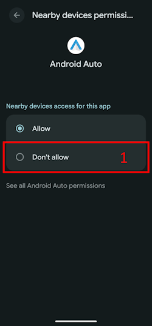
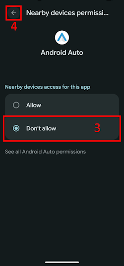

(bluetoothtroubleshooting-bluetooth-related-issues)=

# Отстраняване на неизправности с Bluetooth

Някои потребители имат проблеми с неуспешно активиране на Omnipod DASH, проблеми с връзката на Medtrum Nano и други грешки на пода, свързани с Bluetooth. Много от тези проблеми могат да бъдат проследени до една от следните причини.

Някои от тези проблеми вероятно засягат и други инсулинови помпи с Bluetooth; Medtrum Nano също има известни проблеми с разрешението „Устройства в близост“, както и Omnipod DASH.

---

(bluetoothtroubleshooting-cannot-start-omnipod-with-android-16)=

## Omnipod не може да се стартира с Android 16
- Android 16 изисква поне версия 3.3.2.1 на **AAPS**, за да работи Omnipod DASH правилно, защото тази версия съдържа поправки специално за известните проблеми с Omnipod, появили се в Android 16.

---

(bluetoothtroubleshooting-bluetooth-battery-optimisation)=

## Оптимизиране на батерията за Bluetooth

Newer versions of Android have enabled Battery optimisation for the system Bluetooth app. Известно е, че това причинява проблеми при някои помпи и CGM с Bluetooth.

If you followed the [Setup Wizard](../SettingUpAaps/SetupWizard.md) and followed the configuration settings in the [Bluetooth Battery Optimisation](#setup-wizard-bluetooth-battery-optimisation) section then this setting should be correct, however if you followed an older version of this guide it's possible you have not changed this setting.

Verify this is correctly configured if you have pump and CGM disconnections.

---

(bluetoothtroubleshooting-apps-using-nearby-device-permission)=

## Приложенията, които използват разрешението на Android „Устройства в близост“ (Nearby devices), могат да причинят прекъсване на връзката и проблеми с активирането на пода

Android ви позволява да контролирате какво може да прави или до какво има достъп всяко приложение на телефона ви чрез система от разрешения. За всяко инсталирано приложение можете да изберете дали да разрешите или да забраните конкретни разрешения, напр. достъп до файловете на устройството, достъп до Bluetooth, търсене на устройства в близост и др.

**AAPS** requires a number of specific permissions to function, one which is required to ensure that Pods work is the "Nearby devices" permission. Много други приложения също изискват това разрешение. Общността установява, че някои приложения, когато получат това разрешение, могат да причинят проблеми с активирането на нови подове на някои устройства.

(bluetoothtroubleshooting-apps-using-nearby-device-permission-known-apps)=

### Приложения, които използват разрешението „Устройства в близост“ и за които е известно, че са причинили проблеми:

Приложенията в този списък са обсъждани на едно или повече места в общността като причина за проблеми с устройства Omnipod DASH, а в някои случаи и с Medtrum Nano.

```{admonition} Updating the list
:class: note
Пишете на @XiTatiON в Discord канала #omnipod-dash, за да обсъдите приложения, които да бъдат добавени в този списък.
```

- **myBMW** MyBMW прекъсваше връзката с Medtrum Nano и Omnipod DASH. Приложението MyBMW пита за разрешението „find nearby devices“ (намиране на устройства в близост) само веднъж; ако не го дадете, приложението пак работи напълно нормално

- **Amazon Alexa**  Премахването на „Устройства в близост“ за приложението Alexa е решило проблема при някои хора, но спира възможността за сдвояване на IoT устройства с Matter

- **MINI app**  Appears the app is based on myBMW app and might mirror its behavior as a result

- **BM2** Приложение за наблюдение на соларна батерия, използвано в някои кемпери и соларни системи за къмпинг; когато приложението работеше, то пречеше на активирането на нов под. Принудителното спиране (Force stop) на приложението по време на активиране на нов под заобикаля проблема. Стартирането на приложението след това не изглеждаше да пречи на работата на Dash (на Pixel 8 Pro с Android 16).

(bluetoothtroubleshooting-revoke-nearby-device-permission)=

### Как да отнемете разрешението „Устройства в близост“ на други приложения:
If you are facing issues activating a new Pod and you are running on the correct supported version of **AAPS** for your version of Android, it may be necessary to revoke the permission for other apps while activating a new Pod.

Follow this procedure to revoke the "Nearby device" permission for all apps except **AAPS**:

```{admonition} Menus and settings
:class: note
Снимките на екрана и инструкциите в това ръководство са от стандартен (Vanilla) Android 16 на Google Pixel 8 Pro. При други производители и устройства менютата и описанията на настройките най-вероятно няма да съвпадат точно. Нагласете стъпките според своето устройство, а ако се затрудните, вижте раздела [Къде да получите помощ за Dash](#omnipod-dash-where-to-get-help-for-dash), за да разберете как да потърсите помощ от общността.
```

1. Отворете настройките на Android на телефона си, превъртете надолу и натиснете **Сигурност и поверителност (1)** (Security and privacy).

    

2. Превъртете надолу и натиснете **Контроли за поверителност (1)** (Privacy controls).

   

3. Натиснете **Мениджър на разрешенията (1)** (Permission manager).

   

3. Превъртете надолу и натиснете **Устройства в близост (1)** (Nearby devices).

   

4. Разгледайте списъка с приложения и натиснете приложението, на което искате да отнемете разрешението **Устройства в близост**.

   В това ръководство отнемаме разрешението на **Android Auto (1)**.

   За да не станат неизползваеми още подове, съветваме всички в началото да отнемат разрешението на всички приложения освен **AAPS**.

```{admonition} Which app to select?
:class: tip
Ако не сте сигурни кое приложение ви създава проблем, отнемете разрешението на всички (не забравяйте да проверите и списъка с известни проблемни приложения и да започнете с тях). Ако можете да си позволите да загубите няколко пода по пътя, давайте отново разрешението на по едно приложение преди всяко ново активиране на под, докато откриете кое точно приложение причинява проблемите с пода. Ако откриете нови проблемни приложения, моля, кажете ни в Discord канала #omnipod-dash.
```

   

5. За да отнемете разрешението, натиснете **Забраняване (1)** (Don't allow), след това натиснете **Забраняване въпреки това (2)** (Don't allow anyway). Ако сте го направили правилно, трябва да видите избрана опцията **Забраняване (3)**. Сега можете да се върнете в менюто **Устройства в близост**, като натиснете **стрелката „Назад“ (4)**, и да промените тази настройка и за други приложения, ако е нужно.

      

(bluetoothtroubleshooting-re-enable-nearby-device-permission)=

### Как да дадете отново разрешението „Устройства в близост“ на системни и други приложения:

1. Ако е нужно, вижте раздела **Как да отнемете разрешението „Устройства в близост“ на други приложения**, за да разберете как да стигнете до настройките за поверителност на приложението, а след като сте в настройките на **Устройства в близост**, продължете към стъпка 2.

2. Разгледайте списъка с приложения и натиснете приложението, на което искате да дадете разрешението **Устройства в близост**.

   В това ръководство даваме разрешението на **Android Auto (1)**.

   Ще забележите, че **Android Auto (1)** липсва в списъка с приложения, след като разрешението е отнето. Това е така, защото **Android Auto** е **системно приложение** (System app), а системните приложения по подразбиране са скрити.

   

3. За да покажете скритите системни приложения, натиснете **менюто с три точки (⋮) (1)** в горния десен ъгъл, след това натиснете **„Показване на системните“ (2)** (Show system). Сега трябва да виждате скритото системно приложение **Android Auto (3)** в списъка.

```{admonition} Find your app
:class: tip
Ако разрешението на дадено приложение е отнето, трябва да превъртите надолу, докато видите списъка с приложения без разрешение по-долу в списъка.
```

     

5. Следвайте указанията от **Как да отнемете разрешението „Устройства в близост“ на други приложения** в обратен ред, за да дадете отново разрешението на всяко приложение.

---

(bluetoothtroubleshooting-android-15-bluetooth-connection-problems)=

## Android 15: чести проблеми с връзката през Bluetooth

След актуализиране на Android или преминаване към по-нов телефон **AAPS** често губи Bluetooth връзката с помпата. Проблемът изчезва временно при рестартиране на телефона. Ако използвате **Omnipod DASH** и телефонът ви е с Android 15, включването на настройката **Bluetooth свързване (bonding)** може да помогне за по-стабилна Bluetooth връзка. За да я включите:

```{admonition} Android 16
:class: warning
Включвайте **Bluetooth свързване (bonding)** само на Android 15 и само ако имате проблеми с връзката. НЕ включвайте свързването (bonding) на Android 16.
```

1. Отворете [настройките на Dash](#omnipod-dash-settings): отворете екрана на помпата DASH чрез **Управление** > **Помпа** и натиснете иконата **Настройки** (зъбно колело) в горния десен ъгъл.

   

2. Отворете раздела **Разширени настройки** и включете **Bluetooth свързване (bonding)**.

   

3. Ако телефонът покаже заявка за сдвояване, приемете я.

4. Рестартирайте телефона си.
