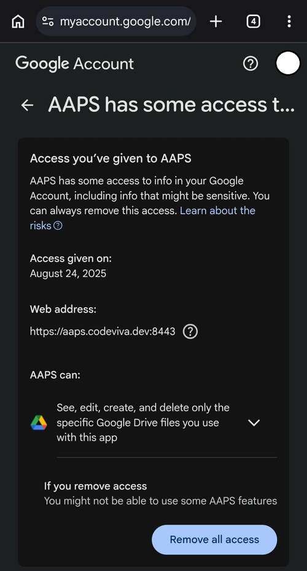

(aaps-ci-troubleshooting)=

# Отстраняване на неизправности при компилиране в браузъра

```{note}
This page collects troubleshooting tips for the [Browser build](../SettingUpAaps/BrowserBuild.md).
```

(aaps-builder-troubleshooting)=

## AAPS Builder

### Step 1: the repository

(aaps-builder-ts-repo-exists)=

#### "my-aaps already exists in this account"


You already have this repository, for example from an earlier attempt. Close the GitHub tab, keep that name in step 1 of the setup page and go on. If you already did steps 2 and 3 for it, your key is still in it: continue with [step 4](#aaps-builder-step4). If it was made with an earlier version of the setup page, update its workflow once as explained in [Updating AAPS](#aaps-builder-updates). You prefer a fresh start? Type another name, for example `my-aaps-2`, and use the same keystore in step 2.

(aaps-builder-ts-user-not-found)=

#### "No GitHub user with this name"


- **„No GitHub user with this name“** в стъпка 1: въведете потребителското си име в GitHub, както е показано във вашия профил в GitHub, а не вашия имейл.
- **Няма бутон „Build AAPS“ или „Run workflow“ или хранилището е празно**: хранилището не е създадено от шаблона. Изтрийте го (**Settings** → най-долу на страницата → **Delete this repository**) и направете отново [стъпка 1](#aaps-builder-step1) с бутона **Create my private repository**.

### Step 3: the secret

(aaps-builder-ts-404)=

#### "Page not found" (404)


- **„Page not found“ (404), когато страницата за настройка отваря GitHub**: влезте в github.com в същия браузър (GitHub показва 404 за частни хранилища, когато не сте влезли). Ако сте влезли, потребителското име или името на хранилището в стъпка 1 на страницата за настройка не съвпада с вашето хранилище. Въведете точните имена.

### Step 4: the build

(aaps-builder-ts-workflow-not-found)=

#### "This workflow does not exist"


Right after the repository is created, GitHub may not have read its workflow file yet: **Build AAPS** is missing from the **Actions** tab, and there is no **Run workflow** button. Any small change to the file makes GitHub read it:

1. In your repository, open **Code**, then the folder `.github`, then `workflows`, then the file `build.yml`.
2. Tap the **⋯** menu at the top right of the file, then **Edit file… In place** (on a computer, click the pencil).

   

3. Tap at the very end of the text and add an empty line (Enter). Tap **Commit changes…** at the top.

   

4. Tap **Commit changes** again.

   

5. Open the **Actions** tab again: **Build AAPS** is now in the list of workflows (on a phone, the list opens with the icon at the left of **All workflows**). Tap it, then **Run workflow**.

   

(aaps-builder-ts-build-failed)=

#### The build failed (red cross)

1. On the setup page, tap **Open my builds** and tap the build with the red cross.

   

2. The page of the build shows **Failure**, and which part failed: **AAPS / Check** (the repository, the secret, the version or the variant: nothing was built) or **AAPS / Build AAPS**.

   

3. Scroll down to **Annotations**, with your finger on the text, not on the diagram. The red lines explain the problem: tap **Show more** to read the whole message, then find it below.

   

- **„Secret KEYSTORE_SET is missing“**: направете стъпка 3 на страницата за настройка.
- **Компилацията спира със съобщението „This repository is PUBLIC“**: във вашето хранилище отворете **Settings** → **General** → **Danger Zone** → **Change visibility** → **Private**, след това компилирайте отново.
- **"Version … does not exist"**: only released versions of **AAPS** can be built, the ones on the [tags page](https://github.com/nightscout/AndroidAPS/tags) of nightscout/AndroidAPS, such as `3.3.2.0`. A branch name such as `dev` doesn't work. Use `latest`, or type a tag exactly as listed.
- **„Variant … is not supported“**: вашият файл с работния процес е по-стара версия. Заменете го, както е обяснено в [Актуализиране на AAPS](#aaps-builder-updates).
- **„The secret is too short“**, **„The secret is not a valid code“** или **„The secret does not contain a keystore“**: в секрета е поставен грешен текст – често самата дума `KEYSTORE_SET` или само част от кода. Във вашето хранилище отворете **Settings** → **Secrets and variables** → **Actions**, редактирайте `KEYSTORE_SET` и поставете отново дългия код от **Copy secret** (първо направете отново стъпка 2 на страницата за настройка, ако сте я затворили).
- **„Keystore, password or alias is wrong“**: проверете паролата и псевдонима на хранилището за ключове, след това направете отново стъпки 2 и 3 на страницата за настройка.
- **„Google Drive access has expired or was revoked“**: направете отново [стъпка 6](#aaps-builder-google-drive) и актуализирайте секрета `GDRIVE_OAUTH2`.
- **Another error**: [read the build log](#aaps-ci-read-the-logs), then [run the build again](#aaps-ci-rerun). If it fails again the same way, ask for help with the name of the failed step and the error lines. Никога не споделяйте съдържанието на своите секрети.

### Step 5: the app

- **Няма връзка Download или се отвори приложението GitHub**: приложението GitHub не може да изтегля компилации. Отворете компилацията в Chrome, както е обяснено в [стъпка 5](#aaps-builder-step5). За да спрете отварянето на връзки към GitHub в приложението: Android **Настройки** (Settings) → **Приложения** (Apps) → **GitHub** → **Отваряне по подразбиране** (Open by default) → изключете **Отваряне на поддържаните връзки** (Open supported links).

## Отстраняване на неизправности с AAPS-CI

(aaps-ci-read-the-logs)=
### Първо: разберете какво се е объркало

Когато компилацията не успее, GitHub пази лог за всяка стъпка. Логът ви казва коя стъпка е неуспешна и защо. Прочетете го, преди да опитате каквото и да е друго: съобщението за грешка е това, което търсите на тази страница, и това, което ще поискат хората, които ви помагат.

1. Във вашето копие на AndroidAPS в GitHub отворете **Actions**. Неуспешната компилация има червено кръстче. Докоснете името ѝ.

   

2. Обобщението на изпълнението показва **Failure**, а под него – задачата (job), която е неуспешна (**Build AAPS**, с червено кръстче).

   

3. Превъртете надолу до **Annotations** и докоснете червения ред **Build AAPS**.

   

4. Задачата (job) се отваря. Стъпките със сива отметка са минали успешно. Стъпката с червено кръстче е неуспешната: GitHub я отваря вместо вас. Стъпките след нея са пропуснати (сиво кръгче).

   

5. Прочетете редовете точно над `Error: Process completed with exit code 1.`: те обясняват проблема. В този пример стъпката **Retrieving Google Drive access token** е неуспешна с `invalid_grant` и `Token has been expired or revoked.`, вижте [Изтекъл токен за опресняване на Google](#aaps-ci-google-token-expired).

   

```{tip}
Търсите помощ? Споделете името на неуспешната стъпка и редовете с грешката (снимка на екрана като горната е достатъчна). Никога не споделяйте съдържанието на своите секрети.
```

(aaps-ci-update-secret)=
#### Обновяване на секрет

Много поправки изискват да смените стойността на секрет. Във вашето копие на AndroidAPS в GitHub отидете на **Settings** → **Secrets and variables** → **Actions** и докоснете молива до секрета.


Въведете или поставете новата стойност и докоснете **Update secret**. GitHub никога не показва старата стойност: полето винаги е празно.


(aaps-ci-rerun)=
#### Стартиране на компилацията отново след поправка

След като сте отстранили причината, не е нужно да започвате отначало: отворете неуспешното изпълнение, докоснете **...** (горе вдясно), след това **Re-run failed jobs**.


Докоснете **Re-run jobs**. Можете също да стартирате нова компилация от **Run workflow**, както обикновено.


(aaps-ci-preparation-web)=
### Уеб страницата aaps-ci-preparation
  - Подготвителната страница се показва от временен локален сървър (например Simple Web Server на компютър), който също получава токена за опресняване на Google.
  - Ако видите екрана по-долу, локалният сървър е спрял или не е достъпен.
  - Затворете подготвителната страница, проверете дали локалният сървър работи, след това отворете отново aaps-ci-preparation.html по същия начин както в Стъпка 2 и изпълнете останалите стъпки. Това е нужно особено при създаването на първоначалната връзка с Google по време на настройката.

  

(aaps-ci-google-token-expired)=
### Изтекъл токен за опресняване на Google
  - Токените за опресняване на Google OAuth2 изтичат, ако не се използват 6 месеца, и могат да станат невалидни и при други условия (напр. ако сте сменили паролата на профила си в Google или сте отнели достъпа ръчно). За повече подробности вижте [документацията за Google OAuth2](https://developers.google.com/identity/protocols/oauth2).
  - В [лога на компилацията](#aaps-ci-read-the-logs) стъпката **Retrieving Google Drive access token** е неуспешна с `invalid_grant` и `Token has been expired or revoked.`:

  

  - Ако компилацията ви е неуспешна заради изтекъл или отнет токен за опресняване на Google, трябва да повторите стъпките от [Google Drive Auth](#aaps-ci-google-drive-auth), за да получите нов токен `GDRIVE_OAUTH2`, да [обновите секрета](#aaps-ci-update-secret) във вашето хранилище в GitHub и след това да [стартирате компилацията отново](#aaps-ci-rerun).
  - Ако разрешаването отново не успее или Google вече не ви пита за съгласие, първо премахнете съществуващия достъп на AAPS от профила си в Google, вижте [по-долу](#aaps-ci-google-remove-access).

(aaps-ci-google-remove-access)=
### Премахване на достъпа на AAPS от профила ви в Google и повторно разрешаване
  - Ако разрешаването за Google Drive продължава да не успява или искате да започнете отначало от чисто състояние, първо премахнете достъпа, който преди сте дали на AAPS, и след това направете разрешаването отново.
  - На телефона си отворете [https://myaccount.google.com](https://myaccount.google.com), докоснете **Security** (Сигурност), превъртете надолу до **Your connections to third-party apps & services** (Вашите връзки с приложения и услуги на трети страни) и отворете списъка със свързани приложения. Можете също да отидете направо на [https://myaccount.google.com/connections](https://myaccount.google.com/connections).
  - Докоснете **AAPS** в списъка.

  

  - Страницата показва достъпа, който сте дали на AAPS (файловете в Google Drive, използвани с приложението). Докоснете **Delete all** (Изтриване на всички), за да премахнете връзката, или докоснете **See details** (Вижте подробностите), за да я прегледате първо.

  

  - На страницата с подробности докоснете **Remove all access** (Премахване на целия достъп).

  

  - Докоснете **Confirm** (Потвърждаване).

  

  - Google потвърждава, че AAPS вече няма достъп. AAPS вече не се показва в списъка със свързани приложения.

  

  - Сега започнете разрешаването отначало: затворете **и двете** – подготвителната страница и приложението за управление на файлове, отворете отново aaps-ci-preparation.html от приложението за управление на файлове и повторете стъпките от [Google Drive Auth](#aaps-ci-google-drive-auth). Google ще ви поиска отново да дадете достъп и страницата ще ви даде нов токен `GDRIVE_OAUTH2`.
  - [Обновете секрета `GDRIVE_OAUTH2`](#aaps-ci-update-secret) във вашето хранилище в GitHub с новия токен, след това [стартирайте компилацията отново](#aaps-ci-rerun).

(aaps-ci-disable-software)=
### Изключете софтуера, който може да пречи на проверката OAuth
  - Преди да опитате да получите ключа OAuth, изключете на телефона всяко VPN приложение или приложение за сигурност (защитна стена, програма срещу зловреден софтуер...).

(aaps-ci-actions-permission)=
### Проверка на настройките за разрешения на GitHub Actions
  - Уверете се, че правилата (policies) на GitHub Actions са зададени на „Allow all actions and reusable workflows“ (Settings → Actions → General). Ако го промените, натиснете **Save** под опциите.

  

`actions/checkout@v4` and `actions/setup-java@v4` are not allowed to be used in `xxxxx/AndroidAPS`. Actions in this workflow must be: within a repository owned by `xxxxx`

(aaps-ci-workflow-permissions)=
### Проверка на настройките за разрешения на работните процеси в GitHub
  - Ако компилацията спре веднага с грешка „Invalid workflow file“, подобна на тази по-долу, разрешенията по подразбиране за работните процеси във вашето хранилище са твърде ограничени:

```
Invalid workflow file
The workflow is not valid. .github/workflows/aaps-ci.yml (Line: 361, Col: 3):
Error calling workflow 'xxxxx/AndroidAPS/.github/workflows/cleanup-workflow-runs.yml@...'.
The nested job 'cleanup' is requesting 'actions: write', but is only allowed 'actions: none'.
```

  - Уверете се, че Workflow permissions е зададено на „Read and write permissions“ (Settings → Actions → General → Workflow permissions), след това запишете и стартирайте отново работния процес за компилиране.

  

(aaps-ci-password-special-characters)=
### Компилацията е неуспешна при проверката на паролата на хранилището за ключове
  - В [лога на компилацията](#aaps-ci-read-the-logs) стъпката **Validating keystore, alias and password** е неуспешна с `Either KEYSTORE_BASE64, KEYSTORE_PASSWORD, KEY_PASSWORD, or KEY_ALIAS is incorrect`, последвано от `Keystore was tampered with, or password was incorrect`. Компилацията спира там: хранилището за ключове и паролите се проверяват, преди AAPS да бъде компилиран.

  

  - Работният процес за компилиране запазва всеки знак от паролите ви непроменен. Въведете `KEYSTORE_PASSWORD` и `KEY_PASSWORD` точно както са, без да добавяте обратна наклонена черта или друг знак за екраниране (escape). Ако сте добавили обратни наклонени черти, [обновете секретите](#aaps-ci-update-secret) с паролата точно както е. Примерът по-долу е грешен: паролата е `Example2026`, а обратната наклонена черта е добавена.

  

  - Ако компилацията все още е неуспешна при подписването на APK, въпреки че паролата ви е правилна, и паролата съдържа `$`, обратен апостроф (backtick), `"` или `\`, файлът на работния процес във вашия fork е по-стар от септември 2026 г. и все още интерпретира тези знаци. [Синхронизирайте своя fork](#Update-to-new-version-update-your-repo) с най-новата версия на dev, след това стартирайте отново работния процес за компилиране.
  - Вертикалната черта `|` е специален случай. Подготвителната страница от [Вариант 1](#aaps-ci-option1) обединява хранилището за ключове, паролите и псевдонима (alias) в един секрет `KEYSTORE_SET`, разделени с `|`, а работният процес ги разделя по този знак. Паролата, създадена от подготвителната страница, съдържа само букви и цифри, затова това не може да се случи с Вариант 1. Това може да се случи само ако сами сте съставили секрет `KEYSTORE_SET` с парола, която съдържа `|`. В този случай изтрийте `KEYSTORE_SET` и вместо него въведете отделните секрети от [Вариант 2](#aaps-ci-option2).
