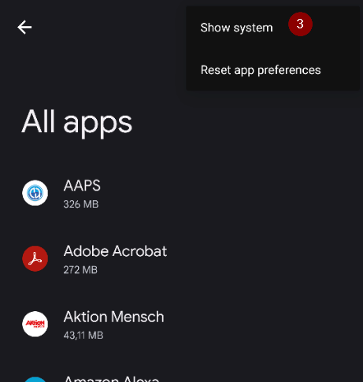
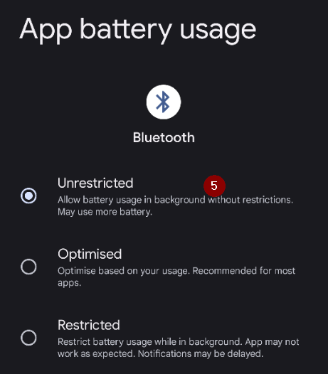
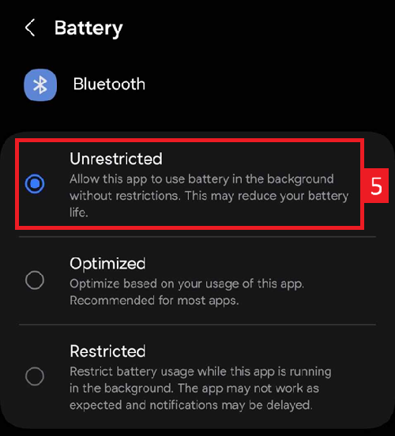

(generaltroubleshooting)=

# Отстраняване на неизправности

**Започнете оттук, когато нещо не работи.** Информацията за отстраняване на неизправности е на много страници в документацията. Тази страница я събира на едно място: това е обща колекция от връзки, подредени по теми, която ще ви помогне да решите най-честите проблеми.

Ако не намерите отговор по-долу, проверете също:

* раздела [Често задавани въпроси](../UsefulLinks/FAQ.md) с отговори на често срещани въпроси и
* ръководството [Настройване на профила в AAPS](ProfileTuning.md), ако кръгът ви работи, но контролът на кръвната захар трябва да се подобри.

```{admonition} Still stuck?
:class: tip
Ако никоя от връзките не реши проблема ви, вижте [Къде мога да получа помощ?](WhereCanIGetHelp.md), за да попитате общността (Facebook, Discord), или изпратете своите [лог файлове](AccessingLogFiles.md) на разработчиците.
```

---

(generaltroubleshooting-aaps-app)=

## Приложението AAPS

### Компилиране и актуализиране

* Ако компилирането е неуспешно, вижте [Ако компилирането е неуспешно](#building-aaps-troubleshooting): там е посочен разделът за отстраняване на неизправности за всеки метод на компилиране:
  * [AAPS Builder](#aaps-builder-troubleshooting)
  * [Компилиране в браузъра](#aaps-ci-troubleshooting)
  * [Android Studio](TroubleshootingAndroidStudio.md)
* Изгубено или ново хранилище за ключове: [Преинсталиране на AAPS с ново хранилище за ключове](#reinstall-aaps)
* Актуализиране на **AAPS**: [с AAPS Builder](#aaps-builder-updates), [с компилиране в браузъра (fork)](#update-browser-build-troubleshooting), [с Android Studio](#update-computer-build-troubleshooting)

### Инсталиране

* [Предупреждение от Google Play Protect](#transferring-installing-play-protect-warning): приложението е отбелязано като опасно.
* Инсталирането е **блокирано** със съобщение за непроверен разработчик: вижте [Проверка на разработчиците за Android](#android-developer-verification) за безплатните начини за инсталиране.

### Настройки

* [Профил: „Базалът не се поддържа от помпата“](#your-aaps-profile-basal-not-compatible)
* [Помпа: „Данните идват от различна помпа“](#config-builder-wrong-pump-data)
* [Nightscout Client](TroubleshootingNsClient.md)
* **"AAPS settings cannot be read"** at start: the settings are encrypted with a key that Android keeps for **AAPS**, and that key does not open them any more, for example after the key store of the phone was reset. While this screen is shown, **AAPS** is not running and does not control the pump. Tap **Retry**: it closes and restarts **AAPS**. If that does not help, restart the phone. Use **Start fresh** only when nothing else helps: it sets the unreadable settings file aside (it is renamed and kept) and starts **AAPS** with empty settings. Then import your last [settings export](../Maintenance/ExportImportSettings.md).

### Употреба

* [Грешни стойности за въглехидратите (бавно усвояване на въглехидратите)](#CobCalculation-detection-of-wrong-cob-values)
* [Автоматизации](#automations-troubleshooting)
* [Напълно затворен кръг](#full-closed-loop-troubleshooting)

---

(generaltroubleshooting-bluetooth-related-issues)=


## Проблеми, свързани с Bluetooth

За известни проблеми с Bluetooth връзките, прекъсвания на връзката с помпата/пачовете или проблеми с активирането и връзката вижте [Отстраняване на неизправности с Bluetooth](../GettingHelp/BluetoothTroubleshooting.md)

---

(generaltroubleshooting-android-related-issues)=

## Проблеми, свързани с Android

### Оптимизиране на батерията

**AAPS** може да ви помогне да намерите правилните настройки за телефона си: отворете **менюто** (☰) > **За приложението** и докоснете **Don't kill my app?**. Така се отварят указанията за вашата марка телефон в [Don't kill my app](https://dontkillmyapp.com/). [Съветникът за настройване](#setup-wizard-bluetooth-battery-optimisation) също ви моли да изключите оптимизирането на батерията за **AAPS** и Bluetooth.

Android има вградени настройки за пестене на батерията, които са включени по подразбиране. Тези настройки автоматично спират или поставят на пауза приложения, които не са нужни за работата на системата. Така се пести енергията на батерията, която използват приложения, които не е нужно да работят постоянно.

Ако то е включено, много вероятно ще причини проблеми на **AAPS** и на други помощни приложения, като **xDrip**.

Важно е да изключите оптимизирането на батерията, за да сте сигурни, че **AAPS** и другите помощни приложения остават активни през цялото време.

В зависимост от модела и марката на телефона може да има повече от едно място и настройка, където това трябва да се изключи.

***ЗАБЕЛЕЖКА:** Следвайте стъпките по-долу, за да изключите оптимизирането на батерията за услугата Bluetooth, ако телефонът ви има тази опция. Същите стъпки може да се използват и за **AAPS** и други приложения, но екранните снимки показват как става това само за услугата Bluetooth.*

#### Телефони Pixel (стандартен Android)

* Отидете в настройките на Android и изберете „Приложения“ (Apps).

  

* Изберете „Вижте всички приложения“ (See all apps)

  

* В менюто вдясно изберете „Показване на системните приложения“ (Show system).

  

* Сега потърсете и изберете приложението „Bluetooth“.

  

* Натиснете „Използване на батерията от приложението“ (App battery usage) и изберете „Без ограничения“ (Unrestricted). В някои по-стари версии на Android тази опция се нарича „Не е оптимизирано“ (Not optimized).

  


#### Телефони Samsung

* Отидете в настройките на Android и изберете „Приложения“ (Apps)

* Върху иконата, която уж променя начина на сортиране (1), изберете „Показване на системните приложения“ (Show system apps) (2).

  

  

* Сега потърсете приложението Bluetooth и го изберете, за да видите настройките му.

  

* Изберете „Батерия“ (battery).

  

* Задайте „Без ограничения“ (Unrestricted). В някои по-стари версии на Android тази опция се нарича „Не е оптимизирано“ (Not optimized).

  

#### Телефони Huawei

Вижте това ръководство за [Huawei: Bluetooth и оптимизиране на батерията](../CompatiblePhones/Huawei.md)

---

(generaltroubleshooting-cgm)=

## Устройство за непрекъснато мониториране на глюкозата (CGM)

Полезни връзки към известни проблеми и стъпки за решаването им при CGM.

* [Общи](#general-cgm-troubleshooting)
* [Dexcom G6](#DexcomG6-troubleshooting-g6)
* [Libre 2 с Minimal Looper](#minimallooper-troubleshooting)
* [Libre 3](#libre3-experiences-and-troubleshooting)
* [xDrip - няма данни от CGM](#xdrip-identify-receiver)
* [xDrip - отстраняване на неизправности с Dexcom](#xdrip-troubleshooting-dexcom-g5-g6-and-xdrip)

---

(generaltroubleshooting-pumps)=

## Помпи

Полезни връзки към известни проблеми и стъпки за решаването им при помпите

* [Accu-Chek Combo](#combov2-tips-for-basic-usage)
* [Accu-Chek Insight](#Accu-Chek-Insight-Pump-insight-specific-errors)
* [CareLevo](#carelevo-alarms-and-notifications)
* [DanaRS](#DanaRS-Insulin-Pump-dana-rs-specific-errors)
* [Diaconn G8](#diaconn-g8-bluetooth-troubleshooting)
* [EOPatch2](#eopatch2-alarms-and-warnings)
* [Medtronic + RileyLink](#MedtronicPump-what-to-do-if-i-loose-connection-to-rileylink-and-or-pump)
* [Medtrum Nano](#medtrum-nano-troubleshooting)
* [Omnipod DASH](#omnipod-dash-troubleshooting)
* [Omnipod Eros](#OmnipodEros-troubleshooting)

---

(generaltroubleshooting-phones)=

## Телефони

Полезни връзки към известни проблеми и стъпки за решаването им при телефоните

* [Списък с тествани конфигурации на телефони и устройства](https://docs.google.com/spreadsheets/u/1/d/e/2PACX-1vScCNaIguEZVTVFAgpv1kXHdsHl3fs6xT6RB2Z1CeVJ561AvvqGwxMhlmSHk4J056gMCAQE02sAWJvT/pubhtml?gid=683363241&single=true)
* [Jelly](../CompatiblePhones/Jelly.md)
* [Huawei: Bluetooth и оптимизиране на батерията](../CompatiblePhones/Huawei.md)

---

(generaltroubleshooting-remote-control)=

## Дистанционно управление

* [AAPSClient и дистанционно управление (сдвояване, командите не се получават)](#client-master-control-troubleshooting)
* [Проблеми с „Токен за достъп до Nightscout“](#remotecontrol-nightscout-access-token)
* [SMS команди](#SMSCommands-troubleshooting)
* [Android Auto](#android-auto-troubleshooting)

---

(generaltroubleshooting-smartwatches)=

## Смарт часовници

Полезни връзки към известни проблеми и стъпки за решаването им при смарт часовниците

* [Отстраняване на неизправности с приложението Wear](#Watchfaces-troubleshooting-the-wear-app)
* [Часовникът и телефонът не комуникират](#wear-os-watch-phone-communication)
* [Wear OS 5](#wear-os-5-troubleshooting)
* [Компилиране на приложението Wear](#building-aaps-wear-os-troubleshooting)
