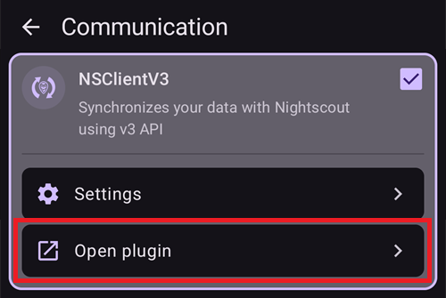

(reinstall-aaps)=
# Преинсталиране на AAPS с ново хранилище за ключове

Всеки apk на **AAPS** е подписан с **хранилище за ключове**. Актуализацията се инсталира върху текущия ви **AAPS** само ако е подписана със **същото хранилище за ключове**: тогава всичките ви настройки и данни се запазват. Затова е препоръчително да пазите хранилището за ключове и паролата му на сигурно място.

Ако се опитате да инсталирате apk, подписан с различно хранилище за ключове от предишното, ще получите съобщение за грешка, че инсталирането е неуспешно!

(reinstall-aaps-when)=
## Кога трябва да преинсталирате?

Трябва да деинсталирате и да инсталирате отново **AAPS**, когато новият ви apk е подписан с различно хранилище за ключове, например:

- Не можете да намерите старото си хранилище за ключове или паролата му.
- Създали сте ново хранилище за ключове, например с [Вариант 1 на компилирането в браузъра](../SettingUpAaps/BrowserBuildKeystore.md) или с **Create a new key** в [AAPS Builder](../SettingUpAaps/BrowserBuildAapsBuilder.md).
- Компилирате на нов компютър и не сте копирали хранилището за ключове на него.

Ако все още имате хранилището си за ключове, тази страница не ви е нужна: използвайте го отново и [актуализирайте **AAPS**](../Maintenance/UpdateToNewVersion.md) върху текущата инсталация.

(reinstall-aaps-before)=
## Преди да започнете

- Деинсталирането на **AAPS** изтрива всичките му настройки, вашите [цели](../SettingUpAaps/CompletingTheObjectives.md) и текущата връзка с помпата. Връщате ги, като импортирате своя **файл с настройки**, затова се уверете, че имате скорошен такъв.
- Файлът с настройки не съдържа историята на леченията и на кръвната захар. Ако качвате данни в [Nightscout](../SettingUpAaps/SettingUpTheReportingServer.md), можете да ги заредите обратно след преинсталирането (стъпка 8).
- Нужна ви е вашата [**главна парола**](#Preferences-master-password): файлът с настройки е шифрован с нея.
- **Потребители на Omnipod и Medtrum:** първо прочетете [Помпи без маркуч](#ExportImportSettings-tubeless-pumps). Файлът ви с настройки трябва да е експортиран по време на пода или пача, който носите в момента.
- Ако е нужно, [настройте приемника за CGM/източника на КЗ](../Getting-Started/CompatiblesCgms.md), преди да започнете.

(reinstall-aaps-steps)=
## Стъпки

Снимките показват преминаване от **AAPS** 3.4 (стъпки от 1 до 3) към **AAPS** 4 (стъпки от 6 до 8). Другите версии изглеждат малко по-различно.

(reinstall-aaps-export)=
### 1. Експортирайте настройките си

Експортирайте настройките си с **AAPS**, който в момента е инсталиран на телефона ви. Вижте [Експорт на настройките](#ExportImportSettings-Settings-Export) за подробности.

В **AAPS** 3.4: отворете **Поддръжка** и докоснете **Export options** (опции за експорт). Под **User Settings** (потребителски настройки) отметнете **Local Storage** (локална памет) и докоснете **ОК**.

*Бележка: можете да използвате и [Cloud Storage](#preferences-maintenance-cloud) (облачно пространство), за да имате резервно копие за безопасност: това е добра идея, но запазете и Local Storage (локална памет), за да можете бързо да възстановите настройките.*

Сега на бутона пише **Export settings (local)**. Докоснете го.

**AAPS** показва името на файла, който ще създаде. Докоснете **ОК**, въведете главната парола и докоснете **ОК**.

В **AAPS** 4: отворете **Поддръжка**, изберете бутона **Локално** до **Експорт настройки** и докоснете **Експорт настройки**.

(reinstall-aaps-copy)=
### 2. Копирайте файла с настройки извън телефона

Файлът е в папката **preferences** на вашата [**AAPS** директория](#SetupWizard-StoragePermission) и има име като `2026-10-13_222735_full.json`. Копирайте го или го качете на външно място (напр. на компютъра си, в облачно пространство...). Обикновено файлът остава на телефона ви след деинсталирането, но за всеки случай пазете копие и на друго място.

(reinstall-aaps-nightscout-before)=
### 3. Синхронизирайте с Nightscout

Тази стъпка не е задължителна, но се препоръчва, ако използвате [DynISF](#Open-APS-features-DynamicISF): тя ще ви позволи да продължите направо с текущите настройки, вместо да чакате 5 дни, докато се съберат нужните данни за плъгина. NSClient V3 трябва да бъде [включен и конфигуриран](../SettingUpAaps/SettingUpTheReportingServer.md).

Уверете се, че Nightscout има всичките ви данни, преди да деинсталирате.

Отворете **NSClient**, докоснете бутона **Пълна синхронизация** в долната част на екрана, след това **ОК**.

*Бележка: нужното време зависи от услугата, на която е хостван вашият Nightscout.*

След това **AAPS** предлага да почисти базата си данни. **ОК** изтрива от телефона данните, по-стари от 3 месеца, и така синхронизацията става много по-бърза. **Откажи** синхронизира без почистване. Базата данни на телефона и без това се изтрива при деинсталирането, затова и двата варианта са наред.

Оставете **AAPS** да работи, докато синхронизацията приключи.

(reinstall-aaps-build)=
### 4. Компилирайте новия apk

[Компилирайте](../SettingUpAaps/BuildingAaps.md) нов подписан apk с новото си хранилище за ключове и го прехвърлете на телефона си.

(reinstall-aaps-uninstall)=
### 5. Деинсталирайте AAPS

В телефона си отворете **Настройки** (Settings) > **Приложения** (Apps) > **AAPS**, докоснете **Деинсталиране** (Uninstall) и потвърдете с **OK**.

(reinstall-aaps-install)=
### 6. Инсталирайте и стартирайте новия AAPS

[Инсталирайте](../SettingUpAaps/TransferringAndInstallingAaps.md) новия apk и стартирайте **AAPS**. [Съветникът за настройване](../SettingUpAaps/SetupWizard.md) пита за правата за достъп, които са нужни на **AAPS**: докоснете **Позволи** за всяко от тях. Така отново се изключва и [оптимизацията на батерията](#setup-wizard-bluetooth-battery-optimisation).

За **AAPS директория** изберете същата папка на **AAPS** като преди (тази, в която има папка **preferences**), докоснете **ИЗПОЛЗВАНЕ НА ТАЗИ ПАПКА** (Use this folder) и **Разрешаване** (Allow).

Когато **AAPS** намери експортираните ви настройки, съветникът за настройване показва екран [Открити са предишни настройки](#setup-wizard-import-settings), от който можете да ги импортирате. Можете също да затворите съветника и да импортирате от **Поддръжка**, както е описано по-долу.

(reinstall-aaps-import)=
### 7. Импортирайте настройките си

Ако файлът с настройки вече не е на телефона ви, копирайте го обратно в папката **preferences** на вашата **AAPS** директория.

Отворете менюто (☰) > **Поддръжка**, изберете бутона **Локално** до **Импорт настройки** и докоснете **Импорт настройки**.

Списъкът показва за всеки файл версията на **AAPS** и колко е стар. Изберете файла, който експортирахте в стъпка 1.

Не е нужно първо да задавате главна парола в новия **AAPS**. Въведете главната парола, която сте използвали при експорта, в **Парола за декриптиране** и докоснете **Декриптиране**. **Файлът е бил криптиран с друга парола** е очаквано съобщение: новият **AAPS** още не знае паролата ви. Импортът я възстановява заедно с другите ви настройки.

Отметнете **Замени и настройките на помпата**: без това помпата ви и нейните настройки не се възстановяват. Потребители на Omnipod и Medtrum: отметнете го само ако файлът е експортиран по време на текущия ви под или пач (вижте [Помпи без маркуч](#ExportImportSettings-tubeless-pumps)).

Докоснете **Импорт**, след това **ОК**, за да приложите настройките, и отново **ОК** при **Настройките са приложени**.

(reinstall-aaps-nightscout-after)=
### 8. Върнете историята си от Nightscout

Отворете менюто (☰) > [**Конфигурация**](../SettingUpAaps/ChangeAapsConfiguration.md) > **Комуникация** и докоснете **Отвори плъгин** под **NSClientV3**. Проверете дали статусът показва **Свързана**. Ако не показва, вижте [Отстраняване на неизправности с NSClient](TroubleshootingNsClient.md).

Докоснете бутона **Пълна синхронизация** в долната част на екрана и **ОК**. Базата данни е нова, затова можете да отговорите на въпроса за почистване както искате.

**AAPS** зарежда данните ви от Nightscout. Когато приключи, дневникът показва **Full sync finished**.

(reinstall-aaps-check)=
### 9. Проверете и продължете със затворения кръг

Проверете дали помпата ви е свързана и стойностите от CGM пристигат, след това продължете със затворения кръг.

(reinstall-aaps-afterwards)=
## След това

Отсега нататък винаги използвайте новото си хранилище за ключове и го пазете заедно с паролата му на сигурно място извън телефона. Вижте [Създаване на резервни копия](../Maintenance/ExportImportSettings.md).
