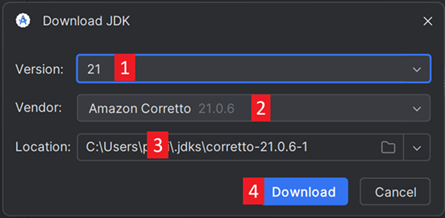
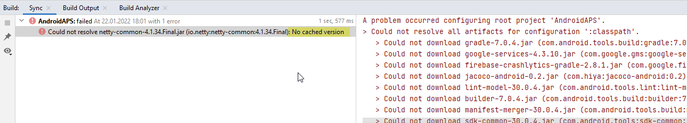

(troubleshooting_androidstudio-troubleshooting-android-studio)=

# Отстраняване на неизправности в Android Studio

```{contents} List of common issues
:depth: 2
:local: true
```

(troubleshooting_androidstudio-lost-keystore)=
## Изгубено хранилище за ключове
Ако сте изгубили хранилището за ключове или паролата му, apk, подписан с ново хранилище за ключове, не може да обнови текущия ви **AAPS**: трябва да го деинсталирате и да го инсталирате отново. Вижте [Преинсталиране на AAPS с ново хранилище за ключове](#reinstall-aaps).

## Неуспешна синхронизация на Gradle (Gradle Sync failed)
Синхронизацията на Gradle (Gradle Sync) може да е неуспешна по различни причини. Когато получите съобщение, че „gradle sync failed“, отворете раздела „Build“ (1) в долната част на Android Studio и проверете какво съобщение за грешка (2) се показва.


```{contents} Likely reasons for gradle sync failures are:
:depth: 1
:local: true
```

*Важно*: След като сте изпълнили инструкциите за своя конкретен проблем, трябва да стартирате отново [синхронизацията на Gradle](#gradle-resync).

(troubleshooting_androidstudio-uncommitted-changes)=
### Незаписани промени (Uncommitted changes)

Ако получите съобщение за грешка като това:


```
Build file 'C:\Data\50-Android\AndroidAPS\app\build.gradle.kts' line: 243

There are uncommitted changes.
Clone sources again as described in wiki and do not allow gradle update
```

#### Стъпка 1 – Проверка на инсталацията на Git
  * Отворете раздела Terminal (1) в долната част на Android Studio, копирайте следния текст и го поставете или въведете в терминала (2).
    ```
    git --version
    ```

    

    Бележка: Между git и version има интервал и две тирета!

  * Трябва да получите съобщение, което показва коя версия на Git е инсталирана, както виждате на снимката на екрана по-горе. В този случай отидете на [Стъпка 2](#troubleshooting-android-studio-check-for-uncommitted-changes).

  * In case you get a message saying
    ```
    Git: command not found
    ```
    инсталацията на Git не е правилна.

  * [Проверка на инсталацията на Git](#BuildingAaps-steps-for-installing-git)

  * If you are on Windows and Git was just installed, you should restart your computer to make Git globally available after the installation

  * If Git is installed, you have restarted (if on Windows), and Git still cannot be found:

  * Потърсете на компютъра си файл „git.exe“.

    Запишете си в коя папка е запазен.

  * Go to the Environment variables in Windows, select the variable "PATH" and click edit. Добавете папката, в която сте намерили инсталацията на Git.

  * Запишете и затворете.

  * Рестартирайте Android Studio.

(troubleshooting-android-studio-check-for-uncommitted-changes)=
#### Стъпка 2: Проверка за незаписани промени (uncommitted changes).

  * В Android Studio отворете раздела „Commit“ (1) от лявата страна. 
  * Може да видите или „Changes“ (в по-старите версии на Android Studio се нарича „Default changeset“) (2), или „Unversioned Files“ (3):

    * При „Changes“ вероятно сте обновили „Gradle“ или по погрешка сте променили съдържанието на някои файлове.

    * Щракнете с десния бутон върху „Changes“ и изберете „Rollback…“ (1)

      

    * Файловете се изтеглят отново от сървъра на Git. Ако в раздела Commit няма други промени, отидете на [Стъпка 3](#gradle-resync).

  * Ако виждате „Unversioned Files“, може по погрешка да сте записали файлове в папката с изходния код. Може това да са важни файлове, например файлът на хранилището за ключове, които трябва да бъдат преместени на друго място. Ако не знаете какви са тези файлове и не сте ги създали сами, можете да ги изтриете.

    * С обикновения файлов мениджър на компютъра си преместете (или изрежете и поставете) този файл на сигурно място.

    * Върнете се в Android Studio и натиснете бутона Refresh (4) в раздела Commit, за да се уверите, че файлът вече не е в папката на **AAPS**.

      Ако в раздела Commit няма други промени, отидете на [Стъпка 3](#gradle-resync).


#### Стъпка 3: Синхронизирайте Gradle отново

Следвайте инструкциите в [Повторна синхронизация на Gradle](#gradle-resync).

### Git Pull Failed - Please tell me who you are

Ако видите това съобщение, Git има нужда да се идентифицирате.


Отворете терминала и въведете следните две команди една след друга.

```
git config --global user.name "Your name here"
git config --global user.email your.email@here.com
```

Името ви трябва да бъде написано в кавички.


(troubleshooting_androidstudio-android-gradle-plugin-requires-java-11-to-run)=

(incompatible-gradle-jvm)=
### Несъвместим Gradle JVM (Incompatible Gradle JVM)


```
Your build is currently configured to use incompatible Java 21.0.3 and Gradle 8.2.
Cannot sync the project.

We recommend upgrading to Gradle version 8.9.

The minimum compatible Gradle version is 8.5.

The maximum compatible Gradle JVM version is 19.
```

Или:

```
Cause: error: invalid source release: 21
```

If you experience the above error message, you need to download a correct JVM version before you can try to rebuild:

1.  Проверете в [таблицата с изисквания](#Building-APK-recommended-specification-of-computer-for-building-apk-file) коя версия на JVM ви трябва за версията на **AAPS**, която компилирате, и си я запишете.

2. Отворете изгледа Gradle, като натиснете слона (1) от дясната страна на Android Studio, отворете настройките (2) и изберете **Gradle Settings** (3):


3.  В полето **Gradle JDK** проверете дали е избрана подходящата версия (1). Ако не е, натиснете полето и вижте дали вече я има в списъка. Примерът по-долу показва, че JVM 21 е обозначен като „jbr-21“. Ако го намерите, просто го изберете и сте готови. Ако я няма, изберете **Download JDK** (2).


4. В Version (1) изберете JDK, нужен за вашата версия на **AAPS** (тази, която си записахте, когато проверихте таблицата с изисквания). Във Vendor (2) изберете който и да е доставчик. Location (3): не променяйте. Натиснете **Download** (4).



5.  Затворете диалога **Settings** с **OK**.
6. Сега трябва да стартирате отново Gradle Sync. Следвайте инструкциите в [Повторна синхронизация на Gradle](#gradle-resync).

(incompatible-version-of-android-gradle-plugin)=
### Несъвместима версия на Android Gradle plugin

  Ако получите следното съобщение за грешка

`The project is using an incompatible version (AGP x.x.x) of the Android Gradle plugin. Latest supported version is AGP x.x.x`

  

  Използвате остаряла версия на Android Studio. В менюто отидете на Help > Check for updates и инсталирайте всички намерени актуализации на Android Studio и неговите плъгини.

(troubleshooting_androidstudio-could-not-resolve-no-cached-version)=
### Could not resolve/No cached version

  Може да получите това съобщение за грешка:



  * От дясната страна отворете раздела Gradle (1).

    Уверете се, че бутонът, показан при (2), *НЕ* е избран.

    

  * Сега трябва да стартирате [повторна синхронизация на Gradle](#gradle-resync)

(troubleshooting_androidstudio-unable-to-start-daemon-process)=
### Unable to start daemon process

  Ако видите съобщение за грешка като това по-долу, вероятно използвате 32-битова система Windows 10. Това не се поддържа от Android Studio 3.5.1 и по-новите версии и за съжаление разработчиците на **AAPS** не могат да направят нищо по въпроса!

  В интернет има информация как да определите дали имате 32-битова или 64-битова операционна система – напр. [тази](https://support.microsoft.com/en-us/windows/32-bit-and-64-bit-windows-frequently-asked-questions-c6ca9541-8dce-4d48-0415-94a3faa2e13d).

  

(gradle-resync)=
### Gradle Resync

  Ако все още виждате съобщението, че gradle sync е неуспешна, сега изберете връзката **Try again** (1). 


  Ако вече не виждате съобщението, все пак можете да стартирате това ръчно:

  * Отворете раздела Gradle (1) на десния край на Android Studio.

    

  * Щракнете с десния бутон върху AAPS (2)

  * Натиснете „Reload Gradle Project“ (3)

## Generate Signed APK generated successfully with 0 build variants

When you generate the signed apk, you might get the notification that generation was successful but that '0 build variants' were generated:


Това е фалшиво предупреждение. Проверете папката, която сте избрали като „Destination folder“ при създаването (стъпка [Generate Signed APK](#Building-APK-generate-signed-apk)), и ще намерите създадения apk там!


## Приложението е създадено с предупреждения от компилатора/kotlin

Ако компилацията е завършила успешно, но получавате предупреждения от компилатора или kotlin (показани с жълт или син удивителен знак), можете просто да пренебрегнете тези предупреждения.

 

Вашият apk е компилиран успешно и може да бъде прехвърлен на телефона ви!


## AAPS не получава данни от CGM

* Ако използвате модифицирано приложение Dexcom G6: това приложение е остаряло. Вместо него използвайте приложението [BYODA](#DexcomG6-if-using-g6-with-build-your-own-dexcom-app).

* Ако използвате xDrip: идентифицирайте приемника, както е описано на [страницата с настройки на xDrip](#xdrip-identify-receiver).


## Apk не е инсталиран


* Уверете се, че сте прехвърлили файла „app-full-release.apk“ на телефона си.
* Тази грешка обикновено означава, че новият apk е подписан с различно хранилище за ключове от инсталирания ви **AAPS**. Ако все още имате предишното си хранилище за ключове, изберете го и компилирайте отново. В противен случай вижте [Преинсталиране на AAPS с ново хранилище за ключове](#reinstall-aaps).
* Ако на телефона ви се покаже „App not installed“ (Приложението не е инсталирано), следвайте тези стъпки:

1. [Експорт настройки](../Maintenance/ExportImportSettings.md) (във версията на AAPS, която вече е инсталирана на телефона ви)
2. Деинсталирайте **AAPS** от телефона си.
3. Включете самолетния режим и изключете Bluetooth.
4. Инсталирайте новата версия („app-full-release.apk“)
5. [Импорт настройки](../Maintenance/ExportImportSettings.md)
6. Включете отново Bluetooth и изключете самолетния режим

## Apk е инсталиран, но версията е стара

If you built the app successfully, transferred it to your phone and installed it successfully but the version number stays the same then you might have forgotten to [update your local copy](#Update-to-new-version-update-your-local-copy)

## Нищо от горното не помогна

Ако нито един от горните съвети не ви е помогнал, можете да помислите за компилиране на apk отначало:

1. [Експорт настройки](../Maintenance/ExportImportSettings.md) (във версията на AAPS, която вече е инсталирана на телефона ви)

2. Пригответе паролата на ключа и паролата на хранилището за ключове.

    Или просто използвайте ново хранилище за ключове.

3. Компилирайте apk отначало, както е описано [тук](#Building-APK-download-AAPS-code).

4. Когато компилирате apk успешно, изтрийте съществуващия apk на телефона си, прехвърлете новия apk на телефона и го инсталирайте.
5. Направете отново [Импорт настройки](../Maintenance/ExportImportSettings.md), за да възстановите целите и настройките си.
6. Трябва да проверите опциите за оптимизация на батерията и да ги изключите отново.

## Най-лошият случай

Ако горното не реши проблема ви с компилирането, можете да опитате да деинсталирате Android Studio напълно и да компилирате отначало.  Някои потребители установяват, че това може да реши проблема им с компилирането.  Когато изтривате Android Studio, не изтривайте потребителските настройки на Android и **задължително деинсталирайте всички файлове, свързани с Android Studio.** Ако не премахнете напълно Android Studio с всички скрити файлове, деинсталирането може да създаде нови проблеми, вместо да реши съществуващите. Ръководства за пълно деинсталиране можете да намерите онлайн, напр.

[https://stackoverflow.com/questions/39953495/how-to-completely-uninstall-android-studio-from-windowsv10](https://stackoverflow.com/questions/39953495/how-to-completely-uninstall-android-studio-from-windowsv10).

Инсталирайте Android Studio отначало, както е описано [тук](#Building-APK-install-android-studio).
