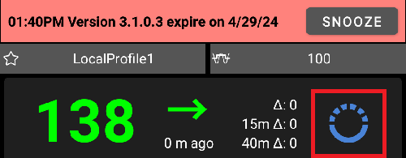

# Бележки към версиите

```{toctree}
:hidden:

Update2_7.md
Update3_0.md
UpdateAaps3204.md
```

Please follow the instructions in the [update manual](UpdateToNewVersion.md) to update to a new version. Разделът за отстраняване на неизправности на страницата с ръководството за актуализиране също разглежда най-честите трудности при актуализиране на **AAPS**.

```{admonition} Upgrading from AAPS v3?
:class: tip
Вижте [Какво се промени в AAPS v4](V4Changes.md) за важните промени в поведението – функции, които са преместени, преименувани или премахнати.
```

Когато има нова актуализация, ще получите известие като това:



Ако не актуализирате до датата на изтичане, **AAPS** ще премине в режим Отворен кръг.

Вижте [Край на поддръжката](EndOfLife.md) за крайните дати на версиите на AAPS.

**Не пренебрегвайте известието.** Новите версии на **AAPS** съдържат важни поправки за безопасността. Затова всеки потребител на **AAPS** трябва да актуализира до последната версия възможно най-скоро. This is an effort to try to improve the safety for each **AAPS** user and the DIY community. Благодарим ви за разбирането.

(maintenance-android-version-aaps-version)=

## Версия на Android и версия на AAPS

Ако вашият смартфон използва версия на Android, по-стара от Android 12, няма да можете да използвате AAPS v3.4 и по-нови, защото те изискват поне Android 12.

За да могат потребителите с по-стар Android да използват по-стара версия на AAPS, бяха публикувани нови версии, които променят само проверката на версията. Други подобрения не са включени.

Намерете вашата версия на Android в таблицата по-долу и използвайте съответната версия на **AAPS**. Кодът се изтегля от <https://github.com/nightscout/AndroidAPS> от показания клон.

| Вашата версия на Android | Версия на AAPS, която да използвате | Клон за изтегляне                                                    |
| ------------------------ | ----------------------------------- | -------------------------------------------------------------------- |
| Android 12 и по-нова     | Последна версия                     | [master](https://github.com/nightscout/AndroidAPS) (по подразбиране) |
| Android 11               | **3.3.2.1**                         | [3.3.2.1](https://github.com/nightscout/AndroidAPS/tree/3.3.2.1)     |
| Android 9, 10            | **3.2.0.4**                         | [3.2.0.4](https://github.com/nightscout/AndroidAPS/tree/3.2.0.4)     |
| Android 8                | **2.8.2.1**                         | [2.8.2.1](https://github.com/nightscout/AndroidAPS/tree/2.8.2.1)     |
| Android 7                | **2.6.2**                           | [2.6.2](https://github.com/nightscout/AndroidAPS/tree/2.6.2)         |

## Версия за WearOS

- AAPS изисква WearOS 3.0, 3.2 или 3.5 (Android 11, API ниво 30) или по-нова. Часовници с WearOS 2 не се поддържат.

```{tip}
WearOS 5, API ниво 34 (Android 14) има [ограничения](#BuildingAapsWearOs-WearOS5).
```

(latestrelease)=

(version400)=

## Версия 4.0.0

Дата на издаване: 31-10-2026

### Нови функции
- Нов потребителски интерфейс: приложението за телефона е изградено наново с Jetpack Compose @MilosKozak
- [Глобално търсене](../DailyLifeWithAaps/GlobalSearch.md) @MilosKozak
- Миграция към Kotlin Multiplatform, клиент за Windows, Mac, Linux (настолен компютър) и iOS @MilosKozak
- [Сценарии](../DailyLifeWithAaps/Scenes.md): запазете набор от действия и ги изпълнявайте заедно @MilosKozak
- [Контрол главен ↔ клиент](../RemoteFeatures/ClientMasterControl.md): изпращане на команди от клиентски телефон към главния телефон @MilosKozak
  - [Роли на клиента](#client-master-control-roles): Само за четене, Хранения, Болногледач или Администратор за всеки клиент @MilosKozak
  - [Режим на засилена защита](#client-master-control-hardened-mode): когато контролът от клиентско приложение е включен, главният телефон приема промени само от свързани клиенти @MilosKozak
  - Свързване чрез QR код, който настройва и Nightscout на клиента, или чрез PIN; тайният ключ за свързване се сменя веднага след свързването @MilosKozak
  - [Собствен токен за Nightscout](#client-master-control-own-token) за всеки клиент, само с правата, които клиентът има нужда @MilosKozak
- Поддръжка на [концентрация на инсулина](../AdvancedOptions/InsulinConcentration.md) (U200, U500) в помпите, калкулатора и профилите @Philoul @MilosKozak
- Управление на инсулините: каталог на инсулините, кратки имена, избор в профила и в калкулатора @Philoul
- Плъгин за калибрация @MilosKozak
- [Изглаждане](../CompatibleCgms/SmoothingBloodGlucoseData.md): Unscented Kalman Filter (UKF) @piecycle
- [Смяна на мястото](#Aapsscreens-site-rotation): проследяване и редуване на местата за поставяне на инфузионния сет @Philoul @MilosKozak
- Преработка на [Autotune](../AdvancedOptions/Autotune.md) @Philoul
- Нови [уиджети](../DailyLifeWithAaps/Widgets.md) @MilosKozak @t1dude
- Достъпност: приложението за телефона работи с екранен четец – именувани контроли, изговаряне на статуса, описания на графиките и заглавия за бърз преглед @MilosKozak
- [Импорт на настройките](../Maintenance/ExportImportSettings.md): може да запази настройките на помпата @MilosKozak
- Постоянното известие използва Android live updates, с поддръжка на Samsung Now bar и делтата @premnirmal
- Графика на КЗ: [натиснете и задръжте](#aaps-screens-graph-press-and-hold), за да видите стойностите в момента на измерване, на всяка графика на главния екран @t1dude @olorinmaia
- Подобрения в производителността @MilosKozak
- Автоматични удължени въглехидрати (e-carbs) в болус калкулатора @MilosKozak

### Нови устройства
- **CareLevo**: нов [драйвер за помпа](../CompatiblePumps/CareLevo.md) @Kisu-Choi @MilosKozak
- **Dana-i2**: поддръжка @MilosKozak
- **Instara**: нов източник на CGM данни @leohunt

### Подобрения в драйверите за помпи
- Екраните за преглед на помпата са изградени наново за Insight, Medtronic, Medtrum, Omnipod, Dana, Diaconn и Equil @MilosKozak
- **Omnipod Dash**: Ref кодове като на PDM и разбираеми описания на грешките, компенсацията на отклонението (drift) е винаги включена, по-добро отчитане на вида болус @nl-ruud
- **Omnipod**: краен срок за Dash и Eros @mcnelson
- **DanaR, RS**: емулатор на помпа за тестване @MilosKozak
- **Equil**: емулатор на помпа за тестване @MilosKozak
- Много поправки за помпите и кръга @MilosKozak и други

### Wear OS
- [Приложението за часовника](../WearOS/WearOsSmartwatch.md) е изградено наново с Compose, нови плочки (tiles) и усложнения (complications), автоматично инсталиране на циферблат (Watch Face Push) на Wear OS 6+ @olorinmaia @Philoul
- CustomWatchface е наличен за WearOS 6.0 (GW7, GW8, GW9...) със специален WFF циферблат @Philoul @olorinmaia
- CustomWatchface вече може да съдържа 5 места за усложнения (complications), които можете да настроите (новата функция е налична само за по-стари часовници) @Philoul
- Нов [WFF циферблат, базиран на усложненията (complications) на AAPS](#wearos-complications-watchface-setup) @olorinmaia
- Поправки в резултата на болус калкулатора и на бързите действия (Quick wizard) @olorinmaia
- Нови екрани за графика на КЗ и текущ режим в главното меню @olorinmaia
- Болус калкулатор: страница [вид хранене](#WearOsSmartwatch-wizard-meal-type), която разделя въглехидратите като калкулатора на телефона, и [време на въглехидратите](#WearOsSmartwatch-wizard-carb-time) с напомнянето *време е за ядене* на часовника @olorinmaia
- [Алармите на телефона на часовника](#WearOsSmartwatch-phone-alarms): часовникът показва алармата и предлага „Заглушаване“ (Silence) и „Без звук 5 мин“ (Mute 5 min) @olorinmaia

### Компилиране
- CI работни процеси за компилации от tag/клон, съответствие на версиите на JDK @Angus-repo

### Сътрудници
@MilosKozak @Philoul @olorinmaia @Kisu-Choi @leohunt @piecycle @Angus-repo @mcnelson @t1dude @premnirmal @nl-ruud

Пълен списък с промените: <https://github.com/nightscout/AndroidAPS/compare/3.4.2.6...4.0.0>

(version3426)=

## Версия 3.4.2.6

- Equil: подобрена стабилност @MilosKozak

(version3425)=

## Версия 3.4.2.5

- Equil: поправено race condition (състезателно условие) @MilosKozak

(version3424)=

## Версия 3.4.2.4

- Поправки за Equil @MilosKozak
- Поправка на синхронизацията на профила с NS @MilosKozak

(version3423)=

## Версия 3.4.2.3
- Dash: решение за отклонението на часовника (drift) @nl-ruud
- NSClientV3: поправена празнина в данните след повторно свързване @MilosKozak
- Автоматизация: поправена десериализацията @MilosKozak
- Equil: поправено отчитането на батерията @MilosKozak
- Cleanup workflow @vanelsberg
- Equil: подобрено възстановяване след грешки @MilosKozak
- DanaRS: поправена комуникацията с помпи за вътрешния (корейския) пазар @MilosKozak
- Insight: поправена синхронизацията на TBR @MilosKozak
- Dash: поправена грешка при активиране @nl-ruud

(version3422)=

## Версия 3.4.2.2

- Поправени проблеми с Equil и Medtronic
- Подобрена безопасност на Medtrum

(version3421)=

## Версия 3.4.2.1

- Equil: поправени сдвояването и диалогът за напредък @MilosKozak

(version3420)=

## Версия 3.4.2.0

Дата на издаване: 04-02-2026

- Equil: поправено съпротивлението за различни модели @hhfcvmars
- Tidepool: поправена сесията @MilosKozak
- Medtrum: Fix activation path by preventing double fill @MilosKozak
- COB: поправено изчисляването на COB (покрива опасен граничен случай) @MilosKozak

(version3410)=

## Версия 3.4.1.0

Дата на издаване: 03-08-2026

### Ядро
- Поправена обработката на лятното часово време (DST) @MilosKozak
- Подобрено и уеднаквено разпознаване на нормална цел (mgdl > 99, mmol > 5,5) @MilosKozak
- SMS: командата RESTART е защитена с PIN @MilosKozak
- Поддръжка: предупреждение, ако е избрана грешна папка @MilosKozak

### Подобрения в драйверите за помпи
- **Omnipod Dash**: кодът на BLE драйвера е преработен и преместен в модула omnipod/common @jwoglom
- **Omnipod Dash**: опит за поправка на състоянието на връзката @MilosKozak
- **Omnipod**: проверка на профила преди активиране на под, за да не се хабят подове (#4534) @brianV
- **Medtronic**: поправено показване на един и същ тип кодиране в диалога с настройки @mifi100
- **Medtronic**: подготовка на общи класове за помпи (подготовка за Tandem) @andy-rozman
- **RileyLink**: поправка на кодирането (#4519) @mifi100
- **Equil**: разширена съвместимост с инсулинови помпи според префикса на серийния номер (#4510) @hhfcvmars
- **Equil**: добавено водене на лог @MilosKozak
- **Diaconn G8**: поправена грешка при синхронизацията на лога и добавена поддръжка на фърмуер 3.58+ @miyeongkim
- **Diaconn**: поправено преобразуване на единицата за продължителност на TBR @miyeongkim
- **Diaconn**: използване на commandQueue.loadEvents() за синхронизация на историята @miyeongkim
- Позволено подаване на инсулин, когато кръгът е спрян, но помпата е достъпна @cschuijt

### Облак / резервно копие
- Добавено резервно копие в Google Drive @Angus-repo
- Известяване на интерфейса при промяна в състоянието на грешка на облачното пространство @Angus-repo
- Позволено едновременно използване на локално и облачно пространство @Angus-repo

### Tidepool
- Подобрена миграция към Tidepool OAuth2 @MilosKozak
- Поправено безкрайно състояние BLOCKED на Tidepool, поправено отхвърляне на празни SSID @michaeln-synapse

### NSClient
- NSCv3: подобрено повторно свързване @MilosKozak

### Wear OS
- Показване на новия IOB в резултата на калкулатора, ако IOB се използва в изчисленията @olorinmaia
- Поправен BolusProgress на часовника с общото количество @Philoul

### Интерфейс
- Подобрена икона ic_none за смяна на мястото @Philoul
- Поправено: настройката за смяна на мястото при управление на помпата не се използваше @samfundev

### Сътрудници
@MilosKozak @Philoul @olorinmaia @jwoglom @mifi100 @andy-rozman @Angus-repo @brianV @cschuijt @hhfcvmars @miyeongkim @samfundev @michaeln-synapse

(version3400)=

## Версия 3.4.0.0

Дата на издаване: 31-12-2025

### Преди актуализацията:
* Тази версия изисква Google Android 12.0 или по-нова. Проверете версията на телефона си, преди да опитате да актуализирате.
* Актуализирайте до последната версия на Android Studio или, още по-добре, използвайте компилиране в браузъра.

### Нови функции
* Текущ режим @MilosKozak
  * Показване на [историята на статуса на кръга](#AapsScreens-running-mode) в разделите с лечения
  * Показване и промяна на [статуса на кръга от AAPSClient](#RemoteControl_aapsclient).<br>Забележка: нужна е настройката [От Nightscout > Синхронизация > Получавай режим на работа от NS](#Preferences-nsclient-synchronization)
* [Нови CGM](../Getting-Started/CompatiblesCgms.md): Glunovo, Intelligo, Sinocare
* Поддръжка на [смяна на мястото](#Aapsscreens-site-rotation) @Philoul
* Ново [действие за автоматизация](#automations-automation-action): включване или изключване на SMB @MilosKozak
* Syai CGM е [надежден източник](#GettingStarted-TrustedBGSource) и поддържа разширено филтриране @MilosKozak

### Подобрения за Wear OS
* значително намален разход на батерията @MilosKozak
* подобрения и поправки в интерфейса @olorinmaia
* почти изцяло пренаписан код, за да отговаря на текущото ниво на библиотеките (преди WearOS 2) @MilosKozak
* 2 нови усложнения (complications) за разширени данни @Philoul
* Миграция към модерен доставчик на усложнения (complication provider) с DataStore @MilosKozak

### Поправки на изтичане на памет
* Поправени изтичания на памет в кода @MilosKozak
* Добавено отчитане на изтичане на памет с LeakCanary към Firebase Crashlytics @MilosKozak

### Подобрения в драйверите за помпи
* **DanaI**: поправени проблеми с прекъсване на връзката @MilosKozak
* **RileyLink**: по-бърза комуникация чрез намаляване на забавянията @mifi100
* **Medtrum**: добавено показване на времето на активиране и възрастта на пача @vanelsberg, поправка на паролата с главни букви @MilosKozak
* **Combo**: поправени race conditions (състезателни условия) в тестовете @MilosKozak @dv1
* **Equil**: оптимизирана свързаност, намален разход на батерията @MilosKozak

### Синхронизация с Nightscout
* Подобрено премахване на дубликати при грешка в NS @MilosKozak

### Подобрения в UI/UX
* various improvements @MilosKozak @Philoul @olorinmaia

### Автоматизация
* Ново действие за управление на SMB – включване/изключване на SMB чрез автоматизация @MilosKozak

### Тестване
* Добавени подробни unit тестове за помпите Equil, Eopatch, Dana и Medtronic @MilosKozak
* Подобрени стабилност и покритие на тестовете в много модули @MilosKozak

### Tidepool
* Tidepool OAUTH2 (поддръжка на новото удостоверяване в Tidepool) @MilosKozak

(version3321)=

## Версия 3.3.2.1

Дата на издаване: 13-08-2025

- Поправена Bluetooth връзката с Omnipod на Android 16
- CI процес (компилиране в браузъра)
- Поправено преобразуване между mmol и mg/dl
- Поправен грешен избор на час в диалозите в някои часови зони
- Поправено четене на ключове в опростен режим
- Поправени липсващи прогнози на часовника
- Подобрен ConfigBuilder
- Подобрена пълна синхронизация с NSCv3

(version3300)=

## Версия 3.3.2.0

Дата на издаване: 27-03-2025

### Как да актуализирате

* За компилиране на тази версия е нужна [версията на Android Studio с име „Meerkat“](#Building-APK-recommended-specification-of-computer-for-building-apk-file) или по-нова. Ако вече сте компилирали версия 3.3.x, трябва отново да актуализирате Android Studio.

(version-enforcement)=

### Starting this version, notification and version enforcement has been simplified and softened and works following way:
*  Няма изтичане, когато устройството е офлайн (ако няма връзка с интернет). Това означава, че вече няма гратисни периоди от 60 и 90 дни.
*  След изтичане се включва принудително режим LGS
*  Ще получавате предупреждения/известия по-рядко:
   - остават 28+ дни: на всеки 7 дни
   - остават 27–14 дни: на всеки 3 дни
   - след това веднъж дневно
   - Известието се създава след обяд, за да не ви безпокои през нощта
* Има само 2 вида известия
   - Налична е нова версия (няма ефект върху AAPS)
   - Приложението изтича на определена бъдеща дата (все още няма ефект върху AAPS) / е изтекло (AAPS ще премине в режим LGS)

### Новости

* SMS команда RESTART @MilosKozak
* Параметри за смяна на профил от часовника @olorinmaia
* Тъмен режим на циферблата AAPS V2 @olorinmaia
* Подобрения в обмена на данни с G7 @olorinmaia
* Конфигурация на уиджет @MilosKozak
* Подобрения в интерфейса на радио бутоните @olorinmaia
* Автоматизация: избор на местоположение от карта @MilosKozak
* Версията се вижда на главните екрани @MilosKozak
* Compilation with existing git system is enforced (no zip downloads)
* Показване на версията на главния екран @MilosKozak
* Подобрения в качването към Tidepool @ConstantinMatheis

### Поправки на грешки

* Поправка при премахване на bonding за Dash @Andreas
* Поправки за Garmin @robertbuessow @suside
* Поправено показване на IOB в диалозите @olorinmaia
* Подобрения в правописа и проверката на целите @MilosKozak
* Поправено изобразяване на емулирани TBR @MilosKozak
* Поправено заобикаляне на защитата @tdrkDev

## Версия 3.3.1.3

Дата на издаване: 21-01-2025

### Поправки на грешки

* Dash: bonding (сдвояването) не е задължително (по подразбиране е изключено) @MilosKozak
* Equil: fixed bolus 10+U, alarm improvements @EquilHack
* Garmin: подобрения за часовника @swissalpine
* Подобрения за часовника @olorinmaia
* Управление на статуса на кръга от часовника @tdrkDev
* Подобрения в стабилността

*  **Може да е нужна нова [настройка на автентикатора](#sms-commands-authenticator-setup).**

## Версия 3.3.1.2

Дата на издаване: 15-01-2025

### Как да актуализирате

* За компилиране на тази версия е нужна [версията на Android Studio с име „Ladybug Feature Drop“](#Building-APK-recommended-specification-of-computer-for-building-apk-file) или по-нова. **Това не е същото като обикновената „Ladybug“.** Ако вече сте компилирали версия 3.3.x, трябва отново да актуализирате Android Studio.

### Поправки на грешки

* Dash: използване на bonding (сдвояване) на Android 15+
* Възстановен бутон Dexcom на главния екран
* Equil: позволено е премахване на помпа, която не работи
* Предупреждение, когато коефициентът за корекция на DynISF (Adjustment Factor) е нула
* NSCv3: решен проблем с websocket комуникацията на телефони с малко различно време
* SMS команди: поправена OneTimePassword (еднократна парола). **Може да е нужна нова [настройка на автентикатора](#sms-commands-authenticator-setup).**
* Поправен проблем, при който някои опции вече не можеха да се редактират.
* Поправено нулиране на главната парола при виртуална помпа.
* Поправен импорт на големи файлове с резервно копие на настройките.

## Версия 3.3.1.0

Дата на издаване: 06-01-2025

### Промени в потребителския интерфейс

* [Добавени цветове за разграничаване на AAPSClient и AAPSClient2](#RemoteControl_aapsclient) @MilosKozak
* Подобрени изглед и икони на потребителските действия

### Други функции

* Нов тригер за автоматизация: [брой стъпки](#screen-heart-rate-steps) @Roman Rihter
* Възможност да се получи всичко при пълна синхронизация с NSCv3 (включително данни, които преди не са се синхронизирали, например TBR) @MilosKozak
* NSClient v3: функцията „Известие“ (Announcement) работи (_т.е._ от AAPSClient към AAPS) @MilosKozak

### Технически промени и поправки на грешки

* Поправен срив на Insight @philoul
* Поправено създаване на прекалено много записи deviceStatus в Nightscout @MilosKozak
* Поправено усвояване на въглехидратите @MilosKozak
* Поправен цвят на RadioButtons и CheckBoxes @MilosKozak
* Поправена грешка в миграцията на процента за DynISF @MilosKozak
* Поправено известие за DynISF, показано на грешното място @MilosKozak
* Поправена грешка в циферблатите @philoul

## Версия 3.3.0.0

Дата на издаване: 29-12-2024

### Основни функции

* Функцията **[Динамично ISF](../DailyLifeWithAaps/DynamicISF.md)** вече не е отделен плъгин, а е включена като опция в плъгина [OpenAPS SMB](#Config-Builder-aps), с някои промени в поведението:
  * **Смяната на профил** и **процентът на профила** вече се вземат предвид в **Динамично ISF** по отношение на силата на динамичната чувствителност
  * Изчислява се средният **ISF** за последните 24 ч и тази стойност се използва за болус калкулатора и за изчисляването на **COB**. Стойността **ISF от профила** изобщо не се използва (освен като резервна стойност, когато няма исторически данни).
  * Страницата с документация за DynamicISF е пренаписана. Моля, прочетете важния раздел [Какво да имате предвид при активиране на Динамично ISF](#dyn-isf-things-to-consider-when-activating-dynamicisf).
* [„Винаги използвай SMB“ и „Разреши SMB след въглехидрати“](#Open-APS-features-enable-smb-always) за потребители на FreeStyle Libre 2 и Libre 3
  * Бележка: Изисква последната версия на xDrip+ или Juggluco.
* Нови тригери за **Автоматизация**
* Автоматичен експорт на настройките

### Как да актуализирате

* Преди актуализацията:
  * **<span style="color:red">Тази версия изисква Google Android 11.0 или по-нова</span>**. Проверете версията на телефона си, преди да опитате да актуализирате.
  * Ако използвате „стария“ драйвер за Combo с устройство ruffy, преминете към [вградения драйвер за Combo](../CompatiblePumps/Accu-Chek-Combo-Pump-v2.md) преди актуализацията.
  * По време на актуализацията ще загубите [допълнителните графики](#AapsScreens-section-g-additional-graphs) на главния екран: ако е нужно, запишете текущата им настройка, за да можете да ги създадете отново след актуализацията.
  * [Проблемите с Bluetooth връзката, които някои хора имат с Android 15](../Getting-Started/Phones.md), **НЕ** са решени в тази версия (това е проблем на Android, а не на **AAPS**). Поправка е налична във версия 3.3.1.2.
  * Бутонът BYODA на главния екран вече не е наличен поради ограничения на Android. Това е поправено във версия 3.3.1.2.
* Инструкции за актуализиране: следвайте ръководството [Актуализиране до нова версия](../Maintenance/UpdateToNewVersion.md).
  * За компилиране на тази версия е нужна [версията на Android Studio с име „Ladybug“](#Building-APK-recommended-specification-of-computer-for-building-apk-file) или по-нова. Ако вече имате инсталирана по-стара версия на Android Studio, може да се наложи да <span style="color:red">настроите версията на JVM на 21</span>. Вижте [Отстраняване на неизправности в Android Studio > Incompatible Gradle JVM](#incompatible-gradle-jvm).
  * Съвет – ако не искате да загубите историята на **AAPS**, ВИНАГИ правете АКТУАЛИЗАЦИЯ, а НЕ ДЕИНСТАЛИРАНЕ/ИНСТАЛИРАНЕ. За всеки случай направете резервно копие на текущите настройки на **AAPS** и запазете стария APK, за да можете да се върнете към старата версия, ако нещо се обърка.
* След актуализацията:
  * Задайте новата настройка [„AAPS директория“](#preferences-maintenance-logdirectory) в раздела „Поддръжка“.

### Подробни промени

#### CGM и помпи

* [„Винаги използвай SMB“ и „Разреши SMB след въглехидрати“](#Open-APS-features-enable-smb-always) за потребители на FreeStyle Libre 2 и Libre 3 @MilosKozak
* Подобрения в [драйвера за Medtrum](../CompatiblePumps/MedtrumNano.md) @jbr77rr
  * Подобрения в комуникацията, включително нова настройка за заобикаляне на проблеми при някои смартфони
  * Показване на нивото в резервоара в началото на активирането
  * Поправена грешка, при която активирането се връща в началото и потребителят не може да го завърши
  * Обратна информация за статуса на синхронизацията и други пояснения
* Нова поддържана помпа: [Equil 5.3](../CompatiblePumps/Equil5.3.md) @EquilHack
* Нови поддържани CGM: [Ottai](../CompatibleCgms/OttaiM8.md) @ottai-developer и [Syai Tag](../CompatibleCgms/SyaiTagX1.md) @syai-dev
* Драйверът за Insight е пренаписан на kotlin @Philoul
* Премахнат е старият драйвер за Combo, който зависи от ruffy

#### Промени в потребителския интерфейс

* [Опростен режим](#preferences-simple-mode) е включен по подразбиране при нова инсталация @MilosKozak
* Нови опции за [Бързи действия](#Preferences-quick-wizard) (QuickWizard) @radicalb
  * Бързите действия (QuickWizard) вече използват същата логика за изчисляване и показване на болуса като калкулатора. Вече можете да използвате полето „време на въглехидратите“ в Бързи действия (QuickWizard), за да направите болус преди хранене.
* Ново [меню за мащаба на графиката](#aaps-screens-main-graph); подобрения в интерфейса на [менюто за допълнителни графики](#AapsScreens-activate-optional-information) @Philoul
* [Подобрен изглед на ConfigBuilder](../SettingUpAaps/ConfigBuilder.md) @MilosKozak
  * Разделите вече са свити по подразбиране. Използвайте стрелката, за да ги разгънете.
* Променливата чувствителност се вижда в AAPSClient
* Подобрения в интерфейса на болус калкулатора @kenzo44
* Поправено показване на текста в разделите на помпите при светла тема @jbr77rr

#### Други функции

* [Автоматичен експорт на настройките](#ExportImportSettings-Automating-Settings-Export) @vanelsberg
* Нов [тригер за автоматизация](#automations-automation-triggers) @vanelsberg
  * Активиране на под (само за пач помпи)
* Нови [тригери за автоматизация](#automations-automation-triggers) @jbr77rr
  * Възраст на иглата, възраст на инсулина, възраст на батерията, възраст на сензора, ниво в резервоара, ниво на батерията на помпата
* Позволено е въвеждане на отрицателни въглехидрати @MilosKozak
* Нов параметър [„AAPS директория“](#preferences-maintenance-settings) за избор на папка за съхранение, различна от тази по подразбиране.
* Позволени са [записи за инсулин, когато помпата е спряна](#aaps-screens-buttons-insulin) @jbr77rr
* Обновена [Цел 2](#objectives-objective2) @MilosKozak
  * Проверка, че главната парола е зададена и известна
* Случайни въглехидрати в тестов режим @MilosKozak
* Поправена грешка в изчисляването на TDD @MilosKozak
* SMS команди: възможност да [**не** се изпраща SMS при смяна на профил](#sms-commands-too-many-messages), идваща от NS @MilosKozak

#### Смарт часовници

* подобрения за часовника и циферблатите @Philoul @MilosKozak @olorinmaia
* Плочки (tiles) на часовника от действия на автоматизацията @Philoul
* Комбинирани циферблати от AAPS, AAPSClient и AAPSClient2 за наблюдение на повече пациенти @Philoul @MilosKozak
* EXTRA: show\_user\_actions\_on\_watch\_only @MilosKozak

#### Технически промени

* [промяна на мястото на лог файловете](#Accessing-logfiles-accessing-logfiles)
* нова вътрешна структура на модулите @MilosKozak
* слоят за съхранение на данни е отделен от основния код @MilosKozak
* файловете за компилиране са пренаписани на kts @MilosKozak
* алгоритмите са пренаписани на kotlin за по-добра производителност @MilosKozak
* много нови unit тестове @MilosKozak и други
* още код е преобразуван в kotlin @MilosKozak
* ново управление на опциите, xml \-\> kotlin @MilosKozak
* нова конфигурация на CI, CI работи на собствени сървъри @MilosKozak
* библиотеките са обновени до последните версии, toml @MilosKozak
* миграция към kotlin 2.0, java 21 @MilosKozak

(version3204)=

## [Версия 3.2.0.4](https://github.com/nightscout/AndroidAPS/releases/tag/3.2.0.4)

Дата на издаване: 27-02-2024

Тази версия е последната, която поддържа Android 10. Ако не можете да актуализирате до Android 11, [актуализирайте AAPS до 3.2.0.4](#update-aaps-3204).

### Промени

- Поддръжка на G7 чрез xDrip
- Поправки за Medtrum
- Поправка на иконата на автоматизацията
- Поправка при изпълнение на цел 1

(version3200)=

## Версия 3.2.0.0, посветена на @Philoul

Дата на издаване: 23-10-2023

### Важни съвети

- Изисква се NS 15
- Когато в плъгина NS v3 се използват websockets, леченията, въведени през уеб интерфейса на NS (бутона плюс) и от други приложения, които използват v1 API, не се изпращат към AAPS. Това ще бъде поправено в бъдеща версия на NS. Винаги използвайте един и същ клиент (v1 или v3) в AAPS и AAPSClient, докато NS не премине изцяло към v3 вътрешно. Същото важи и за самите AAPS и AAPSClient.
- Websockets в плъгина v3 работят по подобен начин като в плъгина v1. Без включени websockets AAPS тегли данни от NS на редовни интервали. Това трябва да намали разхода на енергия, защото NS не е постоянно свързан. От друга страна, това означава забавяне при обмена на данни. Моля, прочетете [тук](#Important-comments-on-using-v3-versus-v1-API-for-Nightscout-with-AAPS) важните бележки от екипа на разработчиците, преди да го използвате!
- Ако използвате xDrip като източник на CGM данни, трябва да го изберете отново след актуализацията поради вътрешни промени.
- Tidepool може да се използва вместо NS, за да изпълните първата цел.
- Ако изпращате данни към xDrip+, трябва да настроите плъгина за синхронизация с xDrip. За да получава xDrip стойностите на КЗ от AAPS, като източник трябва да е избрано „xDrip+ Sync Follower“.
- Ако искате да преминете към драйвера ComboV2, Ruffy трябва да се деинсталира и помпата да се сдвои отново с AAPS.
- За да използвате плъгина DynISF, трябва да стартирате Цел 11 (всички предишни цели трябва да са завършени, за да може да стартирате Цел 11).


### Промени

- Драйвер за помпа EOPatch2 / GlucomenDay @jungsomyeonggithub @MilosKozak
- Драйвер за помпа ComboV2 (не е нужен Ruffy) @dv1
- Драйвер за Medtrum Nano @jbr7rr
- Поддръжка на корейската DanaI @MilosKozak
- Поддръжка на CGM Glunovo @christinadamianou
- Поддръжка на G7 @MilosKozak @rICTx-T1D @khskekec
- Плъгин NSClient v3 @MilosKozak
- Поддръжка на Tidepool @MilosKozak
- Плъгин за изглаждане @MilosKozak, @justmara, Експоненциално изглаждане @nichi (Tsunami), Средно изглаждане @jbr7rr
- Плъгин DynamicISF @Chris Wilson, @tim2000s
- Циферблат за Garmin и поддръжка на сърдечен ритъм (HeartRate) @buessow
- Ново лого @thiagomsoares
- Нов циферблат @Philoul
- поправени са много проблеми от версия 3.1
- бележки могат да се добавят на повече места @Sergey Zorchenko
- Поправки в потребителския интерфейс @MilosKozak @osodebailar @Andries-Smit @yodax @Philoul @dv1 @paravoid
- нови SMS команди LOOP LGS/CLOSED @pzadroga
- преводи за часовника (wear) @Andries-Smit
- комуникацията с xdrip е преместена в отделен модул @MilosKozak
- вътрешни промени: обновени версии на библиотеките, миграция към rx3, нова структура на модулите @MilosKozak
- поправки в драйвера на Diaconn @miyeongkim
- повече опции за поддръжка на базата данни @MilosKozak
- AAPSClient показва дали основният телефон е включен в зарядно @MilosKozak
- Промяна в болус калкулатора. Ако CGM данните не са налични, процентът не се взема предвид (т.е. се използва 100 %).
- миграция към системата за компилиране kts @MilosKozak
- подобрена интеграция с CI @MilosKozak @buessow
- почистване на тестовете @ryanhaining @MilosKozak
- над 110 000 нови реда код, 240 000 променени реда, 6884 променени файла

(Important-comments-on-using-v3-versus-v1-API-for-Nightscout-with-AAPS)=
### Важни бележки за използването на v3 спрямо v1 API за Nightscout с AAPS

v1 е старият протокол за обмен на данни между уеб сайта на NS и сървъра на NS. Той има много ограничения
- v1 изпраща данни само за 2 дни
- v1 изпраща всички данни за 2 дни при всяко повторно свързване
- using websockets is mandatory = permanent connection, more battery consumption
- при чести прекъсвания на връзката с NS връзката се спира за 15 минути, за да се избегне голям пренос на данни

v3 е новият протокол. По-безопасен и по-ефективен
- с токени можете по-точно да определите правата за достъп
- протоколът е по-ефективен и от двете страни (AAPS и NS)
- Може да чете данни от NS за до 3 месеца назад
- you can choose to use or to not use websockets on every device (using means faster updates, not using means lower power consumption, but slower updates ie. minutes)
- NSClient не спира при прекъсване на връзката

ОГРАНИЧЕНИЯ
- С AAPS 3.2 трябва да се използва NS 15
- v3 не вижда промените, направени чрез протокола v1 (вероятно това ще бъде решено в бъдеща версия на NS)
- in the opposite direction, because of the old ineffective method of tracking changes, v1 sees changes done by v3
- имайте предвид, че засега NS все още използва v1 вътрешно, затова не е възможно да въвеждате данни през уеб интерфейса на NS, ако използвате v3. You must use AAPSClient or SMS if you want to enter data remotely

ПРЕПОРЪЧИТЕЛНА НАСТРОЙКА
- поради всичко по-горе трябва да изберете само един метод и да го използвате на всички устройства (имайте предвид, че към момента на писане всички други програми за качване на данни използват v1). Ако решите да преминете към v3, изберете v3 в AAPS и във всички AAPSClient.
- v3 е за предпочитане, защото е по-ефективен
- дали да използвате websockets с v3 зависи от вашето предпочитание
- СИЛНО се препоръчва AAPS да събира всички данни и след това да ги качва в NS като единствен източник на качване. Всички други устройства/приложения трябва само да четат от NS. Така ще избегнете конфликти и грешки при синхронизацията. Това важи и за изпращането на данни за КЗ към NS чрез Dexcom Share connector и др.

(version3100)=

## Версия 3.1.0

Дата на издаване: 19-07-2022

[Бележки към версиите](https://github.com/nightscout/AndroidAPS/releases/tag/3.1.0)

## Версия 3.0.0

Дата на издаване: 31-01-2022

[Бележки към версиите](https://github.com/nightscout/AndroidAPS/releases/tag/3.0.0)

## Версия 2.8.2

Дата на издаване: 23-01-2021

[Бележки към версиите](https://github.com/nightscout/AndroidAPS/releases/tag/2.8.2)

(version-2811)= (important-hints-2-8-1-1)=

## Версия 2.8.1.1

Дата на издаване: 12-01-2021

[Бележки към версиите](https://github.com/nightscout/AndroidAPS/releases/tag/2.8.1.1)

(Releasenotes-version-2-8-0)=

## Версия 2.8.0

Дата на издаване: 01-01-2021

[Бележки към версиите](https://github.com/nightscout/AndroidAPS/releases/tag/2.8.0)

(Releasenotes-version-2-7-0)=

## Версия 2.7.0

Дата на издаване: 24-09-2020

[Бележки към версиите](https://github.com/nightscout/AndroidAPS/releases/tag/2.7.0)

(Releasenotes-version-2-6-1-4)=

## Версия 2.6.1.4

Дата на издаване: 04-05-2020

[Бележки към версиите](https://github.com/openaps/AndroidAPSdocs/blob/e7e2e73cae3dd16af3391ce770fb48b3b3388c1b/docs/EN/Maintenance/ReleaseNotes.md#version-2614)

## Версия 2.6.1.3

Дата на издаване: 03-05-2020

[Бележки към версиите](https://github.com/openaps/AndroidAPSdocs/blob/e7e2e73cae3dd16af3391ce770fb48b3b3388c1b/docs/EN/Maintenance/ReleaseNotes.md#version-2613)

## Версия 2.6.1.2

Дата на издаване: 19-04-2020

[Бележки към версиите](https://github.com/openaps/AndroidAPSdocs/blob/e7e2e73cae3dd16af3391ce770fb48b3b3388c1b/docs/EN/Maintenance/ReleaseNotes.md#version-2612)

## Версия 2.6.1.1

Дата на издаване: 06-04-2020

[Бележки към версиите](https://github.com/openaps/AndroidAPSdocs/blob/e7e2e73cae3dd16af3391ce770fb48b3b3388c1b/docs/EN/Maintenance/ReleaseNotes.md#version-2611)

## Версия 2.6.1

Дата на издаване: 21-03-2020

[Бележки към версиите](https://github.com/openaps/AndroidAPSdocs/blob/e7e2e73cae3dd16af3391ce770fb48b3b3388c1b/docs/EN/Maintenance/ReleaseNotes.md#version-261)

(Releasenotes-version-2-6-0)=

## Версия 2.6.0

Дата на издаване: 29-02-2020

[Бележки към версиите](https://github.com/openaps/AndroidAPSdocs/blob/e7e2e73cae3dd16af3391ce770fb48b3b3388c1b/docs/EN/Maintenance/ReleaseNotes.md#version-260)

## Версия 2.5.1

Дата на издаване: 31-10-2019

[Бележки към версиите](https://github.com/openaps/AndroidAPSdocs/blob/e7e2e73cae3dd16af3391ce770fb48b3b3388c1b/docs/EN/Maintenance/ReleaseNotes.md#version-251)

(Releasenotes-version-2-5-0)=

## Версия 2.5.0

Дата на издаване: 26-10-2019

[Бележки към версиите](https://github.com/openaps/AndroidAPSdocs/blob/e7e2e73cae3dd16af3391ce770fb48b3b3388c1b/docs/EN/Maintenance/ReleaseNotes.md#version-250)

## Версия 2.3

Дата на издаване: 25-04-2019

[Бележки към версиите](https://github.com/openaps/AndroidAPSdocs/blob/e7e2e73cae3dd16af3391ce770fb48b3b3388c1b/docs/EN/Maintenance/ReleaseNotes.md#version-23)

## Версия 2.2.2

Дата на издаване: 07-04-2019

[Бележки към версиите](https://github.com/openaps/AndroidAPSdocs/blob/e7e2e73cae3dd16af3391ce770fb48b3b3388c1b/docs/EN/Maintenance/ReleaseNotes.md#version-222)

## Версия 2.2

Дата на издаване: 29-03-2019

[Бележки към версиите](https://github.com/openaps/AndroidAPSdocs/blob/e7e2e73cae3dd16af3391ce770fb48b3b3388c1b/docs/EN/Maintenance/ReleaseNotes.md#version-22)

## Версия 2.1

Дата на издаване: 03-03-2019

[Бележки към версиите](https://github.com/openaps/AndroidAPSdocs/blob/e7e2e73cae3dd16af3391ce770fb48b3b3388c1b/docs/EN/Maintenance/ReleaseNotes.md#version-21)

## Версия 2.0

Дата на издаване: 03-11-2018

[Бележки към версиите](https://github.com/openaps/AndroidAPSdocs/blob/e7e2e73cae3dd16af3391ce770fb48b3b3388c1b/docs/EN/Maintenance/ReleaseNotes.md#version-20)

## Версия 1.0

```{admonition} First version of **AAPS**
:class: note

Първата тестова версия започна през 2015 г., а първото издание беше през 2016 г.

Точната хронология на тези издания в момента не е налична, но тъй като този въпрос е задаван няколко пъти, го документираме тук.

```

