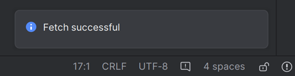

# Актуализиране до AAPS 3.2.0.4

(update-aaps-3204)=

## Компилирайте сами, вместо да изтегляте

**Приложението AAPS (файл apk) не може да бъде изтеглено готово заради правилата за медицинските изделия. Законно е да компилирате приложението за собствена употреба, но НЕ БИВА да давате копие на други хора!**

Вижте [страницата с често задавани въпроси](../UsefulLinks/FAQ.md) за подробности.

## Изисквания към компютъра и софтуера за компилиране на AAPS 3.2.0.4

* За компилиране на apk файла може да е нужна определена версия на **[Android Studio](https://developer.android.com/studio/)**.

| Версия на AAPS          | Препоръчителна<br/>версия на<br/>Android Studio | Алтернативна<br/>версия на<br/>Android Studio | Gradle | JVM |
| ----------------------- | ----------------------------------------------------------- | --------------------------------------------------------- | ------ |:--- |
| [3.2.0.4](#version3200) | Hedgehog (2023.1.1)                                         | до Meerkat                                                | 8.2    | 17  |

„Препоръчителната версия“ идва с подходящата версия на JVM. Препоръчителната версия е и най-ниската версия, с която можете да компилирате **AAPS**. **НЯМА** да можете да компилирате с версия, по-стара от „препоръчителната“. Ако използвате друга версия, може да срещнете проблеми, свързани с версията на JVM. See the [Troubleshooting Android Studio](#incompatible-gradle-jvm) page to help solve these issues. Ако текущата ви версия на Android Studio не е в таблицата, първо трябва да я актуализирате.

Версията на Gradle е свързана с изходния код. Винаги ще получите правилната версия на Gradle, когато изтегляте или актуализирате изходния код. Тя е посочена тук само за справка, не е нужно да правите нищо с нея.

* [32-битови системи Windows](#troubleshooting_androidstudio-unable-to-start-daemon-process) не се поддържат от Android Studio. Моля, имайте предвид, че **64-битов процесор и 64-битова операционна система са задължително условие.** Ако вашата система НЕ отговаря на това условие, трябва да смените съответния хардуер или софтуер, или цялата система.

<table class="tg">
<tbody>
  <tr>
    <th class="tg-baqh">ОС (само 64-битова)</th>
    <td class="tg-baqh">Windows 8 или по-нова</td>
    <td class="tg-baqh">Mac OS 10.14 или по-нова</td>
    <td class="tg-baqh">Всеки Linux с поддръжка на Gnome, KDE или Unity DE;&nbsp;&nbsp;GNU C Library 2.31 или по-нова</td>
  </tr>
  <tr>
    <th class="tg-baqh"><p align="center">Процесор (само 64-битов)</th>
    <td class="tg-baqh">Архитектура на процесора x86_64; Intel Core 2-ро поколение или по-нов, или процесор AMD с поддръжка на <br><a href="https://developer.android.com/studio/run/emulator-acceleration#vm-windows" target="_blank" rel="noopener noreferrer"><span style="text-decoration:var(--devsite-link-text-decoration,none)">Windows Hypervisor</span></a></td>
    <td class="tg-baqh">Чипове с ARM или Intel Core 2-ро поколение или по-нов с поддръжка на <br><a href="https://developer.android.com/studio/run/emulator-acceleration#vm-mac" target="_blank" rel="noopener noreferrer"><span style="text-decoration:var(--devsite-link-text-decoration,none)">Hypervisor.Framework</span></a></td>
    <td class="tg-baqh">Архитектура на процесора x86_64; Intel Core 2-ро поколение или по-нов, или процесор AMD с поддръжка на AMD Virtualization (AMD-V) и SSSE3</td>
  </tr>
  <tr>
    <th class="tg-baqh"><p align="center">Оперативна памет (RAM)</th>
    <td class="tg-baqh" colspan="3"><p align="center">8 GB или повече</td>
  </tr>
  <tr>
    <th class="tg-baqh"><p align="center">Диск</th>
    <td class="tg-baqh" colspan="3"><p align="center">Поне 30 GB свободно място. Препоръчва се SSD.</td>
  </tr>
  <tr>
    <th class="tg-baqh"><p align="center">Резолюция</th>
    <td class="tg-baqh" colspan="3"><p align="center">1280 x 800 минимум<br></td>
  </tr>
  <tr>
    <th class="tg-baqh"><p align="center">Интернет</th>
    <td class="tg-baqh" colspan="3"><p align="center">Широколентов</td>
  </tr>
</tbody>
</table>

**Силно се препоръчва (не е задължително) да използвате SSD (Solid State Disk) вместо HDD (Hard Disk Drive), защото компилирането на apk файла на AAPS ще отнеме по-малко време.**  Все пак можете да използвате HDD, когато компилирате apk файла на **AAPS**. Ако го направите, компилирането може да отнеме много време, но след като започне, можете да го оставите да работи без надзор.

## Помощ и поддръжка при компилирането на 3.2.0.4

Ако имате трудности при компилирането на приложението **AAPS**, има специален раздел [**Отстраняване на неизправности в Android Studio**](https://androidaps.readthedocs.io/en/3.2/GettingHelp/TroubleshootingAndroidStudio.html) – моля, първо прочетете него.

Ако смятате, че нещо в инструкциите за компилиране е грешно, липсва или е неясно, или все още имате трудности, моля, обърнете се към групата на потребителите на **AAPS** във [Facebook](https://www.facebook.com/groups/AndroidAPSUsers) или в [Discord](https://discord.gg/4fQUWHZ4Mw). Ако искате сами да промените нещо (да обновите снимки на екрана _и т.н._), моля, изпратете [pull request (PR)](../SupportingAaps/HowToEditTheDocs.md).

```{note}
Тази страница съдържа примерни снимки както за новия (**New**), така и за стария (**Classic**) потребителски интерфейс на Android Studio.
```

## Преглед на актуализирането от 3.2.0.x до 3.2.0.4

```{contents} Steps for updating to 3.2.0.4
:depth: 1
:local: true
```

### Експортирайте текущите си настройки

Експортирайте настройките от съществуващата версия на **AAPS** на телефона си. Може да не ви потрябват, но е по-добре да сте застраховани.

Вижте страницата [Експорт и импорт на настройките](ExportImportSettings.md), ако не помните как се прави това.

### Актуализирайте локалното си копие на AAPS

* Отворете съществуващия си проект AAPS в Android Studio. Може да се наложи да изберете проекта си. Натиснете (два пъти) върху проекта AAPS.


<br>


* В лентата с менюта на Android Studio изберете Git -> Fetch


<br>


* В долния десен ъгъл ще видите съобщение, че Fetch е успешен.



<br>


* Сега в лентата с менюта изберете Git -> Pull


<br>


* Оставете всички опции както са (origin/master) и изберете Pull


<br>


* Изчакайте, докато изтеглянето приключи. Ще виждате информация за това в долната лента. Когато приключи, ще видите съобщение за успех.

  ```{note}
  Обновените файлове може да са различни! This is not an indication of a problem.
  ```


<br>


* Ще се изпълни Gradle Sync, за да изтегли някои зависимости. Изчакайте, докато приключи.


<br>


### Изберете JVM версия 17

- Отворете изгледа Gradle, като натиснете слона (1) от дясната страна на Android Studio, отворете настройките (2) и изберете **Gradle Settings** (3):


<br>


- В полето **Gradle JDK** (1) проверете дали е избрана подходящата версия: **jbr-17**. Ако не е, натиснете полето и вижте дали версията вече е в списъка. Ако не е в списъка (снимката по-долу показва компютър, на който е налична само **jbr-21**), изберете **Download JDK...** (2).


- Във Version (1) изберете **17**. Във Vendor (2) изберете JetBrains Runtime или произволен доставчик. Location (3): не променяйте.


- Затворете диалога **Settings** с **OK**.

### Изберете клона AAPS 3.2.0.4

- Долу вляво изберете символа на Git, натиснете с десния бутон върху 3.2.0.4 и изберете Checkout.


<br>


### Синхронизирайте проекта с Gradle

```{admonition} WARNING!
:class: warning
**Никога не актуализирайте Gradle.** Винаги го синхронизирайте с проекта.
```

При новия интерфейс използвайте иконата със слон и Sync Project with Gradle Files (или следвайте [това](#gradle-resync)).


Или ([това](https://androidaps.readthedocs.io/en/3.2/GettingHelp/TroubleshootingAndroidStudio.html#gradle-resync)) при класическия интерфейс.


### Компилирайте подписания APK на 3.2.0.4

Изходният ви код вече е текущата издадена версия и всички предварителни условия са проверени. Време е да компилирате подписания apk, както е описано в [раздела за компилиране на подписан apk](#Building-APK-generate-signed-apk).

### Прехвърлете и инсталирайте APK на 3.2.0.4

Трябва да прехвърлите apk файла на телефона си, за да можете да го инсталирате.

```{note}
Ако сте компилирали със същото съществуващо хранилище за ключове в Android Studio, не е нужно да премахвате съществуващото приложение от телефона си. Когато инсталирате apk файла, следвайте указанията за инсталиране на актуализации.
В други случаи, например ако създадете ново хранилище за ключове в Android Studio за подписания apk, трябва да изтриете старото приложение, преди да инсталирате apk файла. **Не забравяйте да експортирате настройките си!**
```

Вижте инструкциите за [прехвърляне и инсталиране на AAPS](../SettingUpAaps/TransferringAndInstallingAaps.md)

### Проверете версията на AAPS 3.2.0.4 на телефона

След като инсталирате новия apk, можете да проверите версията на AAPS на телефона си, като натиснете менюто с трите точки горе вдясно и след това „За приложението“ (About). Трябва да видите текущата версия.

