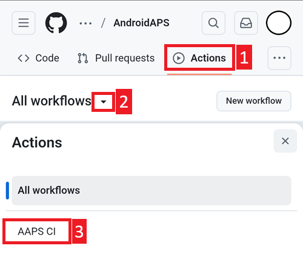
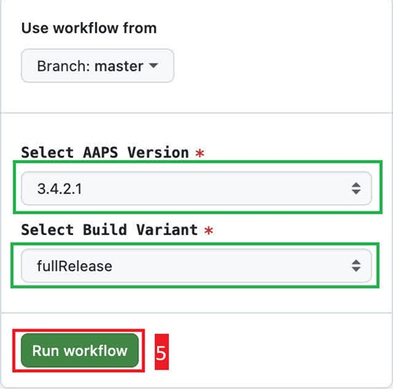

# Актуализиране в браузъра (fork)

```{tip}
Компилирали сте AAPS с **AAPS Builder**? Тази страница не ви трябва: вижте [Актуализиране на AAPS с AAPS Builder](#aaps-builder-updates).
```

## Компилирайте сами, вместо да изтегляте

**AAPS** не може да се изтегли готово заради правилата за медицинските изделия. Законно е да компилирате приложението за собствена употреба, но НЕ БИВА да давате копие на други хора! Вижте [страницата с често задавани въпроси](../UsefulLinks/FAQ.md) за подробности.

```{note}
In case you want to upgrade **AAPS** with a browser for the first time: copy your back-up keystore file to your Google Drive. След това следвайте [процедурата за компилиране на **AAPS** в браузъра](../SettingUpAaps/BrowserBuild.md) вместо това ръководство. Вместо да създавате ново хранилище за ключове, трябва да изберете това, което сте копирали от компютъра си.
Това е задължително само първия път; при следващите актуализации ще можете да следвате това ръководство.
```

```{tip}
**Преминавате към AAPS Builder?** [AAPS Builder](../SettingUpAaps/BrowserBuildAapsBuilder.md) е по-простото компилиране в браузъра: няма fork за синхронизиране и изтегляте приложението директно от GitHub. Не е задължително да преминавате: това ръководство продължава да работи. Ако преминете, първо вземете копие на хранилището за ключове от своя fork, както е обяснено в [Ако идвате от предишното компилиране в браузъра](#aaps-builder-from-fork). Иначе новата компилация няма да може да актуализира AAPS на телефона ви.
```

## Преглед на актуализирането до нова версия на AAPS в браузъра

```{contents} Steps for updating to a new version of AAPS
:depth: 1
:local: true
```

In case you experience problems, see separate page for [browser build troubleshooting](../GettingHelp/BrowserBuildTroubleshooting.md).

### Експортирайте настройките си

Експортирайте настройките от съществуващата версия на **AAPS** на телефона си. Може да не ви потрябват, но е по-добре да сте застраховани.

Вижте страницата [Експорт и импорт на настройките](ExportImportSettings.md), ако не помните как се прави това.

(Update-to-new-version-update-your-repo)=
### Актуализирайте своето хранилище (repository) в GitHub

[Влезте в GitHub](https://github.com/login).

1. Изберете Repositories (хранилища).
2. Превъртете надолу и изберете своето хранилище AndroidAPS.


3. Проверете дали използвате своето копие на AndroidAPS (Forked from nightscout/AndroidAPS)
4. Докоснете Sync fork, за да го актуализирате (броят на изоставащите commits може да е различен от този на снимката)


5. Докоснете Update branch


Бележка: ако по грешка сте променили своето копие на AndroidAPS, ще видите този екран. Отхвърлете всички промени (commits), за да се върнете към издадената версия.


You have now synchronized (updated) your own copy with the latest release of **AAPS**. Добра работа.


### Стартирайте workflow за компилиране на подписания APK

1. В своето копие на AndroidAPS в GitHub изберете Actions.
2. Разгънете All workflows (всички workflows).
3. Изберете AAPS-CI



4. Превъртете надолу и докоснете Run workflow.


5. Keep the branch set to master. In **Select AAPS Version**, check that **4.0.0**, the newest version at the top of the list, is selected. If your fork is not up to date, the preselected version is an older one: if you run the workflow with the form as it opens, you rebuild that older version and your app is not updated. Choose the [variant](#browserbuild-variant) (fullRelease), and then tap Run workflow.

   ```{note}
   The list of versions is part of the workflow in your fork. If **4.0.0** is missing, your fork is not synchronized yet: go back to [Update your GitHub repository](#Update-to-new-version-update-your-repo).
   ```




6. Ще видите съобщението Workflow run was successfully requested (стартирането на workflow е заявено успешно). Опреснете страницата в браузъра и ще можете да следите напредъка на компилирането. Когато действието завърши, при AAPS CI ще се покаже зелена отметка. You have successfully built the updated version of **AAPS**. Това означава, че apk файловете за главния телефон и за часовника (Wear) вече се записват директно във вашия Google Drive (както е показано по-долу). Apk файлът на AAPSClient може да бъде изтеглен от Github > nightscout > AndroidAPS [тук](https://github.com/nightscout/AndroidAPS/releases)


### Инсталирайте APK файла на AAPS

1. Отворете своя Google Drive
2. Отворете папката AAPS, изберете папката с новата версия и там ще намерите и версията за телефона, и версията за Android Wear.


```{note}
От септември 2026 г. [проверката на разработчиците на Android](#android-developer-verification) от Google може да блокира инсталирането на APK файла с докосване на файла, в зависимост от вашата държава. Безплатните заобиколни решения са обяснени на тази страница.
```

Продължете [тук](#Update-to-new-version-check-aaps-version-on-phone)

(update-browser-build-troubleshooting)=

## Отстраняване на неизправности

Ако нещо се обърка, не се паникьосвайте.

Поемете си дъх!

След това проверете дали проблемът ви вече е описан: вижте [Отстраняване на неизправности с AAPS Builder](#aaps-builder-troubleshooting), ако компилирате с **AAPS Builder**, или иначе [Отстраняване на неизправности при компилиране в браузъра](#aaps-ci-troubleshooting).

Ако ви трябва още помощ, моля, обърнете се към други потребители на **AAPS** във [Facebook](https://www.facebook.com/groups/AndroidAPSUsers) или [Discord](https://discord.gg/4fQUWHZ4Mw).
