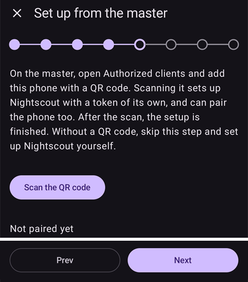
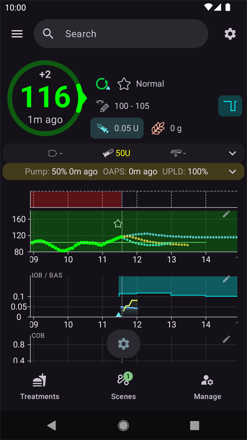

(aapsclient-app)=
# Приложението AAPSClient

**AAPSClient** е допълващото приложение на **AAPS**: придружаващо приложение за втори телефон – обикновено на болногледач – което **следи** човека, който използва **AAPS**. От версия 4 на **AAPS** болногледачът може и да **управлява** кръга от разстояние чрез подписани команди. Двата телефона комуникират чрез вашия **Nightscout** сайт; не е нужна пряка връзка между телефоните.

```{admonition} Wording used on this page
:class: note
- **Клиент** = телефон с **AAPSClient**.
- **Главен телефон** = основният телефон с **AAPS**, който управлява помпата и изпълнява кръга.
```

```{admonition} iPhone version in development
:class: note
В момента **AAPSClient** работи на телефони с Android. Версия на **AAPSClient** за iPhone се разработва и е в ранно тестване. Тя все още не е пусната: няма я в App Store и няма какво да се изтегли. Тази страница ще бъде актуализирана, когато версията стане достъпна.
```

```{contents} Table of contents
:depth: 2
:local: true
```

## Какво е AAPSClient (и какво не е)

**AAPSClient** изглежда и се използва като **AAPS**, но **няма собствен кръг**:

- То **няма APS алгоритъм**, няма **Цели** и **няма драйвери за помпи** – никога не подава инсулин само.
- Плъгините, които се използват само от основното приложение (**SMS комуникатор**, **Tidepool**, **Open Humans**), също не са включени.
- Какво *съдържа*: синхронизация с **NSClientV3**, плъгините за източник на КЗ, излъчване към **xDrip+** и връзките с **Wear OS** / **Garmin** – всичко, което е нужно за следене и за предаване на команди. Часовник **Garmin**, свързан с клиент, може да показва данните, но въглехидратите, които изпраща, не се въвеждат и той не може да свързва или разкачва помпата: клиентът показва съобщение и вместо това ги въвеждате в **AAPS**.

Всичко, което стартирате от **AAPSClient**, се проверява, ограничава, потвърждава и **изпълнява от главния телефон** (телефона с помпата). Отделната страница [Контрол главен ↔ клиент](ClientMasterControl.md) обяснява как работи това: как се свързват двата телефона, как главният телефон написва текста за потвърждение, който виждате, как се подава болус, стартиран от клиента, и какво се случва, когато главният телефон е офлайн.

## Версии: AAPSClient, AAPSClient2 и AAPSClient3

На един и същ телефон на последовател могат да се инсталират едно до друго до три клиентски приложения, всяко от които следи **различен** човек: **AAPSClient** (икона с жълта сова), **AAPSClient2** (синя сова) и – ново във версия 4 на **AAPS** – **AAPSClient3** (зелена сова). Функционално те са еднакви. Различават се само по името и цвета (иконата на приложението, фона на уиджета и секцията за статус на главния екран), за да можете да ги различавате. Всяко приложение е свързано със свой главен телефон. Вижте [За AAPSClient, AAPSClient2 и AAPSClient3](#remotecontrol-aapsclient-versions) за подробности.

## Получаване на приложението

**AAPSClient** се получава по същия начин като **AAPS** – вижте [Изтегляне и инсталиране на AAPSClient](#RemoteControl_aapsclient) – и се инсталира като основното приложение ([Прехвърляне и инсталиране](../SettingUpAaps/TransferringAndInstallingAaps.md)).

## Първо стартиране: по-кратък Съветник за настройване

При първото стартиране **AAPSClient** изпълнява същия **Съветник за настройване**, който познавате от **AAPS**, но с много по-малко стъпки – при последовател няма настройка на профил, инсулин, помпа, APS или цели:

1. **Добре дошли**, **лицензионно споразумение**, **разрешения** и **главна парола** – същите като в основното приложение, вижте [Съветник за настройване на AAPS](../SettingUpAaps/SetupWizard.md).
2. Клиентът **не** пита за **мерни единици** или за **границите за ниска/висока КЗ**: той ги взема от основния телефон веднага щом се свърже с Nightscout. Можете да ги видите по-късно в **Настройки**, където малка **икона на телефон** показва, че са [синхронизирани с основния телефон](#client-master-config-prefs). Те могат да се редактират само докато главният телефон е достъпен.
3. **Настройване от главния телефон** – на главния телефон отворете **Управление → Оторизирани клиенти**, добавете този телефон с **QR код** и докоснете тук **Сканирайте QR кода**. Едно сканиране настройва Nightscout със собствен токен за този телефон и – с код, който свързва – свързва и телефона. Телефонът също приема името, с което е добавен на главния телефон, като име на инстанцията си (буквите с ударения или диакритични знаци стават обикновени букви, „Miloš“ става „Milos“). **След сканирането настройката е завършена**: съветникът се затваря, защото следващите стъпки само биха показали какво е направил кодът. Без QR код пропуснете тази стъпка. (Само за Android: скенерът все още не е наличен за iOS.)

   

4. **Комуникация** – списъкът с плъгини предлага само това, което е нужно на последовател (NSClientV3, xDrip+, Часовник (Wear), Външни приложения за проследяване, Garmin). Ако не сте сканирали QR код, включете **NSClientV3** и въведете **същия адрес на Nightscout** като на основния телефон и токен за достъп, с включени **websockets** – точно както е описано в [Синхронизация](#RemoteControl_aapsclient).

   

5. **Свържи се с главния телефон** – тази стъпка я има **само** на клиента. Тя свързва това устройство с главния телефон по сигурния канал за команди с PIN и приема името, с което телефонът е добавен на главния телефон, както при QR кода. **След свързването настройката е завършена.** Можете също да пропуснете тази стъпка и да се свържете по всяко време по-късно от **Управление → Свържи се с главния телефон**.

   

6. **Кой използва този телефон?** – само ако не сте се свързали в съветника: името на човека, който използва този телефон. То отличава тази инстанция в отчетите и при синхронизацията.

(aapsclient-pairing-with-the-master)=

## Свързване с главния телефон

На **главния телефон** отворете **Управление → Оторизирани клиенти** и добавете клиент. Има два начина за свързване:

- **С QR код** (най-бързият, ако телефонът има камера): сканирайте кода в стъпката на съветника „**Настройване от главния телефон**“ или от **Управление → Свържи се с главния телефон → Сканирай QR код** и потвърдете с „**Използвай**“. Кодът настройва и Nightscout.
- **С PIN**: на **клиента** отворете горната стъпка на съветника (или **Управление → Свържи се с главния телефон**), въведете еднократния PIN, показан на главния телефон, и натиснете „**Свържи**“. След това клиентът показва на кого ще се довери – потвърдете със „**Свържи**“:


От съветника успешното свързване завършва настройката и отваря главния екран. На главния телефон клиентът се появява като **Активен** в списъка [Оторизирани клиенти](#client_master_master_setup). След това **Управление → Свържи се с главния телефон** показва „*Вече е свързан*“, ролята на телефона и дали режимът на засилена защита е включен:

 Пълната процедура за свързване, подробностите за сигурността и отстраняването на неизправности са в [Контрол главен ↔ клиент](#client_master_client_setup).

След свързването клиентът получава от главния телефон собствен токен за Nightscout (ако главният телефон има админ токен) само с правата, които са нужни на клиент, и спира да използва токена, който може да сте въвели. **AAPSClient** никога не записва сам лечения или КЗ в Nightscout: всичко, което прави, се изпраща до главния телефон, който го записва. Вижте [Собственият токен за Nightscout на клиента](#client-master-control-own-token).

Главният телефон решава какво може да прави този телефон чрез неговата **[роля](#client-master-control-roles)** (Само за четене, Хранения, Болногледач или Администратор). **Управление → Свържи се с главния телефон** показва ролята на телефона.

## Главният екран

Главният екран на клиента отразява следения кръг:



- **КЗ, графиките, IOB/COB и профилът** идват от Nightscout, точно както главният телефон ги е качил.
- Показаният **статус на кръга** е този на **главния телефон** (клиентът няма собствен кръг). Докато клиентът не получи текущия режим на главния телефон от Nightscout, елементът за текущия режим показва **въпросителен знак** (неизвестен).
- **Картата за статус** показва резервоара и батерията на **следената помпа** и батерията на телефона, който качва данните, взети от статуса на устройството в Nightscout – клиентът няма помпа, затова в приложението няма локален статус на помпа и никъде няма управление на помпа.
- Долната лента предлага **Лечения**, **Сценарии** и **Управление**, след като клиентът е свързан (преди свързването само **Управление**) – няма раздели за помпа или цели.

## Лечения и действия

Всичко в **Управление** работи като в основното приложение, с една важна разлика: на клиента действията, които биха променили лечението (болус, въглехидрати, временни цели, сценарии…), са **скрити, докато устройството не бъде свързано**, а след свързването те се **предават до главния телефон** за потвърждение и изпълнение – вижте [Използване на отдалечения контрол](#client-master-control).

Изключение е елементът **Профил**: той се показва дори на **несвързан** клиент, но се отваря **само за преглед** – клиентът показва профилите, които получава чрез Nightscout (нужни са му за собствените изчисления), без бутони за редактиране или активиране. След като клиентът бъде **свързан**, списъкът с профили се синхронизира с главния телефон и можете да редактирате и активирате профили от клиента като всяко друго отдалечено действие.

На **несвързан** клиент **Управление** предлага само **Профил** и **Свържи се с главния телефон**:


Червеният банер „*Главният телефон е недостъпен. Редакцията е изключена до възстановяване на връзката.*“ се показва и на несвързан клиент. Това е очаквано: все още няма главен телефон, с който да се свърже. Банерът изчезва, след като клиентът е свързан и главният телефон е онлайн.

След като клиентът е свързан, се появяват действията за лечение:


**Няма елемент Помпа** – клиентът няма помпа.

Ако главният телефон не е достъпен, същият банер се появява и на свързан клиент: действията за лечение са посивени и всичко, което опитате, се блокира, преди да бъде изпратено. Клиентът забелязва, че главният телефон е офлайн, когато опитате действие, и включва отново действията, щом главният телефон стане отново онлайн.


## Настройки, синхронизирани с главния телефон

Активната **конфигурация** на плъгините и много **настройки** се поддържат синхронизирани между главния телефон и свързаните с него клиенти; синхронизираните елементи са отбелязани с малка **икона на телефон** и са изключени (с банер „*Главният телефон е недостъпен*“), докато главният телефон не може да бъде достигнат. Това е описано в [Промяна на конфигурацията и настройките](#client-master-config-prefs).

## AAPSClient на смарт часовник

Часовник с Wear OS може да бъде свързан с телефона **клиент**; действията му се предават през клиента до главния телефон. Вижте [Wear OS](../WearOS/WearOsSmartwatch.md) и [възможностите със смарт часовник в Отдалечен контрол](#RemoteControl_smartwatches).
