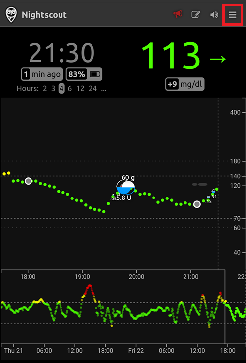
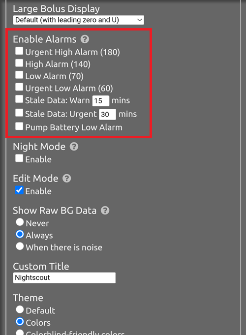
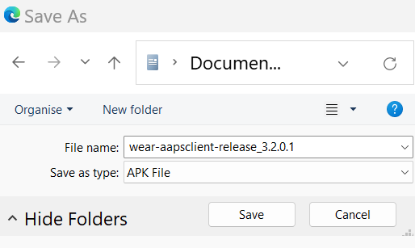

# Дистанционно управление на AAPS

```{contents} In this page
:backlinks: entry
:depth: 2
```

Има четири много ефективни инструмента за дистанционно управление на **AAPS**:

1) [SMS команди](#RemoteControl_SMS-Commands) (телефонът на последователя може да е с Android или iOS), 2) [AAPSClient](#RemoteControl_aapsclient) (телефонът на последователя е с Android; версия за iPhone е в разработка) 3) [Nightscout](#RemoteControl_nightscout) (Android, iOS или друг компютър/устройство), главно за следене: вижте бележката за [контрола от клиентско приложение](#client-master-control) в този раздел.  
4) [Смарт часовници](#RemoteControl_smartwatches) (Android)

Първите три са подходящи главно за болногледачи/родители, но смарт часовниците са много полезни за болногледачи/родители **и** за самите възрастни с диабет.


(RemoteControl_SMS-Commands)=

## 1) SMS команди

Вижте отделната страница [SMS команди](../RemoteFeatures/SMSCommands.md).

(RemoteControl_aapsclient)=
## 2) AAPSClient

**AAPSClient** изглежда много подобно на самия **AAPS** и предлага на болногледача същите екрани и бутони, за да изпраща команди дистанционно към **AAPS**:


(remotecontrol-aapsclient-versions)=
### За AAPSClient, AAPSClient2 и AAPSClient3

Има 3 версии на клиентското приложение: **AAPSClient**, **AAPSClient2** и **AAPSClient3**. Те работят по един и същ начин. Единствената разлика е, че могат да се инсталират едно до друго на един и същ телефон на последовател.

Болногледач, който следи един човек, има нужда само от **AAPSClient**. За да следите и управлявате дистанционно втори човек (със собствен сайт **Nightscout** и собствен телефон с **AAPS**), инсталирайте и **AAPSClient2**, а за трети човек – **AAPSClient3**. Всяко приложение се настройва и [свързва](#aapsclient-pairing-with-the-master) отделно, със сайта **Nightscout** и телефона с **AAPS** на човека, когото следи.

За да различавате приложенията, някои елементи имат различен цвят: жълт за **AAPSClient**, син за **AAPSClient2** и зелен за **AAPSClient3**. Тези елементи са иконата на приложението, фонът на уиджета и разделът със статуса на **AAPS** на главния екран на приложението. <br/> Забележка: непрозрачността на фона на уиджета може да се зададе в настройките на уиджета. При ниска непрозрачност цветът се вижда трудно.


### Изтегляне и инсталиране

**AAPSClient** може да се инсталира на един телефон или на няколко телефона на последователи (напр. телефона на родител 1 и телефона на родител 2), така че и двамата болногледачи да имат достъп и да управляват дистанционно телефона с **AAPS** на пациента.

To download **AAPSClient**, navigate to the [GitHub repository](https://github.com/nightscout/AndroidAPS/releases/) and click on the asset **“app-AAPSClient-release_x.x.x.x”** (it may be a newer version to that shown in the screenshot below):


След това отидете в _изтеглените файлове_ (downloads) на компютъра. On Windows, _downloads_ will show in the right hand ribbon:


След като файлът се изтегли, натиснете _show in folder_ (покажи в папката), за да го намерите.

APK файлът на **AAPSClient** вече може да бъде:

Прехвърлен с USB кабел на телефона на последователя; или Плъзнат в папка в Google Drive и след това добавен на телефона на последователя, като докоснете файла „app-AAPSClient-release“.

Should you be needing **AAPS** for yourself, and **AAPSClient** for monitoring someone else, you will need to build **AAPSClient** yourself instead of downloading it from the GitHub repository as described above. Причината е, че не можете да инсталирате **AAPS** и **AAPSClient** на един и същ телефон, ако са подписани с различен ключ. <br/> За да компилирате **AAPSClient** сами, следвайте същия процес като при [обичайното компилиране на AAPS](../SettingUpAaps/BuildingAaps.md). На страницата **Generate signed App Bundle or APK** изберете **aapsclientRelease** вместо **fullRelease**.

Същото правило важи, когато инсталирате няколко клиентски приложения (**AAPSClient**, **AAPSClient2**, **AAPSClient3**) на един телефон на последовател: всички трябва да са подписани със **същия ключ**. Иначе Android отказва да инсталира второто (грешка `INSTALL_FAILED_DUPLICATE_PERMISSION`).

### Синхронизация: настройка на AAPSClient и AAPS

Once the __AAPSClient__ apk is installed on the follower phone, make sure **NSClientV3** is set up the same way on both phones for Nightscout 15 (see the [update notes](../Maintenance/UpdateToNewVersion.md)). Примерът по-долу показва настройката на синхронизацията с NSClientV3 и Nightscout 15. В __AAPS__ има и други източници на данни (напр. xDrip).

В **Конфигурация** > **Комуникация** потребителят синхронизира данните си с Nightscout чрез __NSClientV3__ (с API v3), настроен по един и същ начин и в __AAPS__, и на телефона на последователя.


Потребителят трябва да се увери, че __и двата__ телефона – с AAPS и с AAPSClient – са синхронизирани, като настрои NSClientV3 на всеки от тях. На телефона на последователя това може да стане и чрез сканиране на QR код, показан от **AAPS**, вижте [Свързване на AAPSClient с AAPS](#remotecontrol-pairing) по-долу:

- Въведете **Nightscout адрес** в **Настройки** на NSClientV3

- Въведете **Токен за достъп до Nightscout** в същите настройки. Моля, следвайте указанията [тук](https://nightscout.github.io/nightscout/security/#create-a-token). На телефона с **AAPS** използвайте **администраторски токен** (admin token): с него **AAPS** създава отделен токен за всеки телефон на последовател.

- Включете **Използвай websockets** на **двата** телефона. На телефона с **AAPS** websockets са **задължителни** за дистанционното управление: без тях **AAPS** не може да получава команди от **AAPSClient**. И на двата телефона те ускоряват синхронизацията, но батерията се изразходва малко повече.


Потребителят трябва да се увери, че и __AAPSClient__, и __AAPS__ показват „Свързана“ (connected) на екрана **NSClientV3** на всеки телефон. На този етап **AAPSClient** следи **AAPS** (КЗ, лечения, профил), но все още не може да го управлява: свържете двата телефона, както е описано по-долу.

(remotecontrol-pairing)=
### Свързване на AAPSClient с AAPS (дистанционно управление)

От версия 4 на **AAPS** **AAPSClient** управлява **AAPS** чрез сигурна, **свързана** (paired) връзка. Само синхронизацията не е достатъчна: докато телефоните не са свързани, **AAPSClient** показва само **Управление** с **Профил** само за преглед и **Свържи се с главния телефон**.

1. На телефона с **AAPS** отворете **Управление → Оторизирани клиенти** и включете **Позволи контрол от клиенти** (по подразбиране е изключено, а в Опростен режим винаги е включено).
2. Докоснете **+**, въведете име за телефона на последователя, изберете как да се настрои и изберете неговата **роля**:
   - **QR код: Nightscout и свързване** — **AAPS** показва QR код, който настройва Nightscout на телефона на последователя и го свързва с едно сканиране. За това трябва администраторски токен в настройките на NSClientV3 на телефона с **AAPS**.
   - **PIN** — за телефон на последовател без камера, който вече е свързан с Nightscout: запишете еднократния **PIN** (валиден около две минути).
3. На телефона с **AAPSClient** сканирайте кода (в Съветника за настройване или в **Управление → Свържи се с главния телефон → Сканирай QR код**) или отворете **Управление → Свържи се с главния телефон** и въведете PIN. Потвърди.

След това телефонът на последователя се показва като **Активен** в списъка **Оторизирани клиенти**, а **AAPSClient** показва **Лечения**, **Сценарии** и **Управление**. Телефонът на последователя получава собствен токен за Nightscout само с правата, които са му нужни. Пълната процедура със снимки на екрана и отстраняване на неизправности е в [Контрол главен ↔ клиент](#client_master_master_setup).

Проверете дали настройката работи: въведете въглехидрати в **AAPSClient**, потвърдете показаното количество и проверете дали записът се появява в **Лечения** на двата телефона.

(remotecontrol-nightscout-access-token)=

### Отстраняване на проблеми с настройката на „Токен за достъп до Nightscout“

Точната настройка на „Токен за достъп до Nightscout“ може да е различна в зависимост от това дали вашият Nightscout е платен хостнат сайт или не.

Ако **AAPS** не приема „Токен за достъп до Nightscout“ и използвате платен хостнат сайт за Nightscout, може първо да се свържете с вашия доставчик на Nightscout, за да решите проблема. Ако не, свържете се с групата на **AAPS**, но преди това проверете дали правилно сте следвали указанията [тук](https://nightscout.github.io/nightscout/security/#create-a-token).

### Какво предлага AAPSClient

След свързване **AAPSClient** предлага на болногледача почти същите екрани като самия **AAPS**:

- **Лечения**: болус инсулин, въглехидрати и болус калкулатор.
- **Сценарии**: стартиране и спиране на [сценарии](../DailyLifeWithAaps/Scenes.md).
- **Управление**: профили, настройки на инсулина, временни цели, Бързи действия (QuickWizard), автоматизация, храна, ротация на местата на поставяне, свързване и текущия временен базал.
- **Главно меню**: история на леченията, браузър на историята, статистика, поддръжка, конфигурация.

В **AAPSClient** няма помпа и няма цели. Вижте [Приложението AAPSClient](AapsClient.md) за подробно описание.

**AAPSClient** позволява на болногледача да прави повечето настройки, разрешени директно в **AAPS**, **включително болуси с инсулин**, дистанционно през мобилната мрежа или интернет. Всяка команда е подписана и се изпраща през Nightscout до телефона с **AAPS**. Той я проверява спрямо собствените си данни, ограничава я, показва ви собствено потвърждение и едва тогава я изпълнява. **AAPSClient** _може_ да е много по-бърз от [SMS командите](../RemoteFeatures/SMSCommands.md), особено за команди, които изискват удостоверяване.

Лечения, въведени в Nightscout по друг начин (например през уебсайта на Nightscout), не се прилагат, докато контролът от клиентско приложение е включен: тогава **AAPS** е в [режим на засилена защита](#client-master-control-hardened-mode) и приема промени само от свързани клиенти. При изключен контрол от клиентско приложение те се прилагат само ако съответните опции за **получаване** (Receive) са включени в [раздела „Синхронизация“ в опциите на NSClient](#Preferences-nsclient-synchronization).

Дистанционното управление чрез **AAPSClient** се препоръчва само ако синхронизацията ви работи добре (_т.е._ не виждате нежелани промени в данните, като самопромяна на временна цел (TT), временен базал (TBR) и т.н.).

### AAPSClient с опции за смарт часовник

Смарт часовникът може да е много полезен инструмент за управление на **AAPS** при деца. Възможни са няколко различни конфигурации. Ако **AAPSClient** е инсталиран на телефона на болногледача, [приложението **AAPSClient WearOS**](https://github.com/nightscout/AndroidAPS/releases/) може да се изтегли и инсталира на съвместим смарт часовник, свързан с телефона на родителя. Това показва текущата КЗ и статуса на кръга. След като **AAPSClient** е свързан с **AAPS**, действията от часовника (включително болуси, въглехидрати, временни цели и смени на профил) се предават чрез **AAPSClient** до **AAPS**, който ги потвърждава и изпълнява: вижте [Wear OS на клиент](#clientmastercontrol-wear-os-on-a-client). Можете да прочетете повече за смарт часовниците [тук](#remotecontrol-smartwatches).

(RemoteControl_nightscout)=
## 3) Nightscout

Освен че Nightscout е сървър „в облака“, има и отделно приложение **Nightscout**, което може да се изтегли директно от App Store на вашия iPhone. If you have an Android follower phone, there is not a dedicated Nightscout app and it is better to use [**AAPSClient**](#RemoteControl_aapsclient), or, if you only want to follow, and not send treatments you can download and install the [Nightwatch](https://play.google.com/store/apps/details?id=se.cornixit.nightwatch) app from the Playstore.

След като инсталирате приложението **Nightscout** на iPhone, отворете го и следвайте подканите за настройка, като въведете адреса на вашия Nightscout (вижте по-долу, вляво). Видът на адреса може да е различен в зависимост от това къде е хостнат вашият Nightscout. (_напр._ http://youraddresshere.herokuapp.com). След това въведете API secret (паролата) на вашия Nightscout (вижте по-долу, вдясно). Ако не бъдете помолени за API паролата, трябва да я въведете, като натиснете катинарчето в горната част на приложението:


Повече информация за настройката има директно в [Nightscout](https://nightscout.github.io/nightscout/discover/)

Когато влезете за първи път, ще видите съвсем прост екран. Настройте опциите за показване, като изберете менюто „хамбургер“ горе вдясно и превъртите надолу:



Превъртете надолу до „Settings“ (Настройки). Може да искате да смените „scale“ (мащаб) на „linear“ (линеен), защото по подразбиране КЗ се показва в логаритмичен мащаб, а в „render basal“ (показване на базала) изберете „default“ (по подразбиране), за да се показва базалът на помпата.


Изберете желаните опции. Махнете отметката от алармите, ако използвате друго приложение за аларми.



Продължете да превъртате надолу, докато стигнете до „show plugins“ (показване на плъгините).

Уверете се, че „careportal“ е отметнато. Можете да изберете и различни други показатели (най-полезни са: IOB, care portal, pump, cannula age, insulin age, basal profile и OpenAPS).

Важно: сега трябва да натиснете „save“ (запази) най-долу, за да влязат в сила промените.


След като натиснете „save“, приложението ще се върне на главния екран на Nightscout, който ще изглежда приблизително така:

1. Текуща стойност на КЗ
2. Информация за статуса на системата AAPS – докоснете отделните раздели на екрана, за да видите повече подробности. Добавяйте или махайте тези опции за показване чрез менюто „хамбургер“.
3. Последната крива на КЗ с показани лечения (въглехидрати, болуси)
4. Крива на КЗ за по-дълъг период
5. Меню „хамбургер“ за опции за показване, създаване на отчети, редактиране на профили и инструменти за администриране на Nightscout
6. Меню „**+**“ за въвеждане на лечения (вижте [по-долу](#RemoteControl_nightscout-treatments) кога **AAPS** ги прилага).
7. Изберете друг период за показване
8. Базален профил
9. Зелена линия = КЗ досега Сини линии = прогнозна КЗ


По-подробно за менюто горе вляво в приложението Nightscout:

1. Портал за лечения – редактиране на минали записи
2. Включване/изключване на алармите
3. Хамбургер – за настройка на предпочитанията
4. Портал за лечения – запис на лечение (вижте [по-долу](#RemoteControl_nightscout-treatments) кога **AAPS** ги прилага)


На този екран в сивите раздели има много информация за статуса на системата **AAPS** (а още повече информация се показва, ако докоснете раздела):

1. Тенденция на КЗ за 5 мин
2. Преглед на болус калкулатора (Bolus Wizard Preview)
3. Натиснете „Basal“, за да видите текущия профил и информация за базала
4. Време от последното измерване на CGM в AAPS
5. **Помпа**: инсулин, батерия (%) и кога AAPS се е свързал с нея за последно
6. Последно опресняване на AAPS – ако е преди повече от 5 мин, това може да означава проблем с връзката между телефона с AAPS и помпата/CGM
7. Натиснете IOB, за да видите разделението на базален и болус инсулин
8. Възраст на инсулина в резервоара
9. Възраст на иглата
10. Статус на батерията на телефона с AAPS
11. Размер на базата данни. Ако тя се напълни твърде много (само при Nightscout, който поддържате сами – хостнатите услуги могат да пренебрегнат това), може да започнат проблеми с връзката. Можете да изтриете данни, за да намалите този размер, в менюто Admin tools (през менюто „хамбургер“).


Натиснете „refresh“ (опресни) в долната част на страницата, за да затворите изскачащия прозорец.

(RemoteControl_nightscout-treatments)=
### Изпращане на лечения от приложението Nightscout към AAPS

In **AAPS** 4 the supported way to control **AAPS** remotely is a **paired AAPSClient**, see [Master ↔ Client control](#client-master-control): each client has a [role](#client-master-control-roles) that limits what it may do, and every command is signed by the client, then checked and confirmed by the **AAPS** phone. Докато контролът от клиентско приложение е включен, телефонът с **AAPS** е в [режим на засилена защита](#client-master-control-hardened-mode): лечения, временни цели и смени на профил, въведени в уебсайта или в приложението Nightscout, **не** се прилагат. Тогава приложението Nightscout е инструмент само за следене.

```{admonition} Only when client control is off
:class: warning
Ако **Позволи контрол от клиенти** е изключено в **Управление → Оторизирани клиенти** (и Опростен режим е изключен), **AAPS** прилага записите от портала за лечения от Nightscout само за типовете данни, които сте включили в опциите за **получаване** (Receive) в [раздела „Синхронизация“ в настройките на NSClientV3](#Preferences-nsclient-synchronization): въглехидрати, временни цели, смени на профил и другите записи от портала за лечения. Инсулинът никога не се подава по този начин: „Корекционен болус“ (Correction bolus), въведен в Nightscout, само се *отбелязва* и **AAPS** го отчита като активен инсулин (IOB), без да го подава. Тази настройка не се препоръчва за дистанционно управление. Вместо това използвайте свързан **AAPSClient**.
```

Прочетете повече за опциите на **Nightscout** [тук](https://nightscout.github.io/)

### Съвети за най-добро използване на приложението Nightscout

1). Ако „заседнете“ на някоя страница и искате да видите отново главния екран, просто натиснете „refresh“ (опресни) долу в средата. Така ще се върнете на началната страница на **Nightscout** с графиката на КЗ.

За да видите текущия профил, който работи на телефона, натискайте различните икони на екрана над графиката. Повече информация (текущ коефициент за въглехидрати, чувствителност, часова зона и т.н.) можете да видите, като натиснете „basal“, а „OpenAPS“ дава информация за профила, текущата цел и т.н. Може да се следи и зарядът на батерията (%) на телефона и на помпата. BWP показва какво алгоритъмът смята, че ще се случи в бъдеще, като отчита IOB и COB.

#### Други икони в менюто: какво означава моливът (редактиране)?

(Технически) можете да използвате молива за редактиране, за да преместите или изтриете болуси или корекции от последните 48 ч.

Повече за това [тук](https://nightscout.github.io/nightscout/discover/#edit-mode-edit)

Въпреки че това може да е полезно за изтриване на въведени въглехидрати (за които не е пуснат болус), на практика в момента не работи добре с **AAPS** и препоръчваме да правите такива промени директно в приложението **AAPS**.

(RemoteControl_smartwatches)= (remotecontrol-smartwatches)=

## 4) Смарт часовници

### Вариант 1) Управление на AAPS от часовник с Wear OS


След като [настроите **AAPS** на часовника](../WearOS/BuildingAapsWearOS.md), подробности за циферблатите и техните функции ще намерите в [Смарт часовник с Wear OS](../WearOS/WearOsSmartwatch.md).

Накратко, от смарт часовника могат да се задействат следните функции:

* задаване на временна цел

* използване на болус калкулатора (параметрите за изчисление могат да се зададат в настройките на телефона)

* подаване на удължени въглехидрати (eCarbs)

* подаване на болус (инсулин + въглехидрати)

* настройки на часовника

* статус

* проверка на статуса на помпата

* проверка на статуса на кръга

* проверка и смяна на профила, CPP (Circadian Percentage Profile = изместване на времето + процент)

* показване на TDD (Total daily dose – обща дневна доза = болус + базал за ден)

* Дистанционен болус, когато болногледачът и детето с диабет тип 1 са на различни места (това е възможно за часовника с **AAPS** и телефона с **AAPS**, ако и двете устройства са свързани към мрежата)

#### Комуникация от болногледачите към часовника чрез други приложения (като WhatsApp)

Можете да добавите и други приложения на часовника, например WhatsApp, за съобщения между болногледачи и деца. Важно е с телефона да е свързан само ЕДИН профил в Google, иначе часовникът няма да пренесе тези данни. Трябва да сте на 13 или повече години, за да имате профил в Samsung, и той трябва да е със същия имейл адрес, който се използва на телефона с Android.

Видео, което обяснява как да настроите WhatsApp за съобщения на часовника Galaxy 4 (не можете да получите всички функции на WhatsApp), има [тук](https://gorilla-fitnesswatches.com/how-to-get-whatsapp-on-galaxy-watch-4/)

Настройките в приложението **Galaxy wearable** на телефона с **AAPS** и на часовника позволяват съобщенията в WhatsApp да се известяват с лека вибрация и да се показват върху текущия циферблат.

### Вариант 2) **AAPS** на часовника за дистанционно управление на **AAPS** на телефона

Подобно на телефон на последовател с **AAPSClient** или SMS команди (вижте разделите по-горе), смарт часовник може да се използва за дистанционно управление на **AAPS** и да показва пълните данни за профила. Основната разлика спрямо телефон на последовател е, че връзката между смарт часовника и телефона с **AAPS** е през Bluetooth и не изисква нито Nightscout, нито код за удостоверяване. Освен това, ако смарт часовникът и телефонът с **AAPS**, свързани чрез Bluetooth, са и в Wi-Fi/мобилна мрежа за данни, часовникът ще комуникира с телефона с **AAPS** и през нея, което дава по-голям обхват. Това включва дистанционно подаване на болус, когато болногледачът с часовника с **AAPS** и детето с диабет тип 1 (с телефона с **AAPS**) са на различни места, което може да е полезно, например когато детето е на училище.

Затова смарт часовник за дистанционно управление често е полезен във всяка ситуация, в която:

а)  **AAPSClient** или **SMS** командите не могат да работят; или

б)  Потребителят иска да избегне въвеждането на код за удостоверяване (както се изисква за SMS командите).

Смарт часовникът трябва да е с **Wear OS 3 или по-нова**, за да може да управлява **AAPS**. Моля, проверете техническите характеристики на часовника и вижте страницата [Смарт часовници и AAPS](../Getting-Started/Watches.md). Search, or ask in the **AAPS** Facebook/Discord groups if unsure.

Specific How-to guides for setting up **AAPS** on the popular Samsung Galaxy Watch 4 (40mm) are given below. Часовникът [Garmin](https://apps.garmin.com/en-US/apps/a2eebcac-d18a-4227-a143-cd333cf89b55?fbclid=IwAR0k3w3oes-OHgFdPO-cGCuTSIpqFJejHG-klBTm_rmyEJo6gdArw8Nl4Zc#0) също е популярен избор. Ако имате опит с настройката на друг смарт часовник и смятате, че ще е полезен за други, моля, добавете го в тези страници ([редактирайте документацията](../SupportingAaps/HowToEditTheDocs.md)), за да споделите опита си с цялата общност на **AAPS**.

### Вариант 3) AAPSClient на часовника за дистанционно управление на **AAPS** на телефона


The software for the watch, **AAPSClient** Wear apk, can be downloaded directly from [GitHub](https://github.com/nightscout/AndroidAPS/releases/).

За да изтеглите софтуера, натиснете приложението за часовник, което отговаря на клиентското приложение на телефона: **wear-aapsclient-release_**_версия_ е за **AAPSClient**, **wear-aapsclient2-release_**_версия_ е за **AAPSClient2** (вижте [За AAPSClient, AAPSClient2 и AAPSClient3](#remotecontrol-aapsclient-versions)):


След това изберете „save as“ (запиши като) и запазете файла на удобно място на компютъра:





Файлът **AAPSClient** wear apk може да се прехвърли на телефона и да се инсталира ръчно на часовника по същия начин като приложението **AAPS** Wear, както е описано в [Прехвърляне на приложението Wear на телефона с AAPS](#remote-control-transferring-the-aaps-wear-app-onto-your-aaps-phone)  


