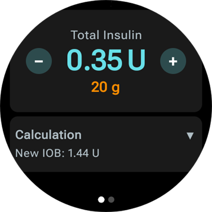
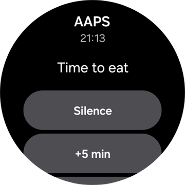
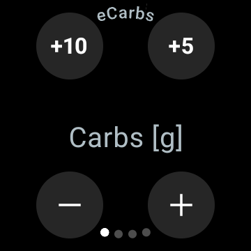

# Управление на AAPS чрез смарт часовник с Wear OS

(Watchfaces-aaps-watchfaces)=

## Циферблати на AAPS

```{warning}
Класическите циферблати на **AAPS** работят само на Wear OS 5 и по-стари версии, а Wear OS 5 вече ги ограничава. На **Wear OS 6 и по-нови версии** приложението за часовника инсталира вместо тях един циферблат във формата Watch Face Format на Google: вашия персонализиран циферблат като картина или **Циферблат с усложнения**. Вижте [Промени в циферблатите при Wear OS](#wearos-watchface-changes) за това какво спира да работи при всяка версия на Wear OS и [циферблата, който AAPS инсталира](#wearos-aaps-v4-watchface) за Wear OS 6.
```

На Wear OS 5 и по-стари версии в приложението **AAPS** за часовника са вградени няколко класически циферблата. Те показват стойността на глюкозата с делтата, IOB, текущата базална доза и графика на стойностите. На тях работят две докосвания:

* Двойно докоснете стойността на глюкозата, за да отворите главното меню на **AAPS**
* Двойно докоснете графиката, за да промените времевия ѝ диапазон

На всяка версия на Wear OS [усложненията](#Watchfaces-complications) и [тайловете](#WearOsSmartwatch-wear-os-tiles), описани на тази страница, работят с всеки циферблат, който има място за тях.

## Конфигурация

Включете **Часовник** в [**Конфигурация** > **Комуникация**](#Config-Builder-wear).

За да давате болус или да изпълнявате други действия от часовника, включете **Контрол от часовник**. Настройките на болус калкулатора за часовника се задават на същото място: вижте [Настройки > Часовник](#preferences-wear). Докато **Контрол от часовник** е изключен, телефонът отказва всяко лечение или промяна на режима, изпратени от часовника, а часовникът показва *„Управлението от Wear е изключено в настройките на Wear на телефона.“*

С **Отвори плъгин** на картата **Часовник** отваряте екрана на плъгина Часовник (Wear):


Горният ред показва името на свързания часовник или **(Няма активна връзка)**. От този екран можете да:

* Повторно изпращане на всички данни. Може да е полезно, ако часовникът не е бил свързан известно време и искате да изпратите информацията към него.
* Отваряне на настройките на часовника направо от телефона.
* Изберете кой циферблат **AAPS** да инсталира на часовника (**Циферблат, инсталиран на часовника**: вашият персонализиран циферблат или циферблатът с усложнения). Тази карта се показва само докато е свързан часовник с **Wear OS 6** или по-нова версия. Вижте [циферблата, който AAPS инсталира](#wearos-aaps-v4-watchface).
* Управлявате **Персонализиран Watchface** (картата се показва, докато е свързан часовник): **Зареди Watchface** изпраща персонализиран циферблат към часовника, **Информация за Watchface** показва подробностите за заредения циферблат и полетата в него, **Още циферблати** отваря [сайта за обмен](../ExchangeSiteCustomWatchfaces/index.md) в браузъра, а **Експорт на шаблона** запазва шаблон, който можете да редактирате. Под бутоните се показва преглед на заредения циферблат. Вижте [Смяна към циферблат на AAPS](#WearOS_changing-to-AAPS-watchface).

Уверете се, че известията от AAPS не са блокирани на часовника. Потвърждението на действие (напр. болус, временна цел) идва като известие, което трябва да плъзнете и да отметнете.

## Отваряне на главното меню на AAPS


За да отворите главното меню на **AAPS**, използвайте един от тези начини:

* отворете **AAPS** от списъка с приложения на часовника
* докоснете усложнение на **AAPS**, което отваря менюто, вижте [Настройки на усложненията](#WearOsSmartwatch-complication-settings)
* докоснете тайла **Графика на КЗ**, ако в **Чукнете действие** е избрано **Главно меню**, вижте [Настройки на тайловете](#WearOsSmartwatch-wear-os-tiles)
* на класически циферблат на **AAPS** двойно докоснете стойността на глюкозата

(WearOsSmartwatch-loop-status)=

## Екран „Статус на кръга“

Екранът **Статус на кръга** показва обобщение на това, което прави кръгът, без да вадите телефона. Отворете го от главното меню на AAPS (**Статус на кръга** или **Статус → Режим на APS - Loop**) или като докоснете усложнението **Кръвна захар**. Менюто **Статус** има и страница **Помпа** и страница **TDD** с общите дневни дози.


Екранът е списък от карти. Превъртете надолу, за да ги видите всички:

* **Текущ режим** — текущият режим (затворен кръг, отворен кръг, LGS, спрян, разкачен…) и при временен режим – колко време още ще продължи.
* **Резултат** — кога кръгът е работил за последен път и временният базал или SMB, които е поискал.
* **Сценарий** — само докато е активен [сценарий](#scenes-from-watch): името му, оставащото време (или **До края** при сценарий без крайно време) и **Следващ сценарий** – сценарият, който започва, когато той приключи.
* **Цели** — вашата цел и временната цел, ако има такава.
* **Профил** — името на активния профил, с **Процент** и **Отместване**, когато те не са със стойностите по подразбиране. Временната смяна на профил е маркирана и показва колко време още ще продължи и профила, към който се връща, когато приключи (**Върни на**).
* **Чувствителност** — същите редове като в полето за чувствителност на главния екран на телефона: стойността на Autosens, ISF от профила, променливият ISF и ефективният ISF.

Малка икона на сценарий до текущия режим, временната цел или смяната на профил означава, че те са **зададени от активния сценарий**. Същата икона се показва и в избора на **Текущ режим**.


(WearOsSmartwatch-bolus-calculator)=

## Болус калкулаторът на часовника

Отворете **Калкулатор** от главното меню на **AAPS**, от [тайла „Действия“](#WearOsSmartwatch-wear-os-tiles) или от усложнение, настроено да отваря калкулатора. Той минава през няколко страници – плъзнете отдясно наляво, за да продължите:

| Въглехидрати                                                                 | Искане                                                                   | Резултат                                                                  | Калкулация                                                                                | Потвърждаване                                                                   |
| ---------------------------------------------------------------------------- | ------------------------------------------------------------------------ | ------------------------------------------------------------------------- | ----------------------------------------------------------------------------------------- | ------------------------------------------------------------------------------- |
|  |  |  |  |  |

1. **Въглехидрати**: въведете въглехидратите с бутоните **+10**, **+5**, **−** и **+**.
2. **Искане**: последната страница, преди телефонът да поеме работата. Тя показва това, което сте въвели: въглехидратите, а също типа хранене, времето на въглехидратите и процента, когато ги използвате, вижте [Допълнителни страници](#WearOsSmartwatch-calculator-optional-pages). Докоснете отметката, за да го изпратите към телефона, който прави изчислението.
3. **Резултат**: болусът, който **AAPS** предлага, а под него въглехидратите: въглехидратите сега и удължените въглехидрати (eCarbs) по-късно, времето на въглехидратите и звънчето на напомнянето за хранене. Променете дозата с **−** и **+**, вижте по-долу. Превъртете надолу до картата **Калкулация**: докоснете я, за да видите всеки ред от изчислението, както на телефона.
4. **Потвърждаване**: плъзнете до втората страница и докоснете отметката. Телефонът подава болуса и записва въглехидратите.

(WearOsSmartwatch-calculator-optional-pages)=

### Допълнителни страници

Три настройки на часовника добавят по една страница след **Въглехидрати**. По подразбиране те са изключени. Отворете главното меню на **AAPS**, след това **Настройки** > **Интерфейс**, и включете тези, които искате; когато са включени повече от една, страниците идват в този ред: **Тип хранене**, **Започват от**, **Процент**. Точките в долната част на калкулатора показват колко страници има той.

| Настройки                                                                                     | Тип хранене                                                                     | Започват от                                                                     | Процент                                                                      |
| --------------------------------------------------------------------------------------------- | ------------------------------------------------------------------------------- | ------------------------------------------------------------------------------- | ---------------------------------------------------------------------------- |
|  |  |  |  |

* **Тип храна**: **Хляб**, **Торта** или **Пица**, което разделя въглехидратите на бавно хранене на въглехидрати сега и удължени въглехидрати (eCarbs) по-късно, вижте [Избор на типа хранене](#WearOsSmartwatch-wizard-meal-type).
* **Calculator Carb Time** (време на въглехидратите в калкулатора): минутите до храненето, със звънче **Напомни ми** за напомнянето за хранене, вижте [Време на въглехидратите и напомняне за хранене](#WearOsSmartwatch-wizard-carb-time).
* **Калкулатор Процент**: процент от изчисления болус, например 70 %, когато искате по-малка доза. Започва от **Болус процент** в [настройките на болус калкулатора](#Preferences-deliver-this-part-of-bolus-wizard-result) на телефона – 100 %, ако не сте го променили. Вижте и бележката в [Промяна на болуса на страницата с резултата](#WearOsSmartwatch-wizard-result).

(WearOsSmartwatch-wizard-result)=

### Промяна на болуса на страницата с резултата

Страницата с резултата показва болуса, който **AAPS** предлага, заедно с бутон **−** и бутон **+**. С тях можете да промените дозата, преди да я потвърдите, без да се връщате към телефона.

| Предложен                                                                         | Повече                                                                              | По-малко                                                                             |
| --------------------------------------------------------------------------------- | ----------------------------------------------------------------------------------- | ------------------------------------------------------------------------------------ |
|  |  |  |

* Всяко натискане променя болуса с **една стъпка на вашата помпа**, така че предлаганите количества винаги отговарят на това, което помпата наистина може да подаде.
* **Натиснете и задръжте** бутон, за да продължите да променяте стойността. Колкото по-дълго задържите, толкова по-бързо се променя.
* Не можете да слезете под **0 U**, нито да надвишите настройката си **максимален болус**.

Текущата сума се показва на страницата с резултата, така че винаги виждате количеството, което ще потвърдите. Промяната се показва след въглехидратите, например *(+0,20 U)*, а използваният бутон става зелен при увеличаване и червен при намаляване.

Ако **AAPS** е трябвало да ограничи дозата, например защото изчисленият болус е над настройката ви **максимален болус**, под общата сума се показва ред с предупреждение в кехлибарен цвят (например *„Приложено ограничение!“*). Същото важи и за ограничено количество въглехидрати.

```{admonition} Това не е същото като „Калкулатор Процент“ :class: note Настройката **Калкулатор Процент** ви позволява да въведете *процент* от изчисления болус, **преди** да се появи страницата с резултата. Бутоните **−** и **+** променят *крайното количество* **на** страницата с резултата. Можете да използвате и двете.

    <br />(WearOsSmartwatch-wizard-meal-type)=
    
    ### Избор на типа хранене
    
    Калкулаторът на часовника може да раздели въглехидратите на бавно хранене на въглехидрати сега и удължени въглехидрати по-късно, както [типа въглехидрати](#AapsScreens-carbs-type) в калкулатора на телефона. Включете **Тип храна** в **Настройки** > **Интерфейс** на часовника. По подразбиране настройката е изключена и тогава страницата **Тип хранене** се пропуска.
    
    * След като въведете въглехидратите, страницата **Тип хранене** показва три икони: **Хляб**, **Торта** и **Пица**. Докоснете икона: името ѝ и въглехидратите, които дава, се показват под иконите, например *65 гр* за хляб или *52+22 гр* за пица (52 г сега и 22 г удължени въглехидрати по-късно). **Хляб** е по подразбиране и оставя всички въглехидрати за сега.
    * Страниците „Искане“ и „Потвърждаване“ показват въглехидратите по същия начин (*52+22 гр*). Страницата с резултата показва и кога започват удължените въглехидрати и колко време продължават.
    * Болусът се изчислява само за въглехидратите, изядени сега. Разделянето използва същите числа като калкулатора на телефона.
    
    (WearOsSmartwatch-wizard-carb-time)=
    
    ### Време на въглехидратите и напомняне за хранене
    
    Когато **Calculator Carb Time** (време на въглехидратите в калкулатора) е включено в **Настройки** > **Интерфейс** на часовника, след въглехидратите идва страница **Започват от**: минутите до храненето, както [времето на въглехидратите](#aaps-screens-bolus-wizard) в калкулатора на телефона. **Сега** (Now) е по подразбиране. **−** и **+** го променят на стъпки от 5 минути, до един час назад или напред от текущия момент. Време в миналото е за въглехидрати, които вече сте изяли.
    
    При време в бъдещето под стойността се появява звънче **Напомни ми**. То е включено по подразбиране; докоснете го, за да го изключите. Страниците „Искане“ и „Резултат“ показват времето на въглехидратите, например *+30 мин*, и звънчето. Телефонът записва въглехидратите в това време, премества заедно с тях удължените въглехидрати на типа хранене и стартира напомнянето си **Време е за ядене**.
    
    | Резултат | Графика на КЗ | Текущо | Време е за ядене |
    | --- | --- | --- | --- |
    |  |  |  |  |
    
    Напомнянето е и на часовника, затова звъни и когато телефонът е далеч:
    
    * Екранът **Графика на КЗ**, тайлът **Графика на КЗ** и графиката на **Циферблат с усложнения** показват оранжева пунктирна линия там, където напомнянето ще звънне, и до нея оставащите минути.
    * Докато напомнянето тече, в списъка с известия стои тихо известие **Време е за ядене** с бутони **Стоп** (Stop) и **+5 мин**. То се появява отново, когато го плъзнете встрани, докато напомнянето не приключи.
    * Когато времето дойде, часовникът вибрира и после отново на всеки половин минута в продължение на пет минути, докато не отговорите. Известието предлага **Заглуши** (Silence) и **+5 мин**, а плъзгането му встрани също го заглушава.
    
    **Стоп**, **Заглуши** и **+5 мин** правят едно и също на часовника, на телефона и в **AAPSClient**, и всички те показват едно и също напомняне.
    
    (Watchfaces-complications)=
    
    ## Усложнения
    
    _Усложнение_ (complication) е термин от традиционното часовникарство, където означава допълнение към основния циферблат – още едно малко прозорче или малък циферблат (с дата, ден от седмицата, фаза на луната и т.н.). Wear OS 2.0 пренася тази идея и позволява към всеки циферблат, който поддържа усложнения, да се добавят собствени източници на данни, например за времето, известия, фитнес броячи и други.
    
    Приложението AAPS за Wear OS поддържа усложнения от версия `2.6` и позволява всеки циферблат на трета страна, който поддържа усложнения, да се настрои да показва данни от AAPS (КЗ с тенденцията, IOB, COB и т.н.).
    
    Усложненията служат и като **пряк път** към функциите на AAPS. Когато ги докоснете, можете да отворите менюта и диалози на AAPS (в зависимост от вида на усложнението и от настройките).
    
    
    
    ### Видове усложнения
    
    Приложението AAPS за Wear OS предоставя само необработени данни според предварително зададени формати. Циферблатът на трета страна решава къде и как да показва усложненията, включително тяхното разположение, рамка, цвят и шрифт. От многото видове усложнения, налични в Wear OS, AAPS използва:
    
    * `SHORT TEXT` – съдържа два реда текст по 7 знака, понякога наричани стойност и етикет. Обикновено се показва в кръг или в малко овално поле – едно под друго или едно до друго. Това усложнение има много малко място. AAPS се опитва да премахне ненужните знаци, за да се събере текстът: закръгля стойностите, премахва нулите в началото и в края на стойностите и т.н.
    * `LONG TEXT` – съдържа два реда текст по около 20 знака. Обикновено се показва в правоъгълник или в дълго овално поле – едно под друго. Използва се за повече подробности и за текстов статус.
    * `RANGED VALUE` – използва се за стойности от предварително зададен диапазон, например процент. Съдържа икона и етикет и обикновено се показва като кръгъл индикатор за напредък.
    * `LARGE IMAGE` – собствено фоново изображение, което може да се използва като фон (ако циферблатът го поддържа).
    * `SMALL IMAGE` / `MONOCHROMATIC IMAGE` – малка икона. В място `SMALL IMAGE` AAPS я рисува в собствения си цвят; в място `MONOCHROMATIC IMAGE` циферблатът я оцветява.
    
    ### Настройване на усложнения
    
    За да добавите усложнение към циферблата, натиснете продължително циферблата и натиснете иконата със зъбно колело отдолу. В зависимост от това как ги настройва конкретният циферблат – или докоснете празните места, или отворете менюто за настройка на усложненията на циферблата. Усложненията на AAPS са групирани в менюто под името AAPS.
    
    Когато настройвате усложнения на циферблата, Wear OS показва и филтрира списъка с усложнения, които могат да се поставят на избраното място на циферблата. Ако дадено усложнение не е в списъка, вероятно видът му не може да се използва за това място.
    
    ### Усложнения, предоставени от AAPS
    
    AAPS предоставя усложненията по-долу. „Отваря“ е това, което прави докосването, когато **Допълнителни действия при почукване** е оставено на **Стандартен**, вижте [Настройки на усложненията](#WearOsSmartwatch-complication-settings).
    
    **Глюкоза**
    
    * **Кръвна захар** (`SHORT TEXT`, отваря _Статус на кръга_): стойността на глюкозата със стрелката за тенденцията на първия ред, времето от измерването и делтата на втория.
    * **Голяма КЗ** (`SHORT TEXT`, отваря _Графика на КЗ_): само стойността на глюкозата на първия ред, за да може циферблатът да я покаже голяма. Времето от измерването и стрелката за тенденцията са на втория ред.
    * **Графика на КЗ** (`SMALL IMAGE` / `LARGE IMAGE`, отваря _Графика на КЗ_): графиката на КЗ като картина, за циферблати с място за изображение. Това е графиката на **Циферблат с усложнения**.
    * **Пълен статус** (`LONG TEXT`, отваря _Меню_): повечето данни на един ред: стойността на глюкозата със стрелката за тенденцията, делтата и времето от измерването, след това активните въглехидрати, активният инсулин и базалната доза.
    * **Пълен статус (обърнат)** (`LONG TEXT`, отваря _Меню_): същото, но двата реда са разменени – за циферблати, които показват само един от двата реда на място `LONG TEXT`.
    
    **Инсулин и въглехидрати**
    
    * **IoB икона** (`SHORT TEXT`, отваря _Болус_): активният инсулин с икона на спринцовка.
    * **IoB детайли** (`SHORT TEXT`, отваря _Болус_): общият активен инсулин на първия ред, болусната и базалната част на втория.
    * **Икона за ВЪГЛ** (`SHORT TEXT`, отваря _Калкулатор_): активните въглехидрати с икона за въглехидрати.
    * **Детайли за въгл** (`SHORT TEXT`, отваря _Калкулатор_): активните въглехидрати сега на първия ред, въглехидратите, които още предстоят (удължени въглехидрати), на втория.
    * **ВЪГЛ & IoB** (`SHORT TEXT`, отваря _Калкулатор_): активният инсулин на първия ред, активните въглехидрати на втория.
    
    **Базал и цел**
    
    * **Базал** (`SHORT TEXT`, отваря _Меню_): текущата базална доза.
    * **БАЗА & IoB** (`SHORT TEXT`, отваря _Меню_): активният инсулин на първия ред, базалната доза на втория.
    * **БАЗА & Цел** (`SHORT TEXT`, отваря _Временна цел_): целта на първия ред, с оставащото време, когато тече временна цел, и базалната доза на втория.
    * **Цел** (`SHORT TEXT`, отваря _Временна цел_): целта на първия ред и, докато тече временна цел, оставащото ѝ време на втория.
    * **БАЗА, ВЪГЛ & IoB** (`SHORT TEXT`, отваря _Меню_): базалната доза на първия ред, активните въглехидрати и активният инсулин на втория.
    
    **Кръг и телефон**
    
    * **Текущ режим** (`SMALL IMAGE` / `ICON`, отваря _избора на текущ режим_): текущият режим на кръга като икона: затворен кръг, отворен кръг, спиране на базала при ниска КЗ, спрян, разкачен или изключен. Докосването отваря избор с промените на режима, позволени в момента, например **Спри кръга** (Suspend loop), **Разкачи помпата**, **Възстанови кръга** или **Свържи отново помпата**. Същият избор е в главното меню на **AAPS** под **Текущ режим**.
    * **Качване/батерия на телефон** (`RANGED VALUE` / `SHORT TEXT` / `ICON`, отваря _Статус_): батерията на телефона с **AAPS** – като индикатор с икона на батерия, като число или само като икона. Обновява се заедно с другите данни на **AAPS**, обикновено на всеки 5 минути с нова стойност.
    
    Изборът на **Текущ режим**, отворен от усложнението, от главното меню или от тайла „Текущ режим“:
    
    
    
    (WearOsSmartwatch-complication-settings)=
    
    ### Настройки на усложненията
    
    В главното меню на **AAPS** на часовника отворете **Настройки** > **Допълнение**:
    
    
    
    * **Допълнителни действия при почукване** (по подразбиране `Стандартен`): какво отваря докосването на усложнение на **AAPS** – за всички усложнения наведнъж:
      * _Стандартен_: това, което отваря самото усложнение, вижте списъка по-горе
      * _Меню_: главното меню на **AAPS**
      * _Калкулатор_: болус калкулаторът
      * _Лечение_: диалогът за лечение – инсулин и въглехидрати
      * _уд. въгл._: диалогът за удължени въглехидрати (eCarbs)
      * _Статус_: менюто „Статус“
      * _Текущ режим_: изборът на текущ режим. Изисква **Контрол от часовник** да е включен в настройките на Wear на телефона, иначе вместо това се отваря главното меню.
      * _Без_: докосването не прави нищо
    * **Диапазон на графиката за КЗ** (по подразбиране `3 часа`): колко часа показва усложнението **Графика на КЗ** – 1, 3 или 6. Тайлът „Графика на КЗ“ има собствена настройка.
    * **Unicode кодиране** (по подразбиране `включено`): усложненията използват Unicode символи като `Δ` за делтата, `⁞` като разделител и `⎍` за базалната доза. Как изглеждат те, зависи от шрифта на циферблата. Задайте `изключено`, когато циферблатът ги показва като квадратчета или празни места.
    
    (WearOsSmartwatch-wear-os-tiles)=
    
    ## Тайлове в Wear OS
    
    Тайловете са страниците, до които стигате, като плъзгате от циферблата. **AAPS** добавя седем тайла, всеки с до четири бутона. Докосването на бутон отваря съответния диалог на часовника или ви моли да потвърдите, а след това телефонът свършва работата. Тайлът е пряк път, а не екран за статус: той не пази състоянието на приложението на телефона.
    
    Преди да използвате тайловете, включете **Контрол от часовник** в [Настройки > Часовник](#preferences-wear).
    
    ### Добавяне на тайл
    
    Има два начина в зависимост от часовника и телефона:
    
    1. На часовника: плъзнете от циферблата след последния тайл до **Add tile** (добавяне на тайл) и изберете тайл на **AAPS**. На повечето часовници продължителното натискане на тайл също отваря изгледа за добавяне и премахване.
    2. На телефона, в придружаващото приложение за часовника (**Galaxy Wearable** за Samsung, **Wear OS** за други марки): отворете **Плочки** (Tiles), докоснете **Добавяне** (Add) и изберете тайловете на **AAPS**, които искате. Редът на тайловете може да се променя с плъзгане.
    
    
    
    ### Настройки на тайловете
    
    Тайловете **Действия**, **Временна цел**, **Графика на КЗ** и **Сценарий** имат настройки на часовника. Отворете главното меню на **AAPS**, след това **Настройки** > **Tiles** и изберете тайла. Продължителното натискане на тайла също отваря настройките му, освен на часовниците Pixel. Другите три тайла се попълват от телефона и нямат настройки на часовника.
    
    | Главно меню | Настройки | Tiles |
    | --- | --- | --- |
    |  |  |  |
    
    Настройките на тайла са списък с неговите четири места. Докоснете място, за да изберете какво да показва, или **Без**, за да остане празно.
    
    | Продължително натискане на тайла | Настройки на тайла „Временна цел“ |
    | --- | --- |
    |  |  |
    
    Всеки тайл има четири места. Тайл с повече записи показва първите четири.
    
    ### Тайл „Действия“
    
    
    
    Преки пътища към диалозите на приложението **AAPS** за часовника. Изберете до четири от тях в настройките на тайла:
    
    * **Калк**: болус калкулаторът с въвеждане на въглехидрати, по желание процент [1] и по желание тип хранене [2]
    * **Лечение**: инсулин и въглехидрати наведнъж
    * **Инсулин**: болус, въведен в единици
    * **въглехидрати**: въглехидрати, също и удължени въглехидрати. Приема се и **отрицателно** количество – до текущите ви активни въглехидрати (COB), – за да коригирате въглехидрати, въведени по-рано. Премахнатите въглехидрати се показват на графиката на КЗ на часовника.
    * **уд. въгл.**: удължени въглехидрати (eCarbs)
    * **Врем цел**: временна цел с цел и продължителност по ваш избор
    * **Смяна на профил**: смяна на профил с процент, отместване във времето и продължителност
    
    
    
    Диалозите, които отварят бутоните. Плъзнете отдясно наляво, за да стигнете до следващата страница на диалога, и докоснете отметката на последната страница, за да изпратите заявката към телефона:
    
    | Лечение | Инсулин | въглехидрати | уд. въгл. | Врем цел | Смяна на профил |
    | --- | --- | --- | --- | --- | --- |
    |  |  |  |  |  |  |
    
    [1] В **Настройки** > **Интерфейс** на часовника включете **Калкулатор Процент**, за да се показва полето за процент в болус калкулатора. The default percentage comes from the phone's ["Bolus percentage"](#Preferences-deliver-this-part-of-bolus-wizard-result). Другите настройки на калкулатора са тези на телефона в **Настройки** > **Настройки на болус калкулатора**.
    
    [2] В **Настройки** > **Интерфейс** на часовника включете **Тип храна**, за да се показва страницата **Тип хранене**, където избирате **Хляб**, **Торта** или **Пица**, за да разделите въглехидратите на бавно хранене на въглехидрати сега и удължени въглехидрати по-късно. Вижте [Избор на типа хранене](#WearOsSmartwatch-wizard-meal-type).
    
    ### Тайл „Временна цел“
    
    
    
    Временни цели от шаблоните на телефона. Задайте продължителността и целта на всеки шаблон на телефона в **Настройки** > [Временни цели по подразбиране](#Preferences-default-temp-targets). Изберете до четири от тях в настройките на тайла:
    
    * **Физ.активност**: за спорт
    * **Хранене**: скоро хранене – по-ниска цел, за да има повече активен инсулин по време на храненето
    * **Хипогликемия**: по-висока цел по време на лечение на хипогликемия
    * **Друго**: цел и продължителност по ваш избор
    * **Откажи**: спира текущата временна цел. Бутонът се показва само докато тече временна цел.
    
    ### Тайл „Съветник“ (Quick Wizard)
    
    
    
    Записите в [Бързи действия](#quickwizards) на телефона, за които е включено **Покажи на часовника**, в рамките на техните часове на валидност. Запис с въглехидрати показва въглехидратите си в г, запис с инсулин – фиксираната си доза в U. Докосването изпълнява записа след потвърждение на часовника. На часовника няма нищо за настройване: редактирайте записите на телефона и включете **Покажи на часовника** в **Избор на устройство** за всеки запис, който искате да е на тайла. Извън часовете на валидност на всички ваши записи тайлът показва **Няма настройки**.
    
    
    
    ### Тайл „Сценарий“
    
    
    
    [Сценариите](#scenes-from-watch) на телефона. Всяко от четирите места се задава в настройките на тайла на **Автоматично**, **Без** или на един сценарий. Място с **Автоматично** взема следващия сценарий от списъка на телефона, който не е зает от друго място. Място, зададено на сценарий, който вече не съществува на телефона, показва **Неналично**.
    
    
    
    ### Тайл „Текущ режим“
    
    
    
    [Режимите на работа](#aaps-screens-running-mode), към които можете да преминете от текущия режим, със същите икони като на телефона: затворен кръг, спиране на базала при ниска КЗ, отворен кръг, изключване на кръга, временно спиране на кръга и разкачване на помпата, или възстановяване и повторно свързване, докато тече някой от тях. **Спри кръга** (Suspend loop) и **Разкачи помпата** първо питат за продължителност. Телефонът решава кои режими се предлагат; часовникът показва първите четири и пропуска **Изключи кръга** (Disable loop), когато **Спри кръга** (Suspend loop) е в списъка.
    
    ### Тайл „Потребителско действие“
    
    
    
    По един бутон за всяка [автоматизация](#automations-automation-triggers) на телефона, чийто тригер е **Потребителско действие**. Докосването ви моли да потвърдите, след което телефонът изпълнява действията на автоматизацията. Бутоните носят имената на автоматизациите, затова им давайте кратки имена. На часовника няма нищо за настройване.
    
    ### Тайл „Графика на КЗ“
    
    
    
    Стойността на глюкозата със стрелка, делта и време от измерването, под нея IOB, COB, базална доза и цел, както и графиката на КЗ с прогнози, болуси, въглехидрати и SMB. Две настройки на часовника: **Времеви диапазон** (1, 3 или 6 часа) и **Чукнете действие**, което отваря пълната **Графика на КЗ**, **Главно меню** или екрана **Статус на кръга**.
    
    
    
    
    
    ## Винаги включен
    
    Този и следващият раздел се отнасят за класическите циферблати на **AAPS** на Wear OS 5 и по-стари версии. На Wear OS 6 **Циферблат с усложнения** има собствен режим „винаги включен“, вижте [циферблата, който AAPS инсталира](#wearos-aaps-v4-watchface).
    
    Дългият живот на батерията е предизвикателство за смарт часовниците с Android Wear OS. Някои смарт часовници издържат до 30 часа без зареждане. За най-добро пестене на енергия дисплеят трябва да се изключва, когато не се използва. Повечето часовници поддържат дисплей „Винаги включен“ (Always on).
    
    От версия 3 на AAPS можем да използваме „Опростен интерфейс“ (Simplify UI) в режим „винаги включен“. Този интерфейс съдържа само кръвната захар, посоката и часа. Този интерфейс е оптимизиран за пестене на енергия: обновява се по-рядко, показва по-малко информация и включва по-малко пиксели, за да пести енергия при OLED дисплеите.
    
    Опростеният интерфейс е наличен за циферблатите Digital Style и Custom. Опростеният интерфейс не е задължителен и се настройва от настройките на циферблата (натиснете продължително циферблата и натиснете „edit“ (редактиране) или иконата със зъбно колело). Изберете настройката „Опростен интерфейс“ и я задайте на „Режим Постоянно включен“ или „Винаги включен по време на зареждане“.
    
    ### Нощен режим
    
    По време на зареждане би било полезно дисплеят да остава „винаги включен“ и да показва кръвната ви захар през нощта. Стандартните циферблати обаче са твърде ярки и показват твърде много информация, а подробностите се четат трудно със сънени очи. Затова добавихме настройка, с която циферблатът показва опростен интерфейс само по време на зареждане, ако това е избрано в конфигурацията.
    
    Опростеният интерфейс е наличен за циферблатите Digital Style и Custom. Опростеният интерфейс не е задължителен и се настройва от настройките на циферблата (натиснете продължително циферблата и натиснете „edit“ (редактиране) или иконата със зъбно колело). Изберете настройката „Опростен интерфейс“ и я задайте на „По време на зареждане“ или „Винаги включен по време на зареждане“.
    
    Опциите за разработчици на Android позволяват часовникът да остава буден по време на зареждане. За да станат достъпни опциите за разработчици, вижте [официалната документация](https://developer.android.com/training/wearables/get-started/debugging). Set the “Stay awake when charging” to “on” in the developer options.
    
    Забележка: не всички дисплеи понасят добре режима „винаги включен“. Той може да причини прогаряне на екрана (burn-in), особено при по-старите OLED дисплеи. Часовниците обикновено затъмняват дисплея, за да предотвратят прогарянето; за съвет вижте ръководството на часовника, информацията от производителя или интернет.
    
    
    
    
    
    (WearOsSmartwatch-phone-alarms)=
    
    ## Аларми от телефона на часовника
    
    
    
    Часовникът показва алармите на телефона, така че виждате защо телефонът издава звук и можете да отговорите от китката си. Часовникът вибрира и после отново на всеки половин минута в продължение на пет минути, докато не отговорите. Известието показва заглавието и текста на алармата със същите отговори като напомнянето [Време е за ядене](#WearOsSmartwatch-wizard-carb-time):
    
    * **Заглуши** (Silence) или плъзгане встрани: алармата спира и екранът с алармата на телефона се затваря.
    * **Заглуши за 5 мин** (Mute 5 min): алармата спира и звъни отново след пет минути – на телефона и на часовника.
    
    До часовника стигат два вида аларми:
    
    * Екранът с аларма на телефона (грешки на помпата, аларми от автоматизации, аларми за КЗ): **Заглуши** и **Заглуши за 5 мин**.
    * Спешни известия със звук, например *Помпата е недостъпна* или аларма от Nightscout: само **Заглуши**. За тях телефонът има само **Откажи**, и те се появяват отново сами, докато причината им продължава.
    
    Напомнянето *Време е за ядене* не се изпраща по този начин: часовникът звъни за него сам.
    
    ## Пряк път за отлагане на аларма (Snooze Alert)
    
    Часовникът [показва алармата](#WearOsSmartwatch-phone-alarms) сам; прекият път е втори начин да я заглушите – с едно натискане. Можете да създадете пряк път за отлагане на сигналите/алармите на AAPS. Заглушаването на звука от часовника е удобно и по-бързо, без да посягате към телефона. Note: you still have to check your alarm message on your phone and handle it accordingly, but you can check that later. Когато часовникът ви има два бутона, можете да зададете на един от тях програмата `AAPS Snooze Alert`.
    
    За да свържете бутона на Samsung Watch 4, отидете в `Settings > Advanced Features > Customize Buttons > Double press > AAPS Snooze Alert`
    
    На циферблат с усложнения усложнението **App shortcut** (пряк път към приложение), зададено на **AAPS Snooze Alert**, прави същото с едно докосване. [Алтернативната настройка на циферблата с усложнения](#wearos-complications-watchface-setup) използва за това горното дясно място.
    
    ### Отлагане на xDrip
    
    Когато използвате xDrip и xDrip е инсталиран на часовника, прекият път „AAPS Snooze Alert“ ще отложи и всяка аларма на xDrip. 
    
    
    ## Съвети за производителност и живот на батерията
    
    Часовниците с Wear OS са устройства с много ограничена енергия. Размерът на корпуса на часовника ограничава капацитета на батерията в него. Дори с последните подобрения в хардуера и в софтуера часовниците с Wear OS все още трябва да се зареждат всеки ден.
    
    If an experienced battery span is shorter than a day (from dawn to dusk), here are some tips to troubleshoot the issues.
    
    Най-много енергия изразходват:
    
    * Активният дисплей с включена подсветка (при LED) или в режим на пълна яркост (при OLED)
    * Изобразяването на екрана
    * Радиовръзката по Bluetooth
    
    Тъй като не можем да правим компромис с връзката (нужни са ни актуални данни) и искаме да се показват най-новите данни, повечето оптимизации могат да се направят в областта на _времето, през което дисплеят е включен_:
    
    * Стандартните циферблати обикновено са по-добре оптимизирани от персонализираните, изтеглени от магазина.
    * По-добре е да използвате циферблати, които ограничават количеството показвани данни в неактивен/затъмнен режим.
    * Внимавайте, когато комбинирате други усложнения, например уиджети за времето от трети страни или други, които използват данни от външни източници.
    * Започнете с по-прости циферблати. Добавяйте по едно усложнение и наблюдавайте как всяко влияе на живота на батерията.
    * Използвайте тъмна тема на циферблата. При OLED дисплеите по-малко светещи пиксели означават по-малък разход на енергия и по-малко прогаряне.
    * Проверете какво работи по-добре на вашия часовник: стандартните циферблати на AAPS или други циферблати с усложнения на AAPS.
    * Наблюдавайте няколко дни, при различна физическа активност. Повечето часовници включват дисплея, когато погледнете часовника, при движение и при други действия на потребителя.
    * Проверете общите системни настройки, които влияят на производителността: известия, време до изключване на подсветката/активния дисплей, кога се включва GPS.
    * Вижте [списъка с изпробвани телефони и часовници](#Phones-list-of-tested-phones) и [попитайте общността](../GettingHelp/WhereCanIGetHelp.md) за опита на други потребители и за живота на батерията, който те съобщават.
    * **Не можем да гарантираме, че данните, показани на циферблата или в усложнението, са актуални**. В крайна сметка Wear OS решава кога да обнови циферблата или усложнението. Дори когато приложението AAPS поиска обновяване, системата може да реши да отложи или да пренебрегне обновяването, за да пести батерия. Ако имате съмнения и батерията на часовника е слаба – винаги проверявайте в основното приложение AAPS на телефона.
    
    (Watchfaces-troubleshooting-the-wear-app)=
    
    ## Отстраняване на неизправности в приложението за часовника
    
    Ако часовникът не показва данни или показва стари данни, първо проверете връзката между часовника и телефона, вижте [Отстраняване на неизправности във връзката между часовника с AAPS и телефона с AAPS](#wear-os-watch-phone-communication). За часовник с Wear OS 5 вижте и [общите препоръки за отстраняване на неизправности при Wear OS 5](#wear-os-5-troubleshooting). Усложнение, което не се обновява, има същите причини като тайл или циферблат, който не се обновява, затова първо проверете тях.
    
    ## Налични са и допълнителни персонализирани циферблати за AAPS
    
    [Тук](../ExchangeSiteCustomWatchfaces/index.md) можете да изтеглите Zip файлове с персонализирани циферблати, създадени от други потребители.
    
    ## Създайте собствен циферблат
    
    Ако искате да създадете собствен циферблат, следвайте [ръководството тук](../ExchangeSiteCustomWatchfaces/CustomWatchfaceReference.md).
    
    Once you have built a custom watchface, you can share your own **AAPS** custom watchface with others, the zip-file can be uploaded in the folder "ExchangeSiteCustomWatchfaces" via a Pull Request into GitHub. При сливането на заявката за промяна (pull request) екипът на документацията ще извлече файла CustomWatchface.png и ще добави пред името му името на Zip файла.
    
    (WearOsSmartwatch-complications-watchface-download)=
    
    ## Направете своя версия на циферблата с усложнения
    
    **Циферблатът с усложнения**, който **AAPS** инсталира на Wear OS 6 (вижте [циферблата, който AAPS инсталира](#wearos-aaps-v4-watchface)), е създаден с **Watch Face Studio** на Samsung. Файлът на проекта му може да се изтегли свободно, така че можете да го промените по свой вкус или да го използвате на часовник с Wear OS 5 или по-стара версия, на който **AAPS** не го инсталира:
    
    [Циферблат с усложнения (AAPS V4), zip](https://github.com/openaps/AndroidAPSdocs/raw/refs/heads/master/docs/_static/wearos/Complications_watchface_AAPS_V4.zip)
    
    Zip файлът съдържа четири файла:
    
    * `AAPS V4_0_2.wfs`: проектът. Отворете го в [Watch Face Studio](https://developer.samsung.com/watch-face-studio/download.html), променете каквото искате и го инсталирайте на часовника оттам.
    * `com.watchfacestudio.aapsv4.apk`: циферблатът в готов вид, готов за инсталиране с [adb](https://developer.android.com/tools/releases/platform-tools): `adb install com.watchfacestudio.aapsv4.apk`, докато часовникът е свързан чрез отстраняване на грешки през ADB (ADB debugging).
    * `README.txt`: двете препоръчани настройки на усложненията – същите като на [страницата за Wear OS](#wearos-complications-watchface-setup).
    * `AAPS V4.png`: преглед.
    
    ```{admonition} Това не е персонализиран циферблат
    :class: note
    Zip файлът не е персонализиран циферблат за **Зареди Watchface** в плъгина **Часовник** и телефонът не може да го инсталира. Той трябва да се разархивира и да се инсталира на часовника с Watch Face Studio или adb, както е описано по-горе.