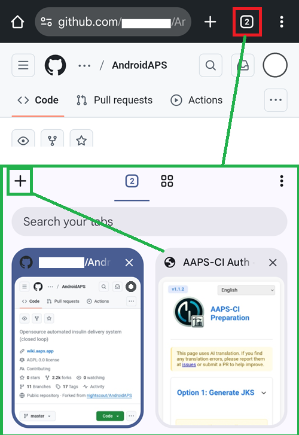

(browser-build)=

# Компилиране в браузъра

Компилиране на AAPS с GitHub Actions.

**Най-ниската поддържана версия на AAPS е 3.3.2.1.**

## Компилирайте сами, вместо да изтегляте

**Приложението AAPS (файл apk) не може да бъде изтеглено готово заради правилата за медицинските изделия. Законно е да компилирате приложението за собствена употреба, но НЕ БИВА да давате копие на други хора!**

Вижте [страницата с често задавани въпроси](../UsefulLinks/FAQ.md) за подробности.

(Building-APK-without-a-computer)=

## Изберете начин за компилиране

Изберете начина, който отговаря на устройството, от което компилирате:

### На телефон с Android: AAPS Builder (препоръчително)

Страница за настройка ви води стъпка по стъпка, докато създадете свое лично хранилище (repository) за компилиране в GitHub. Нищо не се инсталира, няма подготвителен файл и вие сами стартирате всяко компилиране. Изтегляте приложението директно от GitHub. Google Drive не е задължителен.

Това работи и от браузър на компютър.

**→ [Компилиране в браузъра с AAPS Builder](BrowserBuildAapsBuilder.md)**

### На компютър или iPhone / iPad: fork и подготвителен файл

Правите копие (fork) на изходния код на AAPS в GitHub, създавате хранилището си за ключове (keystore) с подготвителен файл, а компилираното приложение се записва във вашия Google Drive. Следвайте четирите стъпки по-долу.

```{note}
**Вече компилирате с fork?** Продължете да го актуализирате, както е описано в [Актуализиране в браузъра](../Maintenance/UpdateBrowserBuild.md), или преминете към AAPS Builder. За да преминете, първо вземете копие на хранилището си за ключове от вашия fork: вижте [Преминаване от предишното компилиране в браузъра](#aaps-builder-from-fork).
```

Ще трябва да използвате няколко раздела в браузъра си и да превключвате между тях. Пример с Chrome:



```{note}
Ще трябва да минавате от раздел на раздел: започнете, като затворите всички раздели, за да не се объркате, когато превключвате между тях.
```

#### Какво ви трябва

- **Профил в Google**, за да може компилираното приложение да се запише във вашия Google Drive.
- **Профил в GitHub** (безплатен) – създавате го в Стъпка 1.
- **Уеб браузър**, който може да държи няколко раздела отворени едновременно (по-долу се приема, че е Chrome).
- Малка **помощна програма за стартиране на подготвителния файл**. Коя ви трябва, зависи от устройството, от което компилирате – сега не инсталирате нищо, Стъпка 2 ще ви покаже как за вашето устройство:
  - **Компютър (Windows / Mac / Linux):** Simple Web Server.
  - **iPhone / iPad:** не е нужно допълнително приложение – използвате вграденото приложение Files (Файлове) и браузъра.

#### Стъпките

Компилирането в браузъра е поредица от избори. Следвайте тези стъпки по ред:

1. **[Създайте свой fork в GitHub](BrowserBuildFork.md)** – направете свое лично копие на изходния код на AAPS.
2. **[Създайте хранилището си за ключове за подписване](BrowserBuildKeystore.md)** – основният избор: създайте ново хранилище за ключове (Вариант 1) или качете съществуващото (Вариант 2), след това следвайте страницата за вашето устройство.
3. **[Разрешете достъп до Google Drive](BrowserBuildGoogleDrive.md)** – позволете на GitHub да записва компилираното приложение във вашия Google Drive.
4. **[Компилирайте APK](BrowserBuildAPK.md)** – стартирайте workflow в GitHub Actions и изберете версията и варианта на приложението.

Ако срещнете проблем, вижте **[Отстраняване на неизправности при компилиране в браузъра](../GettingHelp/BrowserBuildTroubleshooting.md)**. За допълнителни действия с fork вижте [експорт на хранилището за ключове](#ci-keystore-export) или [cherry-pick на commit](#github-cherry-pick).

----

**Започнете със [Стъпка 1 – Създаване на ваш fork в GitHub](BrowserBuildFork.md) →**

```{toctree}
:hidden:

AAPS Builder <BrowserBuildAapsBuilder.md>
Стъпка 1: Създаване на fork <BrowserBuildFork.md>
Стъпка 2: Създаване на хранилище за ключове <BrowserBuildKeystore.md>
Стъпка 3: Разрешаване на Google Drive <BrowserBuildGoogleDrive.md>
Стъпка 4: Компилиране на APK <BrowserBuildAPK.md>
```
