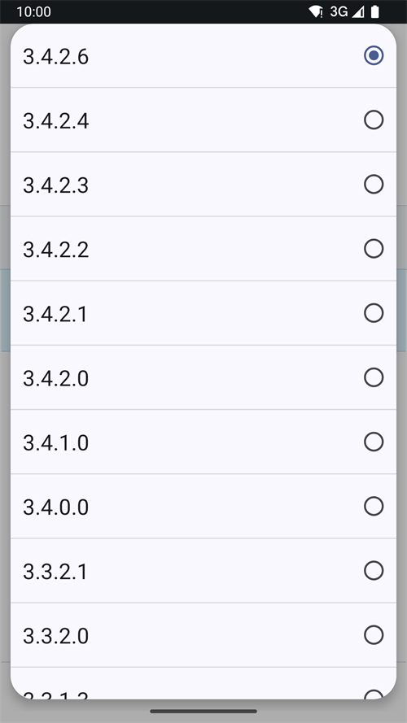

(github-build-apk)=

# Компилиране в браузъра – Стъпка 4: Компилиране на APK

```{note}
Това е **Стъпка 4** от [Компилиране в браузъра](BrowserBuild.md). Първо изпълнете [Стъпка 3 – Разрешаване на достъп до Google Drive](BrowserBuildGoogleDrive.md).
```

## AAPS-CI в GitHub Actions за компилиране на AAPS APK
 - Подходящо за обикновени потребители.

```{tab-set}

:::{tab-item} Wiki
### Стартирайте workflow за компилиране на подписания APK

1. В своето копие на AndroidAPS в GitHub изберете Actions.
2. Разгънете All workflows (всички workflows).
3. Изберете AAPS-CI


4. Превъртете надолу и докоснете Run workflow.


5. Оставете **Use workflow from** на клона master. В **Select AAPS Version** изберете версията на **AAPS**, която искате да компилирате (обикновено най-новата). Изберете [варианта](#browserbuild-variant) (fullRelease) и докоснете Run workflow.


6. Ще видите съобщението Workflow run was successfully requested (стартирането на workflow е заявено успешно). Опреснете страницата в браузъра и ще можете да следите напредъка на компилирането. Когато действието завърши, при AAPS CI ще се покаже зелена отметка. Успешно компилирахте актуализираната версия на AndroidAPS.


### Инсталиране на AAPS APK

1. Отворете своя Google Drive
2. Отворете папката AAPS, изберете папката с новата версия и там ще намерите и версията за телефона, и версията за Android Wear.


:::

:::{tab-item} Видео
<div align="center" style="max-width: 360px; margin: auto; margin-bottom: 2em;">
  <div style="position: relative; width: 100%; aspect-ratio: 9/16;">
    <iframe
      src="https://geo.dailymotion.com/player/x9rdwms.html?video=x9rdwms&loop=true&mute=true"
      loading="lazy"
      style="position: absolute; top: 0; left: 0; width: 100%; height: 100%;"
      frameborder="0"
      allowfullscreen>
    </iframe>
  </div>
</div>
:::  

```

## Избор на версия за компилиране

**С метода в браузъра могат да се компилират само версии на AAPS от 3.3.2.1 нагоре.**

Докоснете **Select AAPS Version** и изберете версията за компилиране. Най-новата версия е най-горе в списъка.



(browserbuild-variant)=

## Избор на вариант за компилиране

*Бележка: приложенията за Android и за Android Wear се компилират автоматично.*

  - Изберете варианта, който ви трябва:
    - fullRelease: За обикновена употреба с помпа, с всички функции.
    - [aapsclientRelease, aapsclient2Release, aapsclient3Release](#RemoteControl_aapsclient): За болногледачи / родители (изисква [Nightscout](../SettingUpAaps/Nightscout.md)). `aapsclient3Release` компилира **AAPSClient3**, който е наличен от версия 4.0 на **AAPS** (вижте [За AAPSClient, AAPSClient2 и AAPSClient3](#remotecontrol-aapsclient-versions)).
    - pumpcontrolRelease: За замяна на приложението/контролера на помпата


Variants ending with “Debug” indicate that the APK will be built in debug mode, which is useful for developers for troubleshooting.

<!-- If you want to test the items in a pull request has been moved to dev page /AdvancedOptions/DevBranch.md -->

----

След успешно компилиране apk файлът се записва във вашия Google Drive. Продължете с [Прехвърляне и инсталиране на AAPS](TransferringAndInstallingAaps.md).

```{note}
От септември 2026 г. [проверката на разработчиците на Android](#android-developer-verification) от Google може да блокира инсталирането на APK файла с докосване на файла, в зависимост от вашата държава. Безплатните заобиколни решения са обяснени на тази страница.
```

Ако компилирането не успее, първо [открийте в журнала на компилирането какво се е объркало](#aaps-ci-read-the-logs), след това вижте [Отстраняване на неизправности при компилиране в браузъра](../GettingHelp/BrowserBuildTroubleshooting.md). За да включите конкретен commit в компилирането, вижте [cherry-pick на commit](#github-cherry-pick).
