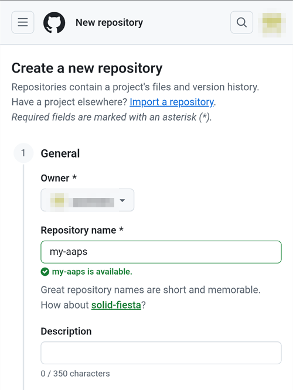
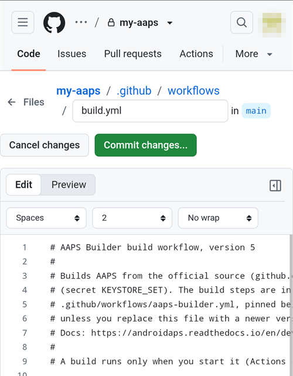
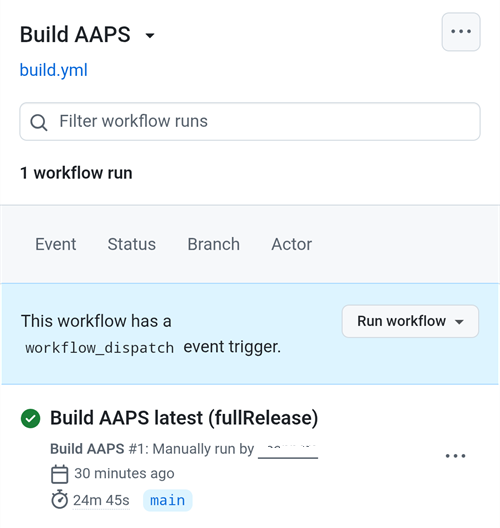
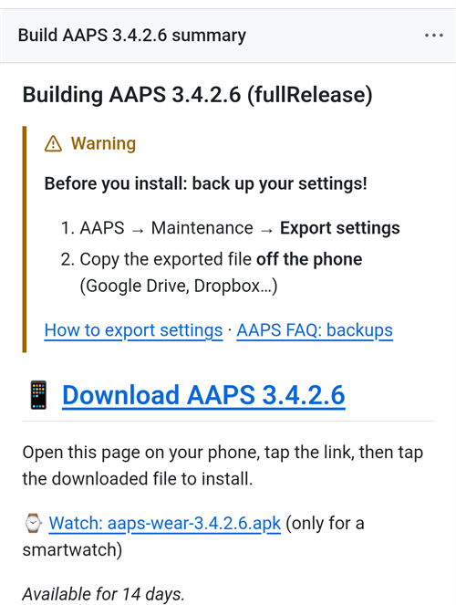

(aaps-builder)=

# Компилиране в браузъра с AAPS Builder

```{note}
Това е препоръчителният начин за компилиране на AAPS от **телефон с Android**. Работи и от браузър на всеки компютър. За другите начини за компилиране от компютър или iPhone вижте прегледа [Компилиране в браузъра](BrowserBuild.md).
```

```{contents} In this page
:backlinks: entry
:depth: 2
```

**AAPS Builder** компилира приложението AAPS вместо вас в GitHub – безплатния уебсайт за хостване на код. Не е нужно да инсталирате нищо на телефона си и няма подготвителен файл, който да отваряте.

Страница за настройка на този сайт ви води стъпка по стъпка. Първия път отнема около 10 мин:

1. Създайте празно **частно** хранилище във вашия профил в GitHub: страницата за настройка отваря GitHub с всичко попълнено, вие само потвърждавате.
2. Добавете **работния процес за компилиране** (build workflow) – файлът, който казва на GitHub как да компилира AAPS.
3. Създайте или качете своя **ключ за подписване** (хранилището за ключове, keystore).
4. Дайте ключа на вашето хранилище (repository) като **секрет** (secret) в GitHub.
5. **Компилирайте** приложението. Една компилация отнема 15–30 мин.
6. **Изтеглете и инсталирайте** приложението на телефона си.

**Не** е нужно да правите fork на AndroidAPS: изходният код на AAPS се изтегля от официалното хранилище на AndroidAPS при всяка компилация. Също така **не** ви е нужен Google Drive: изтегляте приложението директно от GitHub.

```{admonition} Where the code comes from
:class: note

Страницата за настройка и работният процес за компилиране са част от тази документация: те се поддържат и проверяват заедно с нея. <a href="../_static/aaps-builder/aaps-builder-build.yml">Работният процес</a>, който добавяте към хранилището си, е кратък: той изпълнява [стъпките за компилиране](https://github.com/openaps/AndroidAPSdocs/blob/dev/.github/workflows/aaps-builder.yml), които се пазят в хранилището на документацията, фиксирани към една проверена версия. Можете да прочетете и двете, преди да ги използвате. При компилиране работният процес изтегля само официалния изходен код на AAPS и собствените инструменти за компилиране на GitHub. Вашето хранилище за ключове никога не напуска вашия браузър и вашето частно хранилище.
```

(aaps-builder-before-you-start)=

## Преди да започнете

Ще ви трябват:

- **Профил в GitHub** (безплатен). Ако нямате, първо го създайте на [github.com](https://github.com/signup).
- **Уеб браузър**: Chrome на телефона или който и да е браузър на компютър. Влезте в github.com в този браузър, преди да започнете.
- **Имате приложението GitHub на телефона си?** Можете да го запазите. Тогава някои бутони на страницата за настройка отварят приложението вместо Chrome. Компилирането работи в приложението, но приложението **не може да изтегли** готовия AAPS: [стъпка 6](#aaps-builder-step6) показва как да преминете към Chrome за изтеглянето.
- Вашето **съществуващо хранилище за ключове** (файл `.jks`), неговата парола и неговият псевдоним (alias), ако вече сте компилирали AAPS и искате да го актуализирате без преинсталиране.

```{warning}
**Вашето хранилище за компилиране трябва да остане частно.** Всичко, което една компилация създава, се вижда от всеки, който може да вижда хранилището. Страницата за настройка създава частно хранилище за вас. Никога не го правете публично.

Частното хранилище получава 2000 безплатни минути за GitHub Actions на месец, което стига за няколко компилации.
```

```{warning}
**Нов ключ или съществуващ ключ: това решава дали ще можете да актуализирате AAPS.**

- **Вече имате AAPS на телефона си, компилиран с хранилище за ключове, което все още имате**: изберете **I already have a keystore** (вече имам хранилище за ключове) на страницата за настройка и го качете. Следващата ви компилация ще актуализира вече инсталирания AAPS. Компилирали сте AAPS с предишния метод за компилиране в браузъра (собствен fork)? Вашето хранилище за ключове е във вашия fork: [първо вземете копие от него](#aaps-builder-from-fork).
- **Компилирате AAPS за първи път или сте загубили хранилището за ключове или паролата му**: изберете **Create a new key** (създаване на нов ключ). Приложение, подписано с нов ключ, **не може да актуализира** AAPS, подписан с друг ключ. Трябва да експортирате настройките си, да копирате файла извън телефона, да деинсталирате стария AAPS, да инсталирате новия и след това да импортирате настройките си: вижте [Преинсталиране на AAPS с ново хранилище за ключове](#reinstall-aaps).

След това винаги използвайте същия ключ. Когато създавате нов ключ, изтеглете резервното копие, което страницата предлага, и го пазете заедно с паролата и псевдонима му (`key0`) на сигурно място извън телефона.
```

(aaps-builder-from-fork)=

## Преминаване от предишния метод за компилиране в браузъра (fork)

Пропуснете този раздел, ако никога не сте компилирали AAPS с предишния метод за компилиране в браузъра (собствено копие, или fork, на AndroidAPS в GitHub, с подготвителния файл и Google Drive).

Вашето хранилище за ключове е запазено като секрети във вашия fork. GitHub никога не показва секрет отново, затова не можете да го копирате в новото си хранилище. Първо вземете копие от хранилището си за ключове, след това го използвайте в [стъпка 3](#aaps-builder-step3) с **I already have a keystore**.

```{warning}
Не избирайте **Create a new key**. AAPS, компилиран с нов ключ, не може да актуализира AAPS на вашия телефон.
```

Кой е вашият случай?

- **Използвали сте Вариант 2** (качили сте собственото си хранилище за ключове от Android Studio) и все още имате файла `.jks`, паролите и псевдонима му: тук няма какво да правите. Използвайте този файл в стъпка 3.
- **Използвали сте Вариант 1** (подготвителният файл е създал ключа ви) или вече нямате файла на хранилището за ключове: експортирайте го от вашия fork, както е описано по-долу.

За да експортирате хранилището за ключове от вашия fork:

1. Във вашия fork отворете **Settings** → **Secrets and variables** → **Actions** и добавете секрет с име `ZIP_PASSWORD`. Изберете парола само с английски букви и цифри. Тя защитава файла, който ще създадете.
2. Отворете раздела **Actions** на вашия fork, докоснете **CI Keystore Export**, след това **Run workflow**. Повече подробности: [Експортиране на хранилището за ключове](#ci-keystore-export).
3. Когато изпълнението има зелена отметка, отворете своя Google Drive: файлът `keystore.zip` е в папката **AAPS** → **KeyStore**. Ако изпълнението е неуспешно на стъпката за Google Drive, достъпът на вашия fork до Google Drive е изтекъл: вижте [Изтекъл токен за опресняване на Google](#aaps-ci-google-token-expired).
4. Изтеглете `keystore.zip` и го отворете с вашата `ZIP_PASSWORD`: на компютър или на телефона с приложение за файлове, което може да отваря ZIP файлове, защитени с парола. Той съдържа:
   - `keystore.jks`: вашето хранилище за ключове,
   - `keyStoreInfo.txt`: вашите `KEYSTORE_PASSWORD`, `KEY_PASSWORD` и `ALIAS` (обикновено `key0`).
5. Копирайте `keystore.jks` на телефона си (или в Google Drive, за да можете да го изберете оттам).

В [стъпка 3](#aaps-builder-step3) на страницата за настройка:

1. Докоснете **I already have a keystore**.
2. В **Keystore file** изберете `keystore.jks`.
3. В **Keystore password** въведете `KEYSTORE_PASSWORD` от `keyStoreInfo.txt`.
4. В **Key alias** изберете или въведете `ALIAS` от `keyStoreInfo.txt`.
5. Ако `KEY_PASSWORD` е различна от `KEYSTORE_PASSWORD`, махнете отметката от **Key password is the same as the keystore password** и въведете `KEY_PASSWORD`.

Пазете `keystore.zip` и неговата `ZIP_PASSWORD` на сигурно място извън телефона: това е резервното копие на вашия ключ.

Достъпът на вашия fork до Google Drive също не може да бъде копиран. За да запазвате и компилациите от AAPS Builder в Google Drive, направете [стъпка 7](#aaps-builder-google-drive). Можете да запазите своя fork, докато AAPS, компилиран с AAPS Builder, не бъде инсталиран на телефона ви.

## Отворете страницата за настройка

**→ [Отворете страницата за настройка на AAPS Builder](#aaps-builder-setup)**

Оставете тази страница с документацията отворена: натиснете продължително връзката по-горе и изберете **Отваряне в нов раздел** (Open in new tab). Стъпките по-долу обясняват по-подробно всяка част от страницата за настройка.

Страницата за настройка отваря всяка страница на GitHub в нов раздел на Chrome. За да се върнете към страницата за настройка, докоснете бутона за раздели до адресната лента на Chrome (квадратът с число) и изберете страницата за настройка на AAPS Builder.

Страницата за настройка работи изцяло във вашия браузър: вашият ключ и паролите никога не се изпращат никъде, освен в секрета в GitHub, в който сами ги поставяте. Към GitHub се изпраща само вашето потребителско име в GitHub, за да се провери дали съществува. Тя запомня вашето потребителско име в GitHub и името на хранилището, така че можете да се върнете към нея по всяко време, за да отворите отново страницата със секретите или компилациите си.


(aaps-builder-step1)=

## Стъпка 1 – Създайте своето частно хранилище за компилиране

Тази стъпка създава празно частно хранилище във вашия профил в GitHub. Само вие можете да виждате него и приложенията, които то компилира.

1. Уверете се, че сте влезли в github.com в този браузър.

2. В **Your GitHub username** въведете вашето потребителско име в GitHub, а не вашия имейл. Страницата го проверява в GitHub: **✓ GitHub user found** означава, че е правилно.

3. В **Name of your repository** оставете предложението `my-aaps`. Ако вече сте създали хранилището си с друго име, въведете точно това име.

   ```{tip}
   **Вече сами сте създали празно частно хранилище?** Въведете тук точното му име, не докосвайте **Create my private repository** и преминете към [стъпка 2](#aaps-builder-step2).
   ```

4. Проверете реда **Your repository:** – той показва `github.com/<your username>/my-aaps`.

5. Докоснете **Create my private repository**.

   

6. GitHub се отваря в нов раздел с вашия профил като **Owner** (собственик) и избраното от вас име.

   

   Превъртете надолу: **Private**, **No template** и **Add README: Off** вече са избрани. Не променяйте нищо и не добавяйте README или други файлове.

7. Превъртете надолу и докоснете зеления бутон **Create repository**.

   

   GitHub показва вашето ново, празно хранилище. **Върнете се в раздела със страницата за настройка** за стъпка 2: докоснете бутона за раздели до адресната лента на Chrome и изберете страницата за настройка.

(aaps-builder-step2)=

## Стъпка 2 – Добавете работния процес за компилиране

Работният процес за компилиране е кратък текстов файл, който казва на GitHub как да компилира AAPS. Страницата за настройка го добавя към вашето хранилище еднократно: вие само потвърждавате.

1. Проверете дали страницата показва **Workflow version … is ready**, след това докоснете **Add the workflow to my repository**.

   

2. GitHub отваря нов файл във вашето хранилище, вече с име `.github/workflows/build.yml` и вече попълнен. Проверете името на файла горе: то трябва да е точно `.github/workflows/build.yml`. Не променяйте текста.

3. Докоснете **Commit changes…**

   

4. след това отново **Commit changes** в прозореца, който се отваря.

   

   GitHub показва новия файл `build.yml` в папката `.github/workflows` на вашето хранилище.

   

```{warning}
Не натискайте бутона **Назад** на телефона и не дърпайте страницата надолу, докато редакторът на файла е отворен: GitHub презарежда страницата и текстът изчезва. Ако това се случи, докоснете **Restore** в синята лента или се върнете на страницата за настройка и докоснете бутона отново.
```

Ако текстовото поле е празно, докоснете **Updating the workflow, or the text area is empty?** в долната част на стъпка 2 на страницата за настройка: докоснете **Copy workflow** и го поставете в текстовото поле (с продължително натискане на телефон).

```{warning}
Използвайте само работния процес от тази страница за настройка. Не копирайте работен процес за компилиране от друг уебсайт или хранилище: работният процес се изпълнява заедно с вашия ключ за подписване.
```

(aaps-builder-step3)=

## Стъпка 3 – Вашият ключ за подписване

Приложението трябва да бъде подписано с ваш собствен ключ. Изберете един от двата раздела. Първо прочетете [предупреждението за нов или съществуващ ключ](#aaps-builder-before-you-start).


### I already have a keystore (вече имам хранилище за ключове)

1. Докоснете **I already have a keystore**.
2. В **Keystore file** изберете вашия файл `.jks` (или `.keystore`, `.p12`, `.pfx`). На телефон първо копирайте файла на телефона или в Google Drive.
3. В **Keystore password** въведете паролата на хранилището за ключове.
4. В **Key alias** изберете псевдонима си от списъка или го въведете, ако няма списък. За хранилища за ключове, създадени с Android Studio, той обикновено е `key0`.
5. Ако паролата на ключа е различна от паролата на хранилището за ключове, махнете отметката от **Key password is the same as the keystore password** и въведете паролата на ключа.
6. Докоснете **Check and continue**.

Страницата проверява паролата и псевдонима на вашето устройство. **Keystore OK! Continue with step 4.** означава, че всичко е наред. Ако пише, че паролата ще бъде проверена при компилирането, продължете въпреки това: компилацията ще ви каже, ако нещо не е наред.

### Create a new key (създаване на нов ключ)

1. Докоснете **Create a new key**.

2. Изберете парола и я въведете два пъти. Правила: поне 8 знака, само буквите a–z и A–Z, цифрите 0–9 и символи като `! ? #`. Без интервали, без букви с диакритични знаци и без знака `|`.

3. Докоснете **Create key**. Минават няколко секунди, докато се появи **Key created**.

   

4. Докоснете **Download backup (aaps-keystore.jks)**. Ако Chrome попита **Download file again?** (да се изтегли ли файлът отново?), на телефона ви вече има по-старо резервно копие със същото име: докоснете **Download again** (изтегляне отново). След това Chrome запазва новия ключ като `aaps-keystore (1).jks`: това е файлът за този ключ – пазете го и не го бъркайте с по-стария.

   Пазете тези три неща заедно, на сигурно място извън телефона (например във вашето собствено облачно пространство):

   - файла `aaps-keystore.jks`,
   - вашата парола,
   - псевдонима на ключа: **`key0`**.

   И трите ще ви трябват, ако някога компилирате AAPS по друг начин, например с Android Studio. Ключовете, създадени с по-стара версия на страницата за настройка, имат псевдоним `aaps`.

   

(aaps-builder-step4)=

## Стъпка 4 – Дайте ключа на вашето хранилище

Стъпка 4 се отключва, когато стъпка 3 е завършена. Вашият ключ, неговите пароли и неговият псевдоним се събират в една стойност – секрета `KEYSTORE_SET`.

1. Докоснете **Open the secrets page**.


2. GitHub отваря страницата **New secret** на вашето хранилище. На телефон тя е под менюто с настройки: превъртете надолу.


3. Превключете към раздела със страницата за настройка и докоснете **Copy name**. Превключете обратно към раздела на GitHub и поставете името в малкото поле **Name**. Името е `KEYSTORE_SET`.

4. Превключете към раздела със страницата за настройка и докоснете **Copy secret**. Превключете обратно към раздела на GitHub и поставете секрета в голямото поле **Secret** (с продължително натискане на телефон). Секретът е много дълъг код от хиляди знаци: страницата за настройка показва първите му знаци до бутона. Не поставяйте там думата `KEYSTORE_SET`.

5. Докоснете **Add secret**. `KEYSTORE_SET` вече се показва под **Repository secrets**.


Това трябва да направите само веднъж.

```{tip}
GitHub показва **Page not found** (404)? Първо проверете дали сте влезли в github.com в този браузър: GitHub показва 404 за частни хранилища, когато не сте влезли. В противен случай потребителското име или името на хранилището в стъпка 1 не съвпада с вашето хранилище. Проверете името в github.com, коригирайте го в стъпка 1 и докоснете бутона отново.
```

(aaps-builder-step5)=

## Стъпка 5 – Компилирайте приложението

1. На страницата за настройка докоснете **Open the build page**. GitHub отваря страницата **Build AAPS** на вашето хранилище.

   

   Ако вместо това се отвори **приложението GitHub**: докоснете **RUN WORKFLOW**, проверете версията и варианта и докоснете отново **RUN WORKFLOW**. Приложението може все още да показва **Nothing to see here**: дръпнете списъка надолу, за да го опресните и да видите компилацията си. След това продължете със стъпка 4 по-долу.

2. Ако GitHub попита, докоснете зеления бутон, за да разрешите работните процеси (workflows).
3. Докоснете **Run workflow**. Отваря се малък формуляр:
   - **Version** (версия): оставете `latest`, за да компилирате най-новата издадена версия на AAPS, или въведете номер на версия, например `3.3.2.1`.
   - **Variant** (вариант): оставете `fullRelease` за нормална употреба с помпа. Другите варианти са обяснени във [варианти на компилацията](#browserbuild-variant). `aapsclient3Release` компилира **AAPSClient3**, който е наличен от версия 4.0 на **AAPS** (вижте [За AAPSClient, AAPSClient2 и AAPSClient3](#remotecontrol-aapsclient-versions)).
   - Докоснете зеления бутон **Run workflow**.

   

4. Компилацията започва и показва **In progress**, с две части: **AAPS / Check**, след това **AAPS / Build AAPS**.

   

5. Изчакайте 15–30 мин. Зелена отметка означава, че компилацията е завършена. Червен хикс означава, че компилацията е неуспешна: отворете я, за да прочетете съобщението, след това вижте [отстраняване на неизправности](#aaps-builder-troubleshooting).

   

   ```{tip}
   **Имейл, когато компилацията е готова:** GitHub ви изпраща имейл само когато компилацията е неуспешна. За да получавате имейл и при успех: в github.com отворете профилната си снимка → **Settings** → **Notifications** → **System** → **Actions** и махнете отметката от **Only notify for failed workflows**.
   ```

Ако няма бутон **Build AAPS** или **Run workflow**:

- Отворете хранилището си и проверете дали файлът `.github/workflows/build.yml` е там. Ако липсва или има друго име, направете [стъпка 2](#aaps-builder-step2) отново.
- Отворете раздела **Actions**. Ако пише, че работните процеси са изключени, докоснете зеления бутон, за да ги разрешите, след това докоснете **Build AAPS** в списъка.

(aaps-builder-step6)=

## Стъпка 6 – Инсталирайте приложението на телефона си

```{warning}
**Преди всяка актуализация** [експортирайте настройките си](#ExportImportSettings-Automating-Settings-Export) в AAPS и копирайте файла **извън телефона** (Google Drive, Dropbox…). Пазете там и няколко по-стари експорта и APK файловете, за да можете винаги да се върнете назад.
```

1. На телефона отворете страницата за настройка в **Chrome**. Влезте в github.com, ако бъдете помолени.
2. Докоснете **Open my builds**, след това най-новата компилация със зелена отметка.

   ```{admonition} The GitHub app opened instead of Chrome?
   :class: note

   Приложението GitHub не може да изтегля компилации. В приложението отворете най-новата компилация, след това докоснете **Artifacts ↗** или докоснете иконата за споделяне горе и изберете **Chrome** (или **Copy link**, след това поставете връзката в адресната лента на Chrome). Компилацията се отваря в Chrome: продължете там със следващата стъпка.

   За да спрете отварянето на връзки към GitHub в приложението: Android **Настройки** (Settings) → **Приложения** (Apps) → **GitHub** → **Отваряне по подразбиране** (Open by default) → изключете **Отваряне на поддържаните връзки** (Open supported links).
   ```

   

3. Превъртете надолу до обобщението на компилацията и докоснете връзката **Download AAPS**.

   

   ```{tip}
   Превъртайте с пръст върху текста, а не върху диаграмата със стъпките на компилацията: иначе се движи диаграмата, а не страницата.
   ```

   Можете също да превъртите по-надолу до **Artifacts** и да докоснете иконата за изтегляне до `aaps-….apk`.

   

4. Когато изтеглянето приключи, отворете менюто на Chrome **⋮** → **Изтегляния** (Downloads), докоснете `aaps-….apk` и изберете **Инсталиране** (Install). Ако бъдете попитани, разрешете инсталирането на приложения от този източник.

   

`aaps-wear-….apk` е приложението за смарт часовник. Пропуснете го, ако не използвате смарт часовник.

Приложението се пази на страницата на компилацията **14 дни**. То не се показва под **Code** във вашето хранилище. Копирайте го на сигурно място извън телефона, заедно с експортите на настройките си.

За още начини за инсталиране на приложението вижте [Прехвърляне и инсталиране на AAPS](TransferringAndInstallingAaps.md).

```{note}
От септември 2026 г. [проверката на разработчиците на Android](#android-developer-verification) от Google може да блокира инсталирането на APK файла с докосване на файла, в зависимост от вашата държава. Безплатните заобиколни решения са обяснени на тази страница.
```

(aaps-builder-google-drive)=

## Стъпка 7 (по избор) – Запазване на приложението и в Google Drive

Можете също всяка компилация да се запазва във вашия Google Drive, в папката `AAPS/<version>`. Това не е задължително: приложението винаги е достъпно на страницата на компилацията.

За това е нужен още един секрет – `GDRIVE_OAUTH2`. Стойността му получавате с подготвителния файл, който се използва от другите методи за компилиране в браузъра:

1. На **компютър** изтеглете подготвителния файл и го отворете, както е описано във [Вариант 1 – Компютър](BrowserBuildO1Computer.md). Пропуснете частта за хранилището за ключове: вие вече имате своя ключ.
2. Следвайте [Стъпка 3 – Разрешаване на достъп до Google Drive](#aaps-ci-google-drive-auth), за да получите стойността на `GDRIVE_OAUTH2`.
3. На страницата за настройка стъпка 7 отваря вашата страница със секрети.

   

   Докоснете **Copy name**, след това поставете името в малкото поле **Name** (името е `GDRIVE_OAUTH2`). Поставете стойността на `GDRIVE_OAUTH2` в голямото поле **Secret** и докоснете **Add secret**.

От следващата компилация APK файловете се запазват и в Google Drive.

Google спира достъпа, ако не компилирате 6 месеца или ако смените паролата си за Google. Тогава компилацията ще ви каже това: направете тези стъпки отново. Вижте [Изтекъл токен за опресняване на Google](#aaps-ci-google-token-expired).

(aaps-builder-updates)=

## Актуализиране на AAPS

Вашето хранилище никога не компилира нищо само: вие решавате кога да компилирате, коя версия и кой вариант. Когато излезе нова версия на AAPS:

1. [Направете резервно копие на настройките си](#aaps-builder-step6), както е обяснено в стъпка 6.
2. Компилирайте новата версия, както в [стъпка 5](#aaps-builder-step5). Оставете `latest` или въведете номера на версията.
3. Изтеглете я и я инсталирайте, както в [стъпка 6](#aaps-builder-step6).

**Актуализации на работния процес за компилиране:** вашето хранилище никога не изтегля нов работен процес само, а стъпките за компилиране, които изпълнява, са фиксирани към една проверена версия. Когато работният процес се промени, страницата [Актуализации и промени в документацията](../Maintenance/DocumentationUpdate.md) съобщава за това. За да актуализирате, отворете стъпка 2 на страницата за настройка, след това докоснете **Updating the workflow, or the text area is empty?**:

1. Докоснете **Copy workflow**, след това **Open my workflow file**.
2. Заменете целия текст с копирания работен процес (на телефон с продължително натискане: **Избиране на всички** (Select all), след това **Поставяне** (Paste)).
3. Докоснете **Commit changes…**, след това **Commit changes**.

Първият ред на файла показва неговата версия.

(aaps-builder-troubleshooting)=

## Отстраняване на неизправности

За да видите защо компилацията е неуспешна, [прочетете лога на компилацията](#aaps-ci-read-the-logs): имената на стъпките са различни, но намирате грешката по същия начин. Можете също така по същия начин да [актуализирате секрет](#aaps-ci-update-secret) и да [стартирате компилацията отново](#aaps-ci-rerun).

- **Компилацията спира със съобщението „This repository is PUBLIC“**: във вашето хранилище отворете **Settings** → **General** → **Danger Zone** → **Change visibility** → **Private**, след това компилирайте отново.
- **„Secret KEYSTORE_SET is missing“**: направете стъпка 4 на страницата за настройка.
- **„The secret is too short“**, **„The secret is not a valid code“** или **„The secret does not contain a keystore“**: в секрета е поставен грешен текст – често самата дума `KEYSTORE_SET` или само част от кода. Във вашето хранилище отворете **Settings** → **Secrets and variables** → **Actions**, редактирайте `KEYSTORE_SET` и поставете отново дългия код от **Copy secret** (първо направете отново стъпка 3 на страницата за настройка, ако сте я затворили).
- **„Keystore, password or alias is wrong“**: проверете паролата и псевдонима на хранилището за ключове, след това направете отново стъпки 3 и 4 на страницата за настройка.
- **„Version … does not exist“**: версията, която сте въвели, не е издадена версия на AAPS. Използвайте `latest` или проверете номера на версията.
- **„Page not found“ (404), когато страницата за настройка отваря GitHub**: влезте в github.com в същия браузър (GitHub показва 404 за частни хранилища, когато не сте влезли). Ако сте влезли, потребителското име или името на хранилището в стъпка 1 на страницата за настройка не съвпада с вашето хранилище. Въведете точните имена.
- **„No GitHub user with this name“** в стъпка 1: въведете потребителското си име в GitHub, както е показано във вашия профил в GitHub, а не вашия имейл.
- **Няма връзка Download или се отвори приложението GitHub**: приложението GitHub не може да изтегля компилации. Отворете компилацията в Chrome, както е обяснено в [стъпка 6](#aaps-builder-step6). За да спрете отварянето на връзки към GitHub в приложението: Android **Настройки** (Settings) → **Приложения** (Apps) → **GitHub** → **Отваряне по подразбиране** (Open by default) → изключете **Отваряне на поддържаните връзки** (Open supported links).
- **„Could not read the workflow file“** на страницата за настройка: презаредете страницата и докоснете бутона отново. Страницата за настройка трябва да бъде отворена от този сайт с документацията.
- **GitHub казва, че файлът вече съществува**, когато потвърждавате (commit) работния процес: вашето хранилище вече има работен процес. Вместо това го актуализирайте, както е обяснено в [Актуализиране на AAPS](#aaps-builder-updates).
- **„Google Drive access has expired or was revoked“**: направете отново [стъпка 7](#aaps-builder-google-drive) и актуализирайте секрета `GDRIVE_OAUTH2`.

За други проблеми с GitHub и Google Drive вижте [Отстраняване на неизправности при компилиране в браузъра](../GettingHelp/BrowserBuildTroubleshooting.md).

```{toctree}
:hidden:

Страница за настройка на AAPS Builder <BrowserBuildAapsBuilderSetup.md>
```
