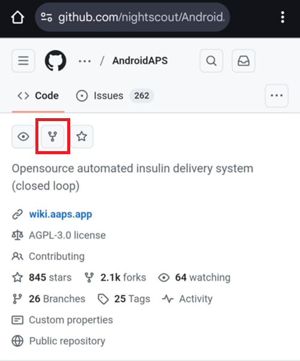
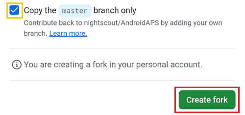

(github-fork)=

# Компилиране в браузъра – Стъпка 1: Създаване на ваш fork в GitHub

```{note}
Това е **Стъпка 1** от [Компилиране в браузъра](BrowserBuild.md).
```

You will need to store your personal Android Java Key and Google Drive information as secrets in GitHub (later in the process, we will explain how).

Тъй като това не може да стане в публичното хранилище (repository) на AndroidAPS, трябва да направите свое лично копие на изходния код (нарича се fork).

## Профил в GitHub

Ако все още нямате профил в GitHub, трябва да [създадете профил в GitHub](https://github.com/signup).  
Можете да се регистрирате с имейла си или с Google. Следвайте процеса на регистрация и потвърждаване.

Когато имате профил, [влезте в GitHub](https://github.com/login).

## Направете fork на AndroidAPS

Отворете официалното хранилище (repository) на AndroidAPS чрез [тази връзка](https://github.com/nightscout/AndroidAPS).

Докоснете иконата за fork. Така ще се създаде копие във вашия собствен профил.



Превъртете надолу на следващия екран и докоснете **Create Fork**.


*Note: you can **unselect** "Copy the master branch only" if you will want to build developer versions or customizations.*



```{note}
You cannot fork and you see this?<br/><br/>
**`No available destinations to fork this repository.`**<br/><br/>
<br/><br/>
This means you already have an existing fork of AndroidAPS.<br/>
Make sure it's up to date and continue to Preparation Steps.
```

```{warning}
**Никога не изтривайте своя fork, без да сте направили резервно копие на секретите си (secrets)!**
```

Сега GitHub показва вашето лично копие на AndroidAPS. Оставете този раздел на браузъра отворен.


----

**Следваща стъпка: [Стъпка 2 – Създаване на хранилище за ключове за подписване](BrowserBuildKeystore.md) →**
