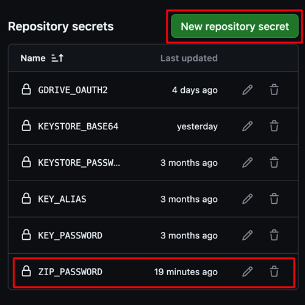

(aaps-ci-preparation)=

# Компилиране в браузъра – Стъпка 2: Създаване на хранилище за ключове за подписване

```{note}
Това е **Стъпка 2** от [Компилиране в браузъра](BrowserBuild.md). Първо изпълнете [Стъпка 1 – Създаване на ваш fork в GitHub](BrowserBuildFork.md).
```

AndroidAPS трябва да бъде подписан с лични ключове, записани в **Java KeyStore (JKS)**. Това е най-важният избор в целия процес, защото от него зависи дали по-късно ще можете да **обновявате** AAPS, без да го преинсталирате.

```{note}
В следващите стъпки ще запишете лична информация (хранилището си за ключове, а по-късно и достъпа до Google Drive) в GitHub като **секрети (secrets)**. Секретът (secret) е просто шифрована стойност, която може да чете само вашето собствено компилиране – никой друг, дори хората, които разглеждат вашия fork, не може да го види. Така компилираното приложение остава само ваше.
```

## Изберете как да създадете хранилището за ключове

Прочетете и двата варианта и изберете този, който отговаря на вашия случай.

### Вариант 1 – Създаване на ново хранилище за ключове (нови потребители)

Изберете този вариант, ако **някое** от следните е вярно:

- Компилирате AAPS **за първи път**.
- Нямате хранилище за ключове от предишно компилиране с Android Studio (на компютър).
- Забравили сте паролата или псевдонима (alias) на хранилището за ключове.

```{warning}
Компилирането на AAPS с **Вариант 1** създава съвсем ново хранилище за ключове, затова **няма да можете да обновите съществуващия си AAPS** направо върху него. За да преминете към новото компилирано приложение, трябва да експортирате настройките си, да деинсталирате стария AAPS, да инсталирате новия и отново да импортирате настройките си. Следвайте стъпките в [Преинсталиране на AAPS с ново хранилище за ключове](#reinstall-aaps).
```

**→ [Продължете с Вариант 1 – Създаване на ново хранилище за ключове](BrowserBuildO1.md)**

### Вариант 2 – Качване на съществуващото хранилище за ключове (настоящи / бивши потребители)

Изберете този вариант, ако **вече имате** хранилището за ключове `.jks`, което сте използвали при предишно компилиране на AAPS на компютър с Android Studio, **и** знаете паролата и псевдонима му (обикновено `key0`).

Така настоящата ви инсталация на AAPS може да продължи да се обновява: бъдещите актуализации ще използват същото хранилище за ключове.

**→ [Продължете с Вариант 2 – Качване на съществуващото хранилище за ключове](BrowserBuildO2.md)**

----

```{note}
На следващата страница ще изберете устройството си (компютър или iPhone). След това страницата за всяко устройство ви води стъпка по стъпка: как правилно да изтеглите и отворите подготвителния файл на това устройство и как да създадете хранилището си за ключове. Компилираното приложение AAPS ще бъде записано във вашия Google Drive.
```

**Следваща стъпка: изберете [Вариант 1](BrowserBuildO1.md) или [Вариант 2](BrowserBuildO2.md) по-горе, след това следвайте страницата за вашето устройство.**

----

(ci-keystore-export)=

## Експорт на хранилището за ключове (по избор)

Ако искате да експортирате записаното хранилище за ключове, използвайте този начин.

Този скрипт ще експортира данните на вече настроеното хранилище за ключове (от Вариант 1 или Вариант 2) като ZIP файл, защитен с парола, в папката `/AAPS/KeyStore` във вашия Google Drive.

```{warning}
Преди да използвате този начин за експорт, уверете се, че настройките на хранилището за ключове и на Google Drive са завършени.
```

### Стъпки:

1. **Добавете секрет (secret) за паролата на ZIP файла:**
   - Отидете в **Settings** → **Secrets and variables** → **Actions** на вашето хранилище (repository)
   - Натиснете **New repository secret**
   - В полето **Name** въведете: `ZIP_PASSWORD`
   - В полето **Secret** въведете своя парола за шифроване на ZIP файла
   - За паролата използвайте само английски букви и цифри (без специални знаци)
   - Натиснете **Add secret**

   

2. **Стартирайте workflow за експорт:**
   - Отидете в раздела **Actions** на вашето хранилище (repository)
   - Изберете **CI KeyStore Export**
   - Натиснете **Run workflow**
   - Експортираният ZIP файл с хранилището за ключове ще бъде записан във вашия Google Drive

   

   

```{toctree}
:hidden:

Вариант 1 – Създаване на ново хранилище за ключове <BrowserBuildO1.md>
Вариант 2 – Качване на съществуващото хранилище за ключове <BrowserBuildO2.md>
```
