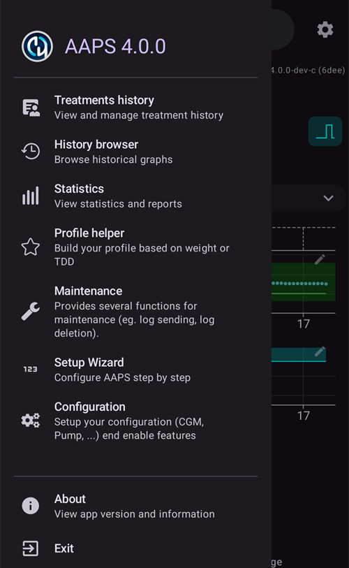

# Making changes to your AAPS configuration

След като сте завършили **[Съветника за настройване](../SettingUpAaps/SetupWizard.md)**, не е нужно да го стартирате целия отново, ако искате да промените само части от конфигурацията на **AAPS**.

Има три начина да промените конфигурацията на **AAPS**. Кой начин ще изберете, е въпрос на удобство или лично предпочитание, защото всеки от тях води до едни и същи настройки.

Те са следните:

1. Екранът **Конфигурация**,
2. Екранът **Настройки** или
3. **Настройките** на даден плъгин, отворени от неговата категория в **Конфигурация**.

Тук обясняваме коя опция е най-удобна за всяка ситуация:

## Конфигурация

Отворете **менюто** (☰) в горния ляв ъгъл на главния екран и изберете **Конфигурация**:

**Конфигурация** служи, за да **изберете кои плъгини са активни** – вашият CGM, помпа, APS алгоритъм, определяне на чувствителност, синхронизация и други, групирани по категории. Това е същият екран, който Съветникът за настройване е конфигурирал за вас.

Документацията за екрана Конфигурация ще намерите [тук](../SettingUpAaps/ConfigBuilder.md).

## Настройки

Докоснете иконата **Настройки** (зъбно колело) в горния десен ъгъл на главния екран. Така се отварят настройките на **всички включени плъгини на едно място**, групирани в раздели, които можете да разгъвате:

Този начин е удобен, ако не сте сигурни къде да търсите дадена опция за конфигурация, но може да е малко досаден, ако знаете, че искате да промените конфигурацията само на един конкретен плъгин.

Документацията за настройките ще намерите [тук](../SettingUpAaps/Preferences.md).

## Настройките на даден плъгин

В **Конфигурация** отворете категория и докоснете „**Настройки**“ под активния плъгин. Отваряте директно настройките **само на този плъгин**:

Например този начин е удобен, ако знаете, че искате да промените конфигурацията на помпата си: отворете **Конфигурация → Помпа**, след това докоснете „**Настройки**“ под избраната помпа.

Това е „пряк път“ към същите настройки, които се показват на общия екран **Настройки**.
