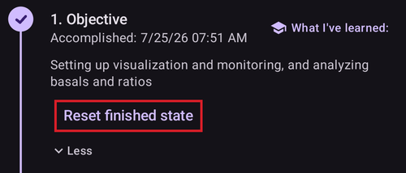

# Изпълнение на целите

**AAPS** има поредица от **Цели**, които трябва да изпълните. Те помагат на потребителя да премине постепенно от основния отворен кръг към хибриден затворен кръг и към всички функции на **AAPS**. Изпълнението на **Целите** трябва да гарантира, че:

* сте настроили всичко правилно в **AAPS**;
* сте научили основните функции на **AAPS**; и
* имате основно разбиране какво може вашата система, за да се чувствате по-уверени, когато използвате **AAPS**.

Когато **AAPS** е инсталиран за първи път, всяка цел трябва да бъде изпълнена, преди да преминете към следващата. Новите функции се отключват постепенно, докато напредвате през всяка **Цел**.

**Цели 1 до 8** ще ви преведат от настройката на **AAPS** на вашия смартфон до „основен“ хибриден затворен кръг. Това ще отнеме около 6 седмици. Можете да стигнете до **Цел 5** с виртуална помпа (а дотогава да използвате друг начин за подаване на инсулин). **Цели 9 и 10** са създадени, за да изпробвате по-напреднали функции на **AAPS**, с цел по-добър контрол на диабета. Изпълнението им отнема до 3 месеца, възможно и повече. Повече подробности за приблизителното разпределение на времето ще намерите тук: [Колко време ще отнеме?](#preparing-how-long-will-it-take)

As well as progressing through the **Objectives**, if required, you can also remove your progress and [go back to an earlier objective](#CompletingTheObjectives-go-back-in-objectives).

## Направете резервно копие на настройките си

```{admonition} Note
:class: note

Препоръчва се да експортирате настройките на **AAPS** след изпълнението на всяка **Цел**!
```

Силно препоръчваме да [експортирате настройките си](../Maintenance/ExportImportSettings.md) след изпълнението на всяка цел, за да не загубите напредъка си в **AAPS**. Този експорт създава **файл с настройки** (.json), който трябва да запазите на едно или повече сигурни места (напр. Google Drive, твърд диск, прикачен файл към имейл _и т.н._). Така се запазва целият ви напредък в **AAPS**. Ако загубите телефона си или случайно изтриете напредъка си, можете отново да заредите json файла в **AAPS**, като импортирате скорошен файл с настройки. Резервен **файл с настройки** е нужен и когато по някаква причина ви трябва нов смартфон за **AAPS** (нов модел, загубен или счупен телефон _и т.н._)

Файлът с **настройки** запазва не само напредъка ви през **Целите**, но и всички ваши настройки на **AAPS**, например **максималния болус** _и т.н._

Ако нямате резервно копие на настройките си и нещо се случи със смартфона ви с **AAPS**, ще трябва да започнете **Целите** отначало. Напредването през **Целите** отнема време. По-добре е да избегнете ситуация, в която трябва да ги изпълните отново, например защото сте загубили смартфона си.

(objectives-objective1)=
## Цел 1: Настройка на визуализацията и наблюдението, анализ на базала и коефициентите

**Цел 1** изисква потребителят да направи основната техническа настройка на **AAPS**. Не можете да напреднете, докато тази стъпка не бъде изпълнена.

- Изберете правилния CGM/FGM в [Конфигурация → Източник на КЗ](#Config-Builder-bg-source). Повече информация ще намерите в [Източник на КЗ](../Getting-Started/CompatiblesCgms.md).
- Изберете правилната помпа в [Конфигурация → Помпа](#Config-Builder-pump), за да може помпата ви да комуникира с **AAPS**. Изберете **виртуална помпа**, ако използвате модел помпа, за който няма драйвер в **AAPS** за затворен кръг, или ако искате да изпълните първите **Цели**, докато използвате друга система за подаване на инсулин. Повече информация ще намерите в [инсулинова помпа](../Getting-Started/CompatiblePumps.md).
- Ако използвате Nightscout:
  - Следвайте инструкциите на страницата [Nightscout](../SettingUpAaps/Nightscout.md), за да може **Nightscout** да получава и показва данните от **AAPS**.
  - Обърнете внимание, че адресът (URL) в **NSClientV3** трябва да е **_без_ „/api/v1/“** в края – вижте [Настройки → NSClientV3](#Preferences-nsclient).
- Ако използвате Tidepool:
  - Следвайте инструкциите на страницата [Tidepool](../SettingUpAaps/Tidepool.md), за да може **Tidepool** да получава и показва данните от **AAPS**.

Note: *You may need to wait for the next sensor glucose reading to arrive before **AAPS** will recognize it.*

(objectives-objective2)=
## Цел 2: Научете се как да управлявате AAPS

**Цел 2** изисква да изпълните няколко „задачи“, както е показано на екранната снимка по-долу. Всяка задача показва своето състояние (**1**): оранжевото „**Все още не е завършено**“ се сменя с „**Приключихме, Браво!**“, веднага щом **AAPS** регистрира действието. Докоснете **Подсказка** (**2**) под задачата, за да отворите съответната документация, ако все още не познавате дадено действие.


Задачите за изпълнение на **Цел 2** са:
- Задайте **Профил** на 90 % за продължителност 10 мин.
  - _Подсказка_: Докоснете името на профила си на главния екран, за да отворите екрана **Профил**. След това използвайте бутона **Активиране** (▶) и задайте процент и продължителност. Повече информация в [Смяна на профил и процент на профила](../DailyLifeWithAaps/ProfileSwitch-ProfilePercentage.md).
  - _Бележка_: **AAPS** не приема базални дози под 0,05 U/ч. If your **Profile** includes rates 0.05U/hr or lower you will need to create a temporary **Profile** with higher basal rates before completing this task. След като изпълните тази задача, превключете обратно към обичайния си **Профил**.
- Симулирайте „вземане на душ“, като [разкачите помпата си](#AapsScreens-loop-status) в **AAPS** за 1 ч.
  - _Подсказка_: натиснете иконата на кръга на главния екран, за да отворите диалога на кръга, след това изберете продължителност под **Разкачи помпата**.
- Завършете „душа“, като свържете отново помпата.
  - _Подсказка_: натиснете иконата „разкачена“, за да отворите отново диалога на кръга, и изберете **Свържи помпата**.
- Задайте ваша собствена [**Временна цел**](../DailyLifeWithAaps/TempTargets.md) с продължителност 10 мин.
  - _Подсказка_: натиснете целевия диапазон на главния екран, за да се покаже екранът за временна цел.
- Покажете съдържанието на плъгина **Кръг**.
  - _Подсказка_: отворете **Конфигурация → Кръг** и докоснете „**Отвори плъгин**“.
- Превъртете или увеличете/намалете графиката на КЗ, за да видите по-дълъг или по-кратък период от време.


(objectives-objective3)=
## Цел 3: Докажете знанията си

**Цел 3** изисква потребителят да премине изпит с въпроси с няколко възможни отговора. Изпитът проверява знанията ви за **AAPS**.

За някои потребители **Цел 3** е най-трудната за изпълнение. Моля, четете документацията на **AAPS** заедно с въпросите. Ако наистина не можете да продължите, след като сте потърсили отговора в документацията на **AAPS**, моля, потърсете „Objective 3“ в групата във [Facebook](https://www.facebook.com/groups/AndroidAPSUsers) или в [Discord](https://discord.gg/4fQUWHZ4Mw) (защото вероятно въпросът ви вече е бил зададен – и групата е отговорила на него). Тези групи могат да ви дадат приятелски подсказки или да ви насочат към съответната част от документацията на **AAPS**.

Междувременно:
- За да намалите броя на известията/решенията, които трябва да вземате (временни базални дози), докато сте в режим Отворен кръг, задайте широк целеви диапазон във вашия **Профил**, _напр._ 90–150 mg/dl или 5,0–8,5 mmol/l.
- Може да искате да зададете по-широка горна граница или дори да изключите отворения кръг през нощта.

За да продължите с **Цел 3**, докоснете ред с въпрос, за да го отворите. Моля, прочетете внимателно всеки въпрос и изберете своя отговор (отговори).

За всеки въпрос може да има повече от един правилен отговор! Ако изберете грешен отговор, въпросът ще бъде заключен за 1 час, преди да можете да се върнете и да отговорите отново. Имайте предвид, че при следващия опит редът на отговорите може да е променен. Целта е да ги четете внимателно и наистина да разбирате дали всеки отговор е верен или не.

```{admonition} __What happens if new question(s) are added to an Objective when I update to a newer version of AAPS?__
:class: note
От време на време в **AAPS** се добавят нови функции, които може да изискват нов въпрос в **Целите**, най-често в **Цел 3**. Затова всеки нов въпрос, добавен към **Цел 3**, ще бъде отбелязан като „неизпълнен“, защото **AAPS** ще изисква да отговорите на него. Не се притеснявайте: всяка **Цел** е независима, затова **няма да загубите функциите на AAPS, които вече имате**, стига другите **Цели** да остават изпълнени.
```

## Цел 4: Стартиране в режим Отворен кръг

Целта на **Цел 4** е да разберете колко често **AAPS** сравнява базалната доза на потребителя с нивата на глюкозата и препоръчва промени на временната базална доза. В тази **Цел** ще активирате отворения кръг за първи път. Ще приемете 20 предложени промени на временната базална доза и при нужда ще ги въведете ръчно в помпата си. Ще наблюдавате и ефекта на [**Временните цели**](../DailyLifeWithAaps/TempTargets.md). Ако все още не знаете как да зададете временна базална доза в **AAPS**, вижте действията с помпата в панела **Управление** ([Къде отиде разделът „Действия“?](#screens-action-tab)).

Минимално време за изпълнение на тази цел: **7 дни**. Това е задължително време за изчакване. Не можете да преминете към следващата **Цел**, дори ако вече сте въвели всички промени на базалната доза.

- Изберете отворен кръг, като натиснете [иконата на кръга](#AapsScreens-loop-status) на главния екран и изберете **Отворен кръг** като текущ режим.
- Изпълнете ръчно поне 20 от предложенията за временна базална доза за период от 7 дни: въведете ги във (физическата) си помпа и потвърдете в AAPS, че сте ги приели. Уверете се, че тези промени на базалната доза се показват в **AAPS** и в **Nightscout**.
- Използвайте [**Временни цели**](../DailyLifeWithAaps/TempTargets.md), когато е необходимо. След лечение на хипогликемия използвайте предварително зададената „Хипо временна цел“, за да не позволите на системата да коригира прекалено при отскока.
- Ако на този етап все още сте в [Опростен режим](#preferences-simple-mode), вероятно сега е подходящ момент да го изключите.

To reduce the number of proposed basal rate changes while in Open Loop, you can still use the tips described in [**Objective 3**](#objectives-objective3). Освен това можете да промените минималния процент за препоръчаните промени на базалната доза с настройката „**Минимална промяна в отворен кръг**“ в **Настройки → Кръг**. Колкото по-висока е стойността, толкова по-малко известия за промени ще получавате.


```{admonition} Note
:class: note

Не е нужно да изпълнявате всяка препоръка на системата!
```
(objectives-objective5)=
## Цел 5: Разбиране на режима Отворен кръг, включително препоръките му за временен базал

В **Цел 5** ще започнете да разбирате как се изчисляват препоръките за временен базал. Това включва [логиката за определяне на базала](#aaps-screens-how-predictions-become-a-dosing-decision), анализ на ефекта чрез наблюдение на [линиите на прогнозата на **главния екран на AAPS**](#aaps-screens-prediction-lines) (или в Nightscout) и преглед на подробните изчисления на екрана на плъгина **OpenAPS SMB** (**Конфигурация → APS → Отвори плъгин**).

Приблизително време за изпълнение на тази цел: **7 дни**.

This **Objective** requires you to determine and set your “Maximum basal rate” (max-basal) value as described in [OpenAPS-features](#Open-APS-features-max-u-h-a-temp-basal-can-be-set-to). Тази стойност може да се зададе в [Настройки → OpenAPS SMB](#Preferences-openaps-smb-settings). В [опростен режим](#preferences-simple-mode) **AAPS** задава тази стойност автоматично и не е нужно да я променяте. Ако все още използвате виртуална помпа, уверете се, че тази настройка за безопасност е зададена и в **AAPS**, и във вашата инсулинова помпа.

Може да искате да зададете [целевата КЗ в **Профила**](#profile-glucose-targets) по-висока от обикновено, докато свикнете с изчисленията и настройките на **AAPS**. Можете да опитате да зададете по-тесен диапазон за **целевата КЗ** във вашия **Профил** (например широк 1 mmol/l или по-малко [20 mg/dl или по-малко]) и да наблюдавате резултата.


```{admonition} If you have been using a virtual pump, change to a real insulin pump now!
:class: note

Ако използвате отворен кръг с виртуална помпа, **спрете тук**. Only tap **Verify** at the end of this **Objective** once you have changed to using a "real" pump which delivers insulin.

```


(objectives-objective6)=
## Цел 6: Стартиране на Затворен кръг със спиране на базала при ниска КЗ


```{admonition} Closed loop will not correct high **BG** values in **Objective 6** as it is limited to **Low Glucose Suspend** only!
:class: note
Все още ще трябва сами да коригирате високите стойности на КЗ (ръчно, с корекции с помпата или с писалка)!
```

В **Цел 6** ще затворите кръга и ще активирате режима му **Спиране на базал при ниска КЗ** (LGS), докато [max IOB](#Open-APS-features-maximum-total-iob-openaps-cant-go-over) е зададен на нула. Трябва да останете в режим LGS 5 дни, за да изпълните тази **цел**. Използвайте това време, за да проверите дали настройките на вашия **Профил** са точни и дали LGS не се задейства твърде често.

Минимално време за изпълнение на тази цел: **5 дни**. Това е задължително време за изчакване. Не можете да преминете към следващата **Цел**, преди да изтече това време.

Много е важно текущият ви **Профил** (базал, ISF, IC) да е добре проверен, преди да затворите кръга в режим **LGS**. Неправилни настройки на **Профила** могат да ви доведат до хипогликемии, които трябва да лекувате ръчно. Точният **Профил** ще намали нуждата от лечение на ниска КЗ през периода от 5 дни.

**Ако все още имате чести или тежки епизоди на ниска глюкоза, помислете дали да не прецизирате [DIA на вашия тип инсулин](#Config-Builder-insulin-dia), базала, ISF и въглехидратните коефициенти.** Вижте групата във [Facebook](https://www.facebook.com/groups/AndroidAPSUsers) или в [Discord](https://discord.gg/4fQUWHZ4Mw), където има много дискусии по тази тема.


По време на **Цел 6** **AAPS** ще промени настройката maxIOB на нула. **Тази промяна ще спре да важи, когато преминете към Цел 7.**

Това означава, че когато сте на **Цел 6** и нивата на глюкозата от сензора падат, **AAPS** ще намали подаването на базален инсулин вместо вас. Но ако нивата на глюкозата от сензора се покачват, **AAPS** ще повиши базалната доза над стойността в **Профила** само ако **базалният IOB** е отрицателен в резултат на предишно **LGS**. В противен случай **AAPS** няма да повиши базала над текущата стойност в профила, дори ако нивата на глюкозата се покачват. Тази предпазна мярка е, за да се избегнат хипогликемии, докато се учите да използвате **AAPS**.

**Затова трябва да коригирате високите стойности на глюкозата ръчно, с болуси за корекция.**

- Ако вашият IOB е отрицателен (вижте екранната снимка по-долу), в **Цел 6** може да се задейства временна базална доза (TBR) > 100 %.


- Задайте целевия диапазон малко по-високо, отколкото обикновено бихте искали, само за по-сигурно и за да имате резерв за безопасност.
- Включете режима „Спиране на базал при ниска КЗ“, като натиснете иконата на кръга на главния екран и изберете **Спиране на базал при ниска КЗ** като текущ режим.
- Следете активните временни базали чрез тюркоазения текст за базала на главния екран (OVERVIEW) или чрез тюркоазения базал на графиката на главния екран.
- Временно може да имате скокове на КЗ след лекувани хипогликемии, без кръгът да може да повиши базала при отскока.

(objectives-objective7)=
## Цел 7: Настройване на Затворения кръг, повишаване на maxIOB над 0 и постепенно понижаване на целевите стойности на КЗ

За да изпълните **Цел 7**, трябва да затворите кръга и да повишите [maxIOB](#Open-APS-features-maximum-total-iob-openaps-cant-go-over). В **Цел 6** **maxIOB** беше автоматично нулиран заради режима Спиране на базал при ниска КЗ. Това вече не е така. **AAPS** ще започне да използва зададената от вас стойност maxIOB, за да коригира високите стойности на глюкозата. В [опростен режим](#preferences-simple-mode) **AAPS** задава maxIOB автоматично и не е нужно да го променяте.

Минимално време за изпълнение на тази цел: **1 ден**. Това е задължително време за изчакване. Не можете да преминете към следващата **Цел**, докато не изтече този период.

- Изберете **Затворен кръг**, като натиснете [иконата на кръга](#AapsScreens-loop-status) на главния екран и изберете **Затворен кръг** като текущ режим. Останете в режим **Затворен кръг** за период от 1 ден.

- Slowly raise your 'Max IOB for SMB' (in OpenAPS called 'max-iob') above 0, until you find the settings that work best for you.

Препоръчителната стойност по подразбиране за тази настройка е „**среден болус за хранене + 3 x максимален дневен базал**“, където „максимален дневен базал“ е най-голямата часова стойност във всеки отрязък от деня.


Тази препоръка трябва да се приема като отправна точка. Ако използвате това правило, но AAPS подава твърде много инсулин, когато нивата на глюкозата се покачват, може да е нужно:
* lower the "Max IOB for SMB" value;
* прегледайте настройките на вашия **Профил**, като правите само по една промяна наведнъж.

Или, ако сте много инсулинорезистентни, повишавайте стойността на **maxIOB** много внимателно.

Когато сте сигурни колко **maxIOB** отговаря на начина, по който работи вашият затворен кръг, понижете **целевите стойности на КЗ** до желаното ниво.

(objectives-objective8)=
## Цел 8: Настройване на базала и коефициентите, ако е нужно, и след това активиране на Autosens

В тази **цел** ще прегледате отново как работи вашият **Профил** и ще използвате функцията [Autosens](#Open-APS-features-autosens) като показател за грешни настройки.

Минимално време за изпълнение на тази цел: **7 дни**. Това е задължително време за изчакване. Не можете да преминете към следващата **Цел**, докато не изтече този период.

Включете [Autosens](../DailyLifeWithAaps/KeyAapsFeatures.md) за период от 7 дни (в [опростен режим](#preferences-simple-mode) е включен по подразбиране) и наблюдавайте [бялата линия на графиката на **главния екран**](#AapsScreens-section-g-additional-graphs), която показва как инсулиновата ви чувствителност се повишава или понижава заради физическо натоварване, хормони и т.н. Следете екрана на плъгина **OpenAPS SMB** (**Конфигурация → APS → Отвори плъгин**), който показва как **AAPS** съответно коригира чувствителността, базалите и целите.

Сега е подходящ момент да прегледате настройките си за [Определяне на чувствителност](#Config-Builder-sensitivity-detection). Можете да видите чувствителността си на главния екран в [допълнителна графика](#AapsScreens-section-g-additional-graphs).

Освен това можете еднократно да използвате [Autotune](#autotune-how-autotune-calculates-adjustments), за да проверите дали базалите ви са все още точни, или да направите традиционен базален тест.

(objectives-objective9)=
## Цел 9: Разрешаване на допълнителни функции на oref1 за използване през деня, като супер микро болус (SMB)

В **Цел 9** ще се запознаете със **„Super Micro Bolus (SMB)“** и ще го използвате като основна функция. След като прочетете задължителните материали, ще разбирате добре какво са SMB, как работят и защо базалът временно се спира на нула след подаване на SMB (нулев временен базал).

Минимално време за изпълнение на тази цел: **28 дни**. Това е задължително време за изчакване. Не можете да преминете към следващата Цел, преди това време да изтече.

- [Разделът за SMB в тази документация](#Open-APS-features-super-micro-bolus-smb) и [описанието на oref1 в документацията на openAPS](https://openaps.readthedocs.io/en/latest/docs/Customize-Iterate/oref1.html) са задължителни за прочитане, за да разберете **SMB** и идеята за **нулев временен базал (zero-temping)**.
- След това можете да [повишите maxIOB](#Open-APS-features-maximum-total-iob-openaps-cant-go-over), за да работят **SMB** по-ефективно. maxIOB вече включва целия **IOB**, а не само натрупания базал. Тази граница спира **SMB**, докато IOB не падне под тази стойност (_напр._ **maxIOB** е 7 U и за хранене е подаден болус от 8 U: SMB ще бъдат спрени и няма да се подават, докато **IOB** не падне под 7 U). Добро начало е **maxIOB** = **среден болус за хранене + 3 x максимален дневен базал**, където „максимален дневен базал“ е най-голямата часова стойност във всеки отрязък от деня. See [objective 7](#objectives-objective7) as reference.
- Оценете скоростта на усвояване на въглехидратите и помислете дали да промените параметъра „min_5m_carbimpact“ в [Настройки → Настройки за абсорбция → min_5m_carbimpact](#Preferences-min_5m_carbimpact), ако според вас усвояването е твърде бавно или твърде бързо.

(objectives-objective10)=
## Цел 10: Автоматизация

**Автоматизациите** стават достъпни, когато започнете **Цел 10**.

Минимално време за изпълнение на тази цел: **28 дни**. Това е задължително време за изчакване. Не можете да преминете към следващата Цел, преди това време да изтече.

Първо прочетете страницата от документацията [Автоматизация](../DailyLifeWithAaps/Automations.md).

Настройте най-простото правило за автоматизация, например да се покаже известие на Android след няколко минути:
- Отворете **Управление → Автоматизация** и докоснете бутона **+** (**Добавяне на правило**).
- Въведете **Име на правилото**, например „Моето първо известие от автоматизация“.
- Под **Условие** докоснете „**РЕД**“.
  - Докоснете „**Добавяне на тригер**“ и изберете „**Време**“. **AAPS** създава запис за днес с текущия час.
  - Променете часа така, че правилото да се задейства след няколко минути.
  - Докоснете иконата **Запиши** (горе вдясно), за да се върнете към правилото.
- Под **Действие** докоснете „**ДОБ**“ и изберете „**Известие**“.
  - Въведете съобщение в картата на действието, например „Моята първа автоматизация“.
- Докоснете иконата **Запиши** (горе вдясно) и се уверете, че правилото е **Включено**.
- Изчакайте, докато настъпи времето и се появи известието (имайте предвид, че в зависимост от телефона то може да закъснее с няколко минути)

След това можете да опитате да настроите по-полезна **Автоматизация**. Страницата от документацията дава няколко примера. Можете да потърсите и екранни снимки на „Automation“ в групата във [Facebook](https://www.facebook.com/groups/AndroidAPSUsers). Има и отделен канал в общността в [Discord](https://discord.gg/4fQUWHZ4Mw).

Например, ако всяка сутрин закусвате едно и също по едно и също време преди училище/работа, можете да създадете **Автоматизация**, например „before-breakfast-target“, която задава малко по-ниска **Временна цел** 30 минути преди закуска. В такъв случай условието ви вероятно ще включва „Повтарящо се време“, което се състои от избор на определени дни от седмицата (понеделник, вторник, сряда, четвъртък, петък) и определен час (06:30 ч.). Действието ще бъде „Стартирай временна цел“ с по-ниска от обичайната целева стойност и продължителност 30 минути.

## Когато всички цели са изпълнени

Когато изпълните всички **Цели**, списъкът показва всяка от тях с отметка и датата, на която е изпълнена. Елементът **Цели** изчезва от долната навигация; все пак можете да отворите списъка с **Конфигурация → Ограничения → Цели → Отвори плъгин**.


Натиснете „**Повече**“ под дадена цел, за да видите отново нейните задачи:


(CompletingTheObjectives-go-back-in-objectives)=
## Връщане назад в целите

Ако по някаква причина искате да се върнете назад в **Целите**, отворете завършената **Цел** с „**Повече**“ и докоснете „**Изчисти завършените**“:



По същия начин **Целта**, върху която работите в момента, може да бъде започната отначало с „**Изчисти стартираните**“.
