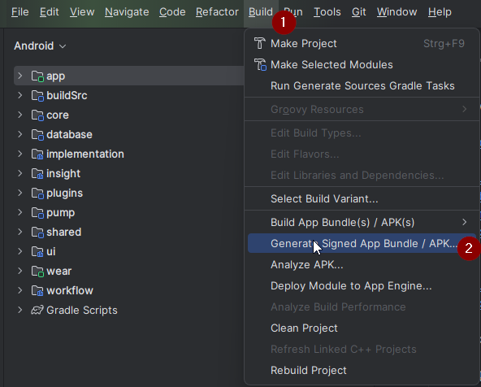
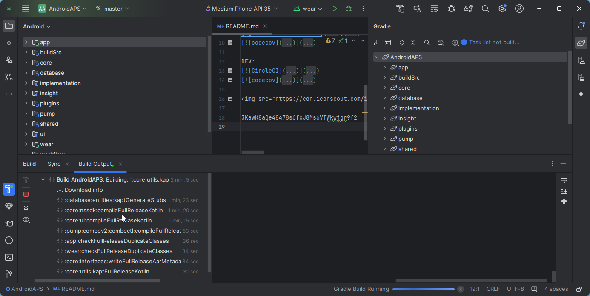

<!-- Android Studio Build, FKA Computer Build. Preserve filenames to avoid breaking URLs. -->

# Компилиране с Android Studio

Това е традиционният начин за компилиране на приложението AAPS.

Можете да компилирате приложението без компютър чрез метода [Компилиране в браузъра](./BrowserBuild.md).

## Компилирайте сами, вместо да изтегляте

**Приложението AAPS (файл apk) не може да бъде изтеглено готово заради правилата за медицинските изделия. Законно е да компилирате приложението за собствена употреба, но НЕ БИВА да давате копие на други хора!**

Вижте [страницата с често задавани въпроси](../UsefulLinks/FAQ.md) за подробности.

---

(Building-APK-recommended-specification-of-computer-for-building-apk-file)=
## Изисквания към компютъра и софтуера за компилиране на AAPS

* За компилиране на apk файла може да е нужна определена версия на **[Android Studio](https://developer.android.com/studio/)**. Вижте таблицата по-долу:

| Версия на AAPS          | Препоръчителна<br/>версия на<br/>Android Studio | Алтернативна<br/>версия на<br/>Android Studio | Gradle | JVM |
| ----------------------- | ----------------------------------------------------------- | --------------------------------------------------------- | ------ |:--- |
| 2.6.2                   | 3.6.1                                                       |                                                           | 5.6.4  | 11  |
| 2.8.2.1                 | 4.1.1                                                       |                                                           | 6.1.1  | 13  |
| [3.1.0.3](#version3100) | 2020.3.1                                                    | изпробвано до Quail 4                                     | 7.3.3  | 17  |
| [3.2.0.4](#version3204) | Hedgehog (2023.1.1)                                         | изпробвано до Quail 4                                     | 8.2    | 17  |
| [3.3.1.3](#version3300) | Ladybug Feature Drop (2024.2.2)                             | изпробвано до Quail 4                                     | 8.10   | 21  |
| [3.3.2](#version3300)   | Meerkat (2024.3.1)                                          | изпробвано до Quail 4                                     | 8.11.1 | 21  |
| [3.3.2.1](#version3321) | Narwhal (2025.1.2)                                          | изпробвано до Quail 4                                     | 8.13   | 21  |
| [3.4.2.6](#version3426) | Panda 2 (2025.3.2)                                          | изпробвано до Quail 4                                     | 9      | 21  |
| [4.0.0](#version400)    | Rabbit 2 (2026.2.2)                                         | Latest                                                    | 9.8    | 21  |

„Препоръчителната версия“ идва с подходящата версия на JVM. Препоръчителната версия е и най-ниската версия, с която можете да компилирате **AAPS**. **НЯМА** да можете да компилирате с версия, по-стара от „препоръчителната“. Ако използвате друга версия, може да срещнете проблеми, свързани с версията на JVM. Вижте страницата [Отстраняване на неизправности в Android Studio](#troubleshooting_androidstudio-uncommitted-changes) за помощ при решаването на тези проблеми. Ако текущата ви версия на Android Studio не е в таблицата, първо трябва да я актуализирате.

Версията на Gradle е свързана с изходния код. Винаги ще получите правилната версия на Gradle, когато изтегляте или актуализирате изходния код. Тя е посочена тук само за справка, не е нужно да правите нищо с нея.

* [32-битови системи Windows](#troubleshooting_androidstudio-unable-to-start-daemon-process) не се поддържат от Android Studio. Моля, имайте предвид, че **64-битов процесор и 64-битова операционна система са задължително условие.** Ако вашата система НЕ отговаря на това условие, трябва да смените съответния хардуер или софтуер, или цялата система.

<table class="tg">
<tbody>
  <tr>
    <th class="tg-baqh">ОС (само 64-битова)</th>
    <td class="tg-baqh">Windows 10 or higher</td>
    <td class="tg-baqh">macOS 12 or higher</td>
    <td class="tg-baqh">Any Linux distribution that supports Gnome, KDE, or Unity DE;&nbsp;&nbsp;GNU C Library (glibc) 2.31 or later</td>
  </tr>
  <tr>
    <th class="tg-baqh"><p align="center">Процесор (само 64-битов)</th>
    <td class="tg-baqh">x86_64 CPU from 2017 or newer (Intel 8th generation Core i5, AMD Ryzen, or newer) with <a href="https://developer.android.com/studio/install" target="_blank" rel="noopener noreferrer">virtualization support</a> (Intel VT-x or AMD-V) enabled in the BIOS</td>
    <td class="tg-baqh">Apple Silicon (M1 or newer), or 6th generation Intel Core or newer (support for Intel Macs is being phased out)</td>
    <td class="tg-baqh">x86_64 CPU from 2017 or newer (Intel 8th generation Core i5, AMD Ryzen, or newer) with virtualization support (Intel VT-x or AMD-V) enabled in the BIOS</td>
  </tr>
  <tr>
    <th class="tg-baqh"><p align="center">Оперативна памет (RAM)</th>
    <td class="tg-baqh" colspan="3"><p align="center">16GB or more (8GB is the strict minimum for Android Studio alone, 32GB is recommended)</td>
  </tr>
  <tr>
    <th class="tg-baqh"><p align="center">Диск</th>
    <td class="tg-baqh" colspan="3"><p align="center">At least 32GB free space. Препоръчва се SSD.</td>
  </tr>
  <tr>
    <th class="tg-baqh"><p align="center">Резолюция</th>
    <td class="tg-baqh" colspan="3"><p align="center">1280 x 800 minimum (1920 x 1080 recommended)<br></td>
  </tr>
  <tr>
    <th class="tg-baqh"><p align="center">Интернет</th>
    <td class="tg-baqh" colspan="3"><p align="center">Широколентов</td>
  </tr>
</tbody>
</table>

**Силно се препоръчва (не е задължително) да използвате SSD (Solid State Disk) вместо HDD (Hard Disk Drive), защото компилирането на apk файла на AAPS ще отнеме по-малко време.**  Все пак можете да използвате HDD, когато компилирате apk файла на **AAPS**. Ако го направите, компилирането може да отнеме много време, но след като започне, можете да го оставите да работи без надзор.

## Помощ и поддръжка по време на компилирането

Ако срещнете трудности при компилирането на приложението **AAPS**, има специален раздел [**Отстраняване на неизправности в Android Studio**](../GettingHelp/TroubleshootingAndroidStudio.md) – моля, първо прочетете него.

Ако смятате, че нещо в инструкциите за компилиране е грешно, липсва или е неясно, или все още имате трудности, моля, обърнете се към групата на потребителите на **AAPS** във [Facebook](https://www.facebook.com/groups/AndroidAPSUsers) или в [Discord](https://discord.gg/4fQUWHZ4Mw). Ако искате сами да промените нещо (да обновите снимки на екрана _и т.н._), моля, изпратете [pull request (PR)](../SupportingAaps/HowToEditTheDocs.md).

## Ръководство стъпка по стъпка за компилиране на приложението AAPS

```{admonition} WARNING
:class: warning
Ако вече сте компилирали AAPS, не е нужно да изпълнявате отново всички следващи стъпки.
Преминете направо към [ръководството за актуализиране](../Maintenance/UpdateToNewVersion.md)!
```

```{contents} The overall steps for building the **AAPS** apk file
:depth: 1
:local: true
```

В това ръководство ще намерите _примерни_ екранни снимки от компилирането на apk файла на **AAPS**. Тъй като **Android Studio** – програмата, с която компилираме apk файла на **AAPS** – редовно се актуализира, тези екранни снимки може да не са еднакви с вашата инсталация, но все пак би трябвало да можете да ги следвате.

Since **Android Studio** runs on Windows, Mac OS X and Linux platforms, there might also be minor differences in the steps for the different  platforms.

(install-git-if-you-dont-have-it)=
### Инсталиране на Git

```{admonition} Why Git? 
:class: dropdown

Git е известен като „_система за контрол на версиите_“ (Versioning Control System, VCS).\
Git е програма, която ви позволява да проследявате промените в кода и да работите съвместно с други хора. Ще използвате Git, за да направите копие на изходния код на **AAPS** от уебсайта GitHub на своя компютър. Then, you will use Android Studio on your computer to build the **AAPS** application (apk). 
```

(BuildingAaps-steps-for-installing-git)=
#### Стъпки за инсталиране на Git

1.  Проверете дали вече нямате инсталиран **Git**. Можете да направите това, като напишете „git“ в лентата за търсене на Windows – ако видите **„Git bash“** или друга форма на Git, той вече е инсталиран и можете да преминете направо към [инсталирането на Android Studio](#install-android-studio):


2. Ако нямате инсталиран Git, изтеглете и инсталирайте най-новата версия за своята система от раздела „Download“ [**тук**](https://git-scm.com/downloads). Всяка нова версия на Git би трябвало да работи. Изберете правилната версия според системата си: Mac, Windows или Linux.

**Бележка за потребителите на Mac:** уеб страницата на Git ще ви насочи и към инсталиране на допълнителна програма, наречена „homebrew“, която помага при инсталирането. Ако инсталирате Git чрез homebrew, не е нужно да променяте никакви настройки.

(Make_a_note_of_Git_path)=

* По време на инсталирането, когато бъдете попитани „select destination location“ (изберете място за инсталиране), запишете си _къде_ се инсталира Git („**пътя за инсталиране**“) – ще трябва да го проверите в следващата стъпка. Той ще бъде нещо подобно на „C:\Program Files\Git\cmd\git.exe“

*  Докато преминавате през стъпките на инсталирането на Git, просто приемайте всички опции по подразбиране.

*  Ако след инсталирането сте забравили да запишете къде е инсталиран Git, можете да го намерите така: въведете „git“ в лентата за търсене на компютъра, щракнете с десния бутон върху „Git bash“, изберете „open file location“ (отваряне на местоположението на файла) и задръжте мишката над иконата „Git bash“ – така ще видите къде е инсталиран.

* Рестартирайте компютъра преди следващата стъпка.

(Building-APK-install-android-studio)=
### Инсталиране на Android Studio

- **По време на следващите стъпки трябва през цялото време да имате връзка с интернет, защото Android Studio изтегля няколко актуализации**

```{admonition} What is Android Studio?
:class: dropdown
Android Studio е програма, която работи на компютъра ви. Тя ви позволява да изтегляте изходен код от интернет (с помощта на Git) и да компилирате приложения за смартфон (и за смарт часовник). Не можете да „счупите“ текущата версия на **AAPS** със затворен кръг, която може би работи на смартфона ви, като компилирате ново или актуализирано приложение на компютъра си с Android Studio – това са напълно отделни процеси. 
```

Едно от най-важните неща при инсталирането на Android Studio е: **бъдете търпеливи!** По време на инсталирането и настройката Android Studio изтегля много неща, което отнема време.

```{admonition} Different UI
:class: warning
Important note: Android Studio changed its UI during the last releases. Това ръководство показва стъпките с *новия интерфейс* (new UI). Екранните снимки са направени с „Ladybug“, така че по-новите версии може да изглеждат малко по-различно. Ако все още използвате стария интерфейс, може първо да превключите Android Studio към новия интерфейс, като следвате [тези инструкции](#computerbuild-NewUI).
```

Версията на Android Studio е много важна. Вижте [инструкциите по-горе](#Building-APK-recommended-specification-of-computer-for-building-apk-file), за да изберете правилната версия на Android Studio.

Изтеглете [текущата версия на Android Studio](https://developer.android.com/studio) или по-стара версия от [**Archives**](https://developer.android.com/studio/archive) (архива) и приемете условията за изтегляне.


Когато изтеглянето приключи, стартирайте изтегленото приложение, за да го инсталирате на компютъра. Може да се наложи да приемете/потвърдите някои предупреждения на Windows за изтеглени приложения!

Инсталирайте Android Studio, като щраквате върху „Next“, както е показано на следващите екранни снимки. **Не** е нужно да променяте никакви настройки!


If you want to save hard disk space, you can uncheck Android Virtual Device: it is not used for building **AAPS**.


Сега щракнете върху „Install“:


Когато приключи, натиснете „Next“


В последната стъпка щракнете върху „Finished“, за да стартирате Android Studio за първи път.


Ще бъдете попитани дали искате да помогнете за подобряването на Android Studio. Изберете опцията, която предпочитате. Това няма да промени нищо в следващите стъпки.


Началният екран ви приветства в инсталирането на Android Studio. Натиснете „Next“.


Изберете „Standard“ като тип инсталация.


Проверете настройките, като отново щракнете върху „Next“.


Сега трябва да приемете лицензионните споразумения. Вляво има два раздела (1 + 3), които трябва да изберете един след друг, и за всеки да изберете „Accept“ (2 + 4) вдясно.

След това можете да щракнете върху бутона „Finish“ (5).


Сега ще бъдат изтеглени и инсталирани някои пакети за Android. Бъдете търпеливи и изчакайте.

Когато приключи, ще видите следния екран, в който отново можете да изберете „Finish“.


Сега ще видите началния екран (Welcome) на Android Studio.


(Building-APK-download-AAPS-code)=
### Изтегляне на кода на AAPS

```{admonition} Why can it take a long time to download the AAPS code?
:class: dropdown

Първия път, когато **AAPS** се изтегля, Android Studio ще се свърже през интернет с уебсайта GitHub, за да изтегли изходния код на **AAPS**. Това би трябвало да отнеме около 1 минута. 

След това Android Studio ще използва **Gradle** (инструмент за разработка на приложения за Android), за да определи другите компоненти, които са нужни за компилирането на компютъра ви. 
```

На началния екран на Android Studio (Welcome) проверете дали вляво е маркирано „**Projects**“ (1).

След това натиснете „**Clone Repository**“ (2) вдясно:


Сега ще кажем на Android Studio откъде да вземе кода:


* „Repository URL“ трябва да е избрано (по подразбиране) вляво (1).
* „Git“ трябва да е избран (по подразбиране) като система за контрол на версиите (2).
* Сега копирайте този URL адрес:
    ```
    https://github.com/nightscout/AndroidAPS.git
    ```
    и го поставете в текстовото поле URL (3).

* Проверете дали папката (по подразбиране) за записване на клонирания код все още не съществува на компютъра ви (4). Можете да го промените на друга папка, но запомнете къде сте го запазили!
* Сега щракнете върху бутона „Clone“ (5).

```{admonition} INFORMATION
:class: note
Запишете си папката. Там се съхранява изходният ви код!
```

Сега ще видите екран, който показва, че хранилището се клонира:


В някакъв момент Android Studio ще се затвори и ще стартира отново. Може да бъдете попитани дали искате да се доверите на проекта. Щракнете върху „Trust project“:

  


Само за потребители на Windows: ако защитната стена поиска разрешение, разрешете достъпа:

 

След като хранилището бъде клонирано успешно, Android Studio ще отвори клонирания проект.

(computerbuild-NewUI)=
```{admonition} New UI
:class: note
Android Studio промени интерфейса си наскоро. Новите инсталации на Android Studio използват новия интерфейс по подразбиране!

Само ако вашето Android Studio изглежда различно, може да трябва да превключите към новия интерфейс:
Натиснете менюто (hamburger menu) горе вляво и изберете **Settings** (или **Preferences** на компютри на Apple).
В **Appearance & Behavior** отидете на **New UI** и поставете отметка на **Enable new UI**. След това рестартирайте Android Studio, за да започнете да го използвате.

Ако не намирате опцията **New UI**, не се притеснявайте: вече използвате новия интерфейс!
```


Когато Android Studio се отвори, изчакайте търпеливо (това може да отнеме няколко минути) и особено **не** актуализирайте проекта, както се предлага в изскачащия прозорец.

Android Studio автоматично ще стартира „Gradle project sync“, което ще отнеме няколко минути. Можете да видите, че (все още) работи:


```{admonition} NEVER UPDATE GRADLE!
:class: warning

Android Studio може да препоръча актуализиране на системата gradle. **Никога не актуализирайте gradle!** Това ще доведе до проблеми.
```

Само на компютри с Windows: Може да получите известие, че работи Windows Defender: Натиснете **Automatically** и потвърдете – това ще направи компилирането по-бързо!


Можете да оставите синхронизацията на Gradle да работи и вече да следвате следващите стъпки.

(Building-APK-set-git-path-in-preferences)=
### Задаване на пътя до Git в настройките на Android Studio

Сега ще кажем на Android Studio къде да намери Git, който инсталирахте [по-рано](#install-git-if-you-dont-have-it).

* Само за потребители на Windows: Уверете се, че сте рестартирали компютъра си след [инсталирането на Git](#install-git-if-you-dont-have-it). Ако не, рестартирайте сега и отворете отново Android Studio

В горния ляв ъгъл на **Android Studio** отворете менюто (hamburger menu) и отидете на **File** > **Settings** (на Windows) или **Android Studio** > **Preferences** (на Mac). Това отваря следния прозорец: натиснете, за да разгънете падащия списък **Version Control** (1), и изберете **Git** (2)


Проверете дали **Android Studio** може автоматично да намери правилния **Path to Git executable** (път до изпълнимия файл на Git), като натиснете бутона „Test“ (1):


Ако автоматичната настройка е успешна, текущата ви версия на **Git** ще се покаже до пътя.

   


Ако установите, че **git.exe** не се намира автоматично или че натискането на „Test“ води до грешка, можете:
* да въведете ръчно пътя, който записахте [по-рано](#BuildingAaps-steps-for-installing-git), или
* click on the folder icon (1) and manually navigate to the directory where **git.exe** was installed [earlier](#BuildingAaps-steps-for-installing-git)
* Проверете настройките си с бутона **Test**!

  

(Building-APK-generate-signed-apk)=
### Компилиране на „подписания“ (signed) APK на AAPS

```{admonition} Why does the AAPS app need to be "signed"?
:class: dropdown

Android изисква всяко приложение да бъде _подписано_, за да се гарантира, че по-късно то може да бъде актуализирано само от същия доверен източник, който е издал оригиналното приложение. За повече информация по тази тема следвайте [тази връзка](https://developer.android.com/studio/publish/app-signing.html#generate-key). 

За нашите цели това просто означава, че създаваме файл за подписване, т.нар. „хранилище за ключове“ (keystore), и го използваме, когато компилираме приложението **AAPS**.
```


**Важно: Преди да продължите, се уверете, че синхронизирането на gradle (gradle sync) е завършило успешно!**


Щракнете върху менюто (hamburger menu) горе вляво, за да отворите лентата с менюта. Изберете **Build** (1), след това изберете **Generate Signed App Bundle / APK** (2)



Изберете „APK“ (1) вместо „Android App Bundle“ и натиснете „Next“ (2):


На следващия екран се уверете, че „Module“ е зададено на „AndroidAPS.app“ (1). Частта преди „.app“ е името на папката, в която клонирахте кода.

(Building-APK-wearapk)=
```{admonition} INFORMATION!
:class: note
Ако искате да създадете apk файла за часовника си, сега трябва да изберете AndroidAPS.wear!
```


Щракнете върху „Create new...“ (2), за да започнете да създавате хранилището за ключове.

```{admonition} INFORMATION!
:class: note
Ще трябва да създадете хранилището за ключове (keystore) само веднъж.
If you have built AAPS before, do NOT create a new keystore but select your existing one and enter its passwords!
```

**_Бележка:_** Хранилището за ключове (keystore) е файл, в който се съхранява информацията за подписване на приложението. То е шифровано и информацията е защитена с пароли.


* Щракнете върху символа на „папка“ (1), за да изберете място на компютъра за хранилището за ключове.

  **Не** използвайте папката, в която сте записали изходния си код, а някоя папка, която бихте прехвърлили и на нов компютър.

```{admonition} WARNING!
:class: warning
Запишете си къде се съхранява вашето хранилище за ключове (keystore). Ще ви трябва, когато компилирате следващата актуализация на AndroidAPS!
```

* Сега изберете проста парола (и я запишете), въведете я в полето за парола (2) и я потвърдете (2).

  Паролите за хранилището за ключове и за ключа не е нужно да са сложни. Ако в бъдеще загубите паролата си, вижте [Преинсталиране на AAPS с ново хранилище за ключове (keystore)](#reinstall-aaps).

```{warning}
**Избягвайте специални знаци в паролите си.** Използвайте само букви и цифри за паролата на хранилището за ключове и за паролата на ключа. По-специално не използвайте `$`, обратен апостроф (backtick), `"` или `\`. Ако по-късно преминете към [компилиране в браузъра](#aaps-ci-option2) и използвате отново това хранилище за ключове, тези знаци могат да доведат до неуспех на стъпката за подписване – вижте [Компилиране в браузъра: отстраняване на неизправности](#aaps-ci-password-special-characters).
```

* Псевдонимът (alias) по подразбиране (3) за вашия ключ е „key0“ – не го променяйте.

* Сега ви е нужна парола за ключа. За по-просто, ако искате, можете да използвате същата парола, която използвахте по-горе за хранилището за ключове. Въведете парола (4) и я потвърдете.

```{admonition} WARNING!
:class: warning
Запишете си тези пароли! Ще ви трябват, когато компилирате следващата актуализация на AAPS!
```

* Валидността по подразбиране е 25 години – оставете я така.

* Въведете името и фамилията си (5). Не е нужно да добавяте друга информация, но можете да го направите (6-7).

* Щракнете върху „OK“ (8), за да продължите:


На страницата **Generate signed App Bundle or APK** вече ще се показва пътят до вашето хранилище за ключове (keystore). Сега въведете отново паролата на хранилището за ключове (Key Store password) (1) и паролата на ключа (Key password) (2) и отметнете полето (3) за запомняне на паролите, за да не се налага да ги въвеждате отново следващия път, когато компилирате APK (т.е. при актуализиране до нова версия на AAPS). Щракнете върху „Next“ (4):


На следващия екран изберете вариант за компилиране „fullRelease“ (1) и натиснете „Create“ (3). Запомнете папката, показана в (2), защото по-късно там ще намерите компилирания apk файл!

   

Сега Android Studio ще компилира apk файла на **AAPS**. Долу вдясно ще се покаже „Gradle Build running“ (2). Процесът отнема известно време в зависимост от компютъра и интернет връзката ви, така че **бъдете търпеливи!** Ако искате да следите напредъка на компилирането, натиснете малкото чукче „build“ (1) в долната част на Android Studio:


Сега можете да следите напредъка на компилирането:



Когато компилирането завърши, Android Studio ще покаже съобщението „BUILD SUCCESSFUL“. Може да видите изскачащо известие, в което можете да щракнете, за да изберете „locate“. Ако сте пропуснали това, натиснете иконата за известия (1), за да отворите известията (Notifications), и след това – **locate** (2):


**_Ако компилирането не е успешно, вижте раздела [Отстраняване на неизправности в Android Studio](../GettingHelp/TroubleshootingAndroidStudio.md)._**

В полето Notifications щракнете върху синята връзка „locate“:

 Файловият мениджър ще се отвори и ще ви покаже apk файла, който току-що компилирахте.

   

Поздравления! Сега, след като компилирахте apk файла на **AAPS**, в следващия раздел на документацията ще прехвърлите този файл на смартфона си.

```{tip}
Ако смятате, че в бъдеще може да искате да използвате смарт часовник с Android Wear, сега е най-подходящият момент да компилирате apk файла на AAPS за Wear, за да сте сигурни, че той ще бъде синхронизиран с apk файла на AAPS.
```

Преминете към следващия етап: [Прехвърляне и инсталиране на **AAPS**](../SettingUpAaps/TransferringAndInstallingAaps.md).


