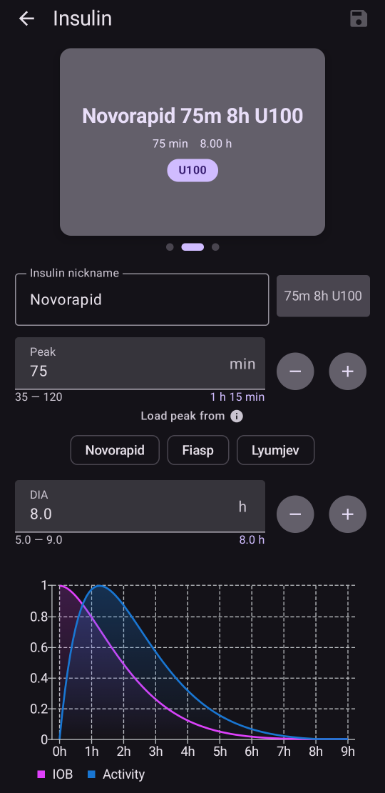

# Конфигурация (Config Builder)

```{admonition} Идвате от AAPS v3? :class: note **Config Builder** вече се нарича **Конфигурация** и се намира в **менюто** (☰). Вижте [Какво се промени в AAPS v4](#v4-changes).

    <br />**Конфигурация** е мястото, където избирате кои плъгини са активни (CGM, помпа, алгоритъм на APS, чувствителност, синхронизация, …) и отваряте всеки плъгин и настройките му. [Описанието стъпка по стъпка](#configuration-v4) е по-долу; останалата част от тази страница описва подробно всяка секция.
    
    (configuration-v4)=
    ## Конфигурация в AAPS v4
    
    В **AAPS** v4 докоснете **менюто** (☰) в **горния ляв** ъгъл на главния екран и изберете **Конфигурация** (*„Настройка на конфигурацията (CGM, помпа, …) и пускане на други функции“*).
    
    
    
    Плъгините са групирани по **категории** – например *Изглаждане*, *Калибрация*, *Определяне на чувствителност*, *APS*, *Комуникация* и *Основни*. Всеки ред показва името на категорията и **активния в момента** плъгин (напр. *APS → OpenAPS SMB*). Докоснете ред, за да отворите категорията.
    
    
    
    В категорията виждате плъгините, които са налични за нея. При категориите с един избор избирате активния плъгин; в някои категории можете да изберете няколко (*„Изберете всички валидни“*). Всеки плъгин предлага две действия:
    
    - **Отвори плъгин** – отваря собствения екран на плъгина.
    - **Настройки** – отваря настройките на плъгина (настройките може да са групирани в секции, които се разгъват).
    
    
    
    (configuration_sync_icon)=
    ### Иконата на телефон – „синхронизирано от главния телефон“
    
    Малка **икона на мобилен телефон** до категория или настройка означава, че този елемент е **синхронизиран от главния телефон (master)** – стойността или изборът му се доставя до това устройство по канала NSClientV3 (Nightscout).
    
    На **клиент** (**AAPSClient**) тези елементи **се поддържат синхронизирани с главния телефон**. Иконата се показва само на клиент, затова не се вижда на снимката по-горе, която е направена в основното приложение **AAPS**. На клиент тя обикновено се появява при *Изглаждане*, *Калибрация*, *Определяне на чувствителност* и *APS*. Как точно главният телефон и клиентите остават съгласувани – и кои настройки можете да променяте от всяка от двете страни – е описано в [Управление главен телефон ↔ клиент](#client-master-config-prefs).
    
    Същата икона се показва и **в настройките**, до отделните настройки, които се синхронизират. В примера по-долу *Максимална абсорбция* има иконата; настройките без иконата се задават поотделно на всяко устройство:
    
    
    
    Елементите **без** иконата се задават **поотделно на всяко устройство**. Най-важният пример е самата връзка **NSClientV3 (Комуникация)** – **Nightscout адрес**, **токенът за достъп** и **websockets** се задават на всеки телефон поотделно, затова **не** показват иконата на телефон.
    
    ---
    
    (Config-Builder-tab-or-hamburger-menu)=
    ## Отваряне на екрана на плъгин
    
    Всеки екран на плъгин се отваря по един от тези начини (разделите и отметката с око от **AAPS** v3 вече ги няма, вижте [Какво се промени в AAPS v4](#v4-changes)):
    
    - **Конфигурация** → категорията на плъгина → **Отвори плъгин**,
    - листът **Управление** в долната навигация – за екраните, които използвате най-често (Профил, Настройки на инсулина, Помпа, Автоматизация, Храна...),
    - бутон [QuickLaunch](../DailyLifeWithAaps/QuickLaunch.md), който добавяте сами,
    - **лентата за търсене** на главния екран.
    
    ```{contents}
    :backlinks: entry
    :depth: 2
    

(ConfigBuilder_Profile)=

## Профил

Този модул не може да бъде изключен, защото е основна част от **AAPS**.

Вижте [Вашият профил в AAPS](../SettingUpAaps/YourAapsProfile.md), за да разберете основно какво съдържа вашият **Профил**.

(insulin)= (Config-Builder-insulin)=

## Инсулин


В **AAPS** 4 инсулинът вече не е плъгин, който се избира в **Конфигурация**. Отворете **Управление → Настройки на инсулина**, за да настроите инсулина, който използвате.

Редакторът на инсулина ви позволява да:

* дадете на профила **Никнейм на инсулин**, за да го разпознавате лесно,
* зададете **Пик** (времето до максималната активност на инсулина, в минути) и **DIA** (време на действие на инсулина, в часове), като въведете стойността или използвате бутоните **–** / **+**,
* докоснете бутон с готова стойност в **Избери пик от** – **Novorapid** (75 мин), **Fiasp** (55 мин) или **Lyumjev** (45 мин) – за да попълните с една стъпка стандартното време на пика за този инсулин.

Позволените диапазони са еднакви, независимо кой инсулин използвате:

* **DIA**: от 5 до 9 часа (от 5 до 10 часа, ако за тип пациент е избрано **Бременност**). Вижте [Време на действие на инсулина (DIA) и пик](#Config-Builder-insulin-dia), за да изберете стойност.
* **Пик**: от 35 до 120 минути.

Кривите **IOB** (активен инсулин) и **Активност** в долната част на редактора се обновяват, докато променяте стойностите. Така веднага виждате как настройките ви оформят действието на инсулина.

Повече информация, за да разберете инсулиновия профил, както е показан в **AAPS**, ще намерите [тук](#AapsScreens-insulin-profile).

(Config-Builder-insulin-change-active)=

### Смяна на използвания инсулин (DIA или пик)

Инсулинът, отбелязан като **АКТИВЕН**, е този, който използва текущият ви профил. Полетата му са в сиво: не можете да го редактирате или изтриете. Така името на инсулина, показано в текущия ви профил, винаги съответства на настройките, които наистина се използват.

За да смените DIA или пика, които използвате:

1. Отворете **Управление → Настройки на инсулина**. Ако екранът се отвори само за четене (**✏️ молив** в горната лента), докоснете молива и отключете настройките си.
2. Докоснете **+** (*Добавяне на нов инсулин*). **AAPS** създава копие на инсулина, показан на екрана.
3. Задайте новия **Пик** и/или **DIA**, след което докоснете иконата за запазване (горе вдясно).
4. Докоснете **▶** (*Активирай инсулин*) и потвърдете. Новият инсулин става **АКТИВЕН**.

```{admonition} Името включва пика и DIA :class: note **AAPS** автоматично добавя пика, DIA и концентрацията към името на инсулина (например *Fiasp 55m 8h U100*), за да можете с един поглед да различите конфигурациите си.

    <br />Можете да изтриете стария инсулин, щом вече не е активен.
    
    ### Готовите стойности в „Избери пик от“
    
    В **AAPS** 4 няма списък с видове инсулин, от който да избирате. Всеки инсулин използва една и съща експоненциална крива на активност; различават се само **Пик** и **DIA**. Готовите стойности в **Избери пик от** в редактора на инсулина попълват с едно докосване препоръчания пик за най-често използваните инсулини (малкото ⓘ до **Избери пик от** ги показва заедно със стойностите на пика им). След това пак можете да промените **Пик** и **DIA**.
    
    Променяйте пика спрямо препоръчаната стойност само ако разбирате какъв ще бъде ефектът. [Графиката на инсулиновата крива](#AapsScreens-insulin-profile) ви помага да разберете кривите.
    
    #### Novorapid
    
    
    
    * препоръчва се за Humalog, Novolog и Novorapid (в **AAPS** v3 се наричаше *Rapid-Acting Oref*)
    * Пик = 75 минути след инжектиране
    
    #### Fiasp
    
    
    
    * препоръчва се за Fiasp (в **AAPS** v3 се наричаше *Ultra-Rapid Oref*)
    * Пик = 55 минути след инжектиране
    
    (Config-Builder-lyumjev)=
    #### Lyumjev
    
    
    
    * препоръчва се за Lyumjev
    * Пик = 45 минути след инжектиране
    
    #### Собствен пик
    
    * В **AAPS** 4 няма отделен вид инсулин „Free-Peak Oref“: въведете произволен **Пик** (от 35 до 120 минути) директно в [редактора на инсулина](#Config-Builder-insulin), без да използвате готова стойност.
    * Собственият пик е полезен, ако използвате инсулин, който не е в списъка, или смес от различни инсулини.
    
    (Config-Builder-insulin-dia)=
    ### Време на действие на инсулина (DIA) и пик
    
    ```{warning}
    При затворен кръг намаляването на DIA или на пика винаги увеличава подадения инсулин. DIA работи в AAPS по различен начин от търговските AID системи. Невнимателните промени на тези настройки може да променят дозирането на инсулина много повече или много по-малко от очакваното.
    

AAPS моделира времето на действие на инсулина с математическа формула, която се настройва чрез **DIA** и тясно свързаната с него настройка **пик**. DIA е теоретичното време, докато IOB стигне нула, а пикът е моментът, в който ефектът на инсулина е най-силен. Така се получават крива на IOB и крива на активността, която е просто **скоростта** на намаляване на IOB.

Имайте предвид, че когато AAPS работи в затворен кръг, е нормално да има периоди с [нулев временен базал](#Open-APS-features-super-micro-bolus-smb). Този липсващ базален инсулин се изважда изцяло от IOB. Затова на практика IOB стига нула много часове по-рано от зададеното DIA. От главния екран можете да видите отделно [IOB от болуси и IOB от базал](#aaps-screens-iob-cob-basal-sens).

За да настроите DIA и пика, докоснете **Управление** на главния екран и след това докоснете **Настройки на инсулина**. AAPS показва активната конфигурация на инсулина ето така:


В този пример пикът е 55 минути, DIA е 8 часа, а [концентрацията на инсулина](#Insulin-Concentration) е стандартната 100 IU/mL.

Заради влиянието на нулевия временен базал, обяснено по-горе, и формулата, която AAPS използва за намаляването на IOB, повечето потребители задават значително по-високо DIA, отколкото в търговските системи. Като цяло много хора намират, че **DIA** от 9 ч работи добре за тях. След като натрупате повече опит с AAPS и имате добре настроен профил, можете да опитате да намерите лични настройки за DIA и пик с помощта на информацията по-долу.

````{admonition} Подробности за влиянието на настройките за DIA и пик :class: dropdown

Тъй като базалната доза влияе непряко на намаляването на IOB в AAPS, твърде високите базални дози могат да прикрият твърде високо DIA и обратно. Има смисъл първо внимателно да настроите базалните дози и чак след това да променяте DIA и пика. Освен това имайте предвид, че настройките за DIA и пик си влияят взаимно: ефектът на DIA зависи от пика и обратно.

Тези графики показват точното влияние на DIA и пика върху кривите на IOB в целия диапазон от позволени стойности.

Промяна на DIA:

```{image} ../images/iob_remaining_static_peak.png :width: 400px

    <br />Промяна на пика:
    
    ```{image} ../images/iob_remaining_static_dia.png
    :width: 400px
    

Накрая, сравнение при едновременна промяна на DIA и пика. Логиката е, че двете стойности се променят с една и съща относителна стъпка, така че `49/35 ~ 7/5`. Или по подобен начин `120/93 ~ 9/7`. Интервалите ще бъдат еднакви независимо от началните стойности на DIA или пика, стига относителната промяна да е една и съща и за двете.

```{image} ../images/iob_remaining_uniform.png :width: 400px

    <br />Имайте предвид, че когато DIA и пикът се променят по този начин, всяка точка от кривата се измества с една и съща относителна стойност.
    
    ````
    
    #### Допълнителна информация за настройването на DIA и пика
    
    * [Технически подробности и историческа информация от предшественика на AAPS, OpenAPS](https://openaps.readthedocs.io/en/latest/docs/While%20You%20Wait%20For%20Gear/understanding-insulin-on-board-calculations.html#understanding-the-new-iob-curves-based-on-exponential-activity-curves).
    * [Защо редовно грешим във времето на действие на инсулина (DIA), което използваме, и защо това е важно…](https://www.diabettech.com/insulin/why-we-are-regularly-wrong-in-the-duration-of-insulin-action-dia-times-we-use-and-why-it-matters/) в Diabettech.
    * [Експоненциални инсулинови криви + Fiasp](https://web.archive.org/web/20220630154425/http://seemycgm.com/2017/10/21/exponential-insulin-curves-fiasp/) в See My CGM (архив).
    * [Преработен модел на Humalog в затворен кръг](https://bionicwookiee.com/2022/04/13/revised-humalog-model-in-a-closed-loop/) и други статии в Bionic Wookie, които препоръчват DIA от 9 ч за Lyumjev, Fiasp, NovoRapid и Humalog.
    
    (Config-Builder-bg-source)=
    ## Източник на КЗ
    Изберете източника на кръвна захар, който използвате. Вижте страницата [Източник на КЗ](../Getting-Started/CompatiblesCgms.md) за повече информация за настройването.
    
    
    
    Превъртете надолу, за да видите другите източници:
    
    
    
    
    
    * [КЗ от xDrip+](../CompatibleCgms/xDrip.md) – също и за съвместими приложения като [Juggluco](../CompatibleCgms/Juggluco.md)
    * [КЗ от NS](../CompatibleCgms/CgmNightscoutUpload.md) – само ако знаете какво правите, вижте [Източник на КЗ](../Getting-Started/CompatiblesCgms.md).
    * [MM640g](../CompatibleCgms/MM640g.md)
    * Glimp – поддържат се само версия 4.15.57 и по-новите
    * [BYODA (Build Your Own Dexcom App)](#DexcomG6-if-using-g6-with-build-your-own-dexcom-app).
    * MicroTech CGM App – за CGM Aidex / LinX
    * [Poctech](../CompatibleCgms/PocTech.md)
    * Tomato (MiaoMiao) – приложението Tomato за устройството MiaoMiao
    * [Glunovo](https://infinovo.com/) – приложението Glunovo за CGM системата Glunovo
    * Intelligo – приложението Intelligo
    * Syai/Ottai – за приложенията Syai и Ottai (вижте [Syai Tag](../CompatibleCgms/SyaiTagX1.md) и [Ottai](../CompatibleCgms/OttaiM8.md))
    * SI App – модифицирано (patched) приложение SI App или Sibionics App за CGM Sibionics
    * Sino App – модифицирано (patched) приложение за CGM Sinocare
    * Четец на Нотификации (Notification Reader) – чете стойностите на глюкозата от известията, които показват официалните приложения за CGM (Dexcom, Medtronic, Eversense и др.)
    * Instara – приложението Instara
    * Произволна КЗ (Random BG) – създава произволни данни за КЗ за тестване. Може да се включи само в инженерна компилация (за разработчици) с **Виртуална помпа**, затова в нормална инсталация на **AAPS** не може да се използва.
    
    ## Изглаждане
    
    
    
    Вижте [Изглаждане на данните за кръвната захар](../CompatibleCgms/SmoothingBloodGlucoseData.md).
    
    ## Калибрация
    
    Изберете как **AAPS** да обработва стойностите, които получава от сензора ви:
    
    - **Без калибрация**: стойностите от сензора се използват такива, каквито са. Използвайте тази опция, когато сензорът вече е фабрично калибриран и е точен. Това е стойността по подразбиране.
    - **Линейна калибрация**: **AAPS** коригира стойностите от сензора с наклон и отместване, които изчислява от въведените от вас измервания от пръст.
    
    Как работи **Линейна калибрация**:
    
    - Необходимо е да е записана **смяна на сензор**, за да знае кога е започнала сесията на сензора. Първите 2 часа от сесията се пропускат като загряване.
    - Необходими са поне **2 измервания от пръст**. Последните измервания тежат повече от старите.
    - Корекцията се прилага само когато резултатът е в безопасен диапазон. Ако измерванията ви са твърде близки едно до друго, се коригира само отместването.
    - **Отвори плъгин** показва състоянието на калибрацията, използваните наклон и корекция и списъка с измерванията от пръст. Можете да добавите измерване с **Добави калибрация** и да премахнете грешно измерване.
    
    ```{admonition} Калибрирайте внимателно
    :class: warning
    Грешна стойност от пръст води до грешни стойности на глюкозата и следователно до грешно дозиране на инсулина. Измийте ръцете си преди измерване и не калибрирайте, докато глюкозата ви се променя бързо.
    


(Config-Builder-pump)=

## Помпа

Изберете помпата, която използвате. Вижте страницата [Съвместими помпи](../Getting-Started/CompatiblePumps.md) за повече информация за настройването.


Превъртете надолу, за да видите всички драйвери на помпи:


Когато изберете друга помпа, **AAPS** ви моли да потвърдите промяната:


* [Dana R](../CompatiblePumps/DanaR-Insulin-Pump.md)
* Dana R Korean (за помпа DanaR от вътрешния пазар на Корея)
* Dana Rv2 (помпа DanaR с неофициално обновен фърмуер)
* [Dana-i/RS](../CompatiblePumps/DanaRS-Insulin-Pump.md)
* [Accu Chek Insight](../CompatiblePumps/Accu-Chek-Insight-Pump.md)
* [Accu Chek Combo](../CompatiblePumps/Accu-Chek-Combo-Pump-v2.md)
* Omnipod за [Omnipod Eros](../CompatiblePumps/OmnipodEros.md)
* Dash за [Omnipod DASH](../CompatiblePumps/OmnipodDASH.md)
* [Medtronic](../CompatiblePumps/MedtronicPump.md)
* [Diaconn G8](../CompatiblePumps/DiaconnG8.md)
* [EOPatch2](../CompatiblePumps/EOPatch2.md)
* [Medtrum](../CompatiblePumps/MedtrumNano.md)
* [Equil 5.3](../CompatiblePumps/Equil5.3.md)
* [Carelevo](../CompatiblePumps/CareLevo.md)
* Виртуална помпа: отворен кръг – само предложения от **AAPS** 
  * докато правите първите си стъпки с **AAPS**, по време на първите [цели](../SettingUpAaps/CompletingTheObjectives.md)
  * за помпа, която все още няма драйвер

(config-builder-wrong-pump-data)=

### Съобщение: „Данните идват от различна помпа“

**AAPS** запомня помпата, с която е свързан (тип помпа и сериен номер). Ако получи данни от друга помпа, например след като помпата ви е сменена с нова от същия модел, той показва това съобщение и пренебрегва данните от тази помпа:


За да използвате новата помпа, сменете драйвера на помпата: изберете **Виртуална помпа**, потвърдете и след това изберете отново своята помпа. След това **AAPS** регистрира помпата, с която е свързан в момента.

(Config-Builder-sensitivity-detection)=

## Определяне на чувствителност


Изберете вида определяне на чувствителност. За повече подробности за различните варианти, моля, [прочетете тук](../DailyLifeWithAaps/SensitivityDetectionAndCob.md). Тази функция анализира историческите данни в движение и прави корекции, ако установи, че реагирате на инсулина по-чувствително (или обратно – по-резистентно) от обикновено. Повече подробности как се изчислява самият коефициент на чувствителност ще намерите в [Основни функции на AAPS > Autosens](#Open-APS-features-autosens).

Можете да видите чувствителността си на главния екран в [допълнителна графика](#AapsScreens-section-g-additional-graphs), като изберете SEN и следите бялата линия. Имайте предвид, че трябва да сте стигнали до [Цел 8](#objectives-objective8), за да може определянето на чувствителност/[Autosens](#Open-APS-features-autosens) автоматично да променя количеството подаван инсулин. Преди да стигнете до тази цел, процентът на Autosens / линията на графиката се показва само за информация.

### Настройки за абсорбция

Ако използвате Oref1 със **SMB**, трябва да промените **min_5m_carbimpact** на 8. Стойността се използва само при прекъсвания в стойностите от **CGM** или когато физическата активност „изразходва“ цялото покачване на кръвната захар, което иначе би накарало **AAPS** да намали COB. Когато [абсорбцията на въглехидратите](../DailyLifeWithAaps/CobCalculation.md) не може да се изчисли динамично според реакцията на кръвната ви захар, се прилага стандартна скорост на намаляване на въглехидратите. По същество това е защитен механизъм.

(Config-Builder-aps)=

## APS


Изберете желания алгоритъм на APS за корекции на лечението. Можете да видите текущите подробности за избрания алгоритъм с **Отвори плъгин**.

* OpenAPS AMA 
  * Advanced Meal Assist: по-стар алгоритъм, който вече не се препоръчва.
  * Казано просто, ползата е, че след като си поставите болус за хранене, системата може по-бързо да зададе висок временен базал, АКО въвеждате въглехидратите надеждно.
* [OpenAPS SMB](#Open-APS-features-super-micro-bolus-smb) 
  * Super Micro Bolus: най-новият алгоритъм, препоръчван за всички потребители.
  * За разлика от AMA, SMB не управлява нивата на глюкозата с временни базални дози, а основно с малки **Super Micro Boluses** (супер микроболуси).
  * Забележка: препоръчва се да използвате този алгоритъм от самото начало, въпреки че реално няма да получавате SMB, докато не стигнете до [Цел 9](#objectives-objective9).
* [Автом ISF](#Open-APS-features-auto-isf) 
  * Експериментален алгоритъм за напреднали потребители. Показва се в списъка само след като целите са изпълнени.

Ако преминавате от алгоритъм AMA към SMB, *min_5m_carbimpact* трябва да се промени ръчно на **8** (стойността по подразбиране за SMB) в [Настройки → Настройки за абсорбция](#Preferences-min_5m_carbimpact).

## Кръг

Този модул не може да бъде изключен, защото е основна част от **AAPS**.


## Ограничения


### Цели

**AAPS** има програма за обучение (поредица от цели), която трябва да изпълните стъпка по стъпка. Тя ще ви преведе безопасно през настройването на система със затворен кръг.

Вижте страницата [Цели](../SettingUpAaps/CompletingTheObjectives.md) за повече информация.

## Комуникация

В тази категория (в **AAPS** v3 се наричаше **Синхронизация**) избирате дали и къде **AAPS** да изпраща данните ви.


Превъртете надолу, за да видите останалата част от списъка:


### NSClientV3

Може да се използва като [сървър за отчети](../SettingUpAaps/SettingUpTheReportingServer.md) и/или за [дистанционно наблюдение](../RemoteFeatures/RemoteMonitoring.md), [дистанционно управление](../RemoteFeatures/RemoteControl.md).

Вижте [Синхронизация със сървъра за отчети](#SetupWizard-synchronization-with-the-reporting-server-and-more), за да настроите синхронизацията с NSClientV3.

### Tidepool

Може да се използва като [сървър за отчети](../SettingUpAaps/SettingUpTheReportingServer.md).

Вижте [Tidepool](../SettingUpAaps/Tidepool.md).

### xDrip

Използва се, за да **изпраща** данни като стойности на глюкозата и лечения към xDrip+ на същия телефон. В настройките му е и **Изпращай статуса към xDrip+** – ред за състоянието с IOB и COB, който xDrip+ и някои придружаващи приложения за часовници показват.

### Open Humans

Вижте [Open Humans](../SupportingAaps/OpenHumans.md).

(Config-Builder-wear)=

### Часовник (Wear)

Наблюдавайте и управлявайте **AAPS** от часовник с Wear OS. Настройването на часовника е обяснено в [Смарт часовник с Wear OS](../WearOS/WearOsSmartwatch.md). След като включите плъгина, изберете опциите му в [Настройки > Часовник](#preferences-wear). Използването на часовника е обяснено в [Управление на AAPS чрез смарт часовник с Wear OS](../RemoteFeatures/RemoteControlWearOS.md).

(external-companion-apps)=

### Външни приложения за проследяване

Разпраща данни за състоянието на **AAPS** в телефона, така че други приложения, инсталирани на него, да могат да ги показват – например придружаващи приложения за часовници или уиджети. Разпращаните данни включват глюкоза и тенденция, IOB, COB, базал и временен базал, име на профила, състояние на кръга, батерия на телефона и на помпата, ниво на резервоара и напредък на болуса. Включете го само ако някое придружаващо приложение, което използвате, изисква тези данни.

Приложенията, за които е известно, че четат тези данни, са [WatchDrip+](https://bigdigital.home.blog/) (часовници Xiaomi и Amazfit), [GlucoDataHandler](https://github.com/pachi81/GlucoDataHandler) (усложнения и уиджети за Wear OS, както и Android Auto чрез GlucoDataAuto) и приложението G-Watch. Настройването им е описано в [Смарт часовници и AAPS](#watches-external-companion-apps). Някои от тях използват и **Изпращай статуса към xDrip+** от плъгина **xDrip** по-горе за ред за състоянието с IOB и COB.

В по-старите версии този плъгин се наричаше **Samsung Tizen** – по името на [приложението G-Watch за часовници Samsung Tizen](#Watchfaces-tizen), за което първоначално беше създаден.

### Garmin

Връзка с устройство Garmin (Fenix, Edge...)

## Лечения

Отворете **менюто** (☰) и изберете [История на леченията](#aaps-screens-treatments), за да видите записаните лечения. Ако искате да редактирате или изтриете запис (например сте изяли по-малко въглехидрати от очакваното), изберете „Изтрий“ и въведете новата стойност (при нужда сменете часа) чрез **Лечения → Въглехидрати** в долната навигация (вижте [Въглехидрати](#screens-bolus-carbs)).

## Общи

В **AAPS** 4 категорията **Основни** в **Конфигурация** съдържа само **Autotune**. Другите функции, описани по-долу, са винаги достъпни и вече не трябва да се включват тук; във всеки абзац пише къде да ги намерите.


### Общ преглед

[Главният екран](#AapsScreens-the-homescreen) на **AAPS** вече не е плъгин и няма собствени настройки в **Конфигурация**. Опциите, които бяха тук, сега са в **Настройки** (иконата със зъбно колело): [Покажи бележките в диалоговите прозорци](#Preferences-show-notes-field-in-treatments-dialogs), [Индикатори](#Preferences-status-lights) и [Болус процент](#Preferences-deliver-this-part-of-bolus-wizard-result), който използва болус калкулаторът. Опцията за супер болус от **AAPS** 3.x [не е налична като настройка](#Preferences-advanced-settings-overview) в **AAPS** 4.

(Config-Builder-actions)=

### Действия

Разделът „Действия“ от **AAPS** 3.x вече не съществува. Бутоните му вече са в листа **Управление** – вижте [Къде отиде разделът „Действия“?](#screens-action-tab).

### Автоматизация

**Управление → Автоматизация** ви позволява да управлявате своите [автоматизации](../DailyLifeWithAaps/Automations.md), като се започне от [Цел 10](#objectives-objective10).

(Config-Builder-sms-communicator)=

### SMS комуникатор

Позволява на болногледачите да управляват от разстояние някои функции на **AAPS** чрез SMS; вижте [SMS команди](../RemoteFeatures/SMSCommands.md) за повече информация за настройването.

### Храна

**Управление → Храна** показва готовите храни, определени в базата данни за храни на Nightscout; вижте [Nightscout Readme](https://github.com/nightscout/cgm-remote-monitor#food-custom-foods) за повече информация за настройването.

Забележка: записите не могат да се използват в калкулатора на **AAPS**. (Само за преглед)

(Config-Builder-autotune)=

### Autotune

Можете да включите Autotune, вижте [тук](../AdvancedOptions/Autotune.md).

### Поддръжка

Отворете **менюто** (☰) и изберете **Поддръжка**, за да експортирате / импортирате настройки и да управлявате лог файловете.


### Конфигурация

Сега се нарича **Конфигурация**: тази страница.