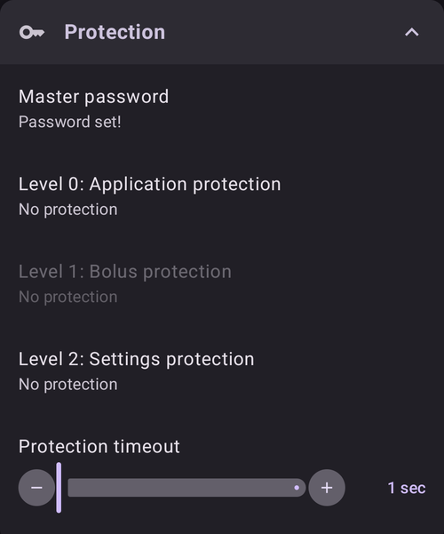
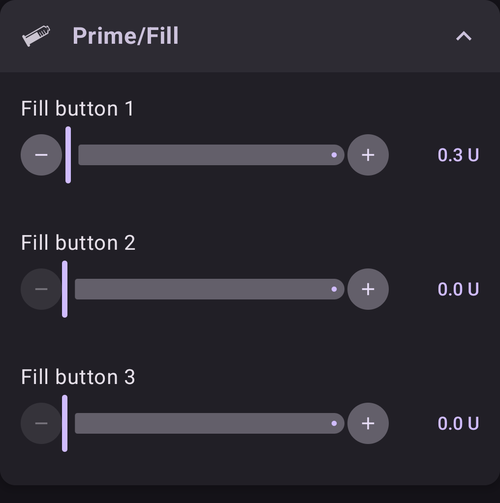
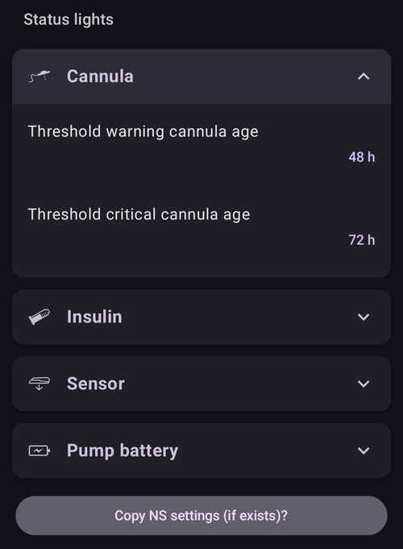
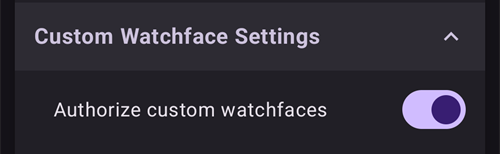
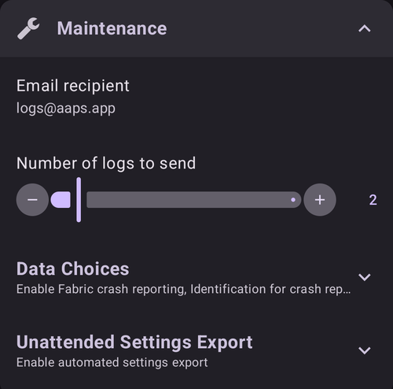

# Настройки

В **AAPS** v4 опциите се намират на екрана **Настройки**. Има три начина да стигнете до тях – подробности ще намерите в [Промени в конфигурацията на AAPS](../SettingUpAaps/ChangeAapsConfiguration.md):

1. Докоснете иконата **Настройки** (зъбно колело) в горния десен ъгъл на главния екран: всички настройки, групирани в секции, които се разгъват.
2. В **Конфигурация** докоснете „**Настройки**“ под активен плъгин: само настройките на този плъгин.
3. Използвайте **лентата за търсене** в горната част на главния екран: просто започнете да пишете част от текста, който търсите. Така се намират отделни настройки (дори тези, които не се виждат на екрана Настройки), диалози и документация.


- **Секциите** се отварят и затварят, като ги докоснете. Секциите, които виждате, зависят от включените плъгини и от [опростения режим](#preferences-simple-mode).


```{contents}
:backlinks: entry
:depth: 2
```

(Preferences-general)=
## Общи


**Единици**

- Задайте единиците mmol/l или mg/dl според предпочитанията си.

**Език**

- By default **AAPS** follows the language of the phone (recommended).

- If you want **AAPS** in another language than the phone, choose it here. On Android 13 and newer, **AAPS** registers it as its own app language in Android, so all its screens, the main screen, the widgets and the way numbers are written follow it.

- Когато смените езика, текстовете на **AAPS** веднага преминават на новия език. Ако някои текстове все още са на стария език, рестартирайте **AAPS**.
- On Android 12 this setting is not shown: **AAPS** always uses the language of the phone.
- Настройката е скрита в [опростен режим](#preferences-simple-mode).

(preferences-simple-mode)= **Опростен режим**

**Опростеният режим** е включен по подразбиране, когато инсталирате **AAPS** за първи път. В **опростен режим** голяма част от настройките са скрити и вместо тях се използват предварително зададени стойности. Изключете опростения режим, след като се запознаете с интерфейса и настройките на **AAPS**.

**Поддръжка на различни инсулинови концентрации**

- Включва поддръжка на различни концентрации на инсулина (U50, U200, ...). Включвайте това само ако наистина използвате концентрация, различна от U100, и прочетете внимателно предупрежденията.
- Настройката е скрита в [опростен режим](#preferences-simple-mode).

**Винаги включен екран**

- Принуждава Android да държи екрана винаги включен. Това е полезно за презентации и т.н. Но изразходва много енергия от батерията. Затова се препоръчва смартфонът да е включен към зарядно.

**Име на инстанцията**

- Името на човека, който използва този телефон. То различава това копие на **AAPS** в отчетите и при синхронизацията, например ако две деца с диабет тип 1 във вашето семейство използват **AAPS**.
- Използва се в имената на файловете с експортирани настройки.
- Показва се в [циферблата Dual](../WearOS/WearOsSmartwatch.md).

(Preferences-skin)=
### Облик (skin)

Изборът на облик (skin) от **AAPS** 3.x (Original, Low resolution, Large display...) вече не съществува в **AAPS** 4. Новият интерфейс се приспособява автоматично към екрана ви, а цветовата схема може да се смени в [Изглед](#preferences-appearance).

(preferences-appearance)=
## Изглед


(Preferences-range-for-visualization)=
### Диапазон за визуализация

Изберете горната и долната граница за графиката на КЗ на главния екран на **AAPS** и на смарт часовника. Това е само за визуализация, а не целевият диапазон за вашата КЗ. Пример: 70–180 mg/dl или 3,9–10 mmol/l

(Preferences-show-notes-field-in-treatments-dialogs)=
### Покажи бележките в диалоговите прозорци

Дава ви възможност да добавяте кратки текстови бележки към леченията си (болус калкулатор, въглехидрати, инсулин...)

Настройката е скрита в [опростен режим](#preferences-simple-mode).

### Тема на приложението

Изберете между светла тема, тъмна тема или темата според системната настройка на телефона.

(Preferences-protection)=
## Защита



(Preferences-master-password)=
### Главна парола

Задължително е, за да можете да [експортирате настройките](../Maintenance/ExportImportSettings.md), тъй като от версия 2.7 те се шифроват.

**Биометричната защита може да не работи на телефони OnePlus. Това е известен проблем на OnePlus при някои телефони.**


(Preferences-settings-protection)=
### Защита на настройките

- Защитете настройките си с парола или с биометричното удостоверяване на телефона (напр. когато [дете използва **AAPS**](../RemoteFeatures/RemoteMonitoring.md)). Ако включите тази функция, ще трябва да се удостоверявате всеки път, когато искате да отворите някой екран, свързан с настройките.

- Тогава екраните за управление (**Профил**, **Настройки на инсулина**, **Временна цел**, **Бързи действия**) се отварят **само за четене**. Пак можете да активирате или използвате запис, но добавянето, редактирането, копирането и изтриването са скрити, докато не отключите настройките си. Вижте [Защитата на настройките вече заключва и екраните за управление](#v4changes-read-only-management).

- Използвайте друга парола, ако искате главната парола да защитава само [експортираните настройки](../Maintenance/ExportImportSettings.md), а за редактиране на настройките да използвате различна парола.

- Ако използвате друга парола, натиснете реда „Парола за защита на настройките“, за да зададете парола, както е описано [по-горе](#Preferences-master-password).

### Защита на приложението

Ако приложението е защитено, трябва да въведете паролата или да използвате биометричното удостоверяване на телефона, за да отворите **AAPS**, и отново, когато се върнете в него след изтичане на [таймаута за защита](#Preferences-password-and-pin-retention).

**AAPS** ще се затвори веднага, ако се въведе грешна парола, но ще продължи да работи във фонов режим, ако преди това е бил отворен успешно.

### Защита от болус

- Защитата от болус може да е полезна, ако **AAPS** се използва от малко дете и вие [поставяте болус чрез SMS](../RemoteFeatures/SMSCommands.md).

- **Защита от болус** може да се избере само след като е зададена **Защита на настройките** (ниво 2).

- В примера по-долу защитата от болус използва **Главна парола**: **AAPS** я иска, преди да отвори диалог за лечение като **Инсулин**. При **Биометрия - пръстов отпечатък**, ако биометричното удостоверяване не работи, можете вместо това да въведете главната парола.


(Preferences-password-and-pin-retention)=
### Запазване на паролата и PIN кода

**Таймаут за Защита** определя колко време (в секунди) настройките или функциите за болус остават отключени, след като въведете правилно паролата.

## Безопасност на лечението


(preferences-patient-type)=
### Възраст на пациента

- Границите за безопасност се задават според възрастта, която изберете в тази настройка.
- Ако започнете да достигате тези твърди граници (например максималния болус), е време да преминете една стъпка нагоре.
- Лоша идея е да изберете по-голяма от реалната възраст, защото това може да доведе до предозиране при въвеждане на грешна стойност в диалога за инсулин (например ако пропуснете десетичния знак).
- Ако искате да знаете точните стойности на тези вградени граници за безопасност, превъртете до функцията на алгоритъма, която използвате, на [тази страница](../DailyLifeWithAaps/KeyAapsFeatures.md).

(Preferences-maximum-bolus)=
### Максимален болус

- Определя максималното количество болус инсулин в единици инсулин, което **AAPS** може да подаде наведнъж.
- Тази настройка е граница за безопасност, която не позволява подаването на огромен болус поради случайно въвеждане или грешка на потребителя.
- Препоръчва се да зададете разумна стойност, която приблизително съответства на най-голямото количество болус инсулин, което някога може да ви трябва за хранене или за корекционна доза.
- Това ограничение се прилага и към резултатите от болус калкулатора.

### Максимални въглехидрати

- Определя максималното количество въглехидрати в грамове, за което болус калкулаторът на **AAPS** може да изчисли доза.
- Тази настройка е граница за безопасност, която не позволява подаването на огромен болус поради случайно въвеждане или грешка на потребителя.
- Препоръчва се да зададете разумна стойност, която приблизително съответства на най-голямото количество въглехидрати, което някога може да ви трябва за едно хранене.

## Източник на КЗ

Настройките на избрания от вас [източник на КЗ](#Config-Builder-bg-source) се показват като отделна секция. Например при **КЗ от xDrip+**:


- **Качвай данните за КЗ в NS**: позволява на **AAPS** да качва получените стойности на КЗ в Nightscout. Включвайте това само ако приложението за CGM само по себе си не ги качва вече.
- **Проследяване на смяна на сензор**: автоматично създава събитие „смяна на сензор“, когато сензорът бъде поставен.

## Главният екран

В **AAPS** 3.x тези настройки бяха групирани в секция „Общ преглед“ (Overview). В **AAPS** 4 те се задават направо от елементите на главния екран, към които принадлежат.

(Preferences-buttons)=
### Бутони QuickLaunch

Задайте кои бутони за действия да се виждат на главния екран: докоснете малкото **зъбно колело** в долната част, по средата на главния екран („Конфигуриране на QuickLaunch“), и **добавете** действията, до които искате бърз достъп (лечения, действия за CGM, записи в портала за лечения...).


(Preferences-quick-wizard)=
### Бързи действия

Създайте свои бутони за определени стандартни хранения или закуски, които ще се показват на главния екран. Полезно е за стандартни хранения, които ядете често.

За всеки бутон задавате въглехидратите и начина на изчисляване на болуса. След това задавате в какъв часови период бутонът ще се вижда на главния екран – само по един бутон за всеки период. Бутонът няма да се вижда извън зададения часови период или ако имате достатъчно IOB, за да покрие въглехидратите, зададени в бутона за бързо действие. Ако за различните хранения са зададени различни часове, на главния екран винаги ще имате подходящия бутон за стандартно хранене според часа от деня.

За да управлявате готовите настройки на съветника, въведете „Бързи действия“ в лентата за търсене на главния екран и отворете **Бързи действия - Настройки на съветника**.

Ако натиснете бутона за бързо действие, **AAPS** ще изчисли и предложи болус за тези въглехидрати според текущите ви коефициенти (като отчита стойността на кръвната захар или активния инсулин, ако това е настроено).

Предложението трябва да бъде потвърдено, преди да се подаде инсулин.

(Preferences-default-temp-targets)=
### Временни цели по подразбиране

[Временните цели (TT)](../DailyLifeWithAaps/TempTargets.md) ви позволяват да промените целевата си стойност на кръвната захар за определен период от време. Когато зададете временни цели по подразбиране, можете лесно да смените целта си при физическа активност, преди хранене и т.н.

Докоснете **целевия диапазон** на главния екран, за да отворите екрана **Временна цел**. Плъзнете през картите с готовите стойности (Преди хранене, Физ. активност, Хипогликемия) и променете целта и продължителността на всяка от тях в **Предварителни настройки**. Стойностите по подразбиране са:

* Преди хранене: цел 90 mg/dl / 5,0 mmol/l, продължителност 45 мин
* Физ. активност: цел 140 mg/dl / 7,8 mmol/l, продължителност 90 мин
* Хипогликемия: цел 160 mg/dl / 8,9 mmol/l, продължителност 60 мин


Научете [тук как да активирате временни цели](#TempTargets-where-can-i-select-a-temp-target).

### Стандартни количества инсулин за смяна/пълнене

Ако искате да напълните тръбичката или иглата чрез **AAPS**, можете да го направите с бутоните **Смяна/Пълнене** в разгънатия панел за състоянието на главния екран.

Стандартните количества на трите бутона за пълнене могат да се зададат в настройките за **Смяна/Пълнене** според дължината на катетъра ви. Въведете „Пълнене“ в лентата за търсене на главния екран, за да ги отворите.



(Preferences-status-lights)=
### Индикатори

Индикаторите дават визуално предупреждение за:

- Възраст на сензора
- Възраст на инсулина (колко дни се използва резервоарът)
- Ниво на резервоара (единици)
- Възраст на иглата
- Възраст на батерията на помпата
- Ниво на батерията на помпата (%)

Ако прагът за предупреждение е надвишен, стойностите ще се показват в жълто. Ако критичният праг е надвишен, стойностите ще се показват в червено.

За да промените праговете, разгънете панела за състоянието на главния екран (стрелката вдясно на реда за състоянието) и докоснете малката икона **Настройки** до „Статус“:



Докоснете елемент (**Игла**, **Инсулин**, **Сензор** или **Батерия на помпата**), за да отворите праговете му за предупреждение и за критично състояние:


Последната опция ви позволява да импортирате тези настройки от Nightscout, ако са зададени там. Вижте [документацията на Nightscout](https://nightscout.github.io/nightscout/setup_variables/#age-pills) за повече информация.

(Preferences-deliver-this-part-of-bolus-wizard-result)=
### Настройки на болус калкулатора

Въведете „болус“ в лентата за търсене на главния екран, за да отворите настройките на **Болус калкулатор**:


**Болус процент** задава [процента по подразбиране](#AapsScreens-section-j) от болуса, изчислен с болус калкулатора.

Стойността по подразбиране е 100 %: без корекция. Дори ако тук зададете друга стойност, пак можете да я промените всеки път, когато използвате болус калкулатора. Ако тази настройка е 75 % и трябва да поставите болус от 10 U, болус калкулаторът ще предложи болус за хранене от само 7,5 U.

Когато използват [SMB](#objectives-objective9), много хора не поставят като болус за хранене 100 % от нужния инсулин, а само част от него (напр. 75 %) и оставят SMB с UAM (Unattended Meal Detection – откриване на необявено хранене) да направи останалото. Стойност под 100 % тук може да е полезна:
* за хора с бавно храносмилане: ако целият болус се подаде предварително, може да се стигне до хипогликемия, защото инсулинът действа по-бързо от храносмилането.
* за да оставите на **AAPS** повече възможност сам да се справи с **покачването на КЗ**. И в двата случая **AAPS** ще компенсира липсващата част от болуса със SMB, ако и когато прецени, че това е подходящо.

**Използвай болус съветник**

Когато е включено и използвате болус калкулатора, докато сте в хипергликемия, ще получите предупреждение с въпрос дали искате да поставите болус предварително и да се храните по-късно, когато **КЗ** се върне в целевия диапазон.

(Preferences-advanced-settings-overview)=
### Суперболус

Опцията Суперболус от **AAPS** 3.x не е налична като настройка в **AAPS** 4.

## Кръг

Вижте [Екраните на AAPS > Главният екран > Статус на кръга](#AapsScreens-loop-status), за да смените режима на кръга сега.

(Preferences-minimal-request-change)=
### Минимална промяна в отворен кръг

Когато използвате **Отворен кръг**, ще получавате известие всеки път, когато **AAPS** препоръча промяна на базалната доза. За да намалите броя на известията, можете да използвате [по-широк целеви диапазон на КЗ](#profile-glucose-targets) или да увеличите процента в настройката „**Минимална промяна в отворен кръг**“. Тази стойност определя относителната промяна, която е нужна, за да се покаже известие.


## Advanced Meal Assist (AMA) или Super Micro Bolus (SMB)

В зависимост от настройките ви в [Конфигурация > APS](../SettingUpAaps/ConfigBuilder.md) можете да избирате между два алгоритъма:

- [Advanced meal assist (OpenAPS AMA)](#Open-APS-features-advanced-meal-assist-ama) – състоянието на алгоритъма през 2017 г.
- [Super Micro Bolus (OpenAPS SMB)](#Open-APS-features-super-micro-bolus-smb) – най-новият алгоритъм, препоръчван за начинаещи

От [**AAPS** версия 3.3](#version3300) функцията [Динамично ISF](../DailyLifeWithAaps/DynamicISF.md) е преместена и е част от OpenAPS SMB.

### OpenAPS AMA

Всички настройки за OpenAPS AMA са описани в специалния раздел в [Основни функции на AAPS > Advanced Meal Assist (AMA)](#Open-APS-features-advanced-meal-assist-ama).

(Preferences-openaps-smb-settings)=
### OpenAPS SMB

Всички настройки за OpenAPS SMB са описани в специалния раздел в [Основни функции на AAPS > Super Micro Bolus (SMB)](#Open-APS-features-super-micro-bolus-smb).

Списъкът с настройки, които виждате, зависи от напредъка ви в [Цели](../SettingUpAaps/CompletingTheObjectives.md) и от [опростения режим](#preferences-simple-mode). При нова инсталация се показва само **Използвай динамична чувствителност**. След като целите са изпълнени, секцията изглежда така:


**Разширени настройки** в долната част на секцията съдържа стойности, които обикновено не е нужно да променяте:


## Настройки за абсорбция


(Preferences-min_5m_carbimpact)=
### Минимално въздействие на въглехидратите за 5 мин при SMB (min_5m_carbimpact)

Настройката е скрита в [опростен режим](#preferences-simple-mode).

Алгоритъмът използва BGI (blood glucose impact – въздействие върху кръвната захар), за да определи кога [въглехидратите се абсорбират](../DailyLifeWithAaps/CobCalculation.md).

Когато абсорбцията на въглехидратите не може да се изчисли динамично според реакцията на кръвната ви захар, **AAPS** прилага стандартна скорост на намаляване на въглехидратите. По същество това е защитен механизъм. Тази стойност се използва само при прекъсвания в стойностите от **CGM** или когато физическата активност „изразходва“ цялото покачване на кръвната захар, което иначе би накарало **AAPS** да намали COB.

Казано просто: алгоритъмът „знае“ как *би трябвало* да се държи кръвната ви захар под влиянието на текущата доза инсулин и т.н. Винаги когато има положително отклонение от очакваното поведение, част от въглехидратите се смятат за абсорбирани. Голяма промяна = много въглехидрати и т.н.

min_5m_carbimpact определя стандартното въздействие от абсорбцията на въглехидрати за 5 минути. Пълното описание на параметъра ще намерите в [документацията на OpenAPS за настройките и настройките за безопасност](https://openaps.readthedocs.io/en/latest/docs/While%20You%20Wait%20For%20Gear/preferences-and-safety-settings.html?highlight=carbimpact#min-5m-carbimpact).

Стандартната стойност за AMA е 3, а за SMB е 8.

Графиката на COB на главния екран показва кога се използва min_5m_carbimpact с оранжеви точки по горния край на кривата на COB.


### Максимална абсорбция

Време, след което всяко хранене се смята за абсорбирано; оставащите въглехидрати се отрязват. Ако често ядете храни с много мазнини или протеини, ще трябва да увеличите времето за абсорбция на храната.

### Разширени настройки – коефициент на autosens


- Задайте минималния и максималния коефициент на [autosens](#Open-APS-features-autosens).
- Обикновено стандартните стойности (макс. 1,2 и мин. 0,7) не бива да се променят.

## Помпа


### Следене на блутут връзката

При нужда включете BT Watchdog (например при помпи Dana). Тази функция изключва Bluetooth за една секунда, ако не е възможна връзка с помпата. Това може да помогне при някои телефони, при които Bluetooth стекът блокира.

## Настройки на помпата

Опциите тук зависят от драйвера на помпата, който сте избрали в [Конфигурация > Помпа](#Config-Builder-pump). Свържете и настройте помпата си според [указанията за съответната помпа](../Getting-Started/CompatiblePumps.md).

Например при **Виртуална помпа** секцията се нарича **Настройки Виртуална Помпа**. Избирате **Тип помпа**, която виртуалната помпа имитира, и дали състоянието ѝ да се качва в Nightscout:


## Tidepool

Повече информация ще намерите на страницата [Tidepool](../SettingUpAaps/Tidepool.md).

(Preferences-nsclient)=
## NSClientV3


Плъгинът NSClient (показан като **NSClientV3** в менюто за конфигурация) синхронизира данните ви с Nightscout. Той използва Nightscout API v3.

```{admonition} Data uploaders
:class: warning

Когато използвате NSClientV3, всички програми за качване (uploaders) трябва да използват Nightscout API v3. If another uploader (for example your CGM app) is not API v3 compliant, **let AAPS upload all data** (BG, treatments, ...) to Nightscout and disable that uploader.
```

- Set your *Nightscout URL* (i.e. <https://yoursitename.yourplatform.dom>).
- **Уверете се, че адресът е БЕЗ /api/v1/ в края.**
- В Nightscout създайте *[Admin токен](https://nightscout.github.io/nightscout/security/#create-a-token)* (за V3 API е нужен [Nightscout 15](https://nightscout.github.io/update/update/)) и го въведете в **Токен за достъп до Nightscout** (не вашия API Secret!). В **AAPSClient** вместо това можете да сканирате QR кода на главния телефон – така се настройва собствен токен на клиента. Клиент, свързан с PIN, получава собствен токен от главния телефон след свързването. Вижте [Собственият токен за Nightscout на клиента](#client-master-control-own-token).
- Така данните могат да се четат и записват и в двете посоки между сайта на Nightscout и **AAPS**.
- Ако не можете да преминете цел 1, проверете тук внимателно за грешки при писане.
- Оставете „Използвай websockets“ включено (препоръчително).

(Preferences-nsclient-synchronization)=
### Синхронизация


Изборът за синхронизация зависи от начина, по който искате да използвате **AAPS**.

Можете да изберете кои данни искате да [качвате в Nightscout и да изтегляте от него](#Nightscout-aaps-settings).

Докато контролът от клиенти е включен (винаги в опростен режим), тези настройки са скрити: тогава **AAPS** е в [режим на засилена защита](#client-master-control-hardened-mode), не приема промени, направени директно в Nightscout, и качва всичките си данни.

### Опции за аларми


- В опциите за аларми можете да изберете кои аларми на Nightscout да се използват чрез приложението. **AAPS** ще подаде аларма, когато се задейства аларма в Nightscout.
- За да звучат алармите, трябва да зададете стойностите за алармите Urgent High, High, Low и Urgent Low в [променливите на Nightscout](https://nightscout.github.io/nightscout/setup_variables/#alarms).
- Те работят само докато имате връзка с Nightscout и са предназначени за родители/болногледачи.
- Ако източникът на **CGM** е на телефона ви (напр. xDrip или BYODA), използвайте неговите аларми вместо алармите на Nightscout.
- NS събития ще повтарят [съобщенията (announcements)](https://nightscout.github.io/nightscout/discover/#announcement) на Nightscout в известията на **AAPS**.
- Можете да промените прага на алармите за остарели данни и за спешно остарели данни, когато от Nightscout не се получават данни за определено време.

### Дистанционно управление

Превключвателят „**Позволи контрол от клиенти**“ вече не е в тези настройки: той е най-горе в **Управление → Оторизирани клиенти**, където се управляват свързаните клиенти. Вижте специалната страница [Контрол главен ↔ клиент](../RemoteFeatures/ClientMasterControl.md), включително [режима на засилена защита](#client-master-control-hardened-mode), който този превключвател включва.

### Настройки за свързване


- Настройките за свързване определят кога ще е разрешена връзката с Nightscout.
- Ограничете качването в Nightscout само при Wi-Fi или дори само при определени SSID на Wi-Fi.
- Ако искате да използвате само определена Wi-Fi мрежа, можете да въведете нейния Wi-Fi SSID.
- Няколко SSID могат да се разделят с точка и запетая.
- За да изтриете всички SSID, въведете интервал в полето.

(Preferences-advanced-settings-nsclient)=
### Advanced settings (NSClientV3)


Опциите в разширените настройки са ясни сами по себе си.

## SMS комуникатор

Повече информация ще намерите на страницата [SMS команди](../RemoteFeatures/SMSCommands.md).

(preferences-wear)=
## Часовник (Wear)

Тази секция се показва, когато плъгинът **Часовник** е включен в [Конфигурация > Комуникация](#Config-Builder-wear). Повече информация ще намерите на страниците [Смарт часовник с Wear OS](../WearOS/WearOsSmartwatch.md) и [Управление на AAPS чрез смарт часовник с Wear OS](../RemoteFeatures/RemoteControlWearOS.md).


- **Контрол от часовник**: позволява от часовника да се изпращат лечения и други действия. Без тази настройка часовникът само показва данни: телефонът отказва всяка команда от часовника, а докосването на усложнение, което би отворило екран за управление, вместо това отваря менюто на **AAPS** на часовника.

**Помощник за часовник** определя кои изчисления се включват в резултата от болус калкулатора на часовника. На часовника въвеждате само въглехидратите; тези превключватели заменят изборите, които бихте направили в болус калкулатора на телефона:

- **Включвай КЗ в болус съветника**: добавя корекция за разликата между текущата ви глюкоза и целта ви.
- **Включвай временните цели в съветника**: използва текущата временна цел вместо целта от профила за тази корекция.
- **Включвай тренда в съветника**: отчита текущата тенденция на глюкозата.
- **Включвай COB в съветника**: добавя инсулин за въглехидратите, които все още са активни.
- **Включвай IOB в съветника**: изважда инсулина, който все още е активен.


**Настройки на Watchface** съдържа **Оторизация на други циферблати**. Файлът на персонализиран циферблат може да съдържа стойности за някои настройки на часовника. Когато този превключвател е включен, при зареждане на такъв циферблат тези настройки на часовника могат да се променят; когато е изключен, циферблатът се зарежда, но настройките остават същите:



**Основни настройки** съдържа **Нотификация при SMB** – за да получавате известие на часовника всеки път, когато се подаде SMB:


## Autotune

Тази секция се показва, когато плъгинът **Autotune** е включен в [Конфигурация > Основни](#Config-Builder-autotune). Настройките са описани на специалната страница [Autotune](../AdvancedOptions/Autotune.md).


## Автоматизация


Изберете коя услуга за местоположение да се използва:

- Чрез пасивна локация: **AAPS** взема местоположението само когато други приложения го изискват
- Чрез локация на мрежата: местоположението на вашата Wi-Fi мрежа
- Чрез GPS (Внимание! Може да изтощава батерията прекомерно!)

## Локални аларми


Настройките би трябвало да са ясни сами по себе си.

**Override Do Not Disturb mode** (on by default): the **AAPS** alarms ring even when the phone is silent or in Do Not Disturb. Turn it off if **AAPS** should respect those modes: the alarms do not ring then, and in Do Not Disturb they only vibrate, on the phone and on the watch. Loop suggestions that arrive during Do Not Disturb are shown without a sound.

When an alarm rings, the alarm screen offers **Silence alarm** (the screen stays open, so you can read the message) and **Silence and close**. Swiping the alarm notification away in the notification tray mutes the alarm. When you open **AAPS** later, an alarm you did not answer is shown again.

(preferences-maintenance-settings)=
## Настройки за поддръжка



**Имейл**: стандартният получател на логовете е <logs@aaps.app>.

**Брой логове за изпращане**: колко от най-новите лог файлове се прикачват, когато изпращате логове.

**Избор на данни**


Можете да помогнете за развитието на **AAPS**, като изпращате отчети за сривове на разработчиците.

**Автоматичен експорт на настройки**<br/> Когато включите тази функция, позволявате на **AAPS** да експортира настройките без намеса на потребителя. За тази цел главната парола се съхранява сигурно (само) на телефона ви при следващия ръчен експорт. Съхранената парола ще се използва до 4 седмици. След 4 седмици ще получите известие, че паролата скоро ще изтече. По време на гратисен период от 1 седмица паролата може да се поднови, като експортирате ръчно настройките от менюто за поддръжка.

След като гратисният период от 1 седмица изтече, съхранената парола става невалидна и всеки автоматичен експорт на настройки ще бъде прекратен, а потребителят ще получи известие с молба да въведе паролата отново. [(**Автоматичните експорти на настройки**)](../DailyLifeWithAaps/Automations.md#automating-preference-settings-export) ще се записват в списъците „Портал за лечения“ и „От потребител“ на **AAPS** в Лечения.

След като включите тази опция, задължително направете ръчен експорт на настройките, при който ще бъдете помолени за паролата, за да може **AAPS** да я съхрани.

### Log файлове

AAPS записва логове за отстраняване на неизправности.

Не изключвайте тази функция: тя помага да се разберат причините, ако нещо се обърка.

Ако трябва да изпратите логовете на разработчиците, опишете точно проблема в имейла. За предпочитане е да изпращате логове само когато ви бъдат поискани след [доклад за проблем (issue) в GitHub](https://github.com/nightscout/AndroidAPS/issues).

Логовете на AAPS ще намерите в паметта на телефона -> Android -> data -> info.nightscout.androidaps -> files.

Работата с логовете (настройки на логовете, изпращане и изтриване на логове) и управлението на файлове се намират на екрана **Поддръжка**, който се отваря от **менюто** (☰) в горния ляв ъгъл на главния екран:


(preferences-maintenance-logdirectory)=

### Задаване на локалната директория на AAPS

Екранът **Поддръжка** съдържа и **AAPS директория**. Тази настройка позволява на потребителя да избере директория на телефона, в която **AAPS** ще съхранява настройки, логове и други файлове. След като изберете директория, пътят ѝ (например `Documents/AAPS`) се показва под **AAPS директория**, така че винаги можете да видите къде се записват файловете ви.

Силно се препоръчва да използвате директория, която е направо в основната папка на паметта на телефона. По подразбиране е AAPS.


Ако изберете поддиректория на AAPS, ще видите съобщение за грешка. Докоснете „OK“ и опитайте отново, като изберете правилната директория (едно ниво нагоре). Не избирайте „DISMISS“, освен ако не знаете точно какво правите.


Android може незабелязано да отнеме разрешението за директорията, например след като преинсталирате **AAPS** или изчистите хранилището му. Когато това се случи, **AAPS** показва постоянно известие **Няма достъп до AAPS директория** и локалният експорт на настройките спира да работи, докато не се върнете тук и не изберете отново директорията. Направете това веднага, иначе резервните копия на телефона вече няма да се обновяват.

(preferences-maintenance-cloud)=

### Задаване на директория в облака

Можете да експортирате настройките, логовете и данните в CSV в облачна услуга.

1. Отворете **менюто** (☰), изберете **Поддръжка** и докоснете **Клауд локация** (под **Управление на файлове**).

   

2. В **Изберете тип на мястото за съхранение** изберете **Google Drive**.

   

3. Отваря се страница за вход в Google. Изберете профила в Google, в който ще се пазят резервните ви копия (можете да използвате [отделен профил в Google](../UsefulLinks/DedicatedGoogleAccountForAaps.md)).

   

4. Проверете дали профилът е правилният и докоснете **Continue** (Продължи), за да дадете достъп на **AAPS**. Ако вече сте задавали директорията в облака, страницата показва, че **AAPS** вече има известен достъп.

   

5. Обратно в **AAPS**, в долната част на главния екран се появява съобщението **Успешно свързване с клауда**:

   

   В менюто **Поддръжка** до **Клауд локация** вече има зелена точка, а бутоните **Клауд** до **Изпрати логове**, **Експорт настройки**, **Импорт настройки** и **Експортиране на потребителски данни към Excel (csv)** са достъпни.

   

За да спрете експорта в облака, докоснете иконата **✕** (**Изчисти настройките**) в края на реда **Клауд локация** в менюто **Поддръжка** (тя се показва, след като е настроена облачна услуга) и потвърдете **Изчисти настройките на клауд**. Така се връщате към локално съхранение и разрешението се изчиства.

## Open Humans

Можете да помогнете на общността, като дарите данните си за изследователски проекти! Подробностите са описани на [страницата Open Humans](../SupportingAaps/OpenHumans.md).

В **Настройки → Open Humans** можете да зададете кога да се качват данните
- само при връзка с Wi-Fi
- само когато телефонът се зарежда
